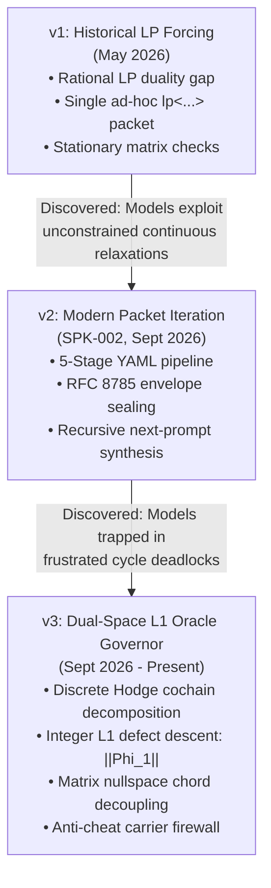

# Evolution of The Symbol Game: The Three Editions

> **Lead Council:** `L3_nous_panepistimion` & `L3_logos_techne`  
> **Audience:** Developers, system architects, and advanced players  
> **AuthorityEffect:** `None`.

---

## 1. Architectural Trajectory

The Symbol Game evolved across three major editions between May and September 2026. Each edition solved a specific vulnerability in autonomous reasoning systems:



---

## 2. Comparative Matrix: The Three Editions

| Architecture Axis | Edition 1: LP-Forcing (v1) | Edition 2: Packet Iteration (v2) | Edition 3: L1 Oracle Governor (v3) |
| :--- | :--- | :--- | :--- |
| **Era & Policy** | May 2026 (`lp-forcing.v1`) | Sept 2026 (`SPK-002`) | Sept 2026–Present (`SG-L1-ORACLE`) |
| **Primary Container** | Single `lp<...>` expression | 5-stage YAML artifacts | Dual-space state machine ($TAU_SG_V1$) |
| **Public Stage Count** | 1 (Ad-hoc packet) | 5 stages (`seed` $\to$ `expand` $\to$ `descent` $\to$ `attack` $\to$ `prompt`) | Continuous turns with 4 moves (`ASSERT`, `CUT`, `VERIFY`, `RETRACT`) |
| **Referee Engine** | Rational Simplex Solver over $\mathbb{Q}$ | Schema validator & replay harness (`core_symbol_game`) | Discrete Oracle Governor ($\Phi_1$ boundary cochain evaluator) |
| **Defect Metric** | Primal-dual duality gap $\Delta = c^T x - b^T y$ | Stage refusal codes (`Refusal`, `Repair`, `OracleNeeded`) | Integer $L_1$ defect cochain $\|\Phi_1\|_1$ and cycle rank $\beta_1$ |
| **Failure Mode Addressed** | Unbounded continuous hallucination | State mutation & schema drift | **Cancellation laundering** & **Stationary loop trapping** |
| **Decoupling Strategy** | Matrix inversion on simplex | Stage-by-stage YAML boundary checking | Spanning tree potential + chord-basis nullspace projection |
| **Carrier Security** | ASCII allowlist | Hashed YAML schemas | Bit-level codepoint allowlist & firewall |

---

## 3. Edition 1: LP-Forcing (v1)

### The Core Concept
The original game replaced vague prompts (`"solve this optimization problem"`) with a finite symbolic linear program encoded in ASCII brackets:
```text
lp<max<3x + 2y> st<2x + y <= 10, x + 2y <= 8> vars<x >= 0, y >= 0>>
```

### The Mechanism
1. The human or model proposes a primal point $(x, y)$ and a dual vector $(\lambda_1, \lambda_2)$.
2. The host computes the rational duality gap:
   $$\text{Gap} = \text{PrimalValue} - \text{DualValue}$$
3. If $\text{Gap} = 0$, the host admits the proof of optimality over $\mathbb{Q}$.

### Why It Evolved
Language models learned to generate continuous approximations that appeared close to zero, or took advantage of unconstrained slack variables without true combinatorial structure. It was limited to convex linear problems and could not model discrete graph topologies or multi-round dialectical debate.

---

## 4. Edition 2: Modern Packet Iteration (v2)

### The Core Concept
Defined under **Policy SPK-002**, v2 organized the game into **Five Public Iteration Stages**:

```text
[Stage 1: Seed Packet]
        │  (Extract carrier, target claim, and boundary conditions)
        ▼
[Stage 2: Symbol Expansion]
        │  (Expand into discrete symbols, relations, and operations)
        ▼
[Stage 3: Descent Audit]
        │  (Audit monotonic decrease of ambiguity and unproved axioms)
        ▼
[Stage 4: Adversarial Rounds]
        │  (Subject candidate to red-team counterexample injection)
        ▼
[Stage 5: Terminal Synthesis]
        │  (Synthesize next-round prompt or emit certified receipt)
        ▼
[Next Iteration / Refusal]
```

### Key Innovations
- **RFC 8785 Canonical JSON Serialization:** Guaranteed that whitespace, key order, and float representations never cause hash collisions.
- **SHA-256 Envelope Sealing:** Tamper-evident cryptographic bindings between stages.
- **Recursive Next-Prompt Generation:** The game produces the *next input packet*, acknowledging that reasoning is an ongoing autopoietic loop.

---

## 5. Edition 3: Dual-Space L1 Oracle Governor (v3 — Modern Standard)

### The Core Concept
Edition 3 establishes a strict mathematical separation between continuous model exploration and discrete host authority:

```text
   CONTINUOUS HEURISTIC SPACE                 DISCRETE ORACLE SPACE
   (LLM Proposer / Neural Net)                 (Deterministic Host)
 ┌─────────────────────────────┐             ┌─────────────────────────────┐
 │ • Generates candidate moves │             │ • Owns Carrier C            │
 │ • Suggests vertex potentials│             │ • Computes Cochain Phi_1    │
 │ • Explores solution paths   │             │ • Detects Frustrated Cycles │
 │ • Heuristic chord selection │             │ • Enforces Strict Descent   │
 └──────────────┬──────────────┘             └──────────────▲──────────────┘
                │ Move Proposal:                            │ State Update:
                │ {CUT, vertex, delta}                      │ Admitted or Rolled Back
                └───────────────────►[FIREWALL]─────────────┘
```

### Why v3 is Revolutionary: Stopping the AM-4 Stationary Loop
When an unguided language model faces a complex graph (such as the complete graph $K_4$, with cycle rank $\beta_1 = 3$), it inevitably gets trapped in **stationary loops**:
- It adjusts edge $A \to B$ to fix Cycle 1.
- This adjustment breaks Cycle 2.
- It adjusts edge $B \to C$ to fix Cycle 2, which breaks Cycle 3.
- It loops endlessly without making progress, burning fuel.

**The Solution:** The v3 governor provides **Chord-Basis Decoupling Guidance**:
1. Fixes an arbitrary spanning tree $T \subset G$.
2. Computes exact vertex potentials $f_T: V \to \mathbb{Q}$ by integrating tree edges.
3. Decouples the remaining chord edges $e \in G \setminus T$, allowing the model to compute all chord targets simultaneously:
   $$c'(u \to v) = f_T(v) - f_T(u)$$
This drops the boundary defect from $\Phi_1 > 0$ directly to $\Phi_1 = 0$ in a single monotonic step.

---

## 6. Migration Summary for Developers

When building systems on The Symbol Game today:
- **Never use v1 `lp<...>` strings** for general reasoning workflows.
- **Use v2 RFC 8785 envelopes** for multi-stage inter-agent communication.
- **Use v3 L1 Oracle Governor protocols** for real-time discrete descent and stationary loop prevention.
