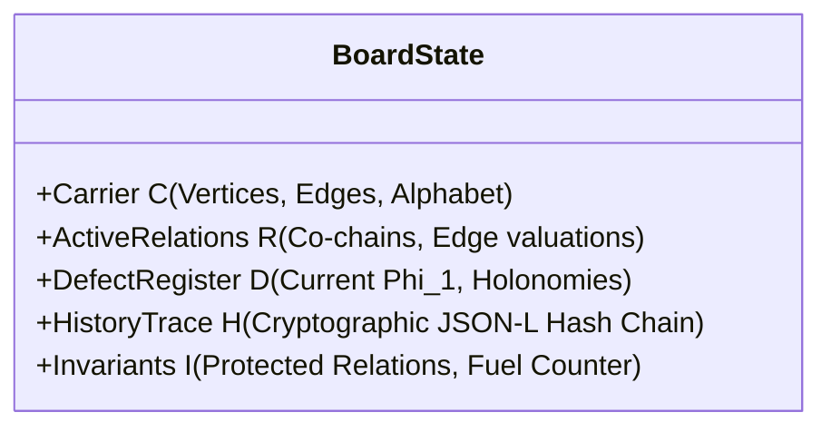
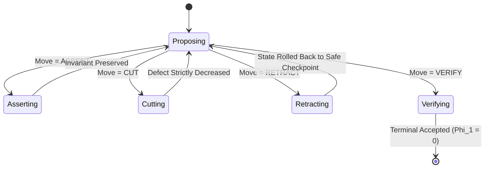
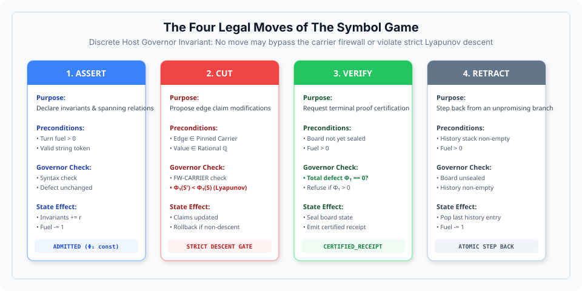
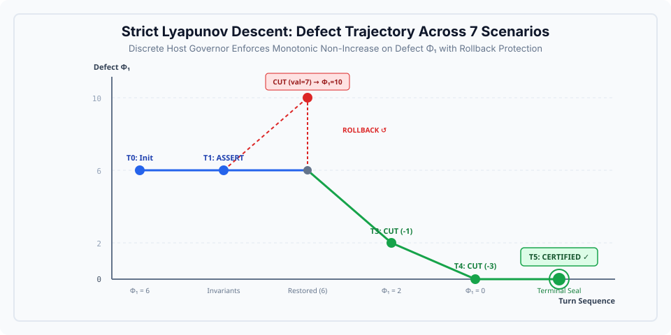

# The Rules of the Board: State, Moves, and Invariants

> Scope: the interactive notebooks use a local triangle teaching model.
> ASSERT records an annotation without proving it. CUT accepts only a strict
> decrease of triangle circulation; VERIFY checks zero circulation on that
> triangle. The legacy field `defect_phi1` is retained for lesson compatibility
> and is not the native host Phi1 functional. The teaching model does not
> implement the RFC 8785 native carrier firewall described in advanced rules.
> RETRACT restores a saved checkpoint without refunding fuel; history is retained.


> **Lead Council:** `L3_logos_techne` & `L3_dianoia`  
> **Audience:** Players, Developers, and System Integrators  
> **AuthorityEffect:** `None`.

---

## 1. The 5-Tuple Board State

A game of The Symbol Game takes place on a discrete board defined by a mathematical 5-tuple:

$$S = \Big( \mathcal{C},\; \mathcal{R}_{\text{active}},\; \mathcal{D}_{\text{register}},\; \mathcal{H}_{\text{trace}},\; \mathcal{I}_{\text{invariants}} \Big)$$



### Components of the State:

1. **Carrier $\mathcal{C}$ (The Pinned Universe):**
   - The finite set of vertices $V$, directed edges $E \subseteq V \times V$, and symbol alphabet $\Sigma$.
   - **Security Law:** The carrier is immutable once pinned. Introducing a vertex $v \notin V$ or a character $c \notin \Sigma$ triggers an immediate `REFUSED_CARRIER_BREACH`.

2. **Active Relations $\mathcal{R}_{\text{active}}$ (The Current Field):**
   - The mapping of current edge values: $c: E \to \mathbb{Q}$.
   - Edge orientation convention: $e = (u \to v)$ has boundary $\partial e = v - u$.

3. **Defect Register $\mathcal{D}_{\text{register}}$ (The Objective Metric):**
   - Stores the current boundary defect $\Phi_1 = \|\delta^1 c\|_1$ and non-zero cycle circulations.
   - For every fundamental cycle $C_k$, the holonomy is:
     $$h(C_k) = \sum_{e \in C_k} \sigma(e) \cdot c(e)$$

4. **History Trace $\mathcal{H}_{\text{trace}}$ (The Immutable Ledger):**
   - An append-only cryptographic log recording every proposed turn, raw LLM token stream, governor decision, and resultant state digest.

5. **Invariants $\mathcal{I}_{\text{invariants}}$ (The Rules of Fair Play):**
   - Remaining fuel (maximum permitted turns).
   - Monotonicity requirements (e.g. strict descent).
   - Invariant edges (edges pinned as reference baselines).

---

## 2. The Carrier Firewall

Before any move is handed to the governor, it must pass through the **Bit-Level Carrier Firewall**:

```text
PROPOSAL INPUT (Raw Bytes)
         │
         ▼
[Codepoint Filter] ───► Contains unpinned unicode? (e.g. Ω, emojis, hidden zero-width spaces)
         │               YES: Refused immediately (REFUSED_CARRIER_MISMATCH)
         ▼
[Syntax Validator] ───► Valid JSON / RFC 8785 canonical structure?
         │               NO: Refused immediately (REFUSED_MALFORMED_SYNTAX)
         ▼
[Carrier Membership] ─► References unknown vertex or undeclared edge?
         │               YES: Refused immediately (REFUSED_CARRIER_DOMAIN)
         ▼
PASS TO GOVERNOR KERNEL
```

---

## 3. The Four Legal Moves

Every proposal must execute one of four strictly defined operations:





---

### Move 1: `ASSERT` (Declaring Relations)

**Intent:** Establish a new relation or declare an invariant without modifying edge circulation.

- **Payload Example:**
  ```json
  {
    "move_type": "ASSERT",
    "payload": {
      "relation": "SPM_TREE_PINNED",
      "edges": ["0->1", "1->2", "2->3"]
    }
  }
  ```
- **Governor Check:** Verifies that the assertion does not contradict existing board invariants.
- **State Effect:** Adds the relation to $\mathcal{I}_{\text{invariants}}$.

---

### Move 2: `CUT` (The Gauge Transformation)

**Intent:** Adjust vertex potentials to eliminate circulation around closed cycles.

In discrete algebraic topology, a **gauge transformation** shifts edge values by the coboundary of a 0-cochain (vertex potential) $f: V \to \mathbb{Q}$:
$$c'(u \to v) = c(u \to v) + \big( f(v) - f(u) \big)$$

- **Payload Example:**
  ```json
  {
    "move_type": "CUT",
    "payload": {
      "proposed_claims": {
        "0->1": 1,
        "1->2": 2,
        "2->0": -3
      }
    }
  }
  ```
- **Governor Check (The Lyapunov Descent Invariant):**
  The host recomputes the new boundary defect $\Phi_1(S')$:
  $$\Phi_1(S') = \sum_{\text{cycles } C} \left| \sum_{e \in C} \sigma(e) \cdot c'(e) \right|$$
  The move is **Admitted** if and only if:
  $$\Phi_1(S') < \Phi_1(S)$$
- **Refusal on Violation:** If $\Phi_1(S') \ge \Phi_1(S)$, the move is rejected with `REFUSED_MONOTONICITY_VIOLATION`. The proposed changes are atomically discarded, but turn fuel is consumed.



---

### Move 3: `RETRACT` (Pruning Dead Ends)

**Intent:** Recover from an unproductive exploratory branch without losing trace provenance.

- **Payload Example:**
  ```json
  {
    "move_type": "RETRACT",
    "payload": {
      "target_step": 4,
      "reason": "STATIONARY_LOOP_DETECTED"
    }
  }
  ```
- **Governor Check:** Verifies that step 4 is an admitted checkpoint in $\mathcal{H}_{\text{trace}}$.
- **State Effect:** Restores $\mathcal{R}_{\text{active}}$ to step 4. The dead-end turns remain permanently recorded in the JSON-L trace for retrospective analysis.

---

### Move 4: `VERIFY` (Terminal Oracle Call)

**Intent:** Conclude the game and request a certified terminal receipt.

- **Payload Example:**
  ```json
  {
    "move_type": "VERIFY",
    "payload": {}
  }
  ```
- **Governor Check:**
  1. Remaining fuel $> 0$.
  2. Current boundary defect $\Phi_1 = 0$.
  3. Cycle rank $\beta_1$ holonomies all vanish.
- **Output:** Emits a terminal `ACCEPTED_ZERO_DEFECT` execution receipt containing SHA-256 state hashes.

---

## 4. Key Mathematical Invariants

1. **Cycle Holonomy Invariance:**
   For any closed cycle $C$, shifting vertex potentials by $f$ leaves the holonomy unchanged:
   $$\sum_{e \in C} \big(c(e) + f(v) - f(u)\big) = \sum_{e \in C} c(e) + \underbrace{\sum_{e \in C} (f(v) - f(u))}_{= 0} = \sum_{e \in C} c(e)$$
   *Implication:* A cycle with non-zero holonomy can **never** be flattened by local cuts alone unless edge claims are explicitly repaired.

2. **Strict Monotonicity:**
   The game engine defines a strictly descending Lyapunov vector:
   $$\mathbf{L}(S) = \big( \Phi_1(S),\; \Gamma_2(S),\; \text{defect\_count}(S) \big)$$
   Every admitted non-terminal turn must strictly descend on this lexicographic ordering.
