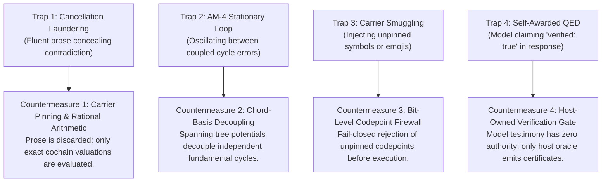

# Developer & Player Handbook: Integrating Models and Avoiding Traps

> **Lead Council:** `L3_logos_techne` & `L3_nous_panepistimion`  
> **Audience:** AI Engineers, System Integrators, and Evaluators  
> **AuthorityEffect:** `None`.

---

## 1. Integrating Language Models into The Symbol Game

When driving an LLM (e.g. OpenAI, Anthropic, or Open-Weights models like Llama 3.1 and Qwen 2.5) in The Symbol Game, follow the **Tri-Layer Architecture**:

```text
 ┌────────────────────────────────────────────────────────┐
 │ Layer 1: Prompt & Decoding Constraints                 │
 │ • System prompt defining pinned carrier                │
 │ • Logit mask setting unpinned tokens to -infinity      │
 └──────────────────────────┬─────────────────────────────┘
                            ▼
 ┌────────────────────────────────────────────────────────┐
 │ Layer 2: Proposal Normalization & Firewall             │
 │ • Strict JSON parser rejecting duplicate keys          │
 │ • Validation of carrier membership                     │
 └──────────────────────────┬─────────────────────────────┘
                            ▼
 ┌────────────────────────────────────────────────────────┐
 │ Layer 3: Independent Host Governor (Ground Truth)       │
 │ • Recomputes Phi_1, Gamma_2 using exact rational arithmetic│
 │ • Emits tamper-proof RFC 8785 receipt                  │
 └────────────────────────────────────────────────────────┘
```

---

## 2. The Four Traps & Their Hardened Countermeasures

Autonomous reasoning systems consistently fall into four characteristic failure modes when tasked with formal reasoning:



---

## 3. Mastering Decoupling Guidance (Defeating the AM-4 Loop)

### The Problem: Why Models Get Trapped
On a graph with multiple coupled cycles (such as $K_4$, with cycle rank $\beta_1 = 3$), every edge shared by two triangles will transmit adjustments from one cycle to another. If an LLM attempts to repair one edge at a time, it creates an infinite oscillatory loop:

```text
Turn 1: Model repairs edge (0->1) to zero Cycle A.  ==> Cycle B defect increases!
Turn 2: Model repairs edge (1->2) to zero Cycle B.  ==> Cycle C defect increases!
Turn 3: Model repairs edge (2->0) to zero Cycle C.  ==> Cycle A defect returns!
... RESULT: 100% STATIONARY LOOPING & FUEL EXHAUSTION.
```

### The Solution: The 4-Step Matrix Decoupling Protocol

To resolve all cycles simultaneously in a single turn:

```text
[Step 1: Pick Spanning Tree T] ──────► T has |V| - 1 edges (e.g. 0->1, 1->2, 2->3).
                                       T contains ZERO closed cycles!
                                       Hold tree edges INVARIANT.
                                            │
                                            ▼
[Step 2: Integrate Vertex Potentials] ─► Set f(root) = 0.
                                       For each tree edge u->v:
                                         f(v) = f(u) + c(u->v).
                                            │
                                            ▼
[Step 3: Solve Chords Simultaneously] ─► For each remaining non-tree chord u->v:
                                         c'(u->v) = f(v) - f(u).
                                            │
                                            ▼
[Step 4: Emit Single CUT Move] ───────► Emit all tree and chord values at once.
                                       Phi_1 drops from >0 directly to 0!
```

---

## 4. Minimal Python Governor Integration

Here is how to run a governed game session locally in Python using exact rational arithmetic:

```python
from fractions import Fraction
import json

class SimpleSymbolGameHost:
    def __init__(self, vertices, edges, initial_claims):
        self.vertices = set(vertices)
        self.edges = set(edges)
        self.claims = {e: Fraction(v) for e, v in initial_claims.items()}
        self.fuel = 10
        self.history = []

    def compute_cycle_defect(self, cycle_edges):
        """Recompute exact rational circulation around a directed cycle."""
        circulation = sum(self.claims[e] for e in cycle_edges)
        return abs(circulation)

    def execute_move(self, proposal_json: str) -> dict:
        self.fuel -= 1
        proposal = json.loads(proposal_json)
        move_type = proposal.get("move_type")

        if move_type == "CUT":
            new_claims = {e: Fraction(v) for e, v in proposal["payload"]["claims"].items()}
            
            # Carrier firewall check
            if not set(new_claims.keys()).issubset(self.edges):
                return {"decision": "REFUSED_CARRIER_MISMATCH", "fuel": self.fuel}

            # Monotonicity audit
            old_defect = self.compute_cycle_defect(["0->1", "1->2", "2->0"])
            
            # Tentative application
            saved = dict(self.claims)
            self.claims.update(new_claims)
            new_defect = self.compute_cycle_defect(["0->1", "1->2", "2->0"])

            if new_defect >= old_defect:
                self.claims = saved  # Atomic rollback
                return {"decision": "REFUSED_MONOTONICITY_VIOLATION", "fuel": self.fuel}

            return {"decision": "ADMITTED", "new_defect": str(new_defect), "fuel": self.fuel}

        elif move_type == "VERIFY":
            defect = self.compute_cycle_defect(["0->1", "1->2", "2->0"])
            if defect == 0:
                return {"decision": "ACCEPTED_ZERO_DEFECT", "fuel": self.fuel}
            return {"decision": "REFUSED_NONZERO_DEFECT", "defect": str(defect), "fuel": self.fuel}

        return {"decision": "REFUSED_UNKNOWN_MOVE", "fuel": self.fuel}
```

---

## 5. Best Practices Checklist for Prompt Construction

- [x] **Pin the Carrier in the Preamble:** Explicitly list vertices, edges, and allowable symbols.
- [x] **Demand Strict JSON Proposals:** Forbid markdown conversational filler; reject raw text responses.
- [x] **Supply Spanning Tree Potentials:** When testing complex graphs, provide integrated vertex potentials to test whether the model can calculate chord coboundaries.
- [x] **Never Trust Model QEDs:** Only terminate when the independent host emits `ACCEPTED_ZERO_DEFECT`.

---

## 6. The Modern Proposal Fidelity Protocol (PFP v2) & Central Gateway

The modern Proposal Fidelity Protocol formalizes the minimal end-to-end evaluation loop:

### 1. Minimal Grounded Carrier ($A < B < C$)
Almost all physical and logical challenges can be represented on a minimal directed graph or poset carrier $A < B < C$. By grounding problems in discrete finite carriers, models are prevented from hallucinating ungrounded continuum abstractions.

### 2. Unified Single-File Prompt Packet ($P$)
A problem packet $P$ bundles three elements:
- `P_system_prompt`: Grammar, RFC 8785 JSON output schema, and prompt constraints.
- `P_user_prompt`: The concrete challenge specification and active demand over the declared carrier.
- `accumulated_antibodies`: Typed historical failure detectors preventing repetition of falsified states.

### 3. External Proposal ($P'$) and Host Evaluation
- External model completions ($P'$) possess zero sovereign authority (`AuthorityEffect: None`).
- An independent host oracle evaluates $P'$ against formal invariants and produces a content-addressed SHA-256 receipt binding $(P, P', \text{outcome})$.

### 4. MSS-$\mu$ 9-Stage Recursive Iteration
When residuals remain, the protocol recurses ($P_0 \to P_1 \to \dots \to P_n \le 9$), refining the problem and incorporating new antibodies until an exact zero defect ($\Phi_1 = 0$) or bounded halt is reached.

### 5. Central Network Gateway Architecture
All external model transport is centralized in `omega_engine_providers.llm_gateway.LlmGateway`:
- **Python Thinness Law:** Python provides a thin ($\approx 1\%$) orchestration boundary.
- **Sovereign Rust Math Delegation:** All discrete cycle calculations, matrix contractions, and exact rational arithmetic reside in Rust crates.

