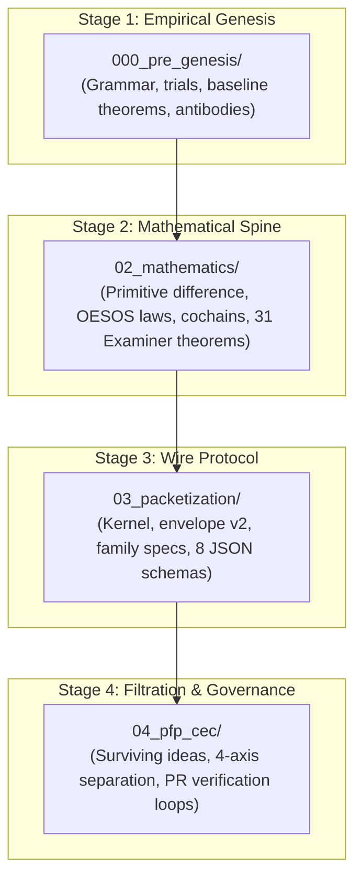

# 00. Master Synthesis & Navigational Cartography: Proposal Fidelity Protocol (PFP)

**Document Status:** Canonical Synthesis Monograph  
**AuthorityEffect:** `None`  
**Evaluation Perspective:** Swarm of `/panep-math-and-physics-prof` Structural Evaluators & Adversarial Epistemic Prosecutors  
**Governing Standard:** Examiner Theoretical Minimum & Claim Hygiene Rule  
**Estate (historical):** `ow/pfp_v0.2/`, no longer present; vocabulary file `packet_and_prompt.md`, no longer present. See the current-source orientation below.  
**Date:** 2026-10-04  

---

## Current-source orientation (2026-10-20)

AuthorityEffect: None. Source pin `c419cc6beb`. This monograph was written on 2026-10-04 for a former estate, `ow/pfp_v0.2/`, which no longer exists. Its four-estate map below is historical. Use this table to find the current home of each part; where no current home exists, the text below is a record of an earlier design.

| Historical name in this page | Current home at the pin | Status |
| --- | --- | --- |
| `000_pre_genesis/` | [`000_oepregen/`](../../000_oepregen/README.md) | Renamed strand. Its [results chapter](../../000_oepregen/03_results_and_arguments.md) lists seven statements and says only two (numbers 5 and 6) have proofs. |
| `02_mathematics/` | [`math/`](../math/README.md) in this strand | Present. |
| `03_packetization/` chapters | None found | Historical. No `03_packetization` directory is tracked. |
| `schemas/` | [`pfp/infrastructure/yaml/schemas/`](../../../../pfp/infrastructure/yaml/schemas/README.md) | Present; 13 schema files, `schema_register.yaml` and a README at the pin. |
| `fixtures/` | [`pfp/infrastructure/yaml/fixtures/`](../../../../pfp/infrastructure/yaml/fixtures/README.md) | Present; the Fable fixture is now `fix_fable_long_horizon_task_packet.yaml`. |
| `packets/` (cycle balance) | [`pfp/infrastructure/yaml/cycle_balance/`](../../../../pfp/infrastructure/yaml/cycle_balance/README.md) | Present: wire, problem, candidate, verifier and receipt files. |
| `04_pfp_cec/` | No directory. Files with the same names (02, 03, 04, 12, 13) are in this `docs/` directory. | Historical directory. The other five names in the tree of section 5 (01, 06, 07, 09 and the two-digit duplicates) are not present under those names. |
| `packet_and_prompt.md` vocabulary | None found | Historical. Use [06](06_prompt_packet_stage_synthesis.md) and [16](16_current_types_and_learnings.md) for current vocabulary. |

Corrections to statements below, checked against current source:

1. **Antibodies AB-01 to AB-07.** No Python, Rust or YAML source at the pin defines `SemanticOvercompletion`, `StaleStateCertification`, `LocalValidGlobalInvalid` or the other four names. The pre-genesis strand's [named failure modes](../../000_oepregen/04_named_failure_modes.md) says these are labels for observed replies, "not a detector, a refusal code or an admitted antibody in the repository". Read the list in section 1 as labels.
2. **Theorems 1 to 7.** The pre-genesis results are of mixed kinds: 1 is true by definition, 2 holds under one convention, 3 is two observed replies, 4 is conceptual analysis, 5 and 6 have proofs, and 7 is a target with no proof. Statement 5 is "forced separation, non-unique lift", not a quotient-collision theorem.
3. **Model versions.** The pre-genesis [trial record](../../000_oepregen/02_trial_record.md) says the model identifier, settings and dates were not recorded. The "DeepSeek v0.0, v1.0, v1.1" labels in section 1 are not supported by that record.
4. **Examiner register size.** [`math/05`](../math/05_examiner_theorems_and_invariant_register.md) is titled "31 Core Theorems" but contains 29 `### Theorem` headings with 29 distinct identifiers (ENC-0111 to ENC-0140 without ENC-0121 and ENC-0125, plus ENC-0195). Updater B owns that file.
5. **Envelope.** The required-field list is in the current [packet_envelope_v2.schema.yaml](../../../../pfp/infrastructure/yaml/schemas/packet_envelope_v2.schema.yaml): 17 required fields, draft 2020-12, `$id: core.symbol-game.packet-envelope.v2`, no `contract_digest` or `task_digest`. The opened `required` list at pin `c419cc6beb` and at HEAD has 17 names, not 18.

## Read

Open [packet_envelope_v2.schema.yaml](../../../../pfp/infrastructure/yaml/schemas/packet_envelope_v2.schema.yaml). The `required` key lists 17 names. The first is `schema_version`. The last is `authority_effect`. Draft `2020-12` and the id `core.symbol-game.packet-envelope.v2` are the first two lines. `contract_digest` and `task_digest` are not in that list. The schemas folder beside it has 13 files whose names end in `schema.yaml`.

**Check.** A summary that says the envelope has 18 required fields fails. The opened list has 17.

## Hear

Say `$id` as "dollar id". Say `core.symbol-game.packet-envelope.v2` as "omega dot symbol hyphen game dot packet hyphen envelope dot v two". Say `schema_version` as "schema version" and `authority_effect` as "authority effect". Seventeen names is not eighteen names.

The recording for scene 2 is [scene2_narration_stage_index.wav](../curriculum/media/voiceovers/scene2_narration_stage_index.wav). This Read, Hear, and Watch block was not separately recorded.

## Watch

Four beats. Each on-screen line is at most 42 characters. Scene 2 already has its own recording, named above. This block was not separately recorded.

| Beat | On screen | Spoken |
| --- | --- | --- |
| 1 | required list has 17 names | Open the required list. It has seventeen names. |
| 2 | schema_version is first | Schema version is the first name. |
| 3 | authority_effect is last | Authority effect is the last name. |
| 4 | 17 is not 18 | Seventeen is not eighteen. A count of eighteen fails. |

---

The sections below are the historical monograph text of 2026-10-04, with broken links repointed or marked on 2026-10-20.

## Executive Summary & Epistemic Boundaries

This monograph establishes a unified, progressive mathematical, empirical, and architectural consolidation of the Proposal Fidelity Protocol (PFP) across four canonical, numbered repository estates:

1. **`000_pre_genesis/`** (now [`000_oepregen/`](../../000_oepregen/README.md)): Empirical trial logs, minimal inscription grammar, baseline theorems (Theorems 1 through 7), and the seven primary immune antibodies (AB-01 through AB-07).
2. **`02_mathematics/`** (now [`math/`](../math/README.md)): The finite mathematical spine, discrete cochain complexes ($d_1 d_0 = 0$), quotient obstruction calculus ($Q^1 = \operatorname{coker}(d_0)$), LP dual witness certifiers, the 31 extracted Examiner theorems (ENC-0111 through ENC-0195), and higher-dimensional HoTT path typing.
3. **`03_packetization/`** (historical, not present): Symbol Game Packetization Protocol prose. Host-packet contracts are now the YAML files in [`yaml/schemas/`](../../../../pfp/infrastructure/yaml/schemas/README.md). Fixtures are now in [`yaml/fixtures/`](../../../../pfp/infrastructure/yaml/fixtures/README.md) and [`yaml/cycle_balance/`](../../../../pfp/infrastructure/yaml/cycle_balance/README.md).
4. **`04_pfp_cec/`** (historical; same-named chapters 02, 03, 04, 12 and 13 are in this `docs/` directory): Filtration of proposals (`ADMIT`, `REFUSE`, `HOLD`, `USEFUL-BUT-UNSAFE`), four-axis separation, and the PR review loop. This directory does not define a prompt or a host packet.



### Constitutional Directives & Ceilings
* **`AuthorityEffect: None`**: Neither this monograph, nor any verifier receipt, nor any successful test replay, nor any LLM proposal mints external authority over uncontracted reality.
* **Zero Genesis Bias & Observer Quarantine**: Spacetime or state descriptions do not assume total, unindexed global observers. All operational measurements are formulated as observer-indexed state-effect pairings $\langle E, \rho \rangle_O$.
* **No-Container Discipline**: Mathematical spaces are not pre-existing unindexed containers. Difference precedes coordinate systems; relations precede metrics.

---

## 1. Stage 1: Empirical Genesis & Baseline Theorems

The empirical pre-genesis testing ([`000_oepregen/`](../../000_oepregen/README.md)) established the behavioral boundaries of primitive symbolic systems under LLM exploration (DeepSeek v0.0, v1.0, v1.1).

### Key Empirical Discoveries
1. **Quiescence (Theorem 1):** An unextended primitive regime $\langle\rangle$ has an empty transition relation (${\longrightarrow}_0 = \varnothing$). Movement requires an external demand or admitted obstruction rule.
2. **Display vs Discriminative Power (Theorem 2):** Expanding external prompt syntax ($P_n \subsetneq P_{n+1}$) does not endow the underlying system with internal observation operators ($O_n$).
3. **Successor Non-Uniqueness (Theorem 3):** Bare primitive difference does not uniquely determine a single canonical successor; constructing an expressivity tower requires an explicit minimality ordering.
4. **Quotient Collision (Theorem 5):** Distinct external strings ($\langle a\rangle, \langle ab\rangle$) collapse internally under coarse quotient projections ($q_1$).

### The Seven Primary Immune Antibodies
* **AB-01 (`SemanticOvercompletion`):** Blocks projecting uncontracted ontologies (SQL, HTML, set theory) into raw marks.
* **AB-02 (`PrematureRelation`):** Blocks declaring equivalence or distinction when the internal regime lacks a deciding observation rule.
* **AB-03 (`SyntaxSemanticsConflation`):** Blocks treating external reader metrics (string length) as internal regime properties.
* **AB-04 (`InjectedFalseProvenance`):** Blocks caller prompts that falsely attribute previous assertions to the transcript.
* **AB-05 (`StaleStateCertification`):** Blocks certifying state based on single-turn diffs instead of full transcript replay.
* **AB-06 (`StateErasureOnTaskDemand`):** Blocks silently overwriting the active state with hypothetical task symbols.
* **AB-07 (`LocalValidGlobalInvalid`):** Blocks steps that appear locally sound while violating global cochain boundary conditions.

---

## 2. Stage 2: The Finite Mathematical Spine

The mathematical spine ([`math/`](../math/)) establishes the exact calculus of difference, obstruction, and repair.

### 2.1 Genesis & The Two OESOS Rules
* **Primitive Difference ($\diamond$):** Nullary marked occurrence $\vdash \diamond : \mathsf{PrimitiveDifference}$ (`<>`).
* **SG-L0 (Graph Non-Determination):** Primitive Difference does not determine graph structure.
* **OESOS Governing Law:**
  * **Rule 1 (Same-Context Repair):** Attempt to discharge obstruction $\Omega$ using licensed transformations $\mathcal{R}_C$ inside the current context.
  * **Rule 2 (Context Extension):** If and only if structural exhaustion is proven ($\operatorname{Exhausted}_C(x)$ by certificate $E$), evaluate the least conservative context extension.
* **SG-L1 (R1 Priority):** An extension outcome $\mathsf{Extend}$ is strictly forbidden if a resolving path exists in $\operatorname{Reach}_C(x)$.

### 2.2 Quotient Obstruction & Exact Homology
Over discrete cochain complexes $C^0 \xrightarrow{d_0} C^1 \xrightarrow{d_1} C^2$:
* **Nilpotence:** $d_1 \circ d_0 = 0$.
* **Quotient Space:** $Q^1 = \operatorname{coker}(d_0) = C^1 / \operatorname{im}(d_0)$.
* **Cohomology Survivor Sector:** $H^1 = \ker(d_1) / \operatorname{im}(d_0)$.
* **Exact Convergence Norms:**
  $$\Phi_1(\omega) = \min_\alpha \|\omega - d_0 \alpha\|_1, \quad \Gamma_2(\omega) = \|d_1 \omega\|_1$$
* **LP Duality Soundness (ENC-0114):** Dual witness vector $y^*$ with zero duality gap ($\omega^T y^* = \|x^*\|_1$) certifies global optimality of primal repair $x^*$.

### 2.3 The Examiner Invariant Register (31 Extracted Theorems)
All 31 extracted theorems (ENC-0111 through ENC-0195) are documented under the Examiner Theoretical Minimum in [`05_examiner_theorems_and_invariant_register.md`](../math/05_examiner_theorems_and_invariant_register.md).

---

## 3. Stage 3: Wire Protocols & Schema Validation

The packetization chapters lived in `03_packetization/` (historical, not present). Prompt, prompt packet, host packet, schema, fixture, and receipt were defined in `packet_and_prompt.md` (historical, not present).

### 3.1 Envelope on disk
The host envelope is [`packet_envelope_v2.schema.yaml`](../../../../pfp/infrastructure/yaml/schemas/packet_envelope_v2.schema.yaml), draft 2020-12, `$id: core.symbol-game.packet-envelope.v2`. Its 17 required fields are listed in the schema itself. The older four-name shorthand `(packet_id, contract_digest, task_digest, payload)` is prose. `contract_digest` and `task_digest` are absent from the schema.

### 3.2 Schemas and fixtures in this tree
Contracts are the YAML files in [`yaml/schemas/`](../../../../pfp/infrastructure/yaml/schemas/README.md). Fixtures are the YAML files in [`yaml/fixtures/`](../../../../pfp/infrastructure/yaml/fixtures/README.md) and the cycle-balance files in [`yaml/cycle_balance/`](../../../../pfp/infrastructure/yaml/cycle_balance/README.md). The register of schemas is [`schema_register.yaml`](../../../../pfp/infrastructure/yaml/schemas/schema_register.yaml). The former catalogue chapter `03_packetization/05_schema_catalog_and_validation_gates.md` is not present.

### 3.3 The Claude Fable handoff fixture
[`fix_fable_long_horizon_task_packet.yaml`](../../../../pfp/infrastructure/yaml/fixtures/fix_fable_long_horizon_task_packet.yaml) is the current bootstrap fixture (renamed from `fable_long_horizon_task_packet_v2.yaml`). Its payload text includes `BOOTSTRAP_REFUSED`. The JSON filename used in older prose is absent.

---

## 4. Stage 4: Proposal Filtration & Verification Governance

The filtration estate ([`03_context_extension_calculus_and_foundations.md`](03_context_extension_calculus_and_foundations.md) and [`04_symbol_game_architecture.md`](04_symbol_game_architecture.md)) prevents speculative corruption of the codebase.

### 4.1 The Four-Axis Separation
* **Axis 1 (Surface Codec):** e.g. SymSys-36.
* **Axis 2 (Lift Depth):** Certified context extensions $d(C)$.
* **Axis 3 (Topological Rank):** 0-cell, 1-cell, 2-cell dimension within an admitted stage.
* **Axis 4 (Evidence / Authority Ceiling):** F0..F6, `AuthorityEffect: None`.

### 4.2 Surviving Ideas Ledger
Ledger evaluating research proposals across five zones (A to E) with four dispositions (`ADMIT`, `REFUSE`, `HOLD`, `USEFUL-BUT-UNSAFE`), ensuring speculative ideas cannot bypass verification gates.

---

## 5. Master Estate Map & Navigational Index (historical, 2026-10-04)

The tree below describes the former `ow/pfp_v0.2/` estate. None of its top-level directories exists under this strand at the 2026-10-20 pin; use the orientation table at the top.

```text
├── prompt_packets/                          <-- PromptPacketV0_1 typed prompt envelopes
├── host_packets/                            <-- content-addressed machine record envelopes
├── spans/                                   <-- role span byte range partitions (task, constraint, etc)
├── dialects/                                <-- wire formats and legends (dialects/wire for mss-boundary-v1)
├── codebooks/                               <-- external natural language symbol dictionaries
├── receipts/                                <-- immutable execution observation records
├── filtrations/                             <-- 04_pfp_cec 4-axis proposal decision records
├── 00_master_synthesis_and_cartography.md
├── schemas/                                   <-- YAML contracts (no *.schema.json child)
├── fixtures/                                  <-- fable YAML fixtures; sidecar names a missing markdown file
├── packets/                                   <-- cycle-balance fixtures, unverified receipt skeleton
├── prompt_templates/                          <-- PromptPacketV0_1 templates
├── rewriting/                                 <-- mss-boundary-v1 prompt rewriting specs
├── pilot_output/                              <-- 64-call empirical corpus (results.md & tests.md)
│
├── 03_packetization/                          <-- chapters; grammar YAML copies; no schemas/ or fixtures/ child
│   ├── README.md
│   ├── 01_packet_kernel_and_sgpp_architecture.md
│   ├── 02_packet_family_specifications.md
│   ├── 03_proposal_generator_and_boundary_compiler.md
│   ├── 04_long_horizon_handoff_and_fable_protocol.md
│   └── 05_schema_catalog_and_validation_gates.md
│
└── 04_pfp_cec/                                <-- proposal filter, documents 01–09
    ├── README.md
    ├── 01_filtration_principles_and_four_axis_separation.md
    ├── 02_surviving_ideas_ledger.md
    ├── 03_context_extension_calculus_and_foundations.md
    ├── 04_symbol_game_architecture.md
    ├── 12_pr_review_and_verification_loop.md
    ├── 06_swarm_architectural_charter_and_design_plan.md
    ├── 07_sentinel_ai_integration_and_product_boundary.md
    ├── 13_review_findings_and_pilot_runbook.md
    └── 09_symbol_game_architecture_and_core_boundary.md
```
