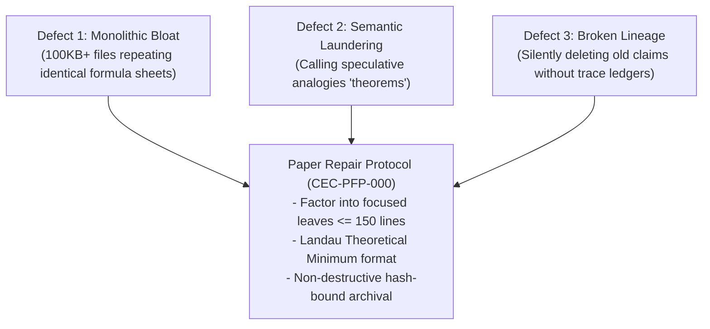

# 04. Symbol Game Architecture & Repair Specification

> **Implementation status (October 4, 2026):** This is design/source material.
> The runnable local scope and unresolved targets were recorded in
> `review_findings.md` and a PFP50 inventory under
> `001_finite_obstruction_calculus/plans/`; neither file is present at the
> 2026-10-20 pin. The nearest current records are
> [13_review_findings_and_pilot_runbook.md](13_review_findings_and_pilot_runbook.md)
> and the PFP50 derivation control
> [plan_7d_pfp50_catalog](../../../../omega_engine_atlas/coda_atlas/F004_papers/001_finite_obstruction_calculus/000_witnessed_difference_programme/code/derivation_controls/plan_7d_pfp50_catalog/derivation.md).
> Gate/mode YAML is not evidence of execution. These reference demos are not
> wired into a 13-gate Woland/Woland pipeline, and no live-provider completion
> or general theorem follows from their local checks.

> **Current-source status (2026-10-20, pin `c419cc6beb`).** Most runtime names in
> this page describe an earlier Rust crate layout. Checked against the tracked
> file list:
>
> | Named in this page | At the pin |
> | --- | --- |
> | Binaries `run_proof_pipeline`, `run_operator_tower`, `run_genesis`, `symproof`, `symsys-pipeline` and the `cargo run` commands below | Not present. The Rust binaries are `omega_symbol_game` ([Cargo.toml](../../../../omega_engine/crates_rs/omega_symbol_game/Cargo.toml)), `symgam` ([runtime Cargo.toml](../../../../omega_engine/crates_rs/omega_symbol_game_runtime/Cargo.toml)) and four `verify_phi*` / `verify_wall_functionals` binaries under `omega_symbol_game/src/bin/`. |
> | Modules `proof_pipeline.rs`, `pipeline_run.rs`, `sn_encoder.rs`, `prompt_builder.rs`, `prompt_router.rs`, `parse_response.rs`, `http_backend.rs`, `file_backend.rs`, `claude_backend.rs`, `mode.rs` | Not present in any tracked crate. |
> | Mode directories `yaml/mode_1_candidate_ideas_proposer`, `yaml/mode_2_proofer`, `yaml/mode_5_operator` with `stage_1_compression_gate.yaml` ... `stage_8_evidence_plan.yaml` | Kept as teaching contracts under [`_how_to_play/contracts/`](../_how_to_play/contracts/symbol_game.contract.yaml). No current runtime loads them. |
> | "Stage 1 is the Compression Gate and Stage 8 is the Evidence Plan" | Historical. The public runtime ([controller.yaml](../../../../omega_engine_pfp/infrastructure/yaml/stages/controller.yaml)) has 11 stages: 1 admit, 2 ideation, 3 audit, 4 l2_extraction, 5 evaluation (host), 6 adversarial, 7 challenge_replay, 8 selection, 9 receipt, 10 hand_off, 11 evidence_plan. |
> | `AuthorityCeiling` five-level chain (PO-CEIL-001) and `mode.rs` | `proof_obligations.md` and `mode.rs` are not present. The current Rust `AuthorityCeiling` in [xi_diagnostic.rs](../../../../omega_engine/crates_rs/omega_types/src/xi_diagnostic.rs) has two variants, `DiagnosticOnly` and `TieBreakerOnly`. |
> | `../math_spines/symbol_game_math_spine.md` (Parts II and III) | Not present at that path. A library certificate record for an archived `symbol_game_math_spine.md` exists under `omega_engine_library/coda_library/encyclopedia/library/certificates/`. The "proved consistent" statements below cite that absent file and were not rechecked. |
>
> Read the runtime sections (Runtime Shape, Symbol Game Workflow, Main Commands,
> Resuming) as a record of the earlier design. The packet lifecycle, local/global
> boundary discipline and authority boundary remain the design intent.


> [!IMPORTANT]
> **Canonical Symbol Game Theory Spine**
>
> The Symbol Game is the finite packet boundary between untrusted generation and Omega authority.
> A model may propose. It may emit structured material. It may even emit certificate-shaped material. It is not the certifier.
>
> \[
> \boxed{
> \mathsf{Finite\ packet\ grammar} + \mathsf{total\ verifier} + \mathsf{packet\ fidelity} + \mathsf{family\ soundness} \Rightarrow \mathsf{failure\ is\ mechanically\ enumerable,\ repairable,\ and\ terminalizable.}
> }
> \]
>
> **Authority Boundary:** Symbol Game emits verifier evidence and terminal statuses. It does not directly mint Omega authority.
>
> **Governance Rule:** symbol_game_math_spine.md is canonical. symbol_game_proof_ledger.md is archival only and non-admissible. Theory is closeable; implementation authority remains gated until conformance passes.

The Symbol Game is a Rust crate plus YAML prompt contract set for running auditable symbolic reasoning pipelines. The public stage convention is one-based: Stage 1 is the Compression Gate and Stage 8 is the Evidence Plan.

## Relationship to the Omega Engine

> **The Symbol Game is the first concrete finite packet realization of the Omega Engine at the GTFOC/GTFDA boundary.**

It began as a proof-of-concept for the larger Omega Engine.

It does not attempt to make an LLM authoritative. It constrains the LLM into finite symbolic regimes where proposals become parseable traces. Those traces can then be checked locally, checked against the global packet boundary, repaired, refused, or lifted into a new symbolic context.

The Symbol Game exists because free-form LLM generation is too slippery for serious reasoning. Ordinary prose lets the model hide uncertainty in fluent language. The Symbol Game replaces that with:

```text
finite symbols
declared rules
typed packets
local validation
global boundary validation
mechanical checks
explicit evidence ceilings

```

In the full Omega Engine, these same mechanisms become the basis for operator discovery, operator composition, lift validation, and reusable operator memory.

> You did not start with a grand machine. You got tired of LLM nonsense and discovered that symbols, boundaries, and validators make the nonsense measurable.

## Symbol Discipline

> **The Symbol Game is a finite-symbol forcing system: it compresses vague intent into declared symbols, rules, obstructions, operators, and terminal conditions before allowing prose or code generation.**

The Symbol Game is not a prompt-polishing system. Its core method is to force reasoning into a small declared symbolic alphabet before asking for construction, proof, or implementation.

Instead of asking:

```text
Build me a primal-dual solver in Rust.

```

the Symbol Game asks the model to operate inside a finite symbolic regime such as:

```text
symbols: a-z, 0-9, <, >, =
rules: declared separately
terms: finite strings over the symbol set
operators: admitted only by contract

```

This matters because natural language lets an LLM hide uncertainty inside fluent prose. A symbolic regime removes most of that escape space. The model must construct terms, propose operators, expose missing rules, and produce replayable artifacts.

The purpose is not to make the LLM "smart." The purpose is to constrain the interaction until reasoning becomes inspectable.

A symbolic state may later be interpreted as algebra, proof search, operator discovery, solver construction, or code generation, but the first move is always the same:

\[
\boxed{\text{replace vibes with finite symbols, typed rules, and replayable transitions.}}
\]

> The Symbol Game does not ask the model to solve from prose. It forces the model to emit symbolic traces that can be parsed, replayed, and mechanically checked.

## Local-to-Global Boundary Discipline

> The Symbol Game is not satisfied by local validity. A trace must remain green at the global packet boundary: same problem, same protected skeleton, same terminal target, same evidence ceiling.

The Symbol Game must distinguish local step validity from global packet validity.

A symbolic move may be locally valid:

```text
local_step_valid ✅

```

while still failing globally:

```text
global_boundary_valid ❌

```

Examples:

* a rewrite is syntactically valid but changes the problem
* a pivot is legal locally but violates feasibility
* a proof step follows from a constraint but targets the wrong objective
* a generated operator reduces one residual while silently mutating a protected skeleton
* a local certificate passes but cannot be composed with the whole run manifest

The Symbol Game therefore requires two gates:

```text
Local Gate:
  Is this step valid under the local symbolic rule?

Global Gate:
  Does this step preserve the declared problem packet, protected boundary, terminal target, and evidence ceiling?

```

A run may proceed only when both gates pass.

\[
\boxed{ \text{LocalGreen} \wedge \text{GlobalGreen} \Rightarrow \text{AdmissibleStep} }
\]

\[
\boxed{ \text{LocalGreen} \wedge \neg\text{GlobalGreen} \Rightarrow \text{BoundaryViolation} }
\]

### Token-Space Constraint

The Symbol Game constrains token space so the model has fewer ways to hide boundary violations in prose. Instead of:

```text
This suggests the solution is probably optimal...

```

it must emit something like:

```text
use<2*ub1+ub2>
derive<3x+2y<=10>
hit<10>
qed<try=opt>

```

Now the parser can ask:

```text
Does every symbol resolve?
Does every reference point to a declared packet field?
Does every local move preserve the global boundary?
Does the terminal claim follow?

```

> **Constrained symbols reduce expressive escape; local/global validation prevents fluent cheating.**

## Runtime Shape

```text
src/bin/
  run_proof_pipeline.rs     Mode 2 end-to-end proof pipeline
  run_operator_tower.rs     Mode 5 operator discovery
  run_genesis.rs            Mode 3 genesis/Nemotron workflow
  symproof.rs               interactive proof session

src/proof/
  proof_pipeline.rs         one-based Stage 1..8 orchestrator
  pipeline_run.rs           run manifest and stage records
  sn_encoder.rs             S(n) prompt context encoder

src/adapters/
  prompt_builder.rs         controller/template assembly
  prompt_router.rs          stage dependency routing
  parse_response.rs         stage response parsing/report handoff

src/generators/
  http_backend.rs           OpenAI-compatible HTTP backend
  file_backend.rs           canned stage_1.yaml..stage_8.yaml backend
  claude_backend.rs         file-exchange backend

src/evaluators, src/solvers, src/validators
  mechanical checks, scoring, schema validation, and authority gates

```

## YAML Contract Shape

Every active mode directory has the same stage inventory:

```text
controller.yaml
stage_1_compression_gate.yaml
stage_2_ideation.yaml
stage_3_audit.yaml
stage_4_l2_extraction.yaml
stage_5_mss_mu_evaluator.yaml
stage_6_adversarial.yaml
stage_7_countermodel.yaml
stage_8_evidence_plan.yaml

```

Mode-specific support files that are not stage templates live under `yaml/support/`.

## Stage Boundary Rule

The public stage ID, YAML filename, run artifact filename, CLI argument, manifest `stage_index`, and documentation name must agree. Zero-based public stage labels and split-stage aliases are not part of the live convention.

## S(n) Mechanics

`S(n)` is the symbolic context level tracked by the Symbol Game. It is separate from pipeline stage numbering.

> **Boundary rule:** `S(n)`is symbolic context level, not proof status, not evidence level, and not pipeline stage number. A pipeline may complete Stage 1 through Stage 8 without changing`S(n)`.

### Meaning

An `S(n)` state records:

* `level`: current symbolic level
* `generators`: declared symbols available at this level
* `terms`: constructed terms
* `obstructions`: unresolved failures or open classes
* `witnesses`: context witnesses that justify a lift

The pipeline may move through Stage 1 through Stage 8 without changing `S(n)`. A lift changes`S(n)` only when a validator or evaluator identifies missing structure that must be added.

### Encoding Modes

| Mode          | Use                                             |
| ------------- | ----------------------------------------------- |
| `full`        | include the full S(n) state and prior outputs   |
| `compressed`  | include compact state counts and recent context |
| `adversarial` | encode the problem as an obstruction packet     |

### Authority

S(n) encoding is a steering and provenance mechanism. It does not prove claims. The authority chain remains:

1. YAML and parser shape
2. validators and mechanical evaluators
3. external proof or empirical oracles

Stage 8 may propose what oracle is needed, but it cannot grant the oracle result itself.

## Symbol Game Modes

Modes change the domain interpretation of terms and contexts. They do not change the public stage convention.

### Active Modes

| Mode                       | Directory                              | Primary binary                  | Authority ceiling                                                                                      |
| -------------------------- | -------------------------------------- | ------------------------------- | ------------------------------------------------------------------------------------------------------ |
| Mode 1: Candidate Ideas    | `yaml/mode_1_candidate_ideas_proposer` | `symsys-pipeline`               | proposal and diagnostic only                                                                           |
| Mode 2: Proofer            | `yaml/mode_2_proofer`                  | `run_proof_pipeline`,`symproof` | theorem status only through external proof oracle                                                      |
| Mode 3: Nemotron/Genesis   | `yaml/mode_3_nemotron`                 | `run_genesis`                   | empirical result only through benchmark/test harness                                                   |
| Mode 4: Writer/Poet/Author | pending                                | pending                         | editorial quality only through rubric                                                                  |
| Mode 5: Operator Tower     | `yaml/mode_5_operator`                 | `run_operator_tower`            | admitted operator only through contract validation, mechanical checks, and operator-lattice validation |

## Operator Tower Boundary

Mode 5 may discover, test, and admit candidate operators, but the architecture document does not prove the operator-growth law.

The S(n) Generator Growth Law, minimal obstruction-separated operator tower, and operator compression theorem belong in the consolidated dependent spine:

```text
../math_spines/symbol_game_math_spine.md Part II

```

This architecture file only records where Mode 5 runs and what authority ceiling it has.

### Canonical Stage Table

| Stage | Template                        | Purpose                                                         |
| ----- | ------------------------------- | --------------------------------------------------------------- |
| 1     | `stage_1_compression_gate.yaml` | decide whether the seed can enter a finite grammar              |
| 2     | `stage_2_ideation.yaml`         | generate candidates within that grammar                         |
| 3     | `stage_3_audit.yaml`            | audit candidates for drift, smuggling, and imported assumptions |
| 4     | `stage_4_l2_extraction.yaml`    | convert prose candidates into typed finite structures           |
| 5     | `stage_5_mss_mu_evaluator.yaml` | run or specify the mechanical MSS-mu classification contract    |
| 6     | `stage_6_adversarial.yaml`      | search for countermodels and separating contexts                |
| 7     | `stage_7_countermodel.yaml`     | refine or deepen countermodel findings                          |
| 8     | `stage_8_evidence_plan.yaml`    | produce evaluator routing, oracle targets, and final ranking    |

### Backend Matrix

| Backend  | Configuration                                                | Use                                   |
| -------- | ------------------------------------------------------------ | ------------------------------------- |
| `http`   | `SYMGAME_LLM_ENDPOINT`,`SYMGAME_LLM_MODEL`,`SYMGAME_LLM_KEY` | local or cloud OpenAI-compatible APIs |
| `file`   | `--responses-dir`with`stage_1.yaml`through`stage_8.yaml`     | deterministic tests and replay        |
| `claude` | `--exchange-dir`                                             | file-exchange workflow                |

### Evidence Levels

| Level | Meaning                                     |
| ----- | ------------------------------------------- |
| F0    | conjecture or unsupported candidate         |
| F1    | LLM-attested candidate after audit          |
| F2    | mechanically checked result                 |
| F3    | formally proved by an external proof oracle |

No LLM stage can promote itself. Evidence upgrades are owned by validators, evaluators, or external oracles.

### AuthorityCeiling Reconciliation

Three definitions of `AuthorityCeiling`exist across the codebase. The canonical definition is from PO-CEIL-001 in`proof_obligations.md`:

| Canonical (PO-CEIL-001) | Runtime Architecture    | Rust source (mode.rs) |
| :---------------------- | :---------------------- | :-------------------- |
| ShapeOnly               | ShapeOnly               | Diagnostic            |
| LocalReplay             | LocalReplay             | BenchmarkHarness      |
| BoundaryChecked         | BoundaryChecked         | ContractValidator     |
| ExternalOracleRequired  | ExternalOracleRequired  | ProofAssistant        |
| EmpiricalOracleRequired | EmpiricalOracleRequired | EditorialRubric       |

The `mode.rs`enum conflates authority ceiling with operational mode. The canonical enum is the 5-level chain from PO-CEIL-001. Implementations must use this chain for ceiling comparisons and monotonicity checks. The`mode.rs` enum should be refactored to separate mode from ceiling in a future implementation sprint.

## Symbol Game Workflow

All current Symbol Game modes use the same public Stage 1 through Stage 8 convention.

| Stage | Key                       | Executor        | Output                                            |
| ----- | ------------------------- | --------------- | ------------------------------------------------- |
| 1     | `compression_gate`        | LLM             | finite grammar, admission, or refusal             |
| 2     | `ideation`                | LLM             | candidate derivations                             |
| 3     | `audit`                   | LLM             | KEEP/MAYBE/KILL-style audit and provenance checks |
| 4     | `l2_extraction`           | LLM             | typed finite/L2 candidate files                   |
| 5     | `mss_mu_evaluator`        | mechanical      | Exact/Survivor/Open classification and witnesses  |
| 6     | `adversarial`             | LLM plus checks | attempted countermodels and drift findings        |
| 7     | `countermodel_refinement` | LLM plus checks | refined countermodel search results               |
| 8     | `evidence_plan`           | LLM             | evaluator/oracle plan and final ranking           |

### Execution Path

1. A binary such as `run_proof_pipeline` receives a seed and selected backend.
2. The pipeline loads the selected mode directory from `yaml/`.
3. `controller.yaml` is prepended to the stage template.
4. Prior stage outputs are injected through canonical placeholders such as `{{STAGE_4_OUTPUT}}`.
5. The generator backend returns YAML, or the file backend reads `stage_N.yaml`.
6. Parsers and validators gate the output before the next stage.
7. `PipelineRun`records one-based`stage_index`values and`runs/{run_id}/stage_N.yaml` paths.

### Main Commands

```bash
cargo run -j 1 --bin run_proof_pipeline -- \
  --seed "Prove LP duality for bounded polyhedra" \
  --backend file \
  --responses-dir runs/test_fixtures

```

```bash
cargo run -j 1 --bin run_operator_tower -- \
  --domain "linear_algebra" \
  --gap "projection operator" \
  --max-iterations 3

```

```bash
cargo run -j 1 --bin symsys-pipeline --features legacy-pipeline -- \
  generate-prompt --stage 4 \
  --input stage_3_response.yaml \
  --stage3-output stage_3_response.yaml \
  --yaml-dir yaml/mode_2_proofer

```

### Resuming

`run_proof_pipeline --resume-from N`uses the public one-based stage number. Use`--resume-from 1` to start from the beginning.

## Packet Lifecycle

Every interaction follows this lifecycle:

```text
Seed → Parse → Local Validate → Global Boundary Check → Fidelity Check → Terminalize → [Operator Extract]

```

### 1. Seed Intake

A seed is a typed request: a natural-language prompt compiled into a finite typed schema with family, instance, carrier, constraints, protected boundary, terminal target, evidence ceiling, oracle policy, and allowed transforms.

### 2. Realization (Parse)

The realization functor `η_SG#`maps raw LLM output to`TypedOmegaPacket + F`(success or typed refusal). This is total-or-refusing, grammar-preserving, ceiling-preserving, and cannot create authority. See`../math_spines/symbol_game_math_spine.md` Part III "Realization Functor Boundary".

### 3. Local Validation

The local replay checker `L_Γ(x,P)`verifies every step uses an admitted local rule and every transition is replayable. Failure produces`LocalInvalid`.

### 4. Global Boundary Check

The global boundary verifier `V_Γ(x,P)`checks that the packet preserves the declared problem, protected skeleton, terminal target, evidence ceiling, and family invariants. A packet that is locally valid but globally invalid is a`BoundaryViolation`.

### 5. Fidelity Check

The fidelity predicate `F(s,P)`verifies task identity, constraint, protected boundary, terminal target, evidence ceiling, oracle policy, and allowed transform preservation between the seed and the packet. See`../math_spines/symbol_game_math_spine.md` Part III §1.4.

### 6. Terminalization

The terminalizer `τ_Γ` maps the combined validator reports to exactly one terminal status:

| Terminal     | Meaning                                           |
| :----------- | :------------------------------------------------ |
| Certificate  | All checks passed within declared scope           |
| Refusal      | Grammar, type, law, budget, or boundary violation |
| Repair       | Close enough for deterministic repair             |
| OracleNeeded | Requires external prover/solver/oracle            |

The concrete terminalizer policy table (first-match, 8 rows) is proved consistent in `../math_spines/symbol_game_math_spine.md` Part III §3.3.

### 7. Operator Extraction (Mode 5)

When a pipeline run resolves an obstruction, the resolution is classified into one of five operator classes (E/I/C/R/M) by the priority classifier. Admitted operators are stored in the operator registry for reuse.

## Operator Algebra

The Symbol Game produces a conditionally composable and compressible fixed-layer operator algebra. Full theory and proofs are in `../math_spines/symbol_game_math_spine.md` Part II §§3--11 and Part III §§5--6. Full inter-layer compression remains open.

### Five Classes

| Class                   | Action            | Phi Effect | Role          |
| :---------------------- | :---------------- | :--------- | :------------ |
| E (Exact Repair)        | `x → x + d₀α`     | Preserved  | Gauge freedom |
| I (Quotient Isometry)   | Permutes Q¹       | Preserved  | Symmetry      |
| C (Context Embedding)   | `x → ρ(c)(x)`     | May change | Diagnostic    |
| R (Residual Projection) | `x → x - d₀α*`    | Computes   | Localization  |
| M (Mutation)            | Undeclared damage | Damaged    | Refused       |

### Composition and Compression

Admissible operators compose without producing mutations. Under declared rewrite table and deterministic TieR, any word in {E,I,C,R} compresses to canonical form `E? ∘ I? ∘ C? ∘ R?` of length ≤ 4. Key rules: E∘E=E, R∘R=R, R∘E=R, I∘E=E'∘I (with transport witness).

### Lift Boundary

A lift is forced when a context embedding produces a witness that no existing E or I can resolve. The five-class structure is invariant across lifts; only the carrier and operator instances change.

## Integration Surface

The Symbol Game integrates with `anomalon_ai`as an invisible validation pipeline. Full integration architecture is in`07_anomalon_ai_integration.md`.

### Data Flow

```text
User Prompt → [Intake] → [Packet Compiler] → [LLM Generator] → [Validator Pipeline]
                                                                     ↓
              User Response ← [Response Decoder] ← [Terminal Status] ← [Repair Loop?]

```

### Key Integration Points

| Component          | Location                        | Role                                      |
| :----------------- | :------------------------------ | :---------------------------------------- |
| Packet Compiler    | symbol_game::adapters           | Compiles prompts into constrained packets |
| Validator Pipeline | symbol_game::evaluators         | Runs 8-stage validation                   |
| Operator Memory    | symbol_game::lifts + ::policies | Stores/retrieves admitted operators       |
| Immune System      | symbol_game::health             | Suppresses known-bad patterns             |
| Response Decoder   | anomalon_ai::decoders           | Maps terminals to confidence labels       |
| Ranking Graph      | anomalon_ai::ranking            | Routes by historical performance          |

### Confidence Labels

The user sees confidence labels derived from terminal status and authority ceiling:

| Terminal + Ceiling            | User Label     |
| :---------------------------- | :------------- |
| Certificate + BoundaryChecked | Verified       |
| Certificate + ShapeOnly       | HighConfidence |
| Repair succeeded              | BestEffort     |
| OracleNeeded                  | CannotVerify   |
| Refusal                       | Refused        |

## Evidence Level Flow

Packets progress through evidence levels as they pass validation stages:

```text
F0 (conjecture) → F1 (LLM-attested, post-audit) → F2 (mechanically checked) → F3 (externally proved)

```

No pipeline stage can self-promote. Evidence upgrades require:

* F0→F1: Stage 3 audit pass
* F1→F2: Stage 5 MSS-mu mechanical check pass
* F2→F3: External proof oracle acceptance

The evidence ceiling declared by the seed caps the maximum achievable level.

---

## 14. Research Paper & Documentation Repair Protocol (CEC-PFP-000)

### 14.1 The Documentation Degradation Defect

As research codebases evolve rapidly across multi-agent sprints, technical documents and academic monographs frequently degrade into one of three defect modes:



### 14.2 The Four-Step Repair Sequence

When repairing an obsolete, bloated, or fragmented research monograph, the agent must execute the **Four-Step Repair Sequence**:

#### Step 1: Factoring & Deduplication
* Identify and remove exact text duplicates.
* Separate normative definitions from historical planning drafts and research quarantine notes.
* Partition monolithic text dumps into focused, progressively numbered leaf documents (<= 300 lines).

#### Step 2: Claim Scoping & Landau Formatting
* Convert informal prose claims into formal Landau Quad-Elements:
  1. **Invariant:** The exact formal statement.
  2. **Boundary:** The carrier and hypotheses under which it holds.
  3. **Witness:** The computational receipt or certificate deciding truth.
  4. **Falsifier:** The counterexample that breaks it.
* Replace forbidden hyperbole verbs (un-fenced claims of certitude or global scope) with claim-disciplined verbs (`supports`, `is consistent with in this toy setting`).

#### Step 3: Evidence Reconciliation & Crosswalking
* Map every claimed theorem to a concrete entry in the formal encyclopedia card catalog (ENC-NNNN).
* Generate machine-readable extraction manifests asserting 100% coverage with zero unmapped theorems.

#### Step 4: Non-Destructive Archival
* Never delete historical technical insights blindly.
* Preserve original commit hashes, git object SHAs, and legacy custody ledgers so past iterations remain completely recoverable from git history.
