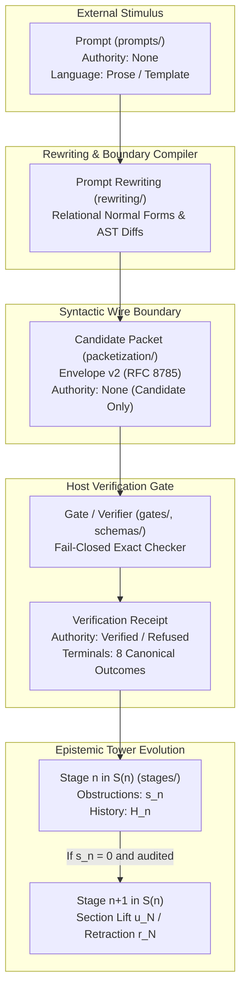

# 06. Semiotic & Architectural Synthesis: Prompt, Packet, Stage, and Mode

**AuthorityEffect:** `None`  
**Governing Laws:** Two Boxed Laws of $S(n)$, Four-Object Lifecycle, Fail-Closed Verifier Architecture  
**Sponsoring Bodies:** Swarm Developer, Woland Red Team, Governance Symbol Game, Semiotic & Rewrite Special Triad  

---

## 1. Executive Summary & Epistemic Demarcation

In the Proposal Fidelity Protocol (PFP v0.2) and the broader Symbol Game architecture, severe category errors arise when the distinct concepts of **Prompt**, **Packet**, **Stage**, and **Mode** are conflated.

Such conflation degrades mathematical rigor and compromises security boundaries:
- If a **Prompt** is treated as a **Packet**, untrusted natural language is mistakenly granted structural authority without fail-closed schema validation.
- If a **Packet** is treated as a **Stage**, a single ephemeral wire envelope is mistaken for a discrete epistemic stratum in the Postnikov obstruction tower.
- If a **Stage** is treated as a **Mode**, an ontological derivational level ($S(n)$) is collapsed into a mere surface-level presentation dialect (Modes 01–20).

This document establishes the precise mathematical, semiotic, and architectural demarcations separating these four entities, records the authoritative anti-pattern catalogue (Woland Audit), and fixes the file custody taxonomy under `030_the_symbol_game_proposal_fidelity_protocol_pfp` (now `004_oepfp`).

> **Current-source corrections (2026-10-20, pin `c419cc6beb`).**
>
> 1. **Paths.** Strand `030_the_symbol_game_proposal_fidelity_protocol_pfp` is now `omega_engine_education/documentation/004_oepfp`. The prompt, packet, stage and mode assets in the matrix below live in the PFP application, not in this strand: [prompts](../../../../omega_engine_pfp/infrastructure/yaml/prompts/README.md), [schemas](../../../../omega_engine_pfp/infrastructure/yaml/schemas/README.md), [fixtures](../../../../omega_engine_pfp/infrastructure/yaml/fixtures/README.md), [stages](../../../../omega_engine_pfp/infrastructure/yaml/stages/controller.yaml), [modes](../../../../omega_engine_pfp/infrastructure/yaml/modes/mode_catalog.yaml) and [gates](../../../../omega_engine_pfp/infrastructure/yaml/gates/README.md). `packetization/` has no current directory; `001_genesis` and `002_s_n` are now `001_oegen` and `002_oesn`.
> 2. **Mode clusters.** The cluster list in section 3.4 did not match the catalog; the corrected table is in that section.
> 3. **Envelope v2.** The six slots in section 3.2 are the fields of the Pydantic `PacketEnvelope` ([packets.py](../../../../omega_engine_pfp/domain/prompts/packets.py) line 26), which also carries `version`, `envelope_hash` and `authority_effect`. Its hash uses `json.dumps(sort_keys=True)`, which the module docstring calls "RFC 8785 style"; it does not apply JCS number rules. The YAML contract [packet_envelope_v2.schema.yaml](../../../../omega_engine_pfp/infrastructure/yaml/schemas/packet_envelope_v2.schema.yaml) is a different record with 18 required fields. PacketCodec, the symbol-game sealer, is a third producer: NFC, then the marker `omega-canonical-v1`, then bare SHA-256. RFC 8785 is implemented separately in [jcs.rs](../../../../omega_engine/crates_rs/omega_symbol_game_runtime/src/jcs.rs). The matrix row and the diagram below still print the older "RFC 8785" label; that label is historical wording on this page. See [01](01_digest_and_canonical_serialization.md) for the producer table. Rechecked 2026-10-22 at pin `305b9690`.
> 4. **Stages.** The public pipeline is numbered 1 to 11, not 0 to 8 ([controller.yaml](../../../../omega_engine_pfp/infrastructure/yaml/stages/controller.yaml), `public_stage_count: 11`). A pipeline stage is not an $S(n)$ stage.
> 5. **Terminals.** The diagram's "8 canonical outcomes" is out of date. `TerminalStatus` in [result.py](../../../../omega_engine_pfp/domain/kernel/result.py) has 10 values, and [terminal_routing.json](../../../../omega_engine_pfp/infrastructure/yaml/stages/terminal_routing.json) maps them onto 5 routing terminals: `CheckPassed` (Exact, Verified, VerifiedWithResiduals), `RequiresLift` (StabilizedSurvivor, NeedsExternalOracle), `Refusal` (OpenObstruction, BlockedByEvidence, InfrastructureFailure), `Refused` (Refused) and `BudgetUnknown` (BudgetExhausted).
> 6. **Two Boxed Laws and $s_n$.** Section 3.3 is corrected below against the governing rule `rl_genesis_and_sn_architecture_discipline.md`.

---

## 2. Four-Axis Disambiguation Matrix

| Concept | Ontological Status | Carrier Substrate | Authority & Validity | Semiotic Role (Peirce) | Primary Estate Path |
|---|---|---|---|---|---|
| **Prompt** | Stimulus / Task Framing | Natural language, markdown, Jinja templates | `AuthorityEffect: None`. Strictly unverified external input to stochastic oracles. | *Signifier / Interpretant* (Unconstrained framing) | `omega_engine_pfp/infrastructure/yaml/prompts/`, this strand's `rewriting/` |
| **Packet** | Syntactic Wire Transport | Canonical JSON LF (RFC 8785), typed YAML schemas, or AST trees | `AuthorityEffect: None` for candidates; `AuthorityEffect: Verified` only upon host receipt. | *Representamen* (Structured carrier) | `yaml/schemas/`, `yaml/fixtures/` (former `packetization/` absent) |
| **Stage** | Epistemic Stratum in Tower | Postnikov tower level $S(n)$, obstruction state $s_n$, history $H_n$ | Formally bounded by the Two Boxed Laws. Retraction invariant $r_N(u_N(x)) = x$. | *Object* (Mathematical state of derivation) | `yaml/stages/` (pipeline), `002_oesn/`, `001_oegen/` ($S(n)$) |
| **Mode** | Presentation / Alphabet Dialect | Restricted grammar start, token alphabet, wire profile | Pure syntax filter; does not alter underlying carrier set or semantic invariants. | *Code / Medium* (Syntactic channel constraints) | `yaml/modes/` |

---

## 3. Deep Domain Definitions



### 3.1 Prompt: The Untrusted Stimulus
A **Prompt** ($A_{\text{stimulus}}$) is an unverified input presented to a stochastic generative model (LLM) or human actor.
- **Authority:** Strictly `None`. Generating a string is not evaluating it, and evaluating a string is not admitting it.
- **Form:** Markdown instructions, template strings, role directives, few-shot examples.
- **Contract:** Prompts may declare expected containment hierarchies (`PromptPacketV0_1`), expansion trees, and slot schemas, but the prompt itself can never execute state transitions or certify mathematical claims.
- **Anti-Pattern:** Embedding host opcodes or expecting the model's natural language response to directly mutate repository code or proof states.

### 3.2 Packet: The Typed Machine Envelope
A **Packet** ($P \in \mathcal{P}$) is a machine-readable, content-addressed syntactic envelope governed by an explicit schema (Draft 2020-12 YAML/JSON).
- **Structure:** In Envelope v2, every packet carries frozen top-level slots:
  1. `schema_id`: Explicit schema URI (e.g., `omega.symbol_game.envelope.v2`).
  2. `task_data`: Immutable task context and problem binding digests.
  3. `protected_boundary`: Declared forbidden mutation paths.
  4. `budget`: Resource ceilings (token floors, round limits, step timeouts).
  5. `candidate_payload`: Untrusted proposed mutations, diffs, or symbol terms.
  6. `witness_data`: Cryptographic signatures, parent hash chains, or proof witnesses.
- **Four-Object Lifecycle:**
  $$\text{Problem / Carrier Contract} \longrightarrow \text{Candidate Packet} \longrightarrow \text{Verifier Contract} \longrightarrow \text{Verification Receipt}$$
- **Anti-Pattern:** Self-certifying candidates. A candidate packet must never assert its own validity (`is_valid: true`, `terminal: PASS`). Only the host verification receipt carries status.

### 3.3 Stage: The Epistemic Stratum in the Presentation Tower
A **Stage** ($S_n$) is a distinct level of derivational maturity and obstruction resolution. It is not a public pipeline stage (numbered 1 to 11). Calling the $S(n)$ tower a Postnikov tower would need a declared realization functor and homotopy-truncation argument, which this page does not supply; "presentation tower" is the scoped term.
- **Decoupled Coordinates:** Every stage is defined by the pair $(s_n, H_n)$:
  - $s_n = |W_n^{\mathrm{active}}|$: count of currently surviving unresolved Genesis obstruction receipts. The normative core counts are $s = (0, 1, 1, 1, 0, 1, 1)$ for $S(0)$ to $S(6)$, so $s_0 = 0$ and $s_4 = 0$. (An earlier version of this line said $s_0 > 0$; that contradicts the normative counts.)
  - $H_n$: Cumulative persistent history certificates. The earlier figure $|H_4| = 5$ was not traced to a source in this pass.
- **The Two Boxed Laws** (as stated in the governing Genesis rule):
  1. $S(n+1)$ may contain only structure forced by an unresolved Genesis obstruction at $S(n)$.
  2. A mathematical realization $R(S(n))$ has no authority to extend $S(n)$.
- **Retraction law (a separate invariant, not one of the Two Boxed Laws):** the section lift $u_N: S(N) \to S(N+1)$ and the typed retraction $r_N: S(N+1) \to S(N) \sqcup \{\mathrm{NON\_DESCENT}\}$ satisfy $r_N(u_N(x)) = x$; terms outside the image of $u_N$ map to $\mathrm{NON\_DESCENT}$. The pair is a section/retraction, not an involution ($u_N \circ r_N \neq \mathrm{id}$). The earlier text called the retraction "unique"; the rule claims no uniqueness.
- **Anti-Pattern:** Conflating a stage with a step in a CI script. A stage is a mathematical quotient level; advancing a stage requires extinguishing an obstruction with an immutable receipt.

### 3.4 Mode: The Operational Communication Dialect
A **Mode** ($M_k, k \in \{1,\dots,20\}$) is an operational presentation profile restricting the grammar, alphabet, and interactive protocol between player and host.
- **Cluster Hierarchy:** 20 canonical modes grouped into 5 clusters. The table below is read from [mode_catalog.yaml](../../../../omega_engine_pfp/infrastructure/yaml/modes/mode_catalog.yaml) at the 2026-10-20 pin; clusters are not contiguous ranges. (An earlier list here gave contiguous ranges 01-04, 05-08, ... with different mode names; it did not match the catalog.)

  | Cluster | Modes |
  | --- | --- |
  | I: Carrier & Representation | 1 Hieroglyphics & Glyph Alphabets; 2 Packets & Sealed Envelopes; 6 CoT Scratchpad Boundary Probes; 15 Interactive TUI / REPL Live Board |
  | II: Internal Steering | 3 Attention Head & Logit Steering; 4 Epistemic Antibody Injections; 5 Skill Injection & Operad Morphisms |
  | III: Group & Cochain Structure | 7 S(n) Permutation & Braid Equivariance; 8 Discrete Cochain Involutions; 12 Simplicial Carrier Representation; 13 Normal Form Confluent Chase (0NF to 6NF) |
  | IV: Dialectical & Adversarial | 10 Cemetery DAG Mining; 11 Woland Adversarial Tribunal; 14 Fail-Closed Typed Refusal; 16 4E Cognitive Autopoiesis; 17 Polygraph Confluence Consensus; 20 Multi-Agent Debate & Oversight |
  | V: Foundational Mechanization | 9 Lean 4 Proof Kernel Elaboration; 18 MUB(6) Moduli Variety; 19 Genesis First-Cut Marking |

  Counts: 4 + 3 + 4 + 6 + 3 = 20.
- **Role:** Restricts channel bandwidth and syntax; does not alter underlying carrier theorems or state invariants.

---

## 4. Woland Red-Team Anti-Pattern Catalogue

1. **The "Hype-as-Proof" Category Error:**
   - *Defect:* A prompt template or test script claims an LLM output establishes mathematical correctness without an external oracle.
   - *Remedy:* Replace with claim hygiene discipline: output "supports in this toy model" or "demonstrates structural compliance with schema $X$."
2. **The "Leaky Candidate" Defect:**
   - *Defect:* A candidate proposal includes fields reserved for verifier receipts (e.g. `bianchi_closure: true`, `hodge_residual: 0.0`).
   - *Remedy:* Reject fail-closed. Candidates propose; only host verifiers certify.
3. **The "Global Sweeper" Defect:**
   - *Defect:* Attempting to run unbounded whole-suite test sweeps across the repository.
   - *Remedy:* Run strictly targeted, individual test files (`py -3.12 -m pytest path/to/test.py`).
4. **The "Host Path Drift" Defect:**
   - *Defect:* Hardcoding references to deprecated scratch directories (`ow/omega_engine_pfp_v0.2/`).
   - *Remedy:* Reconcile all discovery adapters (`mode_discovery.py`, `check_grammars.py`) to canonical estate locations (at the 2026-10-20 pin: `omega_engine_education/documentation/004_oepfp/` for grammar and teaching material, `omega_engine_pfp/infrastructure/yaml/` for runtime YAML).

---

## 5. Consolidated Taxonomy & Estate Layout (historical)

All artifacts previously dispersed under `ow/omega_engine_pfp_v0.2/` were consolidated under:
`omega_engine_education/documentation/030_the_symbol_game_proposal_fidelity_protocol_pfp/`

The tree below is that historical layout. At the 2026-10-20 pin the strand is `004_oepfp/` and holds `README.md`, `_how_to_play/`, `_images/`, `curriculum/`, `docs/`, `encyclopedia/` (95 entries), `grammar/`, `lean4/` (`CarrierOrigin.lean`, `ThymusScreening.lean`), `levels/`, `math/` and `rewriting/`. The runtime directories `stages/`, `modes/`, `prompts/`, `schemas/`, `gates/` and `fixtures/` live under `omega_engine_pfp/infrastructure/yaml/`; `gates/` there holds 22 numbered gate files plus `gate_register.yaml`, not 13. `04_pfp_cec/`, `packetization/`, `papers/`, `pilots/` and `python/` are not present in the strand.

```
030_the_symbol_game_proposal_fidelity_protocol_pfp/
├── 04_pfp_cec/                 # Filtration principles, surviving ideas ledger, foundations
├── math/                       # Primitive difference, Landau theorems, obligations register
├── (moved to ../000_pre_genesis/) # Empirical genesis, trial logs, immune antibodies
├── stages/                     # Sequential controller, stage types, stage models (Stage 1-8)
├── modes/                      # 20 canonical modes, modes_manifest.yaml, mode schemas
├── prompts/                    # Golden prompts, template models, raw originals
├── rewriting/                  # Prompt rewriting models, relational profiles, ADRs
├── packetization/              # Wire grammar, SGPP v2 kernel, family specs, algorithms
│   └── packets/                # Genesis cycle balance wire & 4-object JSON test instances
├── schemas/                    # Draft 2020-12 YAML schemas for all packet families
├── gates/                      # 13 fail-closed verification gates (Hella Cold to Woland)
├── fixtures/                   # Long-horizon Fable task fixtures (v1, v2)
├── grammar/                    # EBNF grammars, check_grammars.py recognizer, conformance cases
├── lean4/                      # Formal CarrierOrigin.lean constructive kernel
├── encyclopedia/entries/       # 95 authoritative symbol game and PFP domain entries
├── papers/                     # Formal papers (000_pfp_minimum_theorem, etc.)
├── pilots/                     # Pilots, including the former staged demos (demo_000, demo_003, ...)
├── python/                     # Clean architecture Python domain, use cases, and controllers
└── docs/                       # Master synthesis, architecture, review prompts, canary ledgers
```

---

## 6. Claim Hygiene Attestation

1. **What this artifact supports:**
   - Supports a strict, typed four-axis separation between Prompts, Packets, Stages, and Modes.
   - Documents the complete consolidation of all assets from `ow/omega_engine_pfp_v0.2/` into `030_the_symbol_game_proposal_fidelity_protocol_pfp/`.
   - Documents the update of discovery adapters intended to let the consolidated estate's tests pass. (No test run is attached to this claim; it is historical.)
2. **What this artifact does NOT support:**
   - Does not assert that generative LLM prompt outputs are mathematically correct or formally verified without external sovereign oracle receipts.
   - Does not assert global completeness of the 20 canonical modes beyond the documented cluster contracts.
3. **Narrowest defensible claim:**
   - Under the declared schemas and EBNF specifications, separating prompt generation, packet encapsulation, and stage-level obstruction tracking prevents category errors and enforces fail-closed verification.
4. **Next test needed:**
   - Execute the targeted test suite in `omega_engine_education/code/tests/` to verify end-to-end receipt generation across all consolidated packet schemas.
   - *Note, 2026-10-15 (`201dc8d`):* `omega_engine_education/code/` no longer exists. PFP tests are under `omega_engine_pfp/tests/`, for example `omega_engine_pfp/tests/protocol/`.
