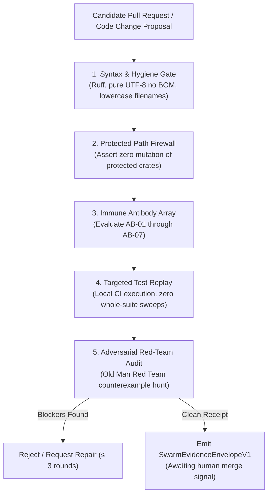

# 12. PR Review Formal Verification Loop & Adversarial Review Prompts

**AuthorityEffect:** `None`  
**Estate:** `omega_engine_education/documentation/004_oepfp/docs/` (historically `ow/omega_engine_pfp_v0.2/04_pfp_cec/`, no longer present)  
**Parent Document:** [`README.md`](README.md)  
**Status:** Verification Loop Specification v3.0  

> **Current-source status (2026-10-20, pin `c419cc6beb`).** This page specifies a review loop; no single executable runs all five stages. What exists at the pin:
>
> | Element | Status |
> | --- | --- |
> | `SwarmEvidenceEnvelopeV1` | Written as `evidence_envelope.json` by the composite developer CLI [swarm_developer.py](../../../../omega_engine_pfp/entrypoints/cli/swarm_developer.py) (lines 484-560). There is no Python or Rust class of that name. |
> | Stage 3, antibodies AB-01 to AB-07 | Not implemented. No code defines them; the pre-genesis strand calls these names labels, not admitted antibodies (see [00](00_master_synthesis_and_cartography.md)). |
> | Stage 5, Old Man Red Team | A skill, `omega-old-man-red-team`, exists in the host skill roots; `AuditFindingV1` appears only in skill-operad JSON catalogs, not as a code type. |
> | Session prompts in section 4 | They name `packetization/*.md`, `symbol_game_math_spine.md` and `ow/pfp/3_code/`, none of which is present. Before using a session prompt, substitute current files, for example [04](04_symbol_game_architecture.md), [11](11_mss_n_machine_wire_registry.md) and the PFP application `omega_engine_pfp/`. |

---

## 1. Automated Adversary & PR Verification Architecture

To enforce absolute integrity over autonomous code contributions, every Pull Request (PR) must pass through the **PR Review Formal Verification Loop (v3)**:



---

## 2. The Five Verification Stages

### Stage 1: Syntax & Mechanical Hygiene
* **BOM Cleanliness:** Source files, markdown, and JSON must be UTF-8 without Byte Order Mark (`\xef\xbb\xbf`).
* **Lowercase Filename Invariant:** All files must use strictly lowercase alphanumeric names, dashes, and underscores (`[a-z0-9_.-]+`). The only allowed uppercase filename is `README.md`.
* **Zero Linter Warnings:** Zero tolerance for unused imports (`F401`), unused variables (`F841`), or import sorting violations (`I001`).

### Stage 2: Protected Path & Sovereign Boundary Firewall
* Asserts that candidate diffs do not touch protected paths (`omega_engine_governance/`, core Rust solver crates, planning manifests).
* Asserts inward clean architecture dependency: `domain/` must have zero imports from `use_cases/`, `infrastructure/`, or `frontend/`.

### Stage 3: Immune Antibody Gate Array
* Evaluates the diff against all 7 learned antibodies (AB-01 through AB-07). (Proposed: no implementation exists at the 2026-10-20 pin.)
* Verifies that no silent test skips (`@pytest.mark.skip`) or unverified mock passes were introduced.

### Stage 4: Targeted Local Test Replay
* Executes only targeted test files scoped to the active change (e.g. `py -3.12 -m pytest <specific_test>.py`).
* Strictly enforces the **No Whole-Suite Sweeps** directive.
* Enforces the **Zero GitHub Actions** directive: all verification executes locally.

### Stage 5: Adversarial Red-Team Audit (Old Man Red Team)
* An independent, read-only adversarial agent inspects the diff looking for:
  1. Boundary condition violations;
  2. Hidden ungrounded assumptions;
  3. Overclaiming in docstrings or summaries.
* Emits a typed `AuditFindingV1`. If blocking findings exist, routes back for bounded repair.

---

## 3. Pull Request Submission Checklist

Before requesting human review or merge signal, the proposing agent must assert:
* [ ] Task contract digest matches parent envelope.
* [ ] All modified files are strictly lowercase (except `README.md`).
* [ ] Pure UTF-8 without BOM confirmed on all edited lines.
* [ ] Scoped unit tests run and passed locally using `py -3.12`.
* [ ] Claim hygiene checked: zero forbidden hype verbs under Claim Hygiene Rule.
* [ ] `SwarmEvidenceEnvelopeV1` generated with `AuthorityEffect: None`.
* [ ] Branch pushed to dedicated feature branch; `origin/main` untouched.

---

## 4. Interactive Review Session Prompts (Claude Code & Swarm Audits)

The following structured prompts are executed during deep verification passes and automated swarm audits. Each session builds upon the findings of the preceding one.


Drop CLAUDE.md into your project root. Then run these prompts inside Claude Code in order. Each builds on what Claude learned from the previous one.

## Session 1: Operator Algebra Deep Review

```text
Read these files in order:
1. 04_symbol_game_architecture.md
2. packetization/operator_classification_packet_v001.md
3. symbol_game_math_spine.md (specifically Part II: Operator Growth and Classification)

These define the E/I/C/R/M operator algebra for the Symbol Game. The claim is that every 
obstruction from the packetization pipeline maps to exactly one class, 
composition compresses to length <= 4, and the algebra tracks state via the 
S(n) context sequence.

Verify:
1. Does the classification priority rule (M -> R -> C -> E -> I -> M_fallback) actually partition 
   all possible declared actions? Find a counterexample or evaluate exhaustion.
2. Is the composition table (§4.5 of symbol_game_math_spine.md) sound? Check each 
   rewrite rule against the mathematical definitions (E: expansion, I: internal permutation, 
   C: boundary contraction, R: redundancy elimination, M: stationary refusal), not just the stated claims.
3. How do operator classification packets (packetization/operator_classification_packet_v001.md) mechanically 
   enforce the five effect-classes on finite token payloads without relying on LLM self-certification?
4. The S(n) context hierarchy forces lifts when context embeddings produce witnesses 
   no existing operator can resolve (e.g. S(0) -> S(1) -> S(2)). Is this well-founded? Can it loop?
5. Which results are PROVED vs CONDITIONAL? Are the conditions stated 
   precisely enough to be checkable by the verifier?

```

## Session 2: Packetization Pipeline & Verification

```text
Read these files:
1. packetization/packetization_algorithms.md
2. packetization/packetization_runtime_architecture.md
3. packetization/packetization_symbol_payloads.md

These define the Symbol Game packet system. The pipeline is:
prose -> envelope -> symbol payload -> LLM -> response -> parser -> validator -> terminalizer

Verify:
1. Trace the full chain for one concrete packet family (LP primal-dual). 
   At every stage, what data exists? What can go wrong? How is each 
   failure detected?
2. Where in this pipeline does obstruction detection happen? Where does 
   operator classification happen? Is the connection to the operator 
   algebra explicit or implicit?
3. The hostile test families (runtime_architecture §4) -- do they cover 
   all failure modes declared in the packet algorithms? Find gaps.
4. The authority ceiling mechanism -- does it correctly bound what each 
   terminal status can claim? Can a Certificate be emitted for something 
   that should be OracleNeeded?
5. Design the trait surface that connects packetization output to the 
   operator algebra input. What crosses this boundary?

```

## Session 3: Symbol Game Sovereign Rust Implementation

```text
Now read all Rust source files in the Symbol Game crates:
- omega_engine/crates_rs/omega_symbol_game/src/
- omega_engine/crates_rs/omega_symbol_game_runtime/src/
- ow/pfp/3_code/  (historical path; not present at the 2026-10-20 pin)

Map every Rust trait and struct to its corresponding mathematical object 
in the Symbol Game specification:

1. Does the Rust type structure faithfully encode the packet grammar, 
   operator algebra, and S(n) state tracking?
2. Are compile-time invariants (trait bounds, type-state) actually 
   enforcing the mathematical invariants, or are they runtime checks 
   pretending to be static?
3. Where is the Rust weaker than the math? Where does the math promise 
   something the Rust cannot enforce?
4. Where is the Rust stronger -- enforcing something the math doesn't 
   require?

Output a trait-to-math mapping table and a gap analysis for the Symbol Game.

```

## Session 4: Proposal Generator Boundary & Authority Ceilings

```text
Review the Symbol Game as a Proposal Generator Boundary (Proposal Fidelity Protocol):

1. The Symbol Game operates under AuthorityEffect: None (ae0). 
   Verify that untrusted generation cannot mint authority, advance evidence 
   ceilings, or self-certify correctness.
2. Verify the Refusal Monad (ref<1..6>): are syntax violations, authority 
   overclaims, physics overclaims, continuum imports, illegal quotients, 
   and unsupported uniqueness claims strictly trapped and halted?
3. Evaluate Local vs Global Verification: verify that local step validity 
   (LocalGreen) does not automatically imply global boundary validity 
   (GlobalGreen). Ensure false-green traps produce Refusal receipts.
4. Examine the stationary refusal law: verify that typed refusal M preserves 
   state identically (before_state = after_state) and that no automated 
   agent is permitted to perform unauthorized carrier surgery.
```

## Session 5: Final Symbol Game Consolidation

```text
You have now reviewed:
- The operator algebra and S(n) context tracking (Session 1)
- The packetization pipeline and validation gates (Session 2)
- The Rust implementation of the Symbol Game (Session 3)
- The proposal generator boundary and refusal monads (Session 4)
- The public API surface and execution pipeline (Session 5)

Produce a single document: SYMBOL_GAME_CONSOLIDATION_REPORT.md

Structure:
1. Architecture status: what's built, what's missing, what's broken
2. Mathematical status: proved, conditional, conjectural claims
3. Pipeline & Runtime status: packet envelopes, parsers, validators, terminalizers
4. API plan: MVP endpoints, first packet families, certificate format
5. Risk register: what can go wrong, ordered by impact x likelihood
6. Key milestones: immediate required fixes vs deferred research items
7. The one sentence that captures the whole system: "The Symbol Game turns unconstrained natural-language generation into typed obstruction flows, classifies every admissible resolution into E/I/C/R, halts on stationary refusal M, and certifies valid traces without conferring unearned authority."

The report must be actionable. Every finding must have a concrete next step.

```
