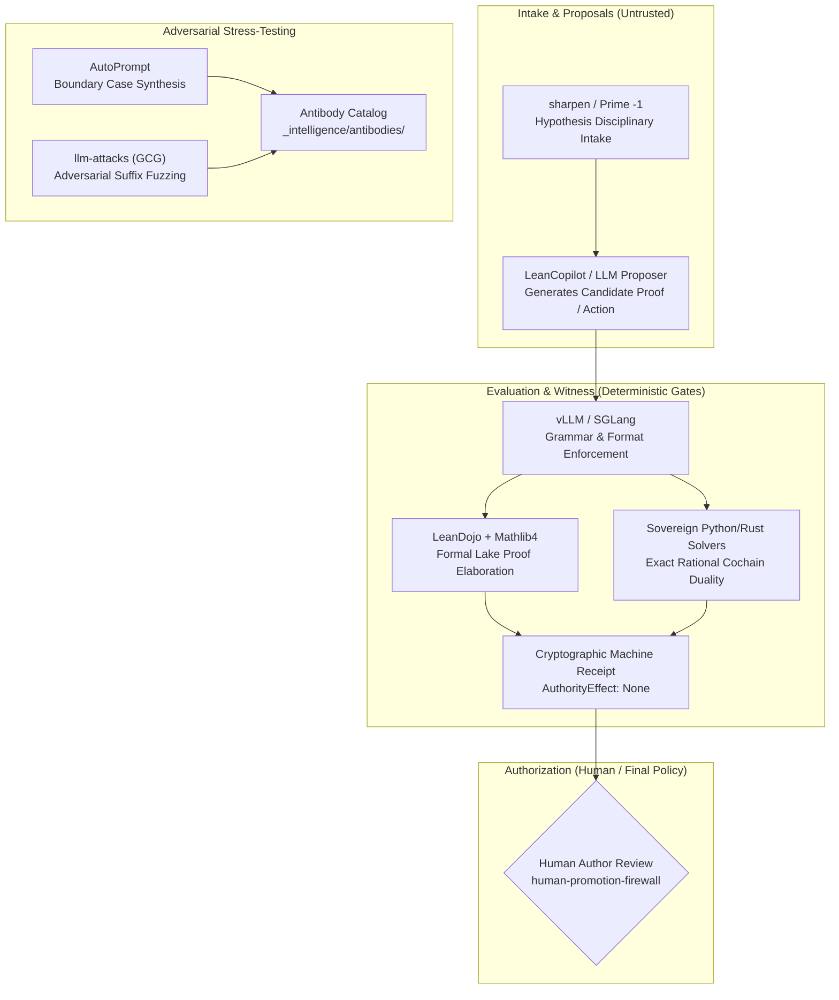

# 15. Comparative Tooling & External Repository Evaluation

**Status:** Canonical Reference Manual  
**AuthorityEffect:** `None`  
**Governing Standard:** Landau Theoretical Minimum & Claim Hygiene Rule  

---

## 1. Executive Summary & Four-Axis Architectural Demarcation

External tooling cannot cross layer boundaries or self-certify correctness. In the **Proposal Fidelity Protocol (PFP)**, all execution is structured along four strictly decoupled axes:

$$\boxed{\text{Proposal (Untrusted)} \longrightarrow \text{Evaluation (Deterministic Gate/Solver)} \longrightarrow \text{Witness (Cryptographic Receipt)} \longrightarrow \text{Authorization (Human/Policy Gate)}}$$

External repositories and community frameworks often combine proposal generation with unverified consensus, claim automated hallucination prevention, or mistake syntactic validation for semantic proof. Under PFP invariants:
1. **Generative models propose; they do not certify.**
2. **Multi-agent voting is a hypothesis topology, not an evaluation oracle.**
3. **Format compliance (valid JSON / EBNF) does not entail mathematical validity.**
4. **Gates must live in sovereign, tested code, never in prompt prose.**

Below is an evaluation of external GitHub repositories identified as potentially relevant to PFP, analyzing their concrete mechanisms, PFP axis mappings, and failure modes.

> **Inventory correction (2026-10-20).** Earlier text said 13 repositories. The tables below name 18 projects: Mathlib4, LeanDojo-v2, LeanCopilot (section 2); CivAgent, CatDock, CEO, AgentCiv (section 3); sharpen, AutoPrompt, gpt-prompt-engineer, TheBigPromptLibrary, DAIR Prompt-Engineering-Guide (section 4); vLLM, SGLang, LLMLingua, Representation Engineering, llm-attacks, Prompt Guard via llama-cookbook (section 5). Counts per section: 3 + 4 + 5 + 6 = 18. None is pinned to a commit, and this page records reading of public descriptions, not inspected behavior; the [deep research prompt review](pfp_pciv_eis_llms_deep_research_prompt.md#pass-one-review-and-second-pass-research-prompt) asks for pinned versions before any integration.
>
> **Local paths (2026-10-20, pin `c419cc6beb`).** The `pilots/` tree named below has moved. `c041_lean4_finite_lemma_proofs` is now under [`omega_engine_pfp/tests/demo_004/e_formal_math/`](../../../../omega_engine_pfp/tests/demo_004/e_formal_math/c041_lean4_finite_lemma_proofs.md). Directories `pilot_0000045` and `pilot_0000046` exist under `omega_engine_woland/tests/pilots/`, but their current READMEs describe other experiments (intrinsic triangle fans and an offline Hodge slice), not "unknown filtration inputs" or "prompt compression information loss"; the pilot bindings below are historical proposals. `_intelligence/` is not present; intelligence records now live under `_ic/` (for example `_ic/antibodies/antibodies_log.md`). `omega_engine_operations/use_cases/woland_bout/` is not present.

---

## 2. Formal Proof Tooling: Mathlib4, LeanDojo, and LeanCopilot

Formal theorem proving provides the mathematical backbone for PFP's obstruction evaluation.

| Repository | PFP Axis | Mechanism | Concrete Utility in PFP | Failure Mode / Boundary Fence |
|---|---|---|---|---|
| **[Mathlib4](https://github.com/leanprover-community/mathlib4)** | **Evaluation Substrate** | Homological algebra, chain complexes, simplicial sets, Dold–Kan correspondence. | Standardizes PFP definitions. Instead of writing standalone custom definitions for discrete cochains, coboundary operators $d$, and chain complexes, binds them directly to Mathlib's `AlgebraicTopology` and `CategoryTheory`. | PFP operates in discrete, finite settings with explicit rational coefficients ($\mathbb{Q}$); Mathlib abstractions can introduce non-constructive axioms or classical logic (`Classical.choice`) unless audited via `lean4-axiom-audit`. |
| **[LeanDojo-v2](https://github.com/lean-dojo/LeanDojo-v2)** | **Evaluation Harness** | Programmatic environment extracting Lean ASTs, proof states, and tactic trees. | Plugs into the PFP automated research loop (`WF_RESEARCH_PFP`). Replaces fragile CLI parsing of `lake build` stderr with structured tactic-state transition graphs. | Heavy dependency footprint; must run hermetically without requiring external network calls during local CI runs. |
| **[LeanCopilot](https://github.com/lean-dojo/LeanCopilot)** | **Proposer Only** | LLM-assisted tactic suggestion and premise retrieval. | Acts strictly as an automated **Proposer**. It suggests candidate proof tactics; the sovereign Lean 4 kernel evaluates them. | Must carry zero authority. A proposed tactic is an untrusted string until accepted by the proof kernel. |

### Concrete Pilot Binding
In `pilots/demo_004/e_formal_math/c041_lean4_finite_lemma_proofs/` (now [`omega_engine_pfp/tests/demo_004/e_formal_math/c041_lean4_finite_lemma_proofs/`](../../../../omega_engine_pfp/tests/demo_004/e_formal_math/c041_lean4_finite_lemma_proofs.md)), connect a minimal obstruction lemma (discrete boundary vanishing on a toy 3-simplex) to Mathlib's chain complex typeclass.

---

## 3. Multi-Agent Governance & Org Simulators: CivAgent, CatDock, CEO Agent

Multi-agent coordination frameworks frequently simulate management hierarchies, committee votes, or role-playing personas. PFP rejects governance by role-play prompt: social consensus does not constitute mathematical evidence.

| Repository | PFP Axis | Mechanism | Concrete Utility in PFP | Failure Mode / Boundary Fence |
|---|---|---|---|---|
| **[CivAgent](https://github.com/LeoLin990405/civagent)** | **Bout Topology** | Configurable decision topologies (centralized, distributed, veto-bearing, jury-based). | Serves as an empirical test harness for the **Woland Adversarial Tribunal**. PFP can run identical proposals through different bout structures (direct evaluator vs. adversarial pair vs. 3-agent veto jury) to measure consensus distortion and refusal rates. | Social structures are hypotheses, not evaluators. A unanimous multi-agent consensus is not evidence of mathematical validity. |
| **[CatDock](https://github.com/CatDock/CatDock)** & **[CEO](https://github.com/ivfarias/ceo)** | **Memory Layout** | Hierarchical dispatch and durable cross-session team storage. | Inspect their disk-backed context stores to compare with PFP's `_intelligence/documentation/sessions/` and RFC 8785 canonical JSON envelopes. | Prompt-driven hierarchies tend to accumulate circular mutual agreements without fail-closed terminal states. |
| **[AgentCiv](https://github.com/agentciv/agentciv)** | **Coordination Experiment** | Simulated society where roles and governance emerge under resource constraints. | Useful for testing coordination under explicit token and communication bounds; distant from formal proof and receipt verification. | Self-reported project outcomes require independent replication before adoption. |

### Concrete Pilot Binding
In `omega_engine_operations/use_cases/woland_bout/`, implement a discrete CivAgent-style veto topology as a deterministic tournament configuration, testing whether a single adversarial prosecutor stops invalid proposals faster than a voting committee.

---

## 4. Prompt Optimization, Boundary Cases & Adversarial Search

Prompt engineering and automated optimization can improve task-specific alignment, but they operate as candidate proposal shapers, not verification oracles.

| Repository | PFP Axis | Mechanism | Concrete Utility in PFP | Failure Mode / Boundary Fence |
|---|---|---|---|---|
| **[sharpen](https://github.com/sazzadurrahmaan/sharpen)** | **Intake Sanitizer (Prime -1)** | Strips speculative assumptions, demotes user claims to testable hypotheses, requires acceptance criteria. | Direct conceptual counterpart to PFP's **Algorithm Prime -1 / Prime 000** sequence. Can serve as an intake linter that refuses vague research directives and forces explicit falsification conditions before execution. | It is a text prompt pattern, not an executable gate; its output must still be validated by schema parsers. |
| **[AutoPrompt](https://github.com/Eladlev/AutoPrompt)** | **Antibody Generator** | Iterative generation of difficult boundary cases against an intent spec. | Feeds the **PFP Antibody Library** and **Cemetery DAG**. Generates adversarial boundary cases (malformed payloads, subtle sign flips, zero-norm vectors) to test whether PFP checkers fail closed. | Evaluation drift: if the generator and judge share the same model family, they can form an ungrounded consensus loop. A separate held-out deterministic oracle is mandatory. |
| **[gpt-prompt-engineer](https://github.com/mshumer/gpt-prompt-engineer)** | **Heuristic Ranking** | ELO rating via blind pairwise LLM comparisons. | Provides heuristic ranking across model prompts for educational or explanatory prose (rewriting PFP lesson docstrings for pedagogical clarity). | ELO scores measure subjective preference, not semantic correctness or mathematical truth. Unusable as a gate. |
| **[TheBigPromptLibrary](https://github.com/0xeb/TheBigPromptLibrary)** & **[DAIR Guide](https://github.com/dair-ai/Prompt-Engineering-Guide)** | **Reference Catalog** | Curated collection of system prompts, custom instructions, and reference guides. | Reference material for discovering candidate adversarial jailbreaks and boundary patterns. | Archive entries may be stale or model-specific; unvalidated as reliable defense mechanisms. |

### Concrete Pilot Binding
Use AutoPrompt's boundary-search loop to construct 20 candidate edge cases targeting `Pilot 000045` (unknown filtration inputs; historical binding, see the path note above), adding the resulting failure receipts into `_intelligence/antibodies/`.

---

## 5. Inference Constraints, Token Pruning & Security Fences

Inference-time constraints operate at the transport and tokenization layers. They enforce grammatical syntax or reduce communication latency, but cannot verify semantic truth.

| Repository | PFP Axis | Mechanism | Concrete Utility in PFP | Failure Mode / Boundary Fence |
|---|---|---|---|---|
| **[vLLM](https://github.com/vllm-project/vllm)** / **[SGLang](https://github.com/sgl-project/sglang)** | **Transport / Syntax Gate** | Guided decoding (Outlines/Regex/EBNF) and high-throughput serving. | Enforces strict syntax at emission time for local model pilots (Symbol Game turn packets matching the EBNF grammar in [`grammar/`](../grammar/)). | Syntactic validity $\neq$ semantic validity. A well-formed RFC 8785 packet containing a false cochain certificate is still mathematically invalid. |
| **[LLMLingua](https://github.com/microsoft/LLMLingua)** | **Lossy Transport Probe** | Budgeted token pruning via small language model perplexity / mutual information. | Relevant to `Pilot 000046` (prompt compression information loss; historical binding, see the path note above). Can benchmark at what compression ratio mathematical proofs lose crucial premises or negation operators. | Highly dangerous if applied unmonitored to mathematical manuscripts or code: dropping a single minus sign or quantifier alters the theorem. Must remain behind a strict semantic preservation test. |
| **[Representation Engineering (RepE)](https://github.com/andyzouman/representation-engineering)** | **Research Direction** | Reading and steering population-level model representations. | Useful for open-model weight steering experiments; inapplicable to hosted API endpoints. | A steering vector is a behavioral intervention, not a mathematical invariant or formal safety guarantee. |
| **[llm-attacks (GCG)](https://github.com/llm-attacks/llm-attacks)** & **[Prompt Guard](https://github.com/meta-llama/llama-cookbook)** | **Adversarial Red Team** | Gradient-based adversarial suffix search and input classifier. | Stress-tests PFP intake firewalls. Evaluates whether adversarial suffixes embedded in untrusted external text can cause PFP agents to bypass gate checks or alter ledger files. | Model-specific; suffix attacks on Llama 2 do not directly translate to API-hosted frontier models. |

---

## 6. Priority Implementation Matrix for PFP

### Order of Highest Leverage:
1. **LeanDojo + Mathlib4**: High technical return for grounding PFP obstruction mathematics in standard homological algebra while replacing fragile subprocess stderr parsing with structured proof-state transitions.
2. **AutoPrompt**: Immediate utility for generating edge-case fixtures and antibodies against the PFP pilot suite (Pilots 000041–000046).
3. **sharpen**: Lightweight conceptual intake pattern to enforce hypothesis framing and explicit verification criteria before running research bouts.
4. **vLLM / SGLang (Grammar Decoding)**: High utility only if running local inference clusters to enforce Symbol Game EBNF syntax at token generation time.

---

## 7. Claim Hygiene Compaction Envelope

1. **What this evaluation supports:**
   - Supports adopting LeanDojo for structured proof-state extraction and Mathlib4 for standardizing homological algebra definitions.
   - Supports utilizing AutoPrompt as an adversarial test generator to farm candidate failure cases for the antibody repository.
   - Supports treating token-level format enforcers (vLLM) and prompt-intake rewriters (sharpen) strictly as preflight formatting or proposal tools, not as verifiers or authorities.

2. **What this evaluation does not support:**
   - Does not support claims that prompt optimization techniques eliminate hallucinations or establish mathematical correctness.
   - Does not support using multi-agent voting (CivAgent, CatDock, CEO) as a substitute for sovereign, compiled gate verifiers.
   - Does not support applying unconstrained lossy compression (LLMLingua) to mathematical proofs or formal specifications.

3. **Narrowest defensible claim:**
   - Several of the cataloged tools provide actionable components for proposal generation, boundary testing, and grammar containment, provided each tool is strictly confined to its declared layer and verified by independent deterministic evaluators.

4. **Next test needed:**
   - Benchmark a discrete homological lemma in `c041_lean4_finite_lemma_proofs` using Mathlib4 chain complex definitions, recording the resulting axiom census via `lean4-axiom-audit`.
