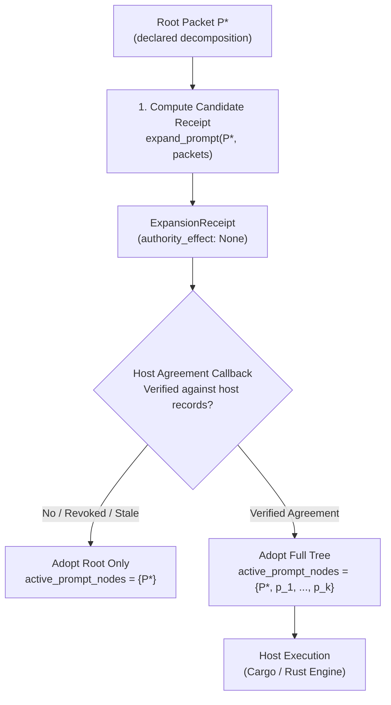

# 21. Prompt Template Contracts, Containment Law & Single Prompt Standard ($P \mapsto P^* \to \{p_i\}$)

For the finite-QM prompt template, staged workflow, execution mode and attached
LLM techniques, see the
[finite-QM reference workflow](22_unified_pfp_v4_operad_workflow_and_hacks.md).
That candidate profile reuses the shared task-turn envelope; it does not rename
this page's packet contracts or the existing numbered stage machine.

**AuthorityEffect:** `None`  
**Governing Standard:** Containment Law, Template Integrity, External Verification Gateway  
**Document Status:** Adopted Canonical Specification & Architectural Monograph  
**Sibling Monograph:** [`06_prompt_packet_stage_synthesis.md`](06_prompt_packet_stage_synthesis.md)  
**Implementation Modules (historical; not present at the 2026-10-20 pin):**
- Builder `p_star_builder.py`, runtime `runtime.py`, expansion tree `tree.py`, adapters `adapters.py` and migration `migration.py`. The paths given here earlier, under `omega_engine_pfp/infrastructure/prompt_templates/` and `omega_engine_pfp/domain/prompt_templates/`, have no commit in Git history. Modules with these names lived under `omega_engine_education/pfp/python/` and were deleted on 2026-10-10 in commit `e6537cc3cf` ("Retire PFP detritus..."), together with `tests/test_p_star_builder.py`.
- Current code: a word search of tracked Python and Rust finds no definition of `build_p_star`, `expand_prompt`, `ExpansionReceipt`, `assert_cardinality_law`, `render_response_schema`, `active_prompt_nodes` or `UNRESOLVED_CHILD_PACKET`. `PromptPacketV0_1`, `SubpromptSlot` and the `expand_prompt` contract survive as YAML schema text in [template_schema_models.yaml](../../../../omega_engine_pfp/infrastructure/yaml/prompts/schemas/template_schema_models.yaml) and `template_schema_types.yaml`; `max_depth: 5` is in `template_schema_containment.yaml`.
- So this page specifies the containment law and its YAML contracts; at the pin no executable checker enforces the law. Sections 2 to 6, 9 and 10 below describe that retired implementation.
- Prompt Templates: [`../../../../omega_engine_pfp/infrastructure/yaml/prompts/templates/`](../../../../omega_engine_pfp/infrastructure/yaml/prompts/templates/)
- Schemas: [`../../../../omega_engine_pfp/infrastructure/yaml/prompts/schemas/`](../../../../omega_engine_pfp/infrastructure/yaml/prompts/schemas/)
- Representations: [`../../../../omega_engine_pfp/infrastructure/yaml/prompts/reprs/`](../../../../omega_engine_pfp/infrastructure/yaml/prompts/reprs/)

---

## 1. Executive Overview & Problem Statement

Prompt engineering across complex multi-stage pipelines frequently suffers from semantic drift, informal envelope representations, and ad-hoc generation tracking. In earlier iterations of the Proposal Fidelity Protocol (PFP) and Symbol Game repositories, prompt assets were fragmented across sequential markdown stages (such as the legacy 8-stage sequence in `9_archive/symgame_v0/1_foundational_run/`), unvalidated YAML envelopes, and isolated demo seeds.

These legacy formats exhibited several recurring failure modes:
1. **Metadata-as-Policy Drift:** Structural invariants (such as fixed glyph counts and policy stamps) were treated as descriptive metadata rather than schema-enforced constraints.
2. **Lineage Incoherence:** Parent-child relationships, decomposition containment, and repeated runtime executions were conflated into flat parent/child lists, obscuring crossover and ancestry.
3. **Prose vs. Machine Drift:** Discrepancies between human-readable instruction templates and machine-validated output JSON schemas allowed model outputs to diverge from parser expectations.
4. **Antibody Conflation:** Learned immune defenses and antibody strings were attached without repository admission records, independent threat evaluations, or custody tracking.

The **Single Prompt Standard** unifies prompt ingestion, decomposition, execution, and verification under a single architectural contract:

$$P \mapsto P^* \to \{p_i\}_{i=1}^k$$

1. An untrusted seed stimulus $P$ enters the protocol (from raw text, external stimulus, or a seed file).
2. The orchestrator constructs root prompt $P^*$ as an envelope conforming to `PromptPacketV0_1` (schema `2.0.0`, `authority_effect: None`).
3. Root prompt $P^*$ decomposes into an ordered list of subprompts $\{p_i\}_{i=1}^k$ forming a directed tree $T = (V, E)$.
4. **Generation Invariance:** Root prompt $P^*$ and all decomposed subprompts $p_i$ share the identical `generation_id` because they originate in the same co-generation decomposition event.
5. **Parent Lineage Invariant:** $P^*$ is declared as the first parent in each child $p_i$'s lineage (`parents[0].prompt_id == P*.prompt_id`, with `relationship == "decompose"`).
6. **Root Ancestry Invariant:** $P^*$ is registered in each child's `root_prompt_ids`.
7. **Containment Cardinality Law:** Total tree node count satisfies:
   $$\text{cardinality}(n) = 1 + \sum_{c \in \text{children}(n)} \text{cardinality}(c)$$

### Epistemic Demarcation: Prompt Packets vs. Host Packets

As established in [`06_prompt_packet_stage_synthesis.md`](06_prompt_packet_stage_synthesis.md), prompt packets (`PromptPacketV0_1`) are **envelopes around untrusted prompt text and instructions**. They are distinct objects from host packets:
- **Prompt Packet:** Carries task instructions, decomposition slots, system policies, and untrusted stimuli. Its generation carries `AuthorityEffect: None`.
- **Host Packet:** A cryptographic RFC 8785 canonical JSON envelope (`omega.symbol-game.packet-envelope.v2`) submitted to sovereign Rust execution engines and verifiers.

---

## 2. Mathematical Contract & Formal Invariants

Let $P$ denote the untrusted input stimulus. The mapping $\mathcal{B}: P \mapsto (P^*, \{p_i\}, \mathcal{R}_T)$ operates under strict constraints:

### Invariant 1: Envelope Typing
$P^*$ and every child $p_i$ are valid instances of `PromptPacketV0_1` (schema `2.0.0`, `authority_effect: None`). Unknown root fields are rejected.

### Invariant 2: Lineage and Co-Generation Identity
For root $P^*$ and child subprompts $p_i \in \{p_1, \dots, p_k\}$:
- $P^*.\text{lineage}.\text{prompt\_id} = \text{ID}(P^*)$
- $P^*.\text{lineage}.\text{generation\_id} = g \in \mathbb{N}_0$
- $P^*.\text{lineage}.\text{mutation\_kind} = \text{"root\_seed"}$ (or prior lineage mutation kind if derived)
- For every child $p_i$:
  - $p_i.\text{lineage}.\text{generation\_id} = g$ (identical to $P^*$)
  - $p_i.\text{lineage}.\text{mutation\_kind} = \text{"decompose"}$
  - $p_i.\text{lineage}.\text{parents}[0] = \text{ParentPrompt}(\text{prompt\_id}=\text{ID}(P^*), \text{generation}=g, \text{relationship}=\text{"decompose"})$
  - $\text{ID}(P^*) \in p_i.\text{lineage}.\text{root\_prompt\_ids}$

### Invariant 3: Source Content Integrity
The root's incoming text is bound in $P^*.\text{source}$ with an exact SHA-256 digest (`sha256:...`). Each child $p_i$ binds its own localized slice or text in $p_i.\text{source}$ with a corresponding SHA-256 digest, while referencing the source field in $P^*$ via `source_field = "user_prompt.audit_elements.i"`.

### Invariant 4: Decomposition Slot Agreement
When $P^*$ declares subprompts ($k \ge 1$):
- $P^*.\text{decomposition}.\text{splitter} = \text{"declared"}$
- $P^*.\text{decomposition}.\text{subprompts}$ contains $k$ contiguous, zero-indexed `SubpromptSlot` entries.
- Ordinals satisfy $o_i = i$ for $i \in \{0, \dots, k-1\}$.
- When $k = 0$, $P^*.\text{decomposition} = \text{null}$, yielding a single leaf node ($|T| = 1$).

### Invariant 5: Cardinality Verification
Evaluation of `expand_prompt(P*, packets={p_i})` produces an `ExpansionReceipt` $\mathcal{R}_T$. The receipt satisfies:
$$\text{cardinality}(T) = 1 + \sum_{i=1}^k \text{cardinality}(p_i)$$
Any mismatch between declared node references and actual packet instances fails closed with `DERIVED_FIELD_MISMATCH` or `UNRESOLVED_CHILD_PACKET`.

---

## 3. The Containment Law & Expansion Tree Architecture

For a successfully validated expansion tree $T$:

$$\text{cardinality}(n) = 1 + \sum_{c \in \text{children}(n)} \text{cardinality}(c)$$

### Structural Rules

1. **Leaf Invariant:** $|T| > 1$ if and only if the root has nonempty declared `decomposition.subprompts`. Absent decomposition or `splitter: none` with an empty list yields one leaf ($|T| = 1$). A refusal is evaluated as a single leaf. Headings, questions, models, audit elements, sections, family members, antibodies, and runs do not create children automatically.
2. **Expansion Receipts without Execution:** `expand_prompt(packet, max_depth=5)` computes an `ExpansionReceipt`; it does not run prompts. Cardinality is absent from template seeds. A stored receipt with an incorrect count fails `assert_cardinality_law` with `DERIVED_FIELD_MISMATCH`. Every node carries `authority_effect: None`; the receipt carries `evidence_effect: None`.
3. **SubpromptSlot Contract:** A `SubpromptSlot` declares:
   - `slot_id`: Local string identifier.
   - `role`: Role string assigned to the subprompt execution.
   - `source_field`: Resolvable dotted path to the source field in the parent packet.
   - `ordinal`: Zero-based integer index. Ordinals must be ordered and contiguous ($0, 1, \dots, k-1$).
   - `packet_id`: Optional identifier for an existing child packet.
4. **Integrity and Cycle Defense:** A referenced child owns its own decomposition. Its original text must match the parent's declared source-field text. A cycle, unresolved child, depth breach (`depth > max_depth`), or node-budget breach produces an error, not an extra tree node. Reusing identical content in two distinct slots yields two occurrences; it does not invent two genome identities.
5. **Response and Antibody Slots:** Response sections require both `expands_to_subprompt: true` and a matching slot. Antibody insertions require an explicit slot with `role: antibody` to count as children. Family size and tree cardinality are completely independent metrics.

### Two-Stage Lifecycle: Candidate Computation vs. Agreement Adoption

Containment evaluation strictly separates proposal inspection from execution permissions:



1. **Compute Candidate Receipt:** Explicit declarations suffice. This allows static linting, schema validation, and PR review of the expansion structure without executing any prompt.
2. **Adopt Child Prompts:** Populating `active_prompt_nodes` requires an external agreement reference verified by a host callback against the exact computed proposal and source. Without verified agreement, only the root $P^*$ is active. A stale, revoked, mismatched, or self-authored agreement fails closed. Agreement adopts the declared tree; execution remains strictly the domain of the host engine.

---

## 4. Architecture Refactor & Defect Remediation

During the unversioned prompt refactor (PR #1056), seven core failure modes in the legacy prompt stack were audited and remediated:

| Finding in Legacy Stack | Remediation in Single Prompt Standard |
|---|---|
| `slot: fixed` was treated as informational metadata. Changing `atomic_glyph_count` from 38 to 39 still passed the Python model. | Constants are strictly enforced by both the generated Python model and structural JSON Schema. Policy `SPK-001` content is preserved as a declared immutable constraint. |
| Python accepted an omitted `lineage`; the JSON Schema required the key. | Structural schemas are derived directly from the generated Python models, with declared cross-field constraints. Both validators are tested in parity. |
| A required, empty `seed_sections` list made an otherwise ordinary leaf node invalid. | The list is optional. Empty sections and audit lists are valid. Non-empty seed lists are rejected by explicit template-mode validation. |
| `"true\|false"` was used as a response placeholder string, causing type confusion with actual booleans. | Descriptors are preserved in the template; actual answers are strictly validated with `PromptResponse`, `render_response_schema`, and `validate_response`. |
| Single parent and child lists could not represent crossover, containment, and repeated execution coherently. | Mutation ancestry uses `parents` and `root_prompt_ids`; containment uses `decomposition`; executions use occurrence records. `decompose` is a distinct mutation kind. Family membership remains `family_name`. |
| Antibody text and an `active` label lacked repository admission, independent-danger, fixture, and custody tracking. | Candidates, insertion requests, and guard evidence are separated. Candidates cannot self-admit. Insertion requires an external host verification port. |
| Prose templates and hand-written output examples could drift over time. | Rendered `template_single_slot.yaml` is generated from the typed packet. It retains exactly one `[USER PROMPT]` slot. The response schema string embeds a machine schema for typed outputs. |

---

## 5. Repository Data Coverage & Subsystem Boundaries

The prompt standard carries data bindings across three major repository subsystems while enforcing clean architectural separation:

| Subsystem | Data Carried in Prompt Packets | Authoritative Subsystem Owner |
|---|---|---|
| **OEWAS** (Workflow & Autopoiesis) | Pinned workflow, catalog, and composition references; agents, skills, and anti-skills; operation snapshots; colored ports; schema and validator digests; lifecycle facets; ordered steps and dependencies; gate, mode, and numbered-stage references. | `OperationV3`, `PortSpecV3`, lifecycle value objects, and `domain/workflow_graph.py`. The prompt adapter projects the planar workflow declaration. OEWAS owns composition validation and catalog indexing. |
| **Prompt Civilization** | Immutable source references; multi-parent ancestry; declared domain; protected source spans; Wild birth tags; genome reference; custody view and ledger revision; domain placement; population, rank, fitness, cemetery, and genealogy references; separate execution occurrences. | `PromptGenomeV1`, `PromptViewV1`, `DomainPlacementV1`, `ExecutionOccurrenceV1`, and persistent ledgers. Views and ranking do not create or alter prompt identity. |
| **OEEIS** (Immune System) | Candidate pharmacy records; positive/negative fixtures; reproduction references; insertion requests; separate admission, detector hit, danger, activation, and custody references; self-panel, holdout, quarantine, retirement, and propagation references. | Pharmacy farm, admission, and guard-activation modules. A schema-valid reference does not constitute authenticated evidence, independent danger, admission, or execution permission. |

### Architectural Fences

1. **Python Role:** Python modules handle contracts, serialization, validation, tree calculation, and adapters. They do not implement mathematical solvers, immune gates, custody databases, or host execution engines.
2. **Budget Enforcement:** Token, call, and cost budgets recorded in prompt envelopes are specifications. Presence in YAML does not make it an enforced budget; sovereign host runtimes enforce limits across all children and retries.
3. **Artifact Integrity:** `ArtifactRef` pins an artifact ID, schema reference, and SHA-256 digest. URIs are informational and never fetched during contract evaluation. Unknown root fields fail validation.

---

## 6. Verification Findings & Corrections to Grok

The regression suite exercises constants, empty leaves, boolean responses, declared trees, source digests, migration, host agreement, and insertion boundaries.

| Test Case | Computed Cardinality | Structural Rationale |
|---|---|---|
| Retrieved `seed_prompt.md`, no declaration | 1 | Single leaf node; `decomposition: null` |
| Retrieved golden `prompt.yaml`, no declaration | 1 | Single leaf node; `decomposition: null` |
| Synthetic section declaration with 3 children | 4 | $1 + 3 = 4$ |
| Synthetic root $\to$ child $\to$ grandchild | 3 | $1 + 1 + 1 = 3$ |
| 3 sections, with 12 element children under elements section | 16 | $1 + 3 + 12 = 16$ |

### Pinned Golden Fixture Correction
Historical Grok evaluation suggested a cardinality of 18 for the nested golden prompt. Analysis of the pinned golden `prompt.yaml` confirms it declares **12** audit elements ($E_0 \dots E_{11}$). Under three sections, the exact cardinality is:

$$\text{cardinality}(T) = 1 + 3 + 12 = 16$$

Worked recursion. Call the three sections $s_1, s_2, s_3$ and put the twelve element children under $s_2$. Each element is a leaf, so cardinality$(E_j) = 1$. Then cardinality$(s_2) = 1 + 12 \cdot 1 = 13$, cardinality$(s_1) = $ cardinality$(s_3) = 1$, and the root gives $1 + (1 + 13 + 1) = 16$. Each node is counted once, at the level where it is declared. The builder example in section 9 is the same law with one level: $1 + 8 \cdot 1 = 9$ nodes, of which 8 are leaves.

Eighteen would require 14 element children or two additional explicitly declared nodes. No split was applied to the repository fixtures.

### Policy and Telemetry Demarcation
Golden `prompt_result_001.md` stamps `derived_under_policy: SPK-002` beside `packet_id: SPK-001`. A confidence field, where present, requires a separate telemetry scope. Demo 001's round-1 result parses as YAML under `SPK-001`. The linter reports failure without silently repairing documents. Confidence checks are scoped hygiene heuristics, not general semantic detectors. Lean fragments in golden prompts remain explicitly F0 syntactic sketches; no Lean theorem verification is performed by prompt adapters.

---

## 7. Policy Manifest, System Prompt Fences & Response Schema

Every generated $P^*$ root envelope embeds the immutable `SystemPrompt` containing:

### 1. Semantic Policy Manifest (`SPK-001`)
- **Policy ID:** `SPK-001`
- **Mandatory Response Stamp:** `derived_under_policy: SPK-001` in all model responses.

### 2. MSS-0 Grammar Constraint
- **System Name:** `SYM SYS`
- **Atomic Glyph Count:** 38 (labels $a..z$, numeric $0..9$, delimiters $\langle$, $\rangle$).
- $\langle\rangle$ is explicitly a 2-glyph pair, not an additional atomic glyph.
- Numeric labels require explicit semantic licenses for arithmetic or weight interpretations.

### 3. Operator Semantics (Layer 1)
- Syntactic binary operators only.
- Forbidden unlicensed interpretations: arithmetic, multiplication, tensor product, boundary, coboundary, causality, optimization, physical transition.

### 4. MSS-0 Topological Typing Hierarchy
- **Level 1:** $N$ (Node / 0-simplex)
- **Level 2:** $L$ (Edge / 1-simplex)
- **Level 3:** $C_2$ (Cycle / 1-chain closed loop; strictly distinct from filled region)
- **Level 4:** $F_1$ (Face / 2-simplex / triangle; strictly requires declared 2-cell)
- **Level 5:** $M_1$ (Mass / topological lock; requires LockStructure, ObstructionClass, ConstraintInvariant)
- **Level 6:** $H_1$ (SelfModel / recursive locus)

### 5. Evaluator Scope Rule
Evaluator receipts promote only the claim type directly tested:
- `cargo test`: Promotes implementation behavior; does not promote mathematical truth.
- `SymPy`: Promotes symbolic calculation; does not promote empirical reality.
- `Lean 4`: Promotes formal theorem validity relative to stated axioms; does not promote physical claims.
- Confidence scores: Promote nothing.

### 6. Claim Hygiene Discipline
- **Forbidden vocabulary:** Adheres to the barred promotional terms cataloged in `RULE[user_global]` (e.g., claims of unconditioned proof, universality, or infallibility without bounded formal proof receipts).
- **Default posture:** Prefer narrow claims over broad claims. Do not promote speculative ideas into theorems.


### 7. Machine Response Schema (`PromptResponse`)
Model responses to $P^*$ or any $p_i$ must conform strictly to `PromptResponse`:

```yaml
derived_under_policy: SPK-001
summary:
  narrowest_defensible_thesis: "<Single narrow defensible thesis statement>"
  evidence_scope: "<Exact evidence scope, model, and evaluator bounds>"
  next_concrete_test: "<Specific falsifiable test to execute next>"
sections: []
process_integrity:
  seed_allows_theory_refutation: true
  detected_prompt_biases: []
  should_continue: true
```

Responses failing this schema were rejected by `validate_response()` in the retired `runtime.py` (historical; see the module note at the top).

---

## 8. Canonical Unversioned Template Inventory

Following PR #1056 and PR #1058, all prompt YAML assets adhere to the unversioned naming rule `template_<slug>.yaml` with $\text{len}(\text{slug}) \le 20$. Version history is maintained in Git rather than on-disk version directories.

### 8.1 Runtime Templates (`omega_engine_pfp/infrastructure/yaml/prompts/templates/`)

| File | Slug (Length) | Contract Role & Scope |
|---|---|---|
| `template_operad_compressed.yaml` | `operad_compressed` (17) | 3-Layer compact operad prompt template (Environment, TreeSkeleton, SpanTable). |
| `template_operad_categorical.yaml` | `operad_categorical` (18) | Category-theoretic multicategory operad prompt template (colours, operators, operands, grafting, ideals, annihilators). |
| `template_p_star_family.yaml` | `p_star_family` (13) | Compiled $P^*$ root prompt family template envelope (`mutation_kind: root_seed`). |
| `template_p_subprompt_family.yaml` | `p_subprompt_family` (18) | Compiled $p_i^*$ child subprompt family template envelope (`mutation_kind: decompose`). |
| `template_single_slot.yaml` | `single_slot` (11) | Runtime single-slot template with one `[USER PROMPT]` placeholder and response schema. |
| `template_typed_contract.yaml` | `typed_contract` (14) | Authoritative typed contract carrying containment, slot metadata, and lineage. |
| `template_standard_base.yaml` | `standard_base` (13) | Base interface template defining `SPK-001` manifest and MSS-0 grammar rules. |
| `template_pfp_t0001.yaml` | `pfp_t0001` (9) | Stage 1 Single-Shot prompt role template (`PFP-T0001`). |
| `template_pfp_t0002.yaml` | `pfp_t0002` (9) | Stage 2 Public Workpad prompt role template (`PFP-T0002`). |
| `template_pfp_t0003.yaml` | `pfp_t0003` (9) | Stage 3 Final-From-Workpad prompt role template (`PFP-T0003`). |
| `template_pfp_r0001.yaml` | `pfp_r0001` (9) | Recipe configuration template (`PFP-R0001`). |
| `template_role_registry.yaml` | `role_registry` (13) | Canonical role registry mapping prompt roles, recipes, and cryptographic bindings. |

### 8.2 Formal Schemas (`omega_engine_pfp/infrastructure/yaml/prompts/schemas/`)

| File | Slug (Length) | Contract Role & Scope |
|---|---|---|
| `template_schema_prompt.yaml` | `schema_prompt` (13) | Raw prompt text schema and SHA-256 fingerprint envelope. |
| `template_schema_containment.yaml` | `schema_containment` (18) | Typed contract for prompt containment law and expansion limits (`max_depth = 5`). |
| `template_schema_models.yaml` | `schema_models` (13) | Formal schema specifications for prompt templates and expansion nodes. |
| `template_schema_types.yaml` | `schema_types` (12) | Shared type primitives for prompt roles, splitters, and mutation kinds. |

### 8.3 Representation Forms (`omega_engine_pfp/infrastructure/yaml/prompts/reprs/`)

| File | Slug (Length) | Representation Paradigm |
|---|---|---|
| `template_repr_raw.yaml` | `repr_raw` (8) | Raw verbatim prompt representation format. |
| `template_repr_structured.yaml` | `repr_structured` (15) | Structured prompt representation format with explicit sections. |
| `template_repr_relational.yaml` | `repr_relational` (15) | Relational prompt representation format with typed entities and relations. |
| `template_repr_symbolic.yaml` | `repr_symbolic` (13) | First-order symbolic expression format. |
| `template_repr_operadic.yaml` | `repr_operadic` (13) | 3-Layer compact operad prompt representation. |
| `template_repr_egraph.yaml` | `repr_egraph` (11) | Equational saturation e-graph normal form representation. |
| `template_repr_diagram.yaml` | `repr_diagram` (12) | Monoidal category planar string diagram representation. |
| `template_repr_cochain.yaml` | `repr_cochain` (12) | Simplicial complex and discrete differential form representation. |

---

## 9. Python Builder Implementation & CLI Workflows

### Python Builder Usage (historical)

The builder was implemented in `p_star_builder.py` (retired 2026-10-10, commit `e6537cc3cf`; the import path below does not resolve at the 2026-10-20 pin):

```python
from omega_engine_pfp.infrastructure.prompt_templates import SubpromptSpec, build_p_star

# 1. Define untrusted input seed P
seed_text = "Audit the 8 foundational derivation steps of SymSys."

# 2. Define decomposed subprompts {p_i}
subprompts = [
    SubpromptSpec(
        subprompt_id=f"P_STAR_STAGE_{i}",
        role="stage_auditor",
        text=f"Audit stage {i} derivation rules.",
        ordinal=i - 1,
    )
    for i in range(1, 9)
]

# 3. Construct P* tree
p_star, child_packets, receipt = build_p_star(
    seed_text=seed_text,
    prompt_id="P_STAR_FOUNDATIONAL_RUN",
    family_name="symgame_foundational_family",
    generation_id=0,
    author="pfp-orchestrator",
    subprompts=subprompts,
)

# Receipt certifies the containment law: |T| = 1 + 8 = 9
assert receipt.cardinality == 9
assert receipt.leaf_count == 8
```

### Operational CLI Commands (historical)

These commands do not run at the 2026-10-20 pin; the modules are retired. They are kept as a record of the earlier interface:

```bash
# Validate template typing against generated schema
python -m omega_engine_pfp.infrastructure.prompt_templates.runtime validate-template template_typed_contract.yaml

# Evaluate expansion tree and verify containment cardinality
python -m omega_engine_pfp.infrastructure.prompt_templates.runtime expand examples/declared_sections.yaml

# Evaluate expansion tree with child packets
python -m omega_engine_pfp.infrastructure.prompt_templates.runtime expand examples/nested_root.yaml --packets examples/child_packets.yaml

# Migrate legacy template while preserving origin hashes
python -m omega_engine_pfp.infrastructure.prompt_templates.migration legacy_template.yaml migrated.yaml \
    --prompt-file seed.txt \
    --prompt-id declared-packet-id \
    --author Orchestrator \
    --created-at-utc 2026-10-15T12:00:00Z
```

Do not clear an unresolved migration item solely to make a test pass. Resolve items against preserved originals and authenticated host records.

---

## 10. Claim Hygiene Summary

In strict accordance with repository Claim Hygiene directives:

1. **What this standard supports:**
   - Deterministic construction of root prompt $P^*$ and child subprompt trees $\{p_i\}$ from an arbitrary seed text $P$.
   - Strict co-generation lineage tracking with identical `generation_id` across the tree and $P^*$ as the first parent in each child's lineage.
   - Enforced containment cardinality law verification via `expand_prompt` and `assert_cardinality_law`.
   - Structural schema validation via `PromptPacketV0_1` and `PromptResponse`.
   - Unversioned on-disk template layout with standardized `template_<slug>.yaml` naming ($\text{len}(\text{slug}) \le 20$).
2. **What this standard does NOT support:**
   - It does not show that generative model outputs are mathematically correct or free of semantic bias.
   - It does not grant execution authority (`AuthorityEffect: None`).
   - It does not replace host agreement verification or external proof checkers (such as Lean 4).
   - Envelopes appearing in YAML do not constitute an enforced token/compute budget without host runtime throttling.
3. **Narrowest defensible claim:**
   - (Historical, before 2026-10-10.) The `p_star_builder` and runtime implementation constructed prompt trees conforming to the declared `PromptPacketV0_1` schema, link decomposition lineage to $P^*$, and satisfy the containment cardinality law for evaluated trees.
4. **Next test needed:**
   - Connect `build_p_star` with live OpenRouter runners in `omega_engine_pfp/infrastructure/pilot_runner.py` to evaluate model response compliance under `SPK-001` across multi-stage decompositions.
