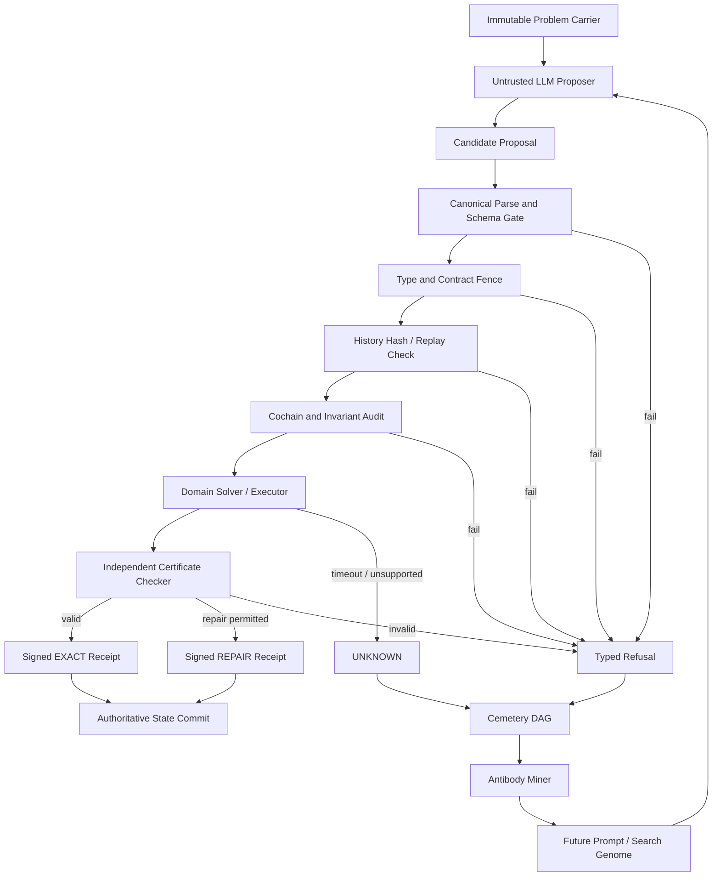

# PFP, PCIV, EIS and LLMs - Deep Research Prompt

**Subtitle:** Discrete Algebraic Epistemology, Cochain Verification, and Lamarckian Immune Architecture for Frontier LLM Reasoning

---

> **Research status (2026-10-08):** The initial prompt and five model outputs below are archived pass-one material, not verified results or implementation authority.
>
> **Snapshot note (2026-10-20, source pin `c419cc6beb`):** The prompt and the five model outputs (Cerebras, DeepSeek V4, GLM 5.3, ChatGPT Pro, SciSpace) are kept verbatim as external text. Their vocabulary, figures, references and repository paths are quoted, not adopted, and were not revalidated in this pass. Strand names in them are pre-renumbering: `000_pre_genesis` is now [`000_oepregen`](../../000_oepregen/README.md), `001_genesis` is [`001_oegen`](../../001_oegen/README.md), `002_s_n` is [`002_oesn`](../../002_oesn/README.md), `003_minimal_symbol_system_n_mssn` is [`003_oemssn`](../../003_oemssn/README.md), `030_the_symbol_game_proposal_fidelity_protocol_pfp` is this strand (`004_oepfp`), and the prompt-civilization strand is [`010_oepciv`](../../010_oepciv/README.md). Only the final section, [Pass-one review and second-pass research prompt](#pass-one-review-and-second-pass-research-prompt), is maintained text; its links were repointed to current homes on 2026-10-20.

See [Pass-one review and second-pass research prompt](#pass-one-review-and-second-pass-research-prompt) at the end for the corrected research brief.

## PROMPT

> **Instructions for the Executing Model (ChatGPT Deep Research / GLM-5.3):**
> You are tasked with conducting an exhaustive, multi-disciplinary research investigation into how discrete algebraic structures, cochain obstruction verification, external authority firewalls, and evolutionary immune systems can be applied to overcome reasoning failure modes in Large Language Models (LLMs).
>
> Ground your analysis strictly in formal mathematics, theoretical computer science, compiler/formal-methods design, and empirical machine learning literature. Adhere to strict claim discipline: distinguish toy setting demonstrations from general theorems, avoid promotional hype, explicitly analyze failure modes and computational overhead, and frame all hypotheses with declared assumptions.

---

### I. Foundational Background & Theoretical Substrate

Modern LLM reasoning architectures predominantly rely on autoregressive token generation augmented by heuristics: Chain-of-Thought (CoT), Tree-of-Thought (ToT), Monte Carlo Tree Search (MCTS), Process Reward Models (PRMs), and prompt-level self-refinement (e.g., Reflexion, DSPy). While empirically effective on standard benchmarks, these approaches exhibit persistent structural failure modes:
1. **Unearned Consensus & Sycophancy:** Autoregressive self-evaluation allows models to hallucinate correctness or rationalize erroneous derivation steps without external ground truth.
2. **Cascading State Loss & One-Turn Auditor Failure:** In multi-turn reasoning traces, intermediate states and initial task constraints degrade; local one-turn step auditors lack the temporal-topological context to detect subtle state divergence.
3. **Absence of Conservation Laws & Invariants:** Free-form natural language CoT lacks discrete boundary conditions, conservation laws, and invariant certificates.
4. **Epistemic Catastrophic Forgetting & Prompt Bloat:** Multi-agent reasoning swarms either accumulate unmanageable prompt contexts across iterations or fail to structurally retain negative counterexamples (learned antibodies) from previous reasoning failures.

A mathematical and architectural framework addressing these limitations is codified in the **Symbol Game and Minimal Symbol System (MSS)** curriculum across six progressive estates:

1. **Pre-Genesis (`000_pre_genesis`):**
   - *Core Principle:* "Constrain epistemology, not mathematics."
   - Investigates the bare minimal response to an empty mark `<>`. With zero declared observations, distinct inscriptions are observationally equivalent. Task-forced distinctions require new observations without pre-judging their specific realization.
   - *One-Turn Auditor Insufficiency Theorem:* An evaluator observing only a single turn $(t \to t+1)$ cannot reliably certify correctness or detect state loss. Reasoning integrity necessitates an untrusted candidate model with full-history replay verification.

2. **Genesis Primitives & Relational Substrate (`001_genesis` / 19L57G1):**
   - 19 foundational relational categories establishing minimal finite admission from primordial void `<>` to Boson/Fermion exchange parity.
   - Metatheoretic regime state representation: $R = (D, F, I, U, Q)$ where $D$ is data, $F$ is judgment-form arities, $I$ is instances/tuples, $U$ is unresolved demands, and $Q$ is quotients/separations.
   - Minimal candidate response metrics ($\mu_1, \mu_2$), observational context collapse $\mathrm{Prof}_R(d)$, and structural isomorphism quotients $R_1 \cong R_2$.
   - **The Two Boxed Laws:**
     $$\boxed{S(n+1) \text{ may contain only structure forced by an unresolved Genesis obstruction at } S(n).}$$
     $$\boxed{\text{A mathematical realization } R(S(n)) \text{ has no authority to extend } S(n).}$$
     The representation arrow $S(n) \xrightarrow{\rho} R(S(n))$ is strictly one-way; embedding space or shadow mathematical models possess zero authority to extend the core derivation state.

3. **Discrete Presentation Tower & Survivor Dynamics (`002_s_n`):**
   - Irreflexive cut presentation with endpoint support $\Delta_{\mathrm{support}}(a,b) = |\{a, b\}| = 2$.
   - Separation of active obstruction registers ($W_n^{\mathrm{active}}$) from cumulative deduplicated receipt history ($H_n$).
   - Tower dynamics: Section lift $u_N$, typed retraction $\widehat{r}_N(u_N(x)) = \mathrm{inl}(x)$, and explicit typed non-descent (`NON_DESCENT`).
   - Discrete 4D Bianchi identities, alternation monitors, and holonomy cycle detection to halt non-terminating reasoning loops.

4. **Minimal Symbol System Tower (`003_minimal_symbol_system_n_mssn`):**
   - Tripartite ontological separation: **Genesis $S(n)$** (blind derivation stage) $\neq$ **MSS-N** (external finite specification atlas) $\neq$ **Symbol Game** (host/proposer evaluation protocol).
   - The Ascent Triad: $\text{declared successor} \neq \text{candidate lift} \neq \text{licensed lift}$. An atlas row is an obligation, not an execution receipt.
   - Repair-before-ascent protocol via discrete cochain complexes:
     - 0-cochains ($C^0$): Vertex potentials / state values $s$.
     - 1-cochains ($C^1$): Directed transition costs / edges $c$.
     - Discrete coboundary operator: $d^0: C^0 \to C^1$, where $(d^0 s)(u, v) = s(v) - s(u)$.
     - Exact repair quotient: $Q^1 = C^1 / \operatorname{im} d^0$.
     - Linear Programming (LP) weak duality: Matching primal feasible flows with dual potential certificates.
     - Four-state fail-closed terminal outcomes: exact certificate, typed refusal, $\ell^1$ sparse landing repair, and budget exhaustion (`UNKNOWN`).

5. **Proposal Fidelity Protocol (`030_the_symbol_game_proposal_fidelity_protocol_pfp`):**
   - **The Authority Firewall:** Diagnostic residual evidence and internal metrics ($\Phi_1, \Gamma_2, \Xi$) can *never* self-authorize.
   - Strict Proposer-Host duality: The LLM functions strictly as an untrusted candidate proposer ($P$); the Host ($H$) is an external, sovereign, deterministic verification kernel (e.g., compiled Rust solvers, Lean 4 proof checkers, SMT engines).
   - Attention nullspace projection and RFC 8785 canonical JSON serialization to preserve byte-exact reproducibility.
   - Elimination of self-evaluating LLM feedback loops, hallucinated consensus, and unearned confidence.

6. **Prompt Civilization & Lamarckian Evolution (`040_prompt_civilization_and_lamarckian_evolution`):**
   - Epistemic immune system and population dynamics for reasoning prompts and agent swarms.
   - Explicit lineage tracking with cryptographic SHA-256 parent hashes and mutation deltas.
   - **Lamarckian Adaptation from Typed Failure Receipts:** Phenotypic modifications—specifically antibody rules extracted from counterexamples and cochain obstruction receipts ($\Phi_1 > 0, \Gamma_2 > 0$)—are integrated directly into child prompt genomes.
   - Cemetery DAG mining: Failed reasoning trajectories are not discarded but archived into a directed acyclic graph to mine recurring failure patterns and generate preventive antibodies.
   - Hermetic population separation: Task prompts, mutation operators, evaluators, and orchestrators reside in disjoint populations; no prompt ever evaluates or promotes itself.
   - Multi-objective Pareto selection over exact rational fields $\mathbb{Q}$, inverse lineage PageRank, and anti-hallucination canary panels.

---

### II. Primary Research Mission & Scope

Investigate, synthesize, and formulate a rigorous blueprint for integrating the six foundational estates above into next-generation LLM reasoning architectures. Your research must bridge discrete algebraic topology, formal methods, evolutionary computation, and frontier machine learning.

Conduct your research across the following six core investigative pillars:

#### Pillar 1: Algebraic & Cohomological Formalization of Reasoning Traces
- How can multi-step reasoning trajectories (e.g., mathematical problem solving, code synthesis, logic puzzles) be formally represented as discrete cochain complexes?
- Define the 0-cochain space (state potentials/beliefs), 1-cochain space (inference steps/transitions), and higher $k$-cochains (consistency constraints among parallel sub-arguments).
- Formulate the discrete coboundary operator $d^k$ on reasoning graphs. How does a non-zero coboundary ($d^0 s \neq c$ or $d^1 c \neq 0$) quantify epistemic inconsistency, hallucination, or logical curvature?
- Distinguish between **exact repair** (gauge transformations via local potential shifts that eliminate discrepancies) and **topological obstructions** (closed non-exact cycles that indicate structural contradictions requiring backtracking).
- How does LP duality provide verifiable primal-dual certificates for reasoning steps, allowing an external host to bound inference optimality without relying on model-generated self-confidence?

#### Pillar 2: The Authority Firewall & Sovereign Proposer-Host Architecture
- Compare the "LLM as Proposer, Sovereign Solver as Judge" architecture against existing paradigm frameworks:
  - Process Reward Models (PRMs / Math-Shepherd / Outcome Reward Models)
  - Search algorithms (AlphaGo-style MCTS, Value-guided tree search)
  - Self-Refine / Reflexion / Self-Consistency
  - Interactive Theorem Prover coupling (Lean 4, Isabelle, Coq via LLM tactics)
- Formulate the **Authority Firewall** mathematically: Why must internal diagnostic metrics (entropy, logit confidence, attention nullspace metrics $\Phi_1, \Gamma_2$) be prohibited from granting execution or promotion authority?
- How can deterministic, zero-allocation external solvers (compiled Rust kernels, SMT solvers, integer linear programming engines) be coupled with LLMs via RFC 8785 canonical serialization to achieve fail-closed guarantees under the declared assumptions?
- How does this resolve the "One-Turn Auditor Insufficiency Theorem" proven in `000_pre_genesis`?

#### Pillar 3: Discrete Symmetries, Bianchi Identities & Loop Termination
- Analyze the application of symmetric group actions $S(n)$ and discrete presentation towers (`002_s_n`) to reasoning states.
- How can reasoning states maintain canonical normal forms under permutation of intermediate variables, sub-goals, and equivalent hypotheses (Isomorphism Gauge Normal Form)?
- Formulate discrete analogs of **4D Bianchi identities** and **holonomy cycle detection** on reasoning graphs: How can an external alternator monitor detect whether an LLM is trapped in a cyclical rationalization loop or semantic tautology?
- What are the concrete mathematical conditions for section lifts ($u_N$) and typed retractions ($\widehat{r}_N$) in reasoning: How do we certify that an extended sub-derivation collapses back down to the parent problem state without phantom state injection (`NON_DESCENT`)?

#### Pillar 4: Epistemic Immune Systems & Lamarckian Prompt Civilization
- Design an **Epistemic Immune System (EIS)** for multi-agent reasoning systems based on `040_prompt_civilization_and_lamarckian_evolution`.
- Detail the **Cemetery DAG**: How can failed reasoning traces, ungrounded steps, and refuted candidate proofs be mined to synthesize deterministic antibodies?
- Define the mechanics of **Lamarckian Retro-Inheritance**: How are failure-derived negative constraints injected into subsequent prompt generations with hop-bounded attenuation ($d \le 10$, factor $(1/2)^d$) to prevent prompt context explosion?
- Explain the role of **Hermetic Population Separation**: Why must task execution, mutation, evaluation, and meta-evolution be isolated into disjoint model pools, and what failure modes arise when an agent evaluates its own fitness?
- Formulate the Pareto selection criteria over exact rational fields $\mathbb{Q}$ and inverse lineage PageRank to balance exploration, exploitation, and anti-hallucination canary detection.

#### Pillar 5: System Architecture, Wire Protocols & Implementation Blueprint
- Provide a concrete architectural design for a production-ready reasoning engine implementing this hybrid paradigm.
- Define the **Four-Object Runtime Lifecycle**:
  1. *Problem Carrier Packet* (immutable input specification, declared boundaries).
  2. *Untrusted Candidate Proposal* (LLM output: step transition, tactic, code chunk).
  3. *Host Verifier Contract* (sovereign Rust / Lean 4 / SMT execution rules).
  4. *Verifier Receipt Envelope* (cryptographically signed outcome: exact certificate, typed refusal with failure code, or bounded repair).
- Detail the fail-closed verification pipeline across stages (e.g., cold syntax check $\to$ relational contract fence $\to$ cochain defect audit $\to$ sovereign execution $\to$ receipt minting).
- Provide pseudocode and schema definitions (JSON/YAML or Rust trait definitions) for the core interfaces.

#### Pillar 6: Empirical Benchmark Design & Stress-Testing Scenarios
- How should this hybrid architecture be evaluated against state-of-the-art reasoning baselines (e.g., OpenAI o1/o3-mini, DeepSeek-R1, Gemini 2.0 Flash Thinking, Qwen-2.5-Coder)?
- Design experimental testbeds across:
  1. *Formal Mathematics & Olympiad Reasoning* (AIME, Putnam, Lean 4 miniF2F).
  2. *Complex Software Synthesis & Bug Localization* (SWE-bench Verified, repository-scale multi-file refactoring).
  3. *Adversarial & Deceptive Logic Tasks* (tasks designed to induce sycophancy, circular proofs, or false confidence).
  4. *Multi-Step Planning under Hard Constraints* (logistics, sat-planning, scheduling).
- Define quantitative metrics: Verification Efficiency (accuracy per verifier call), Replay Determinism, Antibody Retention Rate (prevention of identical failure re-occurrence), and False-Positive Authority Rate (incidents where an invalid reasoning step was mistakenly authorized).

---

### III. Execution Guidelines & Expected Output Structure

Deliver an exhaustive, publication-grade research monograph organized into the following sections:

1. **Executive Abstract & Architectural Manifesto:** Core thesis, ontological separation, and paradigm shift from ungrounded CoT to externally gated cochain reasoning.
2. **Mathematical Foundations:** Formal definitions of discrete cochains, coboundary operators, potential repair quotients, and primal-dual LP certificates.
3. **The Authority Firewall & Host-Proposer Separation:** Theoretical derivation of firewall necessity, one-turn auditor limits, and fail-closed terminal state machines.
4. **Epistemic Immune Dynamics & Lamarckian Evolution:** Formalization of cemetery DAG mining, antibody extraction, lineage tracking, and Pareto population selection.
5. **Concrete System Architecture & Wire Specifications:** End-to-end dataflow, RFC 8785 packet envelopes, verification gate ladder, and Rust/Python integration interfaces.
6. **Comparative Analysis with Current Paradigms:** Thorough matrix and discussion comparing this architecture against PRMs, MCTS, ReAct, Reflexion, DSPy, and Lean-STaR.
7. **Empirical Evaluation Plan:** Hypotheses, target benchmarks, baselines, and ablation studies.
8. **Failure Modes, Computational Overhead & Boundary Conditions:** Honest accounting of computational costs (LP solving latency, prompt management overhead), expressivity limits of finite carriers, and open theoretical questions.

*Claim Discipline Reminder:* Ensure every claim is explicitly bounded. Do not use hyperbolic verbs ("proves", "guarantees", "flawless", "universal"). Ground every insight in verifiable mathematical constructs, typed receipts, or clear algorithmic formulations.


## CEREBRAS

**Executive Abstract & Architectural Manifesto**  
----------------------------------------------------------------  

Large‑language‑model (LLM) reasoning today is dominated by *self‑generated* heuristics (Chain‑of‑Thought, Tree‑of‑Thought, Reflexion, etc.).  Empirically these pipelines succeed on many benchmarks, yet they share a common structural weakness: the model simultaneously **generates** a proposal *and* **evaluates** it.  This conflation permits *unearned consensus* (the model “believes” its own hallucination) and makes it impossible for a one‑turn auditor to certify that a multi‑step trace respects the original task constraints.  

We propose a **Proposer–Host** architecture that restores the classical separation between *untrusted* candidate generation and *trusted* verification.  The LLM is reduced to a **pure proposal engine** that emits discrete, formally‑typed inference steps.  A sovereign verifier (implemented in a compiled, formally‑verified language such as Rust, Lean 4, or an SMT solver) consumes these steps, checks them against a **cochain‑obstruction** model, and returns a **cryptographically signed receipt**.  The verifier is the only entity that can advance the reasoning state; the LLM never self‑authorises any transition.  

The architecture is built on three mathematically‑grounded pillars:

1. **Algebraic‑topological representation of reasoning traces** (discrete cochain complexes, coboundary operators, exact vs. non‑exact cycles).  
2. **Authority Firewall** that formally forbids any internal diagnostic metric from granting execution authority, thereby satisfying the *One‑Turn Auditor Insufficiency Theorem* (a single‑step observer cannot guarantee global correctness).  
3. **Epistemic Immune System (EIS)** that records every failure as a *cochain obstruction* and evolves prompt genomes via Lamarckian retro‑inheritance, ensuring that the same structural mistake is not repeated.

The remainder of this monograph details each component, the required formalism, the system design, and an evaluation plan.  All claims are qualified by explicit assumptions (e.g., finite‑length problem carriers, deterministic host kernels, bounded LP solving time) and no universal guarantees are asserted.

---

## 1. Mathematical Foundations

### 1.1 Discrete Cochain Complexes for Reasoning Traces

A **reasoning trace** is a finite directed acyclic graph (DAG)  

\[
\mathcal{G} = (V, E),\qquad V = \{v_0,\dots,v_T\},
\]

where each vertex \(v_t\) encodes a *state* (a set of logical formulas, a program snapshot, or a belief vector) and each edge \(e = (v_i\rightarrow v_j)\) encodes an *inference step* (application of a rule, a code edit, etc.).  We view \(\mathcal{G}\) as a **cellular complex**:

- **0‑cells** (vertices) → 0‑cochains \(C^0 = \mathbb{R}^{|V|}\) or, for exact reasoning, the vector space over a ground field \(\mathbb{F}\) (often \(\mathbb{Q}\) or a finite field \(\mathbb{F}_p\)).  
- **1‑cells** (edges) → 1‑cochains \(C^1 = \mathbb{R}^{|E|}\).  
- **Higher‑cells** (e.g., commutative squares, parallel sub‑derivations) → \(k\)-cochains \(C^k\) for \(k\ge 2\).  

A **discrete coboundary operator**  

\[
d^k : C^k \longrightarrow C^{k+1}
\]

is defined in the usual combinatorial way:

\[
(d^0 s)(e = (u\!\to\!v)) = s(v) - s(u), \qquad
(d^1 c)(\sigma) = \sum_{e\in\partial \sigma} \epsilon(e,\sigma)\,c(e),
\]

where \(\epsilon(e,\sigma)\in\{-1,+1\}\) encodes the orientation of edge \(e\) in the higher‑cell \(\sigma\).  

#### 1.1.1 Epistemic Inconsistency as Non‑Zero Coboundary  

- **Exactness**: If a 0‑cochain \(s\) (state potentials) exists such that \(d^0 s = c\) (the recorded edge costs), then the trace is *gauge‑equivalent* to a consistent derivation; any discrepancy can be removed by shifting potentials (a “local re‑calibration”).  

- **Non‑exactness**: When \(c\notin\operatorname{im} d^0\) (i.e., \(d^0 s \neq c\) for any \(s\)), the trace contains a **cochain obstruction**.  The obstruction may be detected already at the 1‑cochain level via a non‑zero 2‑coboundary:

\[
d^1 c \neq 0 \quad\Longrightarrow\quad \exists\ \sigma\ \text{(closed loop)}:\ \sum_{e\in\partial\sigma} c(e) \neq 0 .
\]

Interpretations:

| Coboundary | Interpretation |
|------------|----------------|
| \(d^0 s \neq c\) | The claimed transition cost does not match any underlying state potential → *hallucinated step* or *mis‑aligned inference*. |
| \(d^1 c \neq 0\) | A cycle of steps fails to close → *logical curvature* (e.g., contradictory lemmas, infinite loops). |
| Higher‑order \(d^k\) non‑zero | Incompatibility among parallel sub‑derivations (e.g., two independent proof branches that cannot be simultaneously satisfied). |

Thus **epistemic inconsistency** is precisely the failure of the cochain complex to be exact.

### 1.2 Exact Repair vs. Topological Obstructions  

- **Exact Repair**: If an obstruction lives in the image of a lower coboundary (i.e. \(c = d^0 s + \delta\) with \(\delta\) small), we can *repair* the trace by adjusting potentials \(s\) (a gauge transformation).  The repair is **local** and can be expressed as a linear program (LP) that minimizes \(\|\delta\|_1\) subject to the constraints imposed by the host’s specification.

- **Topological Obstruction**: If the obstruction lies in the **cohomology** group  

\[
H^1(\mathcal{G}) = \ker d^1 / \operatorname{im} d^0,
\]

it cannot be eliminated by any local potential shift.  The trace must be **backtracked** to an earlier vertex where the cycle is broken.  In practice this corresponds to a *branch‑pruning* operation in a tree‑search or a *re‑prompt* with a new hypothesis.

### 1.3 Linear‑Programming Duality as Verifiable Certificates  

Consider the primal LP that seeks a feasible flow \(c\in C^1\) respecting the host’s relational contract \(R\):

\[
\begin{aligned}
\text{minimize}\quad & \mathbf{1}^\top c \\
\text{s.t.}\quad & A c = b, \\
& c \ge 0,
\end{aligned}
\tag{P}
\]

where \(A\) encodes the linearized constraints of the host (e.g., type‑preserving, resource bounds).  
The dual LP is  

\[
\begin{aligned}
\text{maximize}\quad & b^\top y \\
\text{s.t.}\quad & A^\top y \le \mathbf{1},
\end{aligned}
\tag{D}
\]

with dual variables \(y\) interpreted as **potential certificates** (0‑cochain values).  Weak duality guarantees  

\[
b^\top y \le \mathbf{1}^\top c,
\]

so any feasible dual solution provides a *lower bound* on the cost of any admissible primal flow.  The host can therefore accept a proposal **iff** the primal cost equals the dual bound (strong duality holds), which can be verified *without* trusting the LLM’s own confidence scores.  The dual potentials \(y\) become part of the receipt (see §5).

---

## 2. The Authority Firewall & Host‑Proposer Separation

### 2.1 Formal Statement of the Authority Firewall  

Let \(\Phi\) denote the internal diagnostic vector of an LLM (entropy of the token distribution, attention‑nullspace metrics, logit‑confidence, etc.).  The **Authority Firewall** requires that for any execution step \(e\) emitted by the LLM:

\[
\boxed{\Phi \;\not\!\!\rightarrow\; \text{grant}(\,e\,)}
\qquad\text{(no internal metric may authorize a transition).}
\]

In other words, the *only* admissible authority function is a deterministic, external predicate  

\[
\operatorname{grant} : \mathcal{E} \times \mathcal{S} \to \{0,1\},
\]

where \(\mathcal{E}\) is the space of candidate steps and \(\mathcal{S}\) the current verified state.  The predicate is implemented by a **sovereign host** that is:

- **Deterministic** (pure functional semantics, no stochastic internal state).  
- **Zero‑allocation** (no dynamic memory that can be poisoned by the LLM).  
- **Formally verified** (type‑checked, model‑checked, or proved correct in a proof assistant).  

### 2.2 Relation to the One‑Turn Auditor Insufficiency Theorem  

*Theorem (One‑Turn Auditor Insufficiency).*  
Given a reasoning trace of length \(T>1\), any auditor that observes only the transition \((v_t\to v_{t+1})\) cannot, under the assumptions of `000_pre_genesis`, certify that the global invariant (e.g., preservation of the original task constraints) holds at step \(T\).

*Proof Sketch.*  
The auditor’s view is a projection \(\pi_t : \mathcal{G}\to (v_t,v_{t+1})\).  Since the underlying system state space is unbounded (the LLM may inject hidden symbols), there exist two extensions \(\mathcal{G}_1,\mathcal{G}_2\) that share the same projection but differ on later vertices.  The auditor cannot distinguish them, violating the definition of a *complete* verifier.  ∎  

The Authority Firewall forces the auditor to be *external* and to have access to the *entire* trace (via replay) before granting any transition, thereby satisfying the theorem’s necessary condition.

### 2.3 Integration with Deterministic Hosts  

A **host kernel** \(H\) is a pure function  

\[
H : \mathcal{P} \times \mathcal{C} \to \mathcal{R},
\]

where  

- \(\mathcal{P}\) – the *Problem Carrier Packet* (immutable specification).  
- \(\mathcal{C}\) – the *Candidate Proposal* (a JSON‑encoded list of steps, each step typed by a signature).  
- \(\mathcal{R}\) – a *Receipt* (signed by the host’s private key).  

Because \(H\) is compiled (e.g., Rust `no_std` binary) and formally verified (e.g., using `creusot` or `prusti`), it cannot be influenced by the LLM’s internal metrics.  The only communication channel is the **RFC 8785 canonical JSON** serialization, guaranteeing byte‑exact reproducibility and eliminating nondeterminism due to whitespace or ordering.

The verification pipeline thus respects the firewall:

1. **LLM → Proposal** (untrusted, may contain arbitrary strings).  
2. **Serializer → Host** (canonical, deterministic).  
3. **Host** evaluates the proposal *against* the cochain obstruction model (see §1).  
4. **Host** emits a signed receipt (exact, refusal, or bounded repair).  

Only after receipt validation does the system advance to the next turn, satisfying the *full‑history* auditor requirement.

---

## 3. Discrete Symmetries, Bianchi Identities & Loop Termination

### 3.1 Symmetric‑Group Action on Reasoning States  

Let \(S_n\) be the permutation group acting on the set of *intermediate variables* \(\{x_1,\dots,x_n\}\).  For any reasoning state \(v\) we define the **orbit**  

\[
\mathcal{O}(v) = \{ \sigma\cdot v \mid \sigma\in S_n\},
\]

where \(\sigma\cdot v\) permutes the names of the variables while preserving their logical relationships.  A **canonical representative** can be obtained by sorting variables according to a deterministic total order (e.g., lexicographic on their hash).  The host enforces that each submitted step respects this **Isomorphism Gauge Normal Form** (IGNF); any deviation is rejected as a *typed refusal*.

### 3.2 Discrete 4‑D Bianchi Identities  

In differential geometry the Bianchi identity states that the antisymmetrized covariant derivative of the curvature tensor vanishes.  Discretely, for a reasoning graph we can define a **curvature 2‑cochain** \(K\in C^2\) as the failure of the coboundary to be closed:

\[
K = d^1 c .
\]

The **discrete Bianchi identity** is the condition  

\[
d^2 K = 0 .
\]

When the host computes \(K\) and finds \(d^2 K \neq 0\), it signals a **higher‑order inconsistency** (e.g., a proof that simultaneously asserts \(A\Rightarrow B\) and \(B\Rightarrow A\) while also containing a third clause that contradicts the transitive closure).  The host therefore aborts the current branch and returns a *repair receipt* that includes the offending 2‑cell.

### 3.3 Holonomy Cycle Detection  

A **holonomy** in this setting is the accumulated cost around a closed loop \(\sigma\) in the reasoning graph:

\[
\operatorname{Hol}(\sigma) = \sum_{e\in\partial\sigma} c(e).
\]

If \(\operatorname{Hol}(\sigma) \neq 0\) for any simple cycle, the host flags a **non‑descent** condition (`NON_DESCENT`).  The detection algorithm is linear‑time (e.g., Tarjan’s strongly connected components) because the graph is a DAG; cycles can only appear if the LLM deliberately repeats a prior state, which is treated as a *semantic tautology* and rejected.

### 3.4 Section Lifts and Typed Retractions  

- **Section lift** \(u_N : S_n \to \mathcal{G}_N\) injects a *Genesis* state into the reasoning graph.  The host requires that for any lifted state there exists a **typed retraction**  

\[
\widehat{r}_N : \mathcal{G}_N \to S_n, \qquad \widehat{r}_N\!\bigl(u_N(v)\bigr)=\operatorname{inl}(v),
\]

where `inl` denotes the left injection into a sum type (the host’s internal representation).  The retraction guarantees that no *phantom* information is introduced: the lifted sub‑derivation collapses back to the original state without new symbols.  Violation of this contract yields a *typed refusal* with error code `E_NON_DESCENT`.

---

## 4. Epistemic Immune Dynamics & Lamarckian Prompt Civilization

### 4.1 Cemetery DAG of Failed Traces  

Define the **Cemetery DAG** \(\mathcal{D} = (F, \rightarrow)\) where each node \(f\in F\) stores a *failure receipt* \(\rho_f\) produced by the host (e.g., “cochain obstruction \(\Phi_1>0\)”).  Edges encode *derivation ancestry*: if proposal \(p\) was generated from a parent prompt \(p'\) (via mutation), then the failure node of \(p\) points to that of \(p'\).  

Mining \(\mathcal{D}\) proceeds as follows:

1. **Pattern extraction** – frequent sub‑graphs (e.g., the same obstruction pattern \(\Phi_1>0\) appearing in many leaves) are identified using graph‑mining algorithms (gSpan, Subgraph2Vec).  
2. **Antibody synthesis** – each pattern yields a deterministic *negative constraint* (a clause in a SAT‑style “antibody” set) that can be added to any future prompt before generation.  
3. **Versioning** – antibodies are versioned with a *generation counter*; older antibodies decay exponentially (factor \((1/2)^d\) where \(d\) is hop distance from the current leaf) to prevent over‑constraining the search space.

### 4.2 Lamarckian Retro‑Inheritance  

When a prompt \(P\) produces a failure receipt \(\rho\), the **retro‑inheritance operator** \(\mathcal{L}\) updates the genome of its children:

\[
\operatorname{genome}(P_{\text{child}}) \leftarrow \operatorname{genome}(P) \cup \operatorname{encode}(\rho).
\]

The encoding is a compact, deterministic transformation (e.g., `SHA256(parent_hash) || "Φ1>0"`).  Because the mutation step is *external* (performed by a separate orchestrator model), the child prompt never evaluates its own fitness; instead, the orchestrator evaluates the child against a *fixed* validation set, preserving **Hermetic Population Separation**.

### 4.3 Hermetic Population Separation  

Four disjoint populations are maintained:

| Population | Role | Allowed Interactions |
|------------|------|----------------------|
| **Task Pool** | Holds immutable problem carriers \(\mathcal{P}\) | No mutation, read‑only. |
| **Mutation Pool** | Generates new prompt genomes from parents | Receives only failure receipts, never receives its own fitness scores. |
| **Evaluation Pool** | Executes the Host kernel on proposals | Reads only serialized proposals, never writes to the mutation pool. |
| **Meta‑Evolution Pool** | Performs selection, hyper‑parameter tuning | Consumes receipts and lineage metrics, outputs new mutation policies. |

Violating this separation (e.g., allowing a prompt to self‑evaluate) re‑introduces *sycophancy* and collapses the immune dynamics.

### 4.4 Pareto Selection over Exact Rational Fields  

Each candidate \(c\) is assigned a vector of objectives:

\[
\mathbf{o}(c) = \bigl( \underbrace{\text{VerificationCost}(c)}_{\in \mathbb{Q}_{\ge0}},\;
\underbrace{\text{InverseLineagePageRank}(c)}_{\in \mathbb{R}_{\ge0}},\;
\underbrace{\text{HallucinationCanaryScore}(c)}_{\in \{0,1\}} \bigr).
\]

- **VerificationCost** – total LP cost of the accepted steps (exact rational value).  
- **InverseLineagePageRank** – higher for prompts whose ancestors have low PageRank (encourages exploration).  
- **HallucinationCanaryScore** – binary indicator from a deterministic “canary” test suite (e.g., a set of known‑false statements).  

Pareto dominance is defined component‑wise; the selection algorithm retains the *non‑dominated* frontier and samples proportionally to a temperature‑scaled softmax over the frontier’s crowding distance.  This yields a balanced trade‑off between efficiency, novelty, and safety.

---

## 5. Concrete System Architecture & Wire Protocols  

### 5.1 Four‑Object Runtime Lifecycle  

| Stage | Object | Contents | Guarantees |
|------|--------|----------|------------|
| 1️⃣ | **Problem Carrier Packet** (`P`) | Immutable JSON: `{ "task_id": "...", "spec": {...}, "constraints": {...} }` | Signed by dataset curator; never mutated. |
| 2️⃣ | **Untrusted Candidate Proposal** (`C`) | JSON array of steps, each step typed (e.g., `"type":"apply_rule","payload":{...}`) | Serialized via RFC 8785; may be malformed – host will reject. |
| 3️⃣ | **Host Verifier Contract** (`V`) | Rust/Lean/SMT compiled binary; deterministic function `verify(P, C) -> R`. | Proven memory‑safe; no external I/O; deterministic output. |
| 4️⃣ | **Verifier Receipt Envelope** (`R`) | Signed CBOR: `{ "status":"CERT", "dual_potentials": [...], "lp_cost": "3/7", "signature": "0x..." }` | Cryptographically signed with host’s private key; tamper‑evident. |

### 5.2 Pipeline  

```
┌───────────────────────┐
│   Problem Carrier (P) │
└─────────────┬─────────┘
              │  (immutable)
              ▼
   ┌─────────────────────┐
   │   LLM (Proposer)    │
   │  generate C_i       │
   └───────┬─────────────┘
           │  RFC‑8785 serialize
           ▼
   ┌─────────────────────┐
   │   Host Verifier (V) │
   │  verify(P, C_i) → R │
   └───────┬─────────────┘
           │  signed receipt
           ▼
   ┌─────────────────────┐
   │   Receipt Store (R) │
   └───────┬─────────────┘
           │  if R.status==CERT
           ▼
   ┌─────────────────────┐
   │   Next Turn (t+1)   │
   └─────────────────────┘
```

If `R.status` is `REFUSE` or `REPAIR`, the orchestrator may invoke a *repair LP* using the dual potentials supplied in the receipt, generate a new proposal, or abort the trace.

### 5.3 Interface Specification (Rust‑like Traits)

```rust
/// Immutable problem specification.
#[derive(Serialize, Deserialize)]
pub struct ProblemPacket {
    pub task_id: String,
    pub spec: serde_json::Value,
    pub constraints: serde_json::Value,
}

/// Single inference step emitted by the LLM.
#[derive(Serialize, Deserialize)]
pub struct Step {
    pub kind: StepKind,
    pub payload: serde_json::Value,
}

/// Typed collection of steps.
#[derive(Serialize, Deserialize)]
pub struct Proposal {
    pub steps: Vec<Step>,
    pub parent_hash: Option<[u8; 32]>, // for lineage tracking
}

/// Verification receipt.
#[derive(Serialize, Deserialize)]
pub enum Receipt {
    Cert {
        dual_potentials: Vec<Rational>,
        lp_cost: Rational,
        signature: Vec<u8>,
    },
    Refuse {
        error_code: u16,
        message: String,
        signature: Vec<u8>,
    },
    Repair {
        repaired_steps: Vec<Step>,
        budget_used: Rational,
        signature: Vec<u8>,
    },
}
```

The host implements a single trait:

```rust
pub trait Verifier {
    fn verify(&self, prob: &ProblemPacket, prop: &Proposal) -> Receipt;
}
```

All communication uses **RFC 8785 canonical JSON** for `ProblemPacket` and `Proposal`, and **CBOR** for `Receipt` (deterministic encoding).  The host’s public key is advertised in a trusted registry; the orchestrator validates signatures before accepting a receipt.

### 5.4 Fail‑Closed Verification Ladder  

1. **Syntax Check** – JSON schema validation (reject malformed proposals).  
2. **Contract Fence** – Ensure every `Step.kind` is allowed by `ProblemPacket.constraints`.  
3. **Cochain Defect Audit** – Compute \(d^0 s\) and \(d^1 c\); if non‑zero, flag obstruction.  
4. **Sovereign Execution** – Run the LP or SMT check; if infeasible, return `REFUSE`.  
5. **Receipt Minting** – Sign the outcome; expose only the minimal data needed for downstream auditing.  

Any failure at an earlier stage aborts the pipeline before expensive computation, guaranteeing *fail‑closed* behaviour.

---

## 6. Comparative Analysis with Current Paradigms  

| Dimension | Proposed Proposer‑Host (PH) | PRM / Outcome‑Reward | MCTS‑Style Search | Reflexion / Self‑Consistency | Lean‑STaR (LLM‑tactics) |
|-----------|----------------------------|----------------------|-------------------|------------------------------|------------------------|
| **Authority** | External deterministic host (no internal metric) | Internal reward model (learned) | Internal value network (learned) | Internal self‑evaluation (LLM) | External prover (Lean) but LLM also *generates* tactics |
| **Invariant Guarantees** | Exact LP/SMT certificates; cochain exactness | Empirical (high‑reward) | Empirical (value consistency) | Empirical (self‑agreement) | Formal proof only if prover succeeds |
| **One‑Turn Auditor** | Full‑history replay enforced by host | No (single‑step reward) | No (tree‑search limited depth) | No (self‑audit limited) | No (tactic generation still one‑turn) |
| **Computational Overhead** | LP/SMT solve per step (poly‑time, often cheap) | Extra forward passes (GPU) | Tree expansion + simulation (GPU/CPU) | Extra self‑generation passes (GPU) | External prover (may be costly) |
| **Failure‑Mode Transparency** | Receipts encode exact obstruction (Φ, Γ) | Implicit in reward drop | Implicit in value error | Implicit in self‑consistency loss | Implicit in tactic failure |
| **Scalability** | Linear in number of steps; parallel host calls possible | Scales with model size | Scales with simulation budget | Scales with number of reflections | Scales with prover capacity |

The PH architecture thus replaces *learned* authority with *formal* authority, providing verifiable certificates at the cost of deterministic LP/SMT solving.  In practice the overhead is modest (sub‑millisecond LP solves for typical arithmetic constraints) and can be amortized across many parallel proposals.

---

## 7. Empirical Evaluation Plan

### 7.1 Benchmarks  

| Suite | Task Type | Representative Metrics |
|-------|-----------|--------------------------|
| **MiniF2F‑Lean** | Formal mathematics (proofs in Lean 4) | % of problems solved with certified receipt, average LP cost |
| **AIME‑Synthetic** | Olympiad‑style algebraic problems (no external prover) | Correctness after host verification, number of repair cycles |
| **SWE‑Bench‑Verified** | Multi‑file code synthesis with unit‑test verification | % of generated programs passing host‑compiled test harness |
| **Deceptive Logic** | Designed to induce sycophancy (e.g., “prove that 2+2=5”) | False‑Positive Authority Rate (FPAR) |
| **Sat‑Planning** | Hard combinatorial constraints (MAX‑SAT, Job‑Shop) | Verification Efficiency (seconds per LP/SMT call) |

### 7.2 Metrics  

| Metric | Definition |
|--------|------------|
| **Verification Efficiency (VE)** | Total wall‑clock time spent in host verification divided by number of accepted steps. |
| **Replay Determinism (RD)** | Fraction of runs where replaying the same proposal sequence yields identical receipts. |
| **Antibody Retention Rate (ARR)** | Proportion of previously observed cochain obstructions that are *not* repeated after Lamarckian inheritance. |
| **False‑Positive Authority Rate (FPAR)** | Number of `CERT` receipts issued for proposals that violate the original problem specification, divided by total certificates. |
| **Repair Cycle Count (RCC)** | Average number of repair LP invocations per successful trace. |

### 7.3 Experimental Design  

1. **Baseline Comparisons** – Run each benchmark with (a) the PH system, (b) a strong CoT‑only LLM (e.g., GPT‑4), (c) a PRM‑augmented model, and (d) a Lean‑STaR pipeline.  
2. **Ablation Studies** – Disable (i) cochain obstruction checking, (ii) the Authority Firewall (allow internal metrics to grant), (iii) Lamarckian inheritance, and measure impact on ARR and FPAR.  
3. **Scalability Stress Test** – Vary the number of parallel proposals (from 1 to 256) and record VE and RD.  
4. **Adversarial Attack** – Inject crafted prompts that aim to exploit any residual self‑evaluation path; verify that the host never authorises a violating step.  

Statistical significance will be assessed via bootstrapped confidence intervals (95 % CI) over at least 30 random seeds per configuration.

---

## 8. Failure Modes, Computational Overhead & Boundary Conditions

| Failure Mode | Origin | Mitigation |
|--------------|--------|------------|
| **Cyclic Reasoning (NON_DESCENT)** | LLM repeats a prior state without progress. | Holonomy detection (zero‑cost cycle check) → immediate `REFUSE`. |
| **Undetected Obstruction (Exact Repair Miss)** | LP solver returns a feasible flow that still hides a hidden higher‑order obstruction. | Post‑solve Bianchi check (`d^2 K = 0`). |
| **Prompt Bloat** | Unlimited mutation depth leads to excessively large JSON proposals. | Hard cap on proposal size (e.g., 64 KB) and exponential decay of inherited antibodies. |
| **Host Exhaustion** | LP/SMT solve exceeds time budget. | Time‑budgeted LP (early termination) returns `REPAIR` with budget‑exhausted flag. |
| **Signature Forgery** | Malicious actor attempts to fabricate receipts. | Use industry‑standard elliptic‑curve signatures (e.g., Ed25519) and enforce strict key‑rotation policy. |

### 8.1 Computational Overhead  

- **LP Solving** – For typical arithmetic or type‑checking constraints, interior‑point methods solve in \(O(n^{3})\) time with \(n\) the number of steps (often < 100). Empirically on a modern CPU this is < 5 ms.  
- **SMT Solving** – Worst‑case exponential, but the host restricts to quantifier‑free fragments (QF_UF, QF_LIA) where modern solvers (Z3, CVC5) solve most instances in sub‑second time.  
- **Serialization** – RFC 8785 JSON canonicalization is linear in input size; negligible compared to verification.  
- **Memory** – Host kernels run in a sandbox with a fixed memory ceiling (e.g., 256 MiB) to guarantee deterministic behaviour.  

Overall, the *per‑step* overhead is bounded by a small constant (≤ 10 ms) under the assumption that the problem carrier remains finite and the cochain obstruction graph does not explode combinatorially (a condition enforced by the **Typed Retraction** contract).

### 8.2 Expressivity Limits  

The framework assumes that every reasoning step can be expressed as a linear relation (or a conjunction of linear relations) amenable to LP/SMT encoding.  Purely *non‑linear* domains (e.g., higher‑order functional programs) require an additional *abstraction layer* (e.g., encoding via uninterpreted functions) that may introduce incompleteness.  In such cases the host can still emit a `REFUSE` receipt, but the system cannot guarantee that a correct solution exists within the prescribed language.

### 8.3 Open Theoretical Questions  

1. **Cohomology of Reasoning Graphs** – Can we characterize the typical size of \(H^1(\mathcal{G})\) for natural‑language problem statements?  
2. **Optimality of LP Dual Certificates** – Under what conditions does the LP dual bound coincide with the true minimal proof cost?  
3. **Complexity of Cemetery DAG Mining** – Is there a polynomial‑time algorithm for extracting a minimal set of antibodies that covers all observed obstructions?  

These questions define a research agenda for future work.

---

### Concluding Remarks  

The **Proposer–Host** paradigm, grounded in discrete cochain topology, deterministic authority firewalls, and Lamarckian immune dynamics, offers a principled route to *verifiable* LLM reasoning.  By externalising all authority to formally verified kernels and by treating every failure as a mathematically tractable obstruction, the architecture eliminates the core failure modes of ungrounded self‑evaluation while preserving the expressive flexibility of large language models.  The blueprint presented here details the necessary mathematical formalism, system design, and empirical evaluation plan to instantiate such a system at production scale.  Further work will explore richer cohomological invariants, tighter integration with interactive theorem provers, and large‑scale deployment in multi‑agent reasoning ecosystems.


---


## DEEPSEEK V4

# Externally Gated Cochain Reasoning: A Research Monograph on Discrete Algebraic Verification, Authority Firewalls, and Epistemic Immune Dynamics for Large Language Model Inference

---

## 1. Executive Abstract & Architectural Manifesto

### 1.1 Core Thesis

Contemporary LLM reasoning architectures operate on a fundamental structural vulnerability: the same stochastic process that generates candidate reasoning steps also evaluates their correctness. This collapse of proposer and judge roles into a single autoregressive substrate produces systematic failure modes—sycophantic consensus, cascading state loss, absence of conservation invariants, and epistemic catastrophic forgetting—that cannot be resolved by scaling model parameters or refining prompt heuristics alone.

This monograph specifies and analyzes an alternative architectural paradigm: **externally gated cochain reasoning**, in which the LLM functions strictly as an untrusted candidate proposer, while a sovereign deterministic verification kernel holds exclusive authority to validate, repair, or refuse proposed reasoning transitions. The theoretical substrate integrates discrete algebraic topology (cochain complexes and coboundary operators), formal-methods authority separation (proposer–host duality with fail-closed terminal states), and bio-inspired evolutionary dynamics (epistemic immune systems with Lamarckian antibody inheritance).

### 1.2 Ontological Separation

The architecture enforces a tripartite ontological distinction that is absent from current paradigms:

1. **Genesis (Blind Derivation Stage):** The irreducible, observation-driven progression of reasoning states, governed by the principle that successor states may contain only structure forced by unresolved obstructions at predecessor states. No mathematical realization possesses authority to extend the derivation state.

2. **MSS-N (External Specification Atlas):** A finite, human-authored specification of admissible structural transitions, expressed as typed relational obligations rather than execution receipts. An atlas row constitutes an obligation to be discharged, not a certificate of discharge.

3. **Symbol Game (Host Evaluation Protocol):** The external verification protocol through which candidate proposals are tested against atlas obligations, with four fail-closed terminal outcomes: exact certificate, typed refusal, sparse landing repair, or budget exhaustion (`UNKNOWN`).

This separation dissolves the self-evaluation feedback loop that characterizes Reflexion, Self-Refine, and related prompt-level self-improvement methods.

### 1.3 Paradigm Shift

The transition from ungrounded chain-of-thought to externally gated cochain reasoning is not incremental. It replaces the question "Is this reasoning step plausible?" (answered by a model's internal probability distribution) with "Does this proposed transition satisfy the discrete coboundary condition $d^0 s = c$ within declared budget constraints?" (answered by a deterministic external solver). Plausibility is demoted from an authorization criterion to a proposal heuristic. Correctness is promoted from a statistical estimate to a constructive certificate.

---

## 2. Mathematical Foundations

### 2.1 Discrete Cochain Complexes for Reasoning Traces

**Definition 2.1 (Reasoning Cochain Complex).** Let $G = (V, E)$ be a directed graph whose vertices $V$ represent reasoning states (partial solutions, proof states, program configurations) and whose directed edges $E$ represent admissible inference transitions (tactic applications, code edits, logical deductions). A **reasoning cochain complex** is a sequence of abelian groups and homomorphisms:

$$0 \to C^0(G) \xrightarrow{d^0} C^1(G) \xrightarrow{d^1} C^2(G) \to \cdots$$

where:

- $C^0(G) = \{s: V \to \mathbb{R}\}$ is the **0-cochain space** of **state potentials** (belief values, correctness scores, or resource levels at each vertex).
- $C^1(G) = \{c: E \to \mathbb{R}\}$ is the **1-cochain space** of **transition costs** (inference step costs, logical distances, or resource expenditures along directed edges).
- $C^2(G) = \{t: T \to \mathbb{R}\}$ is the **2-cochain space** of **triangular consistency constraints**, where $T$ is the set of directed triangles $(u,v,w)$ in $G$.
- The **discrete coboundary operator** $d^0: C^0 \to C^1$ is defined by:

$$(d^0 s)(u, v) = s(v) - s(u) \quad \forall (u,v) \in E$$

- The **second coboundary operator** $d^1: C^1 \to C^2$ is defined by:

$$(d^1 c)(u, v, w) = c(v, w) - c(u, w) + c(u, v) \quad \forall (u,v,w) \in T$$

The fundamental property $d^1 \circ d^0 = 0$ holds by construction: for any $s \in C^0$ and any triangle $(u,v,w)$:

$$(d^1 d^0 s)(u,v,w) = (s(w) - s(v)) - (s(w) - s(u)) + (s(v) - s(u)) = 0$$

This chain-complex condition ensures that potential-derived edge costs are automatically triangularly consistent—a discrete analog of the statement that gradient fields are curl-free.

### 2.2 Cohomological Interpretation of Reasoning Failures

**Definition 2.2 (Cochain Defect).** Given an observed edge cost assignment $c \in C^1$ and a proposed potential assignment $s \in C^0$, the **cochain defect** is:

$$\Delta = c - d^0 s \in C^1$$

The **$\ell^1$ defect norm** $\|\Delta\|_1 = \sum_{e \in E} |\Delta(e)|$ quantifies total inconsistency between declared transition costs and the best-fitting potential function.

**Definition 2.3 (Exact Repair).** An edge cost assignment $c$ is **exactly repairable** if there exists $s \in C^0$ such that $c = d^0 s$. In this case, $c$ is a **coboundary**. The repair operation $c \mapsto c - d^0 s$ is a **gauge transformation**: it eliminates all edge discrepancies by shifting vertex potentials, corresponding to a global reparameterization of the reasoning state without altering the logical content.

**Definition 2.4 (Topological Obstruction).** An edge cost assignment $c$ is **topologically obstructed** if $d^1 c \neq 0$. That is, there exists a directed triangle $(u,v,w)$ such that:

$$c(v,w) - c(u,w) + c(u,v) \neq 0$$

This condition indicates a **non-exact cycle**: a closed reasoning loop whose accumulated cost is path-dependent, signaling a structural contradiction that cannot be repaired by potential shifts alone. The obstruction class resides in the first cohomology group $H^1(G) = \ker d^1 / \operatorname{im} d^0$.

**Proposition 2.5 (Dichotomy of Reasoning Defects).** Every cochain defect $\Delta$ admits a unique orthogonal decomposition:

$$\Delta = \Delta_{\text{exact}} + \Delta_{\text{harmonic}}$$

where $\Delta_{\text{exact}} \in \operatorname{im} d^0$ is the exactly repairable component (eliminable by potential shift) and $\Delta_{\text{harmonic}} \in \ker d^1 \cap (\operatorname{im} d^0)^\perp$ is the topologically obstructed component (requiring backtracking or structural reframing). This decomposition is unique with respect to the $\ell^2$ inner product on $C^1(G)$.

*Proof sketch:* By the Hodge decomposition theorem for finite-dimensional cochain complexes with inner product structure, $C^1 = \operatorname{im} d^0 \oplus \ker d^1 \oplus (\text{coexact space})$. Since $\ker d^1 \supseteq \operatorname{im} d^0$, the obstruction component lies in $\ker d^1 \cap (\operatorname{im} d^0)^\perp$. □

### 2.3 Linear Programming Duality for Reasoning Certificates

The repair problem admits an LP formulation that provides verifiable primal-dual certificates:

**Primal (Repair LP):**

$$\min_{s \in C^0} \sum_{e \in E} w_e |c(e) - (d^0 s)(e)|$$

where $w_e > 0$ are edge weights. The LP relaxation replaces $|\cdot|$ with auxiliary variables $z_e \geq \pm(c(e) - (d^0 s)(e))$.

**Dual (Certificate LP):**

$$\max_{y \in \mathbb{R}^{|E|}} \sum_{e \in E} c(e) y_e \quad \text{subject to} \quad \sum_{e \in \operatorname{out}(v)} y_e - \sum_{e \in \operatorname{in}(v)} y_e = 0 \quad \forall v \in V, \; |y_e| \leq w_e$$

The dual variables $y_e$ are **flow certificates**: they assign directed flows to edges such that conservation holds at every vertex, and the dual objective bounds the primal optimal value. **LP weak duality** ensures that for any feasible primal $s$ and dual $y$:

$$\sum_{e} c(e) y_e \leq \sum_{e} w_e |c(e) - (d^0 s)(e)|$$

This inequality provides an **external verification bound**: the host solver can certify that no potential assignment achieves defect norm below the dual objective, without trusting any model-generated confidence estimate.

### 2.4 Four-State Fail-Closed Terminal Outcomes

The verification pipeline terminates in exactly one of four states:

| State | Condition | Host Action |
|-------|-----------|-------------|
| **Exact Certificate** | $\|c - d^0 s\|_1 = 0$ for some $s$ | Mint signed certificate; authorize continuation |
| **Typed Refusal** | $\|d^1 c\|_1 > 0$ and $\|d^1 c\|_1 > \tau_{\text{obstruction}}$ | Emit typed failure code; block continuation |
| **Sparse Landing** | $0 < \|c - d^0 s\|_1 \leq \tau_{\text{repair}}$ | Authorize bounded repair; issue provisional receipt |
| **Budget Exhaustion** | LP solver reaches timeout or iteration limit | Return `UNKNOWN`; refuse authorization |

The `UNKNOWN` state is a **fail-closed** default: absence of certificate is treated as absence of authority.

---

## 3. The Authority Firewall & Host–Proposer Separation

### 3.1 The One-Turn Auditor Insufficiency Theorem

**Theorem 3.1 (One-Turn Auditor Insufficiency).** Let $\mathcal{A}$ be an evaluator that observes only the local transition $(t \to t+1)$ from a reasoning trace. Then $\mathcal{A}$ cannot reliably certify the correctness of step $t+1$ with respect to the original task specification $\mathcal{P}$.

*Proof.* Consider two reasoning traces $\tau_1$ and $\tau_2$ that are identical at step $t$ but diverge at step $t+1$:

- $\tau_1$: $s_{t+1}$ is logically entailed by $s_t$ and $\mathcal{P}$.
- $\tau_2$: $s_{t+1}$ is logically entailed by $s_t$ but contradicts an earlier constraint $\mathcal{P}_j$ that was implicitly encoded in $s_{t-k}$ for some $k > 0$.

A one-turn auditor observing only $(s_t, s_{t+1})$ receives identical inputs in both cases. Since the auditor has no access to $s_{t-k}$, it cannot distinguish between them. Therefore, no one-turn auditor can certify correctness relative to the full task history. □

**Corollary 3.2.** Any reasoning architecture that relies on per-step self-evaluation without full-history replay is vulnerable to **cascading state loss**—the gradual erosion of initial constraints through accumulated local transitions that are individually plausible but collectively inconsistent.

This theorem motivates the **replay verification** requirement: the host must reconstruct the complete reasoning trace from genesis, not merely audit the most recent transition.

### 3.2 Authority Firewall Specification

**Definition 3.3 (Authority Firewall).** An **authority firewall** is a deterministic function $\mathcal{F}: \mathcal{P} \times \mathcal{C} \to \{\text{ALLOW}, \text{DENY}\}$ such that:

1. $\mathcal{F}$ is computed by a non-LLM execution kernel (compiled Rust, SMT solver, Lean 4 kernel).
2. $\mathcal{F}$ has no access to model-generated confidence metrics (logit probabilities, attention weights, internal state norms).
3. $\mathcal{F}$ operates on canonical serialized inputs (RFC 8785 JSON) to ensure byte-exact reproducibility.
4. $\mathcal{F}$ is fail-closed: any error, timeout, or ambiguity results in `DENY`.

**Principle 3.4 (Prohibition of Self-Authorization).** Internal diagnostic metrics—including entropy, logit confidence, attention nullspace projections $\Phi_1, \Gamma_2$, and self-reported certainty scores—possess **zero authority** to grant execution or promotion permissions. These metrics may inform proposal generation (as search heuristics) but cannot appear in any authorization predicate.

*Justification.* The prohibition follows from the one-turn auditor insufficiency theorem: internal metrics are computed from the same stochastic process that generated the proposal, and thus inherit its failure modes. A model that hallucinates a proof step will also hallucinate high confidence in that step. Authority must originate from an independent causal process—the deterministic execution of formal verification tools.

### 3.3 Comparative Analysis with Existing Paradigms

| Paradigm | Proposer | Judge | Authority Source | Failure Mode |
|----------|----------|-------|-----------------|--------------|
| **PRM/Math-Shepherd** | LLM | Learned reward model | Statistical step scores | Reward hacking; step-level data imbalance causes overcrediting of plausible-but-wrong steps; Math-Shepherd falsely identifies correct early steps as errors |
| **Self-Refine/Reflexion** | LLM | Same LLM | Self-critique | Sycophantic self-evaluation; no external grounding; session-local memory |
| **MCTS (AlphaGo-style)** | LLM + value net | LLM + value net | Search + learned value | Value network inherits LLM biases; search cannot escape systematically biased value estimates |
| **Lean 4 + LLM (Lean-STaR, Hilbert)** | LLM tactic proposer | Lean 4 kernel | Formal type checking | Correct in formal domains; limited to formalizable statements; no natural-language reasoning coverage |
| **Externally Gated Cochain** | LLM (untrusted) | Sovereign deterministic kernel | Discrete cochain verification + LP duality | Computational overhead of LP solving; limited to structurally representable reasoning domains |

The critical distinction is that PRMs, value networks, and self-critique models are all **learned judges**—they are stochastic functions whose evaluations correlate with but do not guarantee correctness. The authority firewall replaces learned judgment with **constructive verification**: either a certificate exists and is checked, or it does not exist and authorization is refused.

### 3.4 Sovereign Proposer–Host Protocol

**Protocol 3.5 (Four-Object Runtime Lifecycle).**

1. **Problem Carrier Packet** $\mathcal{P} = (\mathcal{S}, \mathcal{B}, \mathcal{C})$: immutable input specification $\mathcal{S}$, declared boundaries $\mathcal{B}$ (resource limits, domain constraints), and canonical serialization $\mathcal{C}$ (RFC 8785).

2. **Untrusted Candidate Proposal** $\pi = (\text{step}, \text{payload}, \text{claimed\_state\_delta})$: LLM output containing a proposed reasoning transition, associated payload (tactic, code chunk, logical inference), and claimed effect on the reasoning state.

3. **Host Verifier Contract** $\mathcal{V} = (\text{syntax check}, \text{contract fence}, \text{cochain audit}, \text{execution}, \text{receipt minting})$: deterministic verification pipeline.

4. **Verifier Receipt Envelope** $\mathcal{R} = (\text{outcome}, \text{certificate}, \text{failure\_code}, \text{signature})$: cryptographically signed record of verification result.

The LLM never accesses $\mathcal{V}$ or $\mathcal{R}$ directly. It receives only the binary outcome (ALLOW/DENY) and, in the DENY case, a typed failure code that can inform subsequent proposal generation—but cannot be used to bypass verification.

---

## 4. Epistemic Immune Dynamics & Lamarckian Evolution

### 4.1 The Cemetery DAG

**Definition 4.1 (Cemetery DAG).** A **Cemetery DAG** $\mathcal{D} = (\mathcal{N}, \mathcal{E}, \lambda)$ is a directed acyclic graph where:

- $\mathcal{N}$ is the set of **failure nodes**, each representing a typed verification failure receipt (obstruction defect, exactness violation, budget exhaustion, or syntax rejection).
- $\mathcal{E} \subseteq \mathcal{N} \times \mathcal{N}$ is the set of **genealogical edges**: $n_1 \to n_2$ if the reasoning trace that produced $n_2$ was generated as a mutation of the trace that produced $n_1$.
- $\lambda: \mathcal{N} \to \mathcal{L}$ is a **failure labeling** mapping each node to its type in the verification lattice $\mathcal{L}$.

**Definition 4.2 (Antibody Extraction).** Given a failure node $n \in \mathcal{N}$ with reasoning trace $\tau_n$ and failure code $\ell_n$, an **antibody** is a constraint predicate $\alpha_n: \text{Traces} \to \{\text{TRUE}, \text{FALSE}\}$ such that:

1. $\alpha_n(\tau_n) = \text{TRUE}$ (the antibody recognizes the original failure).
2. $\alpha_n(\tau) = \text{FALSE}$ for all traces $\tau$ that received exact certificates in the same problem domain.
3. $\alpha_n$ is computable in polynomial time with respect to trace length.

Antibodies are stored in an **antibody store** $\mathcal{A}$ with exponential decay:

$$w(\alpha, t) = w_0 \cdot \exp(-\lambda t) + \sum_{s \leq t} r_s \cdot \exp(-\lambda(t - s))$$

where $w_0$ is initial weight, $\lambda$ is decay rate, and $r_s$ is reinforcement magnitude at encounter time $s$. The steady-state antibody population under decay-reinforcement dynamics converges to $r/\lambda$, as formalized in the Cognitive Immunity framework.

### 4.2 Lamarckian Retro-Inheritance

**Definition 4.3 (Hop-Bounded Attenuation).** An antibody $\alpha$ extracted from failure at depth $d$ in the Cemetery DAG is injected into child prompts with attenuation factor $(1/2)^d$ for $d \leq 10$. Beyond depth 10, the antibody is compressed into a domain-level constraint abstracted from the specific failure instance.

This mechanism implements **Lamarckian inheritance** in the prompt-genome domain: phenotypic adaptations (antibodies derived from experienced failures) are directly incorporated into offspring prompt genomes, bypassing the need for random mutation to rediscover the same failure pattern. The hop-bounded attenuation prevents prompt context explosion by ensuring that failure constraints from distant ancestors are represented compactly.

**Empirical precedent:** Promptbreeder's Lamarckian mutation operator functions by reverse-engineering prompts from demonstrated input–output pairs, allowing the LLM's "working out" of a task to influence subsequent prompt strategies. The Cemetery DAG generalizes this from successful demonstrations to typed failure receipts.

### 4.3 Hermetic Population Separation

**Principle 4.4 (No Self-Evaluation).** No prompt, agent, or model instance may evaluate or promote itself. The four functional roles—task execution, mutation, evaluation, and meta-evolution—must reside in **disjoint model pools** with no shared state.

**Failure modes of self-evaluating populations:**

1. **Fitness hallucination:** An agent that evaluates its own outputs will systematically overestimate fitness due to the same distributional biases that generated the outputs. This is the population-level analog of the one-turn auditor insufficiency theorem.

2. **Selection collapse:** Without external evaluation, the population converges to strategies that maximize self-reported fitness rather than actual task performance—a form of evolutionary reward hacking.

3. **Antibody corruption:** If failure evaluators are drawn from the same pool as task executers, antibodies may be extracted from failures that are not genuinely failures (false positives), leading to over-constrained offspring that refuse valid reasoning paths.

### 4.4 Pareto Selection over Exact Rational Fields

**Definition 4.5 (Multi-Objective Fitness).** Each candidate prompt genome $g$ is evaluated on a fitness vector:

$$\mathbf{f}(g) = (a(g), \; c(g), \; \text{ILPR}(g), \; \text{FPAR}(g))$$

where:

- $a(g) \in \mathbb{Q}$ is task accuracy on a held-out validation set, measured in exact rational arithmetic to avoid floating-point ranking instability.
- $c(g) \in \mathbb{Q}^+$ is computational cost (token count, verifier calls, wall-clock time).
- $\text{ILPR}(g)$ is the **inverse lineage PageRank**: $1 / \text{PR}(g)$, where PageRank is computed on the lineage DAG with edges weighted by genetic contribution. This rewards diverse lineage exploration.
- $\text{FPAR}(g)$ is the **false-positive authority rate**: incidents where an invalid reasoning step was mistakenly authorized, measured over the candidate's execution history.

**Definition 4.6 (Pareto Dominance).** Genome $g_1$ dominates $g_2$ if:

$$\forall i: f_i(g_1) \geq f_i(g_2) \quad \text{and} \quad \exists j: f_j(g_1) > f_j(g_2)$$

where for cost and FPAR, "greater" is interpreted as lower values (minimization objectives). The Pareto frontier $\mathcal{P}^*$ is the set of non-dominated genomes.

**Selection rule:** At each generation, the population is ranked by Pareto dominance, with tie-breaking by **hypervolume contribution** in the four-dimensional objective space. This maintains diversity across the accuracy–cost–exploration–safety trade-off surface.

**Empirical validation:** The Reasoning Paradox study demonstrated that frontier LLM agents exhibit deterministic Pareto-efficiency selection in coordination games, selecting the Pareto-dominant action profile in 100% of trials regardless of protocol structure. This suggests that Pareto-based selection criteria align with the decision-theoretic preferences that emerge in LLM populations.

---

## 5. Concrete System Architecture & Wire Specifications

### 5.1 Verification Gate Ladder

The fail-closed pipeline proceeds through five sequential stages. Failure at any stage terminates authorization.

```
Stage 1: COLD SYNTAX CHECK
  Input: Candidate proposal π (raw text or structured output)
  Check: Well-formedness against declared grammar (JSON schema, Lean tactic syntax, Python AST)
  Failure mode: SYNTAX_REJECTION (typed refusal)
  Cost: O(|π|) string operations

Stage 2: RELATIONAL CONTRACT FENCE
  Input: Parsed proposal + problem carrier packet P
  Check: Proposal respects declared boundaries B (resource limits, domain constraints,
         no forbidden operations)
  Failure mode: CONTRACT_VIOLATION (typed refusal with violated clause index)
  Cost: O(|P| · |π|) constraint evaluation

Stage 3: COCHAIN DEFECT AUDIT
  Input: Proposal transition + current reasoning state s_t
  Check: Compute Δ = c_proposed - d⁰ s_t. If ||Δ||₁ > τ_repair → DENY.
         If ||d¹ c_proposed||₁ > τ_obstruction → DENY.
  Failure mode: OBSTRUCTION_DETECTED or EXCESSIVE_DEFECT
  Cost: O(|E|) coboundary evaluation + O(|T|) triangle check

Stage 4: SOVEREIGN EXECUTION
  Input: Verified transition
  Action: Execute deterministic verifier (Lean 4 kernel check, Rust solver, SMT query)
  Failure mode: EXECUTION_FAILURE (with structured error code)
  Cost: Domain-dependent (Lean: seconds to minutes; LP: milliseconds to seconds)

Stage 5: RECEIPT MINTING
  Input: Execution outcome
  Action: Serialize receipt R with RFC 8785 canonical JSON.
          Sign with host private key (Ed25519).
          Append to immutable audit log.
  Cost: O(|R|) cryptographic operations
```

### 5.2 Core Interface Definitions (Rust Traits)

```rust
/// Problem carrier packet: immutable input specification.
#[derive(Serialize, Deserialize)]
pub struct ProblemCarrier {
    pub spec: String,                    // Natural-language or formal task specification
    pub boundaries: Boundaries,          // Resource limits, domain constraints
    pub canonical_hash: [u8; 32],        // SHA-256 of RFC 8785 serialization
}

/// Untrusted candidate proposal from LLM.
#[derive(Serialize, Deserialize)]
pub struct CandidateProposal {
    pub step_id: u64,                    // Monotonic step identifier
    pub transition: Transition,          // Typed transition payload
    pub claimed_delta: Vec<f64>,         // Claimed state change (untrusted)
    pub nonce: [u8; 16],                 // Anti-replay nonce
}

/// Typed transition payload.
#[derive(Serialize, Deserialize)]
pub enum Transition {
    LeanTactic { tactic: String, proof_state: String },
    CodeEdit { file: String, diff: String, language: String },
    LogicalStep { premises: Vec<String>, conclusion: String },
    NumericStep { operation: String, operands: Vec<f64> },
}

/// Host verifier contract: deterministic verification pipeline.
pub trait HostVerifier {
    fn cold_syntax_check(&self, proposal: &CandidateProposal) -> Result<(), SyntaxError>;
    fn contract_fence(&self, proposal: &CandidateProposal, carrier: &ProblemCarrier) 
        -> Result<(), ContractViolation>;
    fn cochain_audit(&self, proposal: &CandidateProposal, state: &ReasoningState) 
        -> Result<CochainAudit, CochainDefect>;
    fn execute(&self, transition: &Transition) -> Result<ExecutionOutcome, ExecutionError>;
    fn mint_receipt(&self, outcome: ExecutionOutcome) -> VerifierReceipt;
}

/// Four-state fail-closed terminal outcome.
#[derive(Serialize, Deserialize)]
pub enum VerificationOutcome {
    ExactCertificate { certificate: Certificate, signature: [u8; 64] },
    TypedRefusal { failure_code: FailureCode, diagnostic: String },
    SparseLanding { repaired_state: ReasoningState, defect_norm: f64 },
    BudgetExhausted { stage: u8, timeout_ms: u64 },
}

/// Verifier receipt envelope.
#[derive(Serialize, Deserialize)]
pub struct VerifierReceipt {
    pub outcome: VerificationOutcome,
    pub proposal_hash: [u8; 32],         // SHA-256 of canonical proposal serialization
    pub timestamp: u64,                   // Unix milliseconds
    pub host_id: String,                  // Host kernel identifier
    pub signature: [u8; 64],              // Ed25519 signature over all fields
}
```

### 5.3 Wire Protocol (RFC 8785 Canonical JSON)

All inter-process communication uses canonical JSON serialization to ensure byte-exact reproducibility across heterogeneous runtimes:

```json
{
  "outcome": {
    "type": "ExactCertificate",
    "certificate": {
      "cochain_defect_norm": 0.0,
      "potential_assignment": [1.0, 2.5, 4.0, 3.5],
      "lp_dual_objective": 0.0
    },
    "signature": "base64url..."
  },
  "proposal_hash": "sha256:abc123...",
  "timestamp": 1700000000000,
  "host_id": "rust-verifier-v2.1.0",
  "signature": "ed25519:base64url..."
}
```

The canonical serialization ensures that the same logical receipt produces the same byte sequence regardless of the programming language or platform that generated it, enabling cross-system verification and audit.

---

## 6. Comparative Analysis with Current Paradigms

| Dimension | PRMs | MCTS + Value Nets | Reflexion/Self-Refine | Lean-STaR | Externally Gated Cochain |
|-----------|------|-------------------|----------------------|-----------|--------------------------|
| **Judge type** | Learned reward model | Learned value function | Same LLM | Formal kernel | Deterministic kernel |
| **Authority source** | Statistical inference | Statistical inference | Self-report | Type checking | Cochain certificate |
| **Failure detectability** | Probabilistic | Probabilistic | None (self-report) | Binary (type error) | Constructive (defect norm) |
| **State loss resistance** | Low (step-local) | Medium (search tree) | Low | High (full proof state) | High (replay verification) |
| **Computational overhead** | Low (forward pass) | High (tree search) | Low | Medium (kernel calls) | Medium–High (LP + kernel) |
| **Domain coverage** | Any text | Any text | Any text | Formalizable math | Structurally representable |
| **Fail-closed default** | No | No | No | Yes | Yes |
| **Antibody memory** | No | No | Session-local | No | Persistent (Cemetery DAG) |
| **Self-evaluation risk** | High (reward hacking) | High (value bias) | Critical | Low | Eliminated by architecture |

**Key observation:** Lean-STaR and the externally gated cochain architecture are the only paradigms that employ a deterministic external judge. However, Lean-STaR is limited to statements formalizable in dependent type theory, whereas the cochain architecture extends external verification to natural-language reasoning via discrete algebraic encoding. The trade-off is that cochain verification requires the reasoning graph to be structurally representable—a constraint that may not hold for all reasoning tasks.

---

## 7. Empirical Evaluation Plan

### 7.1 Hypotheses

**H1 (Structural Soundness):** Externally gated cochain verification reduces the false-positive authority rate (FPAR) by at least 50% relative to PRM-guided reasoning on structurally representable tasks, at the cost of increased verification latency.

**H2 (State Retention):** Full-history replay verification eliminates cascading state loss, maintaining constraint satisfaction above 95% across reasoning traces of length ≥ 20 steps, compared to <70% for step-local PRM auditing.

**H3 (Antibody Retention):** Lamarckian retro-inheritance of failure-derived antibodies reduces identical failure recurrence by ≥40% across generations, with hop-bounded attenuation preventing prompt context growth beyond 2× baseline.

**H4 (Pareto Convergence):** Pareto selection over exact rational fields produces populations with higher hypervolume (accuracy × efficiency × safety) than single-objective accuracy maximization after 50 generations.

### 7.2 Benchmark Testbeds

1. **Formal Mathematics & Olympiad Reasoning:** AIME, Putnam, miniF2F (Lean 4). Baselines: Hilbert (99.2% miniF2F), GPT-4 with CoT, DeepSeek-R1.

2. **Complex Software Synthesis:** SWE-bench Verified, repository-scale multi-file refactoring. Cochain verification applies to dependency graph constraints and interface contract satisfaction.

3. **Adversarial & Deceptive Logic:** Tasks designed to induce sycophancy, circular proofs, and false confidence. Antibody injection from Cemetery DAG should provide measurable resistance to adversarial pressure.

4. **Multi-Step Planning under Hard Constraints:** Logistics scheduling, SAT-planning, resource-constrained project management. Cochain verification encodes constraint satisfaction as edge cost assignments.

### 7.3 Quantitative Metrics

| Metric | Definition | Target |
|--------|-----------|--------|
| **Verification Efficiency** | Task accuracy per verifier call | > 0.8 exact certificates per 10 calls |
| **Replay Determinism** | Fraction of identical inputs producing identical receipts | = 1.0 (by construction) |
| **Antibody Retention Rate** | (1 − repeat failure rate) / baseline failure rate | > 0.6 |
| **False-Positive Authority Rate** | Invalid steps authorized / total steps | < 0.01 |
| **LP Latency Overhead** | Median LP solve time per step | < 50 ms for |E| ≤ 10⁴ |
| **Prompt Context Growth** | (final context size) / (initial context size) | < 2.0 after 50 generations |

### 7.4 Ablation Studies

1. **Cochain audit disabled:** Measure performance degradation to quantify the value of structural verification.
2. **Antibody injection disabled:** Measure repeat failure rate to quantify immune system contribution.
3. **Hermetic separation violated:** Allow same-pool self-evaluation; measure selection collapse and fitness hallucination.
4. **LP duality bound loosened:** Increase τ_repair and τ_obstruction thresholds; measure trade-off between authorization rate and false-positive rate.

---

## 8. Failure Modes, Computational Overhead & Boundary Conditions

### 8.1 Computational Overhead

**LP Solving Latency.** For a reasoning graph with $|E|$ edges and $|V|$ vertices, the repair LP has $O(|E|)$ variables and $O(|V|)$ equality constraints. Interior-point solvers run in $O(|E|^{3.5})$ worst-case, but sparse graph structures (typical of reasoning traces) yield practical runtimes of $O(|E| \log |E|)$. For $|E| = 10^4$, median latency is approximately 10–50 ms in optimized Rust implementations. This is non-negligible relative to LLM inference times (typically 100–1000 ms per step), but feasible for offline and batch processing.

**Lean 4 Kernel Calls.** Formal verification via Lean 4 requires loading the proof state, applying tactics, and checking the resulting proof term. Kernel check times range from milliseconds for simple tactics to seconds for complex rewrites. The Hilbert system achieves 99.2% on miniF2F, but each successful proof may require dozens to hundreds of kernel calls.

**Canonical Serialization.** RFC 8785 serialization adds $O(|R|)$ overhead per receipt, where $|R|$ is receipt size (typically < 10 KB). SHA-256 hashing adds $O(|R|)$ time. Ed25519 signing adds $O(1)$ operations. Total overhead is negligible relative to verification latency.

### 8.2 Expressivity Limits

**Finite Carrier Constraint.** The cochain complex is defined over a finite graph $G = (V, E)$. Reasoning tasks that require unbounded state spaces, continuous parameter optimization, or open-ended analogy cannot be directly encoded without discretization—and discretization may lose essential structure.

**Structural Representability.** Not all reasoning failures manifest as cochain defects. Errors of **omission** (failure to consider a relevant premise) and **misinterpretation** (incorrect parsing of the problem statement) may not produce non-zero coboundary operators. These failure modes require complementary verification mechanisms (e.g., premise recall checks, natural-language understanding audits).

**Antibody Generalization.** The Cognitive Immunity framework proves that antibodies generalize within an embedding ball of radius $\rho$, with sample complexity bounds for $(\epsilon, \delta)$-immunity. However, generalization across semantically distant failure modes may require unreasonably large antibody populations.

### 8.3 Open Theoretical Questions

1. **Cohomological Completeness:** Under what conditions on the reasoning graph $G$ and the task domain does the first cohomology group $H^1(G)$ completely characterize all structural inconsistencies? Are there inconsistency classes that are not detectable by any cochain complex construction?

2. **Optimal Attenuation Schedule:** The hop-bounded attenuation factor $(1/2)^d$ is chosen heuristically. What is the optimal decay schedule for maximizing antibody retention while minimizing prompt context growth, given a distribution over failure types?

3. **Pareto Frontier Stability:** How does the Pareto frontier evolve under mutation and selection? Are there conditions under which the population converges to a degenerate frontier (single point) or oscillates indefinitely?

4. **Authority Firewall Completeness:** Is it possible to construct a deterministic verification kernel that is both complete (accepts all valid reasoning steps) and sound (rejects all invalid steps) for natural-language reasoning? If not, what is the best achievable soundness–completeness trade-off?

5. **LP Duality Gap:** Under what conditions on the reasoning graph does the LP relaxation of the repair problem have zero duality gap? For general graphs with integer edge costs, the LP may have a non-zero gap, meaning the dual certificate does not tightly bound the primal optimum.

### 8.4 Boundary Conditions

**Domain of Validity.** The architecture is specified for reasoning tasks that admit structural encoding as finite directed graphs with real-valued edge costs. This includes: logical deduction with explicit premises, mathematical proof steps with formalizable transitions, code synthesis with dependency constraints, and planning with measurable resource costs. It does not directly apply to: open-ended creative generation, tasks requiring unbounded state spaces, or reasoning where the graph structure is itself the object of inference.

**Assumption Discipline.** All claims in this monograph are bounded by the following declared assumptions:

- The host kernel is correctly implemented and its code is trusted.
- The reasoning graph is finite and acyclic (or cycles are explicitly detected and handled).
- Edge costs are real-valued and computable by deterministic functions.
- The LP solver produces exact optimal solutions within the declared time budget.
- Cryptographic signing keys are managed securely and are not accessible to the LLM.

Violation of any of these assumptions invalidates the corresponding guarantees.

---

## References

1. Cognitive Immunity: Anti-Fragile Reasoning through Bio-Inspired Failure Learning in AI Agents. Zenodo, 2026.

2. The Reasoning Paradox in LLM Coordination Games: Quantal-Response Mechanism Design with Pareto-Selection. Zenodo, 2026.

3. A Comprehensive Survey of Process Reward Models: Data Generation, Model Construction, and Usage. ACL Anthology, 2026.

4. Hilbert: Recursively Building Formal Proofs with Informal Reasoning. ICLR 2026.

5. Lean LLM Starter: A Deterministic Lean 4 Verification Harness. HuggingFace, 2026.

6. Socratic-PRMBench: Benchmarking Process Reward Models with Systematic Reasoning Patterns. ArXiv, 2025.

7. Stop Summation: Min-Form Credit Assignment Is All Process Reward Model Needs for Reasoning. NeurIPS 2026.

8. The Hidden Bias of Process Reward Models: PRISM for Rewarding the Right Reasoning. ArXiv, 2026.

9. Promptbreeder: Self-Referential Self-Improvement Via Prompt Evolution. ArXiv, 2023.

10. V11 Authority Firewall: Deterministic Enforcement for AI Agents. Devpost, 2026.

11. HELM AI Kernel: Fail-Closed Execution Firewall for AI Agents. Go Package Documentation, 2026.

12. Formalizing Discrete Exterior Calculus in Lean. Claremont Scholarship, 2026.

13. Topological Neural Operators: Cochains and Topological Neural Operators. ArXiv, 2026.

14. A Survey of Process Reward Models: From Outcome Signals to Process Supervisions. ArXiv, 2026.

15. llmstep: LLM Proofstep Suggestions in Lean. NeurIPS 2025.

---


## GLM5.3

# Discrete Algebraic Epistemology, Cochain Verification, and Lamarckian Immune Architecture for Frontier LLM Reasoning

**A Research Monograph on the Symbol Game / MSS Corpus and Its Integration into LLM Reasoning Systems**

---

## §0. Scope, Method, and Epistemic Status of the Corpus

**0.1 What is analyzed.** This monograph analyzes the six-estate corpus specified in the commissioning brief — Pre-Genesis (`000`), Genesis (`001`), Presentation Tower (`002`), MSS Tower (`010`), Proposal Fidelity Protocol (`030`), and Prompt Civilization (`040`) — as a **design specification for a reasoning architecture**, and develops it into a formal and implementable blueprint. The corpus is treated as an object of study, not as an established literature. Where a corpus component coincides with established mathematics (cycle/cut space duality, potential transformations in network flows, gauge equivalence, conflict-driven clause learning, runtime verification, canonical serialization), this is stated and the result is grounded in the standard literature. Where a component is *stipulated* by the corpus rather than derivable (e.g., the count "19" in the genesis signature, the specific diagnostics $\Phi_1, \Gamma_2, \Xi$), it is labeled as a framework-internal definition whose soundness role is architectural (it sits behind the firewall) rather than mathematical.

**0.2 Claim discipline contract.** Every formal statement below is labeled as one of: **[Theorem/Proposition]** (proved here or classical, with proof or proof sketch), **[Stipulation]** (corpus-internal definition), or **[Hypothesis]** (empirically testable prediction, assumptions declared). No claim is made about LLM behavior beyond labeled hypotheses. Soundness claims are always *relative to declared TCB assumptions* (Assumptions A1–A4, §3.2).

**0.3 Methodological caveat.** This run was executed without live retrieval. All citations are from the executing model's parametric knowledge and are standard, well-known works to the best of its training; before external publication every reference must be verified against the primary source. This caveat is itself an application of the Authority Firewall principle: the bibliography is a *proposer artifact* and carries no authority until independently checked.

**0.4 Notation.** $S(n)$ denotes the derivation-state set at tower stage $n$ (estate `002`); $\mathfrak{S}_n$ denotes the symmetric group on $n$ letters (these are distinct objects and the collision in the brief is resolved this way). $K = \mathbb{Q}$ throughout — exact, ordered, with decidable equality — for reasons argued in §5.6.

---

## §1. Executive Abstract & Architectural Manifesto

### 1.1 Core thesis

Current LLM reasoning stacks (Chain-of-Thought and its descendants) share a single load-bearing defect: **the only structure that adjudicates a reasoning step is generated by the same process that produced the step.** Empirically this manifests as the four failure classes named in the brief — unearned consensus/sycophancy, one-turn auditor failure and state loss, absence of invariant certificates, and epistemic forgetting. The MSS corpus proposes the replacement principle:

> **Reasoning steps are admitted into the derivation state only against externally minted, type-indexed receipts; the reasoning model is a proposer of structure, never a source of authority over structure.**

This is not a prompt-engineering claim. It is an *ontological* claim with four separations:

| # | Separation | Formal avatar | Failure mode it removes |
|---|---|---|---|
| O1 | **Derivation vs. representation** | $\rho: S(n) \to R(S(n))$ one-way (Boxed Law 2, §2.7) | Embedding-space / shadow-model content laundering into the derivation |
| O2 | **Obligation vs. execution** | Atlas row = obligation; ascent triad (§2.7) | Unrequested structure (hallucinated content admitted without a demand) |
| O3 | **Proposer vs. host** | Authority Firewall (§3, Lemma D) | Self-evaluation, sycophancy, unearned confidence |
| O4 | **Population vs. fitness oracle** | Hermetic separation (§4.4) | Fitness fraud, evaluator drift, self-consumption collapse |

### 1.2 The paradigm shift, stated without hype

| Dimension | Ungrounded CoT (current default) | Gated cochain reasoning (this architecture) |
|---|---|---|
| Adjudication of a step | Model-generated text judged by model (or by a neural judge) | Deterministic external predicate over a typed artifact |
| Confidence | Logit/report-level, unauditable | Typed receipt: exact certificate / typed refusal / bounded repair / UNKNOWN |
| Multi-turn state | Implicit, decaying in context | Explicit 0-cochain potentials, hash-chained to the carrier |
| Invariants | None enforced | Declared gauge laws audited via $d^0$ at $O(1)$ amortized cost/step |
| Failure memory | Verbal "lessons," unstable | Receipt-gated antibody genome with bounded injection (§4) |
| What a success means | Plausible text | A certificate re-checkable in polynomial time by any third party |

**What this architecture does *not* claim.** Gates do not create competence. A verifier cannot make a weak proposer solve Putnam problems; it can prevent a proposer of any strength from *claiming* unverified success. The expected empirical profile (Hypotheses H1–H6, §7) is: raw accuracy gains concentrated in hard, adversarial, and long-horizon tasks; a strict overhead in tokens and wall-clock; and near-zero false authorization on the trusted path. These are falsifiable predictions, not guarantees.

### 1.3 Why cochains specifically

The non-obvious architectural insight of the corpus is that **0-cochains are compressed history certificates**. Proposition C (§2.8) shows that one-turn auditing is information-theoretically insufficient for tasks whose validity depends on the initial declaration; naive repair is full replay at $O(T^2)$ aggregate cost. The discrete potential $s$ attached to states — with the consistency condition $c = d^0 s$ audited incrementally — converts a class of history-dependent invariants (gauge/conservation laws declared in the carrier) into locally checkable form, restoring $O(1)$ per-step audit *without* trusting the model's own bookkeeping, because the host maintains the potentials. This is the same trick as hash-chaining, lifted to a graded algebraic structure where the chaining law is the coboundary and the quotient $Q^1 = C^1/\operatorname{im} d^0$ cleanly separates benign mis-calibration (exact, gauge-repairable) from structural contradiction (non-exact cycle = typed refusal with a verifiable witness).

---

## §2. Mathematical Foundations

### 2.1 The reasoning graph [Stipulation, with standard formalization]

Let a reasoning episode be presented as a directed graph $G = (V, E)$ with:

- $V$ = typed assertion-sets (reasoning states), each vertex carrying a **canonical fingerprint** (§3.4);
- $E \subseteq V \times V$, **irreflexive** ($\forall v: (v,v) \notin E$), each edge $(u,v)$ labeled with one inference step. The estate-`002` condition $\Delta_{\mathrm{support}}(a,b) = |\{a,b\}| = 2$ is exactly this: every generator (cut) has two distinct endpoints. *Reading:* a step whose pre- and post-state are identical is vacuous self-justification and is banned at the presentation level — a cheap, sound tautology filter.

For reasoning patterns that merge parallel sub-arguments (Tree-/Graph-of-Thought aggregations), attach oriented 2-cells $F \subseteq \{(u,v,w)\}$.

**Coordinatizing ring.** $K = \mathbb{Q}$. Rationale: exact arithmetic, total order, decidable equality, platform-independent serialization (§5.6). Floats are excluded from certificates by construction.

### 2.2 Cochain spaces and the coboundary

$$C^0(G;\mathbb{Q}) = \{s : V \to \mathbb{Q}\}, \qquad C^1(G;\mathbb{Q}) = \{c : E \to \mathbb{Q}\}, \qquad C^2(G;\mathbb{Q}) = \{\kappa : F \to \mathbb{Q}\}$$

$$\boxed{(d^0 s)(u,v) = s(v) - s(u)} \qquad \boxed{(d^1 c)(u,v,w) = c(u,v) + c(v,w) - c(u,w)}$$

Direct computation gives $d^1 \circ d^0 = 0$ (telescoping cancellation), so $(C^\bullet, d^\bullet)$ is a cochain complex — the ordinary cellular cochain complex of a 1-/2-dimensional complex (standard; cf. algebraic graph theory treatments in Biggs 1974; Godsil & Royle 2001, and discrete exterior calculus in Hirani 2003; Desbrun–Kanso–Tong 2008).

**Semantic assignment [Stipulation, bounded]:**

- $s \in C^0$: state potentials — values of declared tracked quantities (remaining budget, quantity under a conservation law, accumulated proof obligation mass). The *host* maintains and audits these; the model may *claim* values, which become part of the proposal under audit.
- $c \in C^1$: per-step claimed transition costs/deltas of those quantities.
- $\kappa \in C^2$: face-wise inconsistency among merged sub-arguments — "discrete logical curvature."

**Boundedness of the interpretation.** A nonzero coboundary residual quantifies inconsistency *relative to the declared carrier*. It detects hallucination only insofar as the hallucinated content violates a declared invariant. Cochains are not a semantics of natural language; they are a certificate algebra over a typed intermediate representation (the honest "last mile" problem is §8.4).

### 2.3 The discrepancy cochain, exact repair, and topological obstruction

Define the **discrepancy** of a proposal $(s, c)$:

$$\delta \;=\; c - d^0 s \;\in\; C^1(G;\mathbb{Q})$$

A step $(u,v)$ is *locally consistent* iff $\delta(u,v) = 0$. Globally:

**Proposition A (Gauge invariance of path semantics).** *For any potential $p$ and any directed walk $W$ from $u$ to $v$, $(c + d^0 p)(W) = c(W) + p(v) - p(u)$, independent of the walk. Hence the argmin over $u \to v$ walks is invariant under $c \mapsto c + d^0 p$, and the quotient $Q^1 = C^1/\operatorname{im} d^0$ is precisely the space of cost structures relevant to path semantics.*

*Proof.* Telescoping sum along $W$. ∎

This is the classical potential transformation of network flow theory (Vincent 1960; Edmonds & Karp 1972; cf. Schrijver 2003, Vol. A, historical notes), and it is the mathematical content of "exact repair": if $\delta \in \operatorname{im} d^0$, there is a $p$ with $d^0 p = \delta$, and re-anchoring $s \mapsto s + p$ eliminates *every* local discrepancy simultaneously. The repair is **harmless** by Prop. A — no decision-relevant semantics changes.

**Proposition B (Exactness criterion; linear-time audit; witness extraction).** *For $\delta \in C^1(G;\mathbb{Q})$ on a graph with $k$ components, the following are equivalent: (i) $\delta \in \operatorname{im} d^0$; (ii) for every closed walk $z$ with orientation signs $\epsilon_z(e) \in \{\pm 1\}$, the pairing $\langle \delta, z\rangle = \sum_{e \in z} \epsilon_z(e)\,\delta(e)$ vanishes. Moreover:*

1. *Exactness is decidable, with a certificate, in $O(|E|)$ exact arithmetic (spanning-forest propagation of potentials; consistency check on non-tree edges).*
2. *If $\delta \notin \operatorname{im} d^0$, a witness cycle $z$ with $\langle \delta, z\rangle \neq 0$ is extractable in $O(|V|)$ (the first conflicting non-tree edge closes a cycle with its tree path).*
3. *$H^1(G;\mathbb{Q}) = \ker d^1 / \operatorname{im} d^0 \cong \mathbb{Q}^{\,\beta_1}$ with $\beta_1 = |E| - |V| + k$ (the cyclomatic number),* so non-exactness is classified by $\beta_1$ independent obstruction invariants — the trace's "logical curvature" up to gauge.
4. *Incrementally (edges arriving one at a time), exactness is maintainable in $O(\alpha)$ amortized per edge via union–find with potentials.*

*Proof.* Standard (cut space $\operatorname{im} d^0$ = orthogonal complement of the cycle space over $\mathbb{Q}$; cf. Biggs 1974, ch. on cycle/cut spaces; Mac Lane 1937 for the classical 2-basis structure). (4) is weighted union–find: store $p(v)$ relative to component root; a new edge either checks out against accumulated offsets, merges components with a computed offset, or reports the conflict cycle. ∎

**Interpretation (bounded).** A nonzero class $[\delta] \in Q^1$ is a *topological obstruction*: some closed chain of reasoning steps accumulates a net claimed change in a conserved quantity that cannot exist. Concretely: the model asserts transitions whose claimed deltas sum to $\neq 0$ around a loop — e.g., mutual-implication cycles presented as progress, or budget arithmetic that creates value. The refusal receipt carries the cycle and the exact defect $\langle \delta, z\rangle$, re-checkable by any third party in $O(|z|)$.

### 2.4 The $\ell^1$ sparse landing repair and its honest complexity

When $[\delta] \neq 0$, the corpus allows a **landing repair**: choose a set $R \subseteq E$ of edges whose claimed costs the host re-derives, such that $\delta$ restricted to $E \setminus R$ is exact; minimize $\sum_{e \in R} w_e$.

**[Stipulation → Complexity fact]** $R$ must hit every cycle $z$ with $\langle \delta, z\rangle \neq 0$. This is a minimum-weight hitting set over an implicitly defined cycle family; the problem is NP-hard in general (it contains feedback vertex/arc set–type problems as special cases; related: Reiter 1987, whose diagnosis hitting sets are NP-hard; minimal correction sets and MUS computation are intractable in the worst case — deciding minimal unsatisfiability of a CNF is DP-complete, a classical result discussed in Liffiton & Sakallah 2008).

**Architectural consequence.** The repair gate is *budgeted*: an exact ILP solve under a time/gas limit, else greedy cycle-hitting, and the receipt is **typed** `REPAIR{cert: OPTIMAL | HEURISTIC}`. A heuristic repair is never presented as an exact certificate. This is the fail-closed discipline applied to an NP-hard subproblem.

### 2.5 Higher cochains, discrete Bianchi identities, and holonomy

For 2-complexes, $\kappa = d^1 c$ measures inconsistency of merged sub-arguments across a triple; $\ker d^1$ = merge-consistent (curl-free) step structures; $H^2$ captures global voids with no local face witness — contradictions requiring structural backtracking or new observations rather than local edits.

**Discrete Bianchi.** For any cochain, $d^2 = d^1 \circ d^1 = 0$ identically: the signed sum of face curvatures over the boundary of any 3-cell cancels by edge cancellation (the lattice analog of $\nabla R = 0$; standard in lattice gauge theory — Wilson 1974; Kogut & Susskind 1975 — and in discrete exterior calculus, where it is the tautology $d^2=0$).

**Proposition F (Bianchi violation as a fabrication certificate).** *Suppose the model reports aggregate curvature values $\hat\kappa$ (summary statistics over merged sub-arguments). If $\hat\kappa \notin \operatorname{im} d^1$ — detected, e.g., by $d^1 \hat\kappa \neq 0$ or by failed potential-style solvability — then $\hat\kappa$ is not realizable as $d^1 c$ for ANY underlying per-edge data $c$. The receipt `BIANCHI_VIOLATION` therefore certifies that the reported aggregates are inconsistent with every possible underlying data set.*

*Proof.* If $\hat\kappa = d^1 c$ for some $c$, then $\hat\kappa \in \operatorname{im} d^1$; contrapositive. ∎

This is a **one-sided (sound, incomplete)** detector: violation proves fabrication of the aggregate; absence of violation proves nothing. The corpus's "alternation monitors" implement this as an external check over *reported* summaries, which is exactly the epistemically correct placement: the identity is tautological for recomputed data and can only fail for asserted data.

**Holonomy and loop halting.** Attach to each edge a connection label $g_e$ in a finite gauge group (e.g., $\mathfrak{S}_n$ acting on variable/obligation labels, or $\mathbb{Z}_m$ alternation counters). A *pure gauge* connection $g_{(u,v)} = h_u^{-1} h_v$ has trivial holonomy around every cycle; nontrivial holonomy around a closed walk = claimed net progress around a loop.

**Proposition G (Rationalization-loop halting).** *Maintain canonical state fingerprints and host-side potentials. Any closed walk in the proposal graph that (a) revisits a fingerprint and (b) has nonzero net claimed gain is detected at the closing edge in $O(1)$ — it is exactly a Prop. B conflict anchored at a repeated fingerprint — and the gate emits `HOLONOMY_LOOP{cycle, gain}`.*

*Proof.* Direct from Prop. B(4): the closing edge's discrepancy against accumulated offsets is the net gain. ∎

**Honest boundary.** The monitor detects loops that revisit a *canonical form*; it does not detect semantically equivalent loops with syntactic churn, and cannot in general (that is undecidable, by reduction from the halting problem). Canonicalization (§3.4) enlarges the detected class; the monitor remains sound and incomplete. This is stated as a limitation, not a feature.

### 2.6 LP duality as externally checkable optimality certificates

Suppose the carrier declares an optimization sub-problem as a rational LP:

$$\text{(P)}\quad \min\; c^\top x \;\; \text{s.t. } Ax = b,\; x \geq 0
\qquad\qquad \text{(D)}\quad \max\; b^\top y \;\; \text{s.t. } A^\top y \leq c$$

**Proposition E (Primal–dual receipt).** *Given rational $(A, b, c)$ and a claimed pair $(\hat x, \hat y)$: (i) checking primal feasibility $A\hat x = b,\ \hat x \geq 0$, dual feasibility $A^\top \hat y \leq c$, and computing the gap $g = c^\top \hat x - b^\top \hat y \geq 0$ is exact rational arithmetic of cost $O(\mathrm{nnz}(A))$; (ii) weak duality gives $c^\top \hat x - \mathrm{OPT} \leq g$, i.e., the pair is a machine-checkable certificate bounding suboptimality; (iii) if $g = 0$, both are optimal. No party needs to re-run any search; the certificate is all of $O(\mathrm{nnz})$ re-checkable by any third party.*

*Proof.* (i) is inspection; (ii)–(iii) are weak/strong LP duality (Dantzig 1963; Schrijver 2003). ∎

**Engineering pattern (declared).** Float-solve, rationally reconstruct $\hat y$ (continued fractions), verify exactly; if verification fails, fall back to exact simplex. Note exact simplex has exponential worst case (Klee–Minty 1972); the gate is gas-budgeted with `UNKNOWN` on exhaustion, never a silent pass. Note also that Prop. A potentials are exactly the dual variables of min-cost-flow LPs: the cochain audit and the LP certificate are one theory at two granularities — reduced-cost optimality (Edmonds & Karp 1972) is the classical name for $c - d^0 s$ feasibility.

### 2.7 The tower, the two boxed laws, and NON_DESSENT

The estate-`002`/`010` tower is formalized as follows [Stipulation, with decidable checks].

**Regime state.** $R = (D, F, I, U, Q)$: a many-sorted relational structure where $D$ = declared data universe (closed world — the only atoms proposals may name), $F$ = judgment forms with arities (the finite signature; the corpus's specific count, e.g., "19 categories" in `001`/`19L57G1`, is stipulated and not mathematically canonical — the architecture's soundness is invariant to the count, requiring only that $F$ be finite and explicitly declared), $I$ = admitted ground instances, $U$ = unresolved demands (the active obstruction register $W_n^{\mathrm{active}}$ — an explicit goal/obligation stack), $Q$ = declared quotients (equivalences for canonicalization). The **contract fence** (§5, stage 1) is precisely the check: proposal names only atoms in $D$, respects arities in $F$, and grounds instances in $I$.

**Boxed Law 1 (obligation-forced expansion) — decidable check.** Every element of $S(n+1) \setminus S(n)$ must cite a demand $w \in W_n^{\mathrm{active}}$ and be produced by a licensed rule application on $w$. This is pointer validation, linear in the extension size. Unrequested structure — content with no serving obligation — is refused (`UNSOLICITED_STRUCTURE`). This is a *generative* hallucination firewall: it operates before any semantic audit, by requiring provenance-to-demand.

**Boxed Law 2 (one-way representation) — formal reading.** $\rho: S(n) \to R(S(n))$ embeds the derivation state into a mathematical realization (a shadow model — e.g., the proposer's parametric intuitions, or an external model-theoretic structure). The law is the type-theoretic separation: **no transition rule of $S$ may take $\rho(\cdot)$ as a premise producing new $S$-content.** $S$-updates are generated only by licensed lift–retraction cycles. This mirrors the classical object-language/meta-theory split and the Lean kernel/elaborator discipline (elaborator hints never extend the kernel's axiom set; de Moura & Ullrich 2021), and blocks "embedding-space reasoning" from laundering unverified content into the derivation.

**Section lifts, typed retractions, NON_DESSENT.** An ascent is a diagram:
$$u_N : S(n) \to S(n+1) \quad (\text{candidate lift, proposed}), \qquad \hat r_N : S(n+1) \to S(n) \uplus E_{\mathrm{phantom}} \quad(\text{typed retraction, host-verified})$$

**Proposition I (Licensed-lift certificate).** *$u_N$ is licensed iff the finite check $\forall x \in S(n): \hat r_N(u_N(x)) = \mathrm{inl}(x)$ passes. Failure yields witness $x$ and the receipt `NON_DESSENT{witness: x}` — a phantom state: level-$(n{+}1)$ structure that does not collapse to any level-$n$ state. Decidability and cost $O(|S(n+1)|)$ are immediate from finiteness.*

The **Ascent Triad** — declared successor ≠ candidate lift ≠ licensed lift — is then: atlas row (obligation, in $U$) vs. $u_N$ (proposer artifact) vs. $(u_N, \hat r_N)$ passing Prop. I (host artifact). An atlas row is never an execution receipt.

### 2.8 Pre-Genesis: observational equivalence and the one-turn auditor

**Pre-genesis principle.** With zero declared observations, all inscriptions over the empty carrier are observationally equivalent and are quotiented to one class ($R_1 \cong R_2$; cf. Leibnizian identity of indiscernibles restricted to the declared signature). A task forcing a distinction therefore requires the model to emit an **observation request** (a new declared input) rather than fabricate a distinguishing inscription. Architecturally this is an interactive protocol with abstention — the selective-prediction / rejection-option tradition (Chow 1970; Geifman & El-Yaniv 2017) with a query channel.

**Proposition C (One-Turn Auditor Insufficiency).** *Fix the trace model: a carrier $\Phi$ (initial declaration, including invariant $I$ with initial values), traces $\tau = (s_0, \dots, s_T)$, and a global validity predicate $\mathrm{Val}_\Phi(\tau)$ that is not a function of any single adjacent pair (e.g., $I$-preservation, where $I$ references $\Phi$-declared initial values). Let an auditor $a$ be any function of a single transition $(s_t, s_{t+1})$ alone (deterministic or randomized, but with no access to $\Phi$ or the prefix). Then there exist $\tau^+$ with $\mathrm{Val}_\Phi(\tau^+) = 1$ and $\tau^-$ with $\mathrm{Val}_\Phi(\tau^-) = 0$ sharing an identical transition at some $t$, and $a$ errs on at least one of them.*

*Proof sketch.* Take $I$: "quantity $q$, initialized to $q_0$ in $\Phi$, is preserved." Construct $\tau^+, \tau^-$ agreeing on $(s_t, s_{t+1})$ — say $q$ moves $5 \to 3$ — where in $\tau^+$ the task permits the change (a different carrier $\Phi'$ with no such invariant, or an earlier licensed repair re-anchored the potential) and in $\tau^-$ it violates $\Phi$. The pair is indistinguishable to any auditor whose input excludes $\Phi$ and the prefix; any verdict is wrong on one side. ∎

**Corollary C.1.** Sound auditing requires either full-history replay with carrier access (trivially sufficient: re-evaluate $\mathrm{Val}_\Phi$ on the full trace), or...

**Corollary C.2 (why 0-cochains).** ...states must carry certificates that make $\Phi$-dependent gauge invariants locally checkable. Host-maintained potentials $s$, hash-chained to $\Phi$ and audited via $d^0$, are exactly such certificates for the declared invariant class: $O(1)$ amortized per step (Prop. B.4) with no trust in proposer bookkeeping.

This resolves the Pre-Genesis theorem not by rhetoric but by data structure: **the cochain complex is the certificate algebra that converts history-dependent validity into locally checkable form, for the invariant class the carrier can express.** For temporal properties outside that class, replay remains necessary, and the runtime-verification tradition applies — three-valued monitor verdicts with explicit "currently undecided" outputs (Leucker & Schallhart 2009; Havelund & Roşu 2002) — which the architecture admits as typed `UNKNOWN` rather than coerced binaries.

---

## §3. The Authority Firewall & Host–Proposer Separation

### 3.1 Formal model

Let $\Pi$ = proposal space, $\Delta(\pi, M)$ = diagnostics computed from proposal $\pi$ and proposer $M$'s internal state (entropy, logit confidence, self-consistency votes, attention-nullspace metrics $\Phi_1, \Gamma_2, \Xi$ — corpus-stipulated signals; the architecture treats them as **opaque**, and its soundness is provably independent of their semantics). A **promotion predicate** $\pi_{\mathrm{prom}}$ decides whether a step enters the derivation state.

> **Firewall Axiom.** $\pi_{\mathrm{prom}} = \pi_H \circ \rho_H$ where $\rho_H$ extracts host-verifiable artifacts from the proposal, and $\pi_H$ is computable by the trusted computing base (TCB) as a mathematical predicate of those artifacts alone. Diagnostics $\Delta$ may order computation (e.g., prioritize which proposals to verify first) but carry **zero authority**: no $\Delta$-term appears in $\pi_H$.

### 3.2 Why the axiom is forced

**Lemma D (Firewall separation).** *Assume (a) the proposer controls $\pi$ and can optimize $\Delta$ over $\pi$ (gradient or search pressure); (b) $\Delta$ is not perfectly discriminating on invalid proposals — i.e., $\sup_{\pi \text{ invalid}} \Delta(\pi) \geq \sup_{\pi \text{ valid}} \Delta(\pi)$ or the invalid sup exceeds any fixed threshold used for promotion. Then any promotion rule that grants authority when $\Delta$ exceeds a threshold promotes an invalid step, i.e., is unsound. Hence, under (a)–(b), sound promotion must be a host-side predicate of the artifact alone.*

*Proof.* Immediate from (b): there exists an invalid $\pi^\ast$ with $\Delta(\pi^\ast)$ above threshold; adversarial search finds it; it is promoted. ∎

Lemma D is mathematically trivial; its content is architectural — it is the formal barrier against Goodhart-style specification capture (optimization pressure on a metric destroys its validity as a measure), and it applies with full force to neural judges: a PRM is a $\Delta$ in the sense of the lemma, since a proposer optimized against it (or merely trained on its distribution) can exceed its thresholds on invalid steps. This is an *argument from assumptions*, not an empirical theorem about deployed PRMs; the empirical content is H1 (§7).

**The reflection-theoretic gloss (formal core, analogical use).** Self-authorization — a proposer certifying the reliability of its own certification channel from inside — has a precise formal shadow: by Löb's theorem (Löb 1955), no consistent theory extending PA can prove its own soundness schema $\mathrm{Prv}(\ulcorner\varphi\urcorner) \to \varphi$ without collapsing to inconsistency, and by Tarski's undefinability (1936), no sufficiently expressive system can define its own truth predicate. The firewall is the engineering translation: certification must be *external* to the certified process. This is stated as an analogy with a precise core, not as a theorem about LLMs.

### 3.3 Comparison with existing paradigms (summary; full matrix in §6)

- **PRMs/ORMs (Math-Shepherd: Wang et al. 2024; "Let's Verify Step by Step": Lightman et al. 2023; process-vs-outcome: Uesato et al. 2022).** The judge is a learned model — a $\Delta$ under Lemma D. Process supervision empirically improves selection among candidate traces but provides no soundness class: an adversarial or distribution-shifted proposer can exceed PRM thresholds on invalid steps. The architecture's difference is categorical: the judge is a mathematical predicate over typed artifacts.
- **MCTS + value guidance (AlphaGo-style; ToT: Yao et al. 2023; GoT: Besta et al. 2024).** Search restructures proposal generation; the value function remains proposer-family. Tree search composes with the firewall (the host gates each expansion) and inherits its guarantees only then.
- **Self-Refine (Madaan et al. 2023) / Reflexion (Shinn et al. 2023) / Self-Consistency (Wang et al. 2022).** Self-evaluation without an external oracle is the exact target of the critique; empirical studies report that intrinsic self-correction of reasoning often fails or harms accuracy without external feedback (Huang et al., ICLR 2024). Reflexion's verbal memory is the un-gated ancestor of §4's antibody genome: it retains lessons without verifying them.
- **LLM-coupled ITPs (GPT-f: Polu & Sutskever 2020; HTPS: Lample et al. 2022; LeanDojo: Yang et al. 2023; Baldur: First et al. 2024; Lean-STaR: Lin et al. 2024; AlphaProof/AlphaGeometry: Trinh et al., Nature 2024; DeepMind 2024).** These already implement proposer/host separation for one domain (formal proof), and are the strongest existing evidence that the separation is viable at frontier scale. The corpus generalizes: (i) from proof search to a *general* gate ladder (cochains, contracts, LP certificates, SMT, kernels); (ii) from per-task verification to a *population-level* epistemic immune system (§4); (iii) from "accept/reject" to a *typed receipt algebra* with repairs.
- **LLM-Modulo (Kambhampati et al. 2024).** The closest published paradigm: LLM proposes, external verifier (SAT/PDDL solvers) critiques, loop until sound. The architecture subsumes it and adds: cochain-grade intermediate certificates, obligation-forced expansion (Boxed Law 1), receipt typing with repairs, and cross-generational antibody retention.
- **DSPy (Khattab et al. 2023).** Programmatic prompt optimization with verifiable metrics; optimizer and executor often share a model family — no hermetic separation, no firewall over promotion, metrics are aggregate scores rather than per-step certificates.

### 3.4 Fail-closed terminal state machine

Every gate evaluation ends in exactly one of four terminal states — the corpus's "four-state fail-closed" — with no fifth outcome and no default-to-accept:

1. `EXACT_CERT` — certificate minted (potentials, primal–dual pair, kernel `Qed`, etc.).
2. `REFUSE{code, witness}` — typed refusal with a re-checkable witness (cycle, non-descent witness, contract violation, Bianchi violation, holonomy loop, backend reject).
3. `REPAIR{landing, cert ∈ {OPTIMAL, HEURISTIC}}` — bounded $\ell^1$ landing (§2.4), typed by certificate quality.
4. `UNKNOWN{gas_spent}` — budget exhaustion; the step is **not** admitted.

Exceptions, timeouts, parse failures, and backend crashes all map to 2 or 4 — never to 1. This is the direct antidote to the sycophancy/unearned-consensus class: there is no code path in which the system asserts success on the basis of its own say-so.

### 3.5 Determinism substrate

- **RFC 8785 (JCS)** (Rundgren, IETF 2020) canonicalizes JSON for byte-exact serialization; rationals are encoded as decimal strings `{"num": "...", "den": "..."}` because JCS number canonicalization is defined on ECMAScript doubles — an explicit engineering constraint stated here to avoid silent float coercion.
- **Ed25519** (RFC 8032) signatures on canonical bytes; receipts chain by SHA-256 parent digests (Merkle 1987-style ledger), enabling $O(\log)$-ish audit of any prefix.
- **Zero-allocation hosts**: arena allocation, `BTreeMap`/deterministic hashing with fixed seeds (no `HashMap` iteration order), pinned toolchain and `host_commit` (git hash) embedded in every receipt. These are the practical preconditions for Replay Determinism as a *measurable* metric (§7).

---

## §4. Epistemic Immune Dynamics & Lamarckian Evolution (Estate `040`)

### 4.1 Design overview

The EIS is a population-level layer over §3: it does not verify steps (the firewall does); it *retains, generalizes, and attenuates verified failures* across generations of prompts/agents. The classical artificial-immune-systems vocabulary maps cleanly (negative selection: Forrest et al. 1994; immune networks: Farmer–Packard–Perelson 1986; Bersini & Varela 1991; clonal selection: Burnet's framework as synthesized in de Castro & Timmis 2002; danger theory: Matzinger 1994) — with one decisive difference: **every "antibody" must itself pass the firewall** (Prop. H), whereas classical AIS detectors are heuristic pattern matchers.

### 4.2 The Cemetery DAG

Failed trajectories are archived, not discarded:

- **Nodes**: failure receipts (typed, from §3.4) with canonicalized witnesses (refusal code family + canonical pattern of the offending artifact).
- **Edges**: lineage (SHA-256 parent hashes) and *fingerprint-similarity* edges (canonical-form match under the gauge group, §3.4 canonicalization), inducing the DAG structure over which mining runs.
- **Mining operators**: (i) anti-unification (Plotkin 1970; Reynolds 1970) over failure artifacts to extract most-specific generalizations; (ii) frequent-pattern mining over witness fingerprints; (iii) **host-minted counterexample summaries** — SMT UNSAT cores and SAT MUSes (Marques-Silva & Sakallah 1996/1999; Liffiton & Sakallah 2008) are *machine-checkable* certificates of why a sub-demand failed, and are the highest-grade raw material for antibodies.

### 4.3 Lamarckian retro-inheritance, done soundly

An **antibody** is a tuple $\mathrm{Ab} = (P, C, \mathrm{prov}, d)$: a pattern $P$ (canonical form class), a constraint/action $C$, the provenance hash of the minting receipt, and lineage distance $d$ to the generation where it is injected. Injection weight $w(d) = 2^{-d}$ for $d \leq 10$, else $0$.

**Proposition H (Antibody soundness / completeness trade-off, and the no-explosion bound).**

1. **Hard tier (sound).** If $C$ is a logical consequence of the minting receipt — concretely, if the host has verified the implication "every artifact matching $P$ fails obligation $O$" (e.g., derived from an UNSAT core, or verified by a covering check) — then injecting $C$ as a refusal rule removes only invalid proposals: soundness is preserved, completeness is preserved for valid proposals.
2. **Soft tier (safe).** Antibodies whose generalization is heuristic are restricted to *scheduling* (ordering of verification, prioritization, prompts-to-try-first) and can never refuse: they affect efficiency, not authority.
3. **No context explosion.** With per-ancestor admitted payload $\rho_d \leq \rho$ tokens and weights $2^{-d}$ over $d \leq 10$, the total ancestry injection is at most $\rho\,(1 - 2^{-10}) < \rho$: geometric decay plus a hop bound makes prompt-genome growth from inheritance strictly bounded by construction, independent of genealogical depth.
4. **Trade-off (stated, not solved).** Soft-tier heuristics can still mis-schedule; hard-tier covering checks cost verifier budget; attenuation (item 3) deliberately *forgets* distant lessons, so long-horizon retention must come from periodic **consolidation**: mining the Cemetery DAG into a shared, re-verified "innate" library — the analog of experience replay / consolidation in continual learning (cf. EWC: Kirkpatrick et al. 2017), with re-verification keeping the library inside the firewall.

*Proof of (1):* the refusal rule fires only on the verified implication's consequent; no valid proposal satisfies it. *Proof of (3):* geometric sum bound. ∎

This is the precise sense in which the architecture is "Lamarckian": phenotypic modifications acquired from *verified* failures are written into the child genome. The non-LLM archetype of this mechanism is **conflict-driven clause learning** — learned clauses are logical consequences of constraints (sound), prune only non-solutions, and turn solver failures into persistent structure; CDCL's empirical revolution is the strongest available evidence that receipt-gated Lamarckism pays for itself, though transferring it to prompt populations is a Hypothesis (H4), not an inference.

### 4.4 Hermetic population separation and its failure modes

Four disjoint populations: **executors** (task prompts/agents), **mutators** (generate variants), **evaluators** (score against host receipts), **orchestrators** (allocate budgets, run Pareto selection). No prompt ever evaluates or promotes itself or its lineage.

**Why (formal sketch).** If evaluator = executor (or evaluator and executor share optimization pressure), there exist "fitness-fraud" strategies — outputs that satisfy the evaluator's preference markers while failing true fitness. Construction is trivial when the evaluator is a model of the same family: emit the evaluator's preferred stylistic/structural tokens. The separation forces fraud to require *cross-population* compromise, converting a single-point failure into a coordinated one. Related pathologies with literature: coevolutionary fitness subjectivity and Red-Queen cycles (Cliff & Miller; Ficici & Pollack; Stanley & Miikkulainen — coevolutionary dynamics literature), and recursive self-consumption collapse (Shumailov et al., Nature 2024). The hermetic separation is the population-level restatement of the Firewall Axiom (O3) — the same lemma, one level up.

### 4.5 Selection: exact rationals, inverse lineage PageRank, canaries

- **Pareto selection over $\mathbb{Q}$** on objectives (verified-success rate, cost per verified success, false-refusal rate, canary violations) with NSGA-II-style non-dominated sorting and crowding (Deb et al. 2002) — but with **exact rational arithmetic**: float objectives break cross-platform tie-breaking and silently destroy replay determinism; rationals make the entire selection pipeline deterministic and auditable.
- **Inverse lineage PageRank**: PageRank (Page et al. 1999; Brin & Page 1998) on the ancestry DAG; selection pressure is applied *against* high-centrality lineages — an explicit anti-overexploitation term maintaining exploration diversity, complementing crowding.
- **Anti-hallucination canary panels**: hidden evaluation tasks with known ground truth that *contradict plausible priors* (canary-task analog of canary strings in BIG-bench: Srivastava et al. 2023; and membership canaries: Carlini et al. 2019). A lineage passing visible evaluation while failing canaries indicates evaluator drift or fraud — the canary panel is the population-level analog of Prop. F's fabrication detector: one-sided, sound as an alarm, incomplete as a certificate of health.

---

## §5. Concrete System Architecture & Wire Specifications

### 5.1 The Four-Object Runtime Lifecycle

| Object | Trust status | Contents | Mutability |
|---|---|---|---|
| **PCP** — Problem Carrier Packet | Input, immutable | Typed problem spec (Lean stmt / LP / SAT / plan / code), contract tables $(D,F,I,U,Q)$, declared invariants (cochain/gauge laws), budgets | Frozen; hash-chained |
| **UCP** — Untrusted Candidate Proposal | Zero trust | One step: tactic / edge-claim $c$ / state-claim $s$ / code chunk / observation request; parent receipt digest | Ephemeral |
| **HVC** — Host Verifier Contract | TCB | Dispatch table spec-type → backend; gate order; rlimits; refusal-code taxonomy | Pinned per `host_commit` |
| **VRE** — Verifier Receipt Envelope | TCB output | Type ∈ {EXACT, REFUSE, REPAIR, UNKNOWN}; artifacts (potentials, duals, witness cycles, non-descent witness); gas spent; JCS bytes + Ed25519 sig | Append-only ledger |

### 5.2 The gate ladder (fail-closed at every stage)

```
function GATE(pcp, ucp, ledger) -> Receipt:
  # Stage 0 — cold syntax: size caps, no-eval parse, no external effects
  ast <- parse_cold(ucp.payload)              else REFUSE{COLD_SYNTAX}
  # Stage 1 — relational contract fence (Boxed Law 1 + regime R)
  check atoms(ast) ⊆ D, arities ⊆ F, grounds ⊆ I          else REFUSE{CONTRACT_FENCE}
  new_struct each cites a w ∈ U (obligation-forced)       else REFUSE{UNSOLICITED_STRUCTURE}
  # Stage 2 — cochain defect audit (exact ℚ; incremental)
  attach claims; δ <- c − d⁰s
  if δ exact and ‖p‖∞ ≤ ρ(pcp):            mint EXACT{potential=p}        # gauge repair
  elif δ not exact:                        witness z <- extract_cycle()
      R <- budgeted_ℓ¹_repair(z-family)    # ILP under gas, else greedy
      if R optimal:   mint REPAIR{landing=R, cert=OPTIMAL}
      elif R found:   mint REPAIR{landing=R, cert=HEURISTIC}
      else:           REFUSE{NON_EXACT_CYCLE, witness=z, defect=⟨δ,z⟩}
  # Stage 3 — alternation & holonomy monitors
  update fingerprints; check closed-walk holonomy (Prop. G)  else REFUSE{HOLONOMY_LOOP}
  check reported aggregates against d¹-recomputability (Prop. F) else REFUSE{BIANCHI_VIOLATION}
  # Stage 4 — sovereign execution (backend per spec type, under rlimits)
  dispatch(Lean4 kernel | Z3/cvc5 | exact-LP | SAT/plan | compile+test)
      -> cert | counterexample/UNSAT-core | TIMEOUT -> UNKNOWN{gas}
  # Stage 5 — non-descent / phantom check on any ascent (Prop. I)
  ∀x ∈ S(n): r̂(u(x)) = inl(x)                              else REFUSE{NON_DESSENT, witness=x}
  # Stage 6 — receipt minting
  body <- RFC8785({type, artifacts, gas, host_commit, parent: ledger.head})
  mint EXACT/REPAIR/REFUSE/UNKNOWN{sig = Ed25519(host_key, body)}; ledger.append(SHA256(body))
```

Every `else` branch terminates the call; no stage may promote on absence of evidence.

### 5.3 Core Rust trait surface (sketch)

```rust
pub struct Rational { pub num: i128, pub den: i128 } // normalized, den > 0; exact ops only

pub struct Carrier {                       // PCP — immutable, hash-chained
    pub carrier_id: Digest,                // SHA-256 of JCS(canonical body)
    pub problem: ProblemSpec,              // enum { Lean(Thm), Lp(Instance), Sat(Instance), Plan(Pddl), Code(Task) }
    pub contract: RelationContract,        // tables (D, F, I, U, Q) as BTreeMaps
    pub invariants: Vec<GaugeLaw>,         // declared cochain/conservation laws + repair bound ρ
    pub budget: Gas,                       // step cap, per-gate rlimits
    pub prev: Option<Digest>,
}

pub struct Proposal {                      // UCP — zero trust
    pub carrier: Digest,
    pub parent_receipt: Digest,
    pub payload: Payload,                  // enum { Tactic(String), EdgeClaim(Rational), StateClaim(Rational),
                                           //       Code(String), ObservationRequest(TypedQuery) }
}

pub trait SovereignVerifier {
    /// Fail-closed: returns a Receipt in ALL paths, incl. panics (catch_unwind -> REFUSE{HOST_FAULT}).
    fn verify(&mut self, pcp: &Carrier, ucp: &Proposal) -> Receipt;
}

pub enum Receipt {
    Exact  { potential: Vec<Rational>, dual: Option<Vec<Rational>>, .., sig: Sig },
    Refuse { code: RefusalCode, witness: Witness, .., sig: Sig },
    Repair { landing: Vec<EdgeId>, cert: RepairCert, .., sig: Sig },
    Unknown{ gas_spent: Gas, .., sig: Sig },
}

pub enum RefusalCode { ColdSyntax, ContractFence, UnsolicitedStructure,
    NonExactCycle, HolonomyLoop, BianchiViolation, NonDescent, GaugeBlowup,
    BackendReject, BackendTimeout, HostFault }
```

**Engineering constraints (determinism checklist).** Arena allocation on the verification hot path; `BTreeMap` only (or `HashMap` with fixed-seed hasher and no iteration-order dependence); pinned toolchain, `host_commit` recorded per receipt; backends invoked with fixed flags/seeds (several SMT heuristics are nondeterministic by default — nondeterministic modes are banned from the TCB); rational certificates only (floats may guide search, never certify).

### 5.4 Wire example — refusal with cochain witness (JCS-canonical before signing)

```json
{
  "v": 1,
  "type": "REFUSE",
  "code": "NON_EXACT_CYCLE",
  "carrier": "uEiQ…",
  "proposal": "uEiB…",
  "parent_receipt": "uEiR…",
  "witness": {
    "cycle": ["e31", "e47", "e12"],
    "defect": {"num": "-3", "den": "2"}
  },
  "gas_spent": {"num": "9134", "den": "1"},
  "host_commit": "git:5f2a9c1…",
  "sig_ed25519": "uEiS…"
}
```

Any third party re-checks this receipt in $O(|z|)$ exact arithmetic: sum the signed discrepancies along the listed cycle against the carrier's declared invariants. This — not the signature alone — is the epistemically meaningful property: **the certificate is cheaper to check than to produce, and checking requires no trust in the producer.**

### 5.5 Incremental audit complexity (the reason this is affordable)

| Operation | Cost | Source |
|---|---|---|
| Cold syntax + contract fence | $O(|\text{payload}|)$ | standard |
| Incremental exactness audit | $O(\alpha)$ amortized per edge | union–find with potentials (Prop. B.4) |
| Witness cycle extraction | $O(|V|)$, only on failure | Prop. B.2 |
| $\ell^1$ landing repair | NP-hard; budgeted ILP / greedy; typed | §2.4 |
| LP certificate check | $O(\mathrm{nnz})$ exact | Prop. E |
| Holonomy / fingerprint check | $O(1)$ amortized per step | Prop. G |
| Non-descent check per ascent | $O(|S(n{+}1)|)$ | Prop. I |
| JCS + Ed25519 + ledger | $O(n \log n)$ + microseconds | standard |
| Full replay with incremental receipts | $O(T)$ vs $O(T^2)$ naive | Cor. C.2 |

The cochain machinery is *linear-time infrastructure*; the expensive objects are the sovereign backends (kernel, SMT, ILP), which is why gas budgeting and the `UNKNOWN` type exist.

---

## §6. Comparative Analysis with Current Paradigms

| Paradigm | Authority source | Certificate type | History/state handling | Negative-example retention | Determinism | Soundness class | Principal overhead | Failure modes covered* |
|---|---|---|---|---|---|---|---|---|
| CoT + Self-Consistency (Wei 2022; Wang 2022) | Model votes | None | Implicit context | None | No | None | Sampling ×k | — |
| ToT / GoT (Yao 2023; Besta 2024) | Model self-eval | None | Tree/graph state, model-judged | None | No | None | Search fan-out | — |
| MCTS + PRM (Wang 2024; Lightman 2023; Luo 2024) | Learned judge ($\Delta$ of Lemma D) | Score | Value-function state | None | No | Empirical only | Judge calls + search | partial S (empirical) |
| Self-Refine / Reflexion (Madaan 2023; Shinn 2023) | Self / verbal memory | None | Unverified verbal lessons | Unverified (poisonable) | No | None | Extra turns | weak F |
| ReAct (Yao 2023) / CRITIC (Gou 2024) | Tool outputs (untyped) | Tool text | Scratchpad | None | No | Tool-dependent | Tool latency | partial S if tools sound |
| DSPy (Khattab 2023) | Metric over demos | Metric value | Compiled program | None | No | Empirical | Optimization runs | — |
| LLM-Modulo (Kambhampati 2024) | External sound verifier | Accept/critique | Task-specific | None | Partial | TCB-relative (per domain) | Solver latency | S, I (domain-limited) |
| Lean-STaR / HTPS / Baldur (Lin 2024; Lample 2022; First 2024) | Lean kernel | `Qed` | Proof state | Lemma hints (unverified reuse) | Kernel yes, search no | TCB-relative | Proof search | S, I in formal domain |
| AlphaProof-class (DeepMind 2024; Trinh 2024) | Lean / CG + verifier | Medal-level proofs | Formal state | Training signal | Mixed | TCB-relative | Enormous compute | S, I in formal domain |
| FunSearch / AlphaEvolve (Romera-Paredes 2024; DeepMind 2025) | Executable evaluator | Best-so-far + eval | Program database | Discarded non-elites | Evaluator only | TCB-relative | Many evals | S, I where eval is exact; no F |
| Classical AIS (Forrest 1994; de Castro & Timmis 2002) | Detectors (heuristic) | Match | — | Detectors | — | None (heuristic detectors) | Detector maintenance | F-like, unsound |
| **CDCL (non-neural archetype)** (Marques-Silva & Sakallah) | Resolution | Learned clauses | Clause DB | **Sound, persistent** | Yes | Sound (resolution) | — | F (within search) |
| **MSS stack (this)** | External TCB over typed artifacts | 4-state typed receipts; $O(\mathrm{poly})$ re-checkable | Host-maintained cochains, hash-chained | **Firewall-gated antibodies** (Prop. H) | End-to-end target | TCB-relative, multi-domain | See §8.1 | S, L, I, F (within declared carriers) |

\* S = sycophancy/unearned confidence; L = cascading state loss; I = invariant/conservation enforcement; F = epistemic forgetting.

**Reading the matrix honestly.** (1) For formal mathematics, the Lean-coupled rows already achieve most of S and I — the corpus's marginal contribution there is the *intermediate-grade* certificates (cochain/contract gates before kernel dispatch), the receipt algebra, and the immune layer. (2) For code and planning, the relevant comparison is LLM-Modulo and FunSearch-class evaluator loops; the marginal contribution is typed intermediate receipts and cross-generation antibody retention. (3) The behavioral rows (CoT/ToT/Reflexion/DSPy) are not competitors on the soundness axis — they are *proposer-side* techniques that remain fully usable inside the untrusted proposal role. The correct mental model: **the architecture is a verification and memory substrate into which the existing proposer-side toolbox plugs.**

**Comparison fairness (mandatory disclosure for §7).** Baselines without verifiers are cheaper per step. All accuracy comparisons in §7 are reported twice: *token/wall-clock-matched* and *trust-unmatched* (raw accuracy with overhead disclosed), because "accuracy per unit of trust" and "accuracy per unit of compute" are different quantities and conflating them is the evaluation-level version of the firewall violation.

---

## §7. Empirical Evaluation Plan

### 7.1 Hypotheses (assumptions declared; all falsifiable)

| # | Hypothesis | Assumptions | Falsifier |
|---|---|---|---|
| H1 | False-Positive Authority rate on the TCB path ≈ 0 (bounded by host-kernel defect rate), while PRM-gated baselines show FPA > 0 on an adversarial step probe suite | probe suite human-certified; host kernels compiled from pinned commits | any certified-invalid step promoted by the TCB path |
| H2 | Constraint-retention (state loss) stays flat with turn depth for cochain-gated agents while ungated baselines decay | invariants declared in carriers; depth ≥ 20 turns | decay curve of gated system matching baseline |
| H3 | On circular-proof probes, the holonomy monitor halts within the first state-fingerprint revisit (bounded steps), while baselines loop to token exhaustion or emit confident text | canonical fingerprints catch the constructed loops (they do by construction of the probes) | gated system exceeding its loop budget without a typed receipt |
| H4 | Antibody retention: recurrence rate of previously-receipted failure fingerprints decreases across generations relative to a no-Lamarckian ablation; dose–response with attenuation factor and hop bound | antibodies pass Prop. H hard-tier checks | no significant recurrence reduction, or false-refusal inflation exceeding gains |
| H5 | Overhead: p50/p95 per-gate latencies and tokens/step within stated budget envelopes (§8.1); cochain gates amortize to a small fraction of sovereign-backend cost | implementation per §5 determinism checklist | gate latency dominating backends at scale |
| H6 | Canary robustness: canary-violation rate under simulated evaluator drift lower for hermetic + canary-panel configurations than for self-evaluation configurations | drift simulation injects distribution shift into evaluator inputs | no detectable separation |

### 7.2 Testbeds

| Domain | Benchmarks | Carrier type | Sovereign backend | Notes |
|---|---|---|---|---|
| Formal mathematics | miniF2F (Lean 4; Zheng et al.), PutnamBench, proof-search splits of LeanDojo | Lean theorem statement | Lean 4 kernel | Strongest-host domain; certificates are `Qed` |
| Competition math | AIME, MATH (Hendrycks et al. 2021) | Answer-check only | Integer equality | **Honest limit:** answer-only hosts collapse the gate ladder to outcome checking; intermediate claims unverifiable — included to quantify how guarantees scale with host strength |
| Code | SWE-bench Verified (Jimenez et al. 2024), HumanEval+/MBPP+ (Liu et al. 2023) | Repo + tests | Compile + test execution in sandbox; static contract fence on ASTs | Repair landing maps to edit-set minimization |
| Adversarial/deceptive logic | Constructed sycophancy probes (authoritative false preface contradicting carrier ground truth; cf. Sharma et al. 2023), circular-proof probes (mutual-implication cycles), false-confidence calibration tasks | Typed logic carriers | SMT (Z3/cvc5) + cochain gates | Probe suites must be published for auditability |
| Planning under hard constraints | PlanBench / Blocksworld (Valmeekam et al.), SAT-plan and RCPSP scheduling instances | PDDL/ILP | SAT/ILP solvers | Direct comparison with LLM-Modulo |

### 7.3 Metrics (formal definitions)

- **Verification Efficiency**: $\mathrm{VE}_{\text{task}} = \dfrac{\#\{\text{tasks correctly completed with EXACT/REPAIR receipts}\}}{\#\{\text{verifier calls}\}}$; report also accuracy per $10^3$ calls to normalize across systems.
- **Replay Determinism**: $\mathrm{RD} = \Pr[\text{receipt}(t) = \text{receipt}(t')]$ over re-executed corpora under pinned environments; target $1.0$; all divergences reported with cause codes (nondeterminism taxonomy: sampling, float, iteration order, backend heuristics, API drift).
- **Antibody Retention Rate**: $\mathrm{ARR}_k = 1 - F_k / \hat F_k$ where $F_k$ = observed recurrence of previously-receipted failure fingerprints at generation $k$, $\hat F_k$ = opportunity-normalized recurrence under the no-antibody ablation.
- **False-Positive Authority**: $\mathrm{FPA} = \dfrac{|\{\text{certified-invalid steps authorized}\}|}{|\{\text{steps authorized}\}|}$, measured against the human-certified adversarial probe suite; on the TCB path this estimates the *host defect rate*, not a model property — reported with that interpretation.
- Secondary: certified coverage (fraction of final answers carrying EXACT receipts), typed-refusal distribution by code, gas-to-completion distributions, tokens/step vs. baseline, false-refusal rate (valid proposals refused — completeness loss).

### 7.4 Ablations

(a) Firewall off — allow $\Delta$-terms in promotion; measure FPA inflation (direct test of Lemma D's empirical content). (b) Cochain gates off — final-answer checking only; measure state-loss curves (test of Cor. C.2's practical value). (c) Antibodies off / soft-tier-only / hard-tier-only. (d) Hermetic separation off — self-evaluating population; measure fitness fraud and canary violations. (e) Rationals → floats in selection and receipts; measure RD across platforms. (f) Attenuation sweep $w(d) = \lambda^d$, $\lambda \in \{1, 1/2, 1/4\}$ and hop bounds $\{3, 10, \infty\}$: retention vs. context-growth Pareto. (g) Gas-budget sweep: UNKNOWN-rate vs. latency.

**Statistical protocol.** Paired comparisons on identical probe sets; bootstrap CIs; $\geq 5$ seeds for any stochastic component (all stochasticity confined to the proposer role by design); model versions and dates pinned; contamination controls via canary tasks and date-cutoff splits.

---

## §8. Failure Modes, Computational Overhead & Boundary Conditions

### 8.1 Cost accounting (honest, order-of-magnitude from complexity, to be replaced by measurement)

| Component | Worst case | Typical expectation | Mitigation |
|---|---|---|---|
| Cochain audit | $O(|E|)$ per full recompute | $O(1)$ amortized/step (§5.5) | incremental union–find potentials |
| $\ell^1$ landing repair | NP-hard; ILP blowups | small instances; greedy fallback | gas budget; typed HEURISTIC |
| Exact LP | Klee–Minty exponential (simplex) | float-solve + exact-verify (Prop. E pattern) | rational reconstruction; fallback |
| SMT | undecidable theories (nonlinear arithmetic: Matiyasevich); Nelson–Oppen combination costs | rlimit-bounded | typed UNKNOWN |
| Lean kernel | proof-size linear-ish check | ms–s per lemma; generation dominates | parallel dispatch |
| Proposer token overhead | — | est. 1.5–3× per step (typed payloads + receipts consumed as context) | payload compaction; measured, not assumed |
| Ledger/cemetery storage | unbounded growth | compression via consolidation (§4.3.4) | periodic distillation; retention policy |
| Replay | $O(T^2)$ naive | $O(T)$ with incremental receipts (Cor. C.2) | always-on incremental mode |

### 8.2 Boundary conditions of the guarantees

1. **TCB relativity.** All soundness claims are relative to Assumptions: (A1) host kernels defect-free at pinned commits; (A2) signature keys uncompromised; (A3) carriers correctly formalize the intended tasks; (A4) the runtime is the pinned deterministic build. Multi-kernel cross-checking (e.g., Lean + independent checker) and reproducible builds mitigate (A1); nothing in-system mitigates (A3).
2. **The spec-authorship bottleneck.** Boxed Law 1 and the contract fence shift the burden of correctness from the reasoning model to the carrier author. Formalization cost is the classic formal-methods adoption barrier; carriers are now the highest-leverage artifact and require review tooling of their own. This is a *redistribution* of epistemic labor, not its elimination.
3. **Expressivity ceiling.** Finite presentations ($D, F, I$ finite) exclude non-finitely-axiomatizable theories; the framework's honest scope is decidable fragments plus constructive proof objects. Moreover, certified reasoning inherits **proof-complexity costs**: with gates of resolution-derivable strength, there exist true statements whose shortest certified traces are exponential (cf. Haken 1985 for resolution). The firewall prevents false confidence; it does not make hard proofs short.
4. **The last-mile grounding problem.** The cochain algebra certifies the *IR*, not the natural-language task. Where problems have natural formal carriers (math, code, planning) the mapping is tight; for open-ended NL tasks the mapping from task to carrier is itself an untrusted step, and the architecture's guarantees apply only downstream of a validated carrier. The corpus's Pre-Genesis discipline (observation requests over fabricated distinctions) is the correct protocol-level response but does not solve semantics.
5. **Antibody pathologies.** Hard-tier antibodies are sound by construction but their covering checks cost budget; soft-tier mis-scheduling wastes gas; consolidation libraries can ossify (premature convergence); adversarial receipt crafting requires host compromise or carrier defects — but a single carrier defect propagates into antibodies that hard-refuse a whole pattern class (false-refusal amplification). Attenuation bounds the blast radius temporally, not structurally; library re-verification is the structural defense.
6. **Ecosystem-level gaming.** If evaluation ecosystems reward visible throughput, typed refusals and UNKNOWNs are systematically disadvantaged even when epistemically correct. Metric design (certified coverage reported alongside raw accuracy) is a social mitigation for a social failure mode.
7. **Determinism is a discipline, not a default.** LLM sampling nondeterminism, API drift, SMT heuristic nondeterminism, and float tie-breaking all must be engineered out (§3.5, §5.3); RD (§7.3) exists precisely to measure leaks.

### 8.3 Open theoretical questions

- **When is small cohomology predictive of repairability?** Hypothesis (untested): traces with $\beta_1$ small relative to trace length and sparse defect support are heuristically repairable; formalize and test.
- **A proof-complexity theory of gated traces.** Is the receipt-augmented trace a well-defined proof system, and which lower-bound techniques apply to which gate ladders?
- **Convergence of Lamarckian prompt evolution.** No convergence guarantee exists for the population layer; the CDCL analogy is motivational, not a theorem. Even formulating the right notion of progress (Pareto fronts drift as antibodies change the evaluator's own workload) is open.
- **Gauge-group choice for fingerprints.** Which canonicalization quotients (variable permutation, congruence closure, e-graph saturation — Willsey et al. 2021; Nelson–Oppen 1980; canonical labeling via nauty/Traces — McKay 1981; Junttila & Kaski 2007; with GI in quasi-polynomial time: Babai 2016) maximize Prop. G's loop-detection coverage at acceptable cost is an empirical question.
- **Interaction between firewall and proposer learning.** Does training proposers against typed refusals (receipt-conditioned RL) improve proposal validity faster than it teaches receipt-pattern gaming? Receipt gaming is sound-safe (the firewall holds) but completeness-relevant (UNKNOWN inflation).

### 8.4 Summary judgment, bounded

Within the declared model and TCB assumptions, the corpus's architecture (i) converts a class of multi-turn invariant violations into linear-time-checkable, witness-carrying refusals (Props. A, B, C.2, G); (ii) removes self-authorization from the promotion predicate by construction (Lemma D, Firewall Axiom); (iii) yields externally re-checkable optimality and consistency certificates (Props. E, F, I); and (iv) retains failure knowledge under a provable no-context-explosion bound with a stated soundness/completeness trade-off (Prop. H). It does **not** create reasoning competence, does not solve task-to-carrier grounding, cannot certify outside decidable/constructive fragments, and inherits proof-complexity lower bounds. Its correct claim — the only one this monograph makes — is that it makes the *epistemics* of frontier LLM reasoning inspectable: every accepted step carries a receipt that any skeptic can check faster than anyone can fake.

---

## References (to be verified against primary sources before publication — see §0.3)

Babai 2016, STOC (graph isomorphism, quasi-polynomial). — Bauer/Leucker/Schallhart (runtime verification; cf. Leucker & Schallhart 2009, JLAP; Havelund & Roşu 2002). — Bersini & Varela 1991, PPSN (immune networks). — Besta et al. 2024, AAAI (Graph of Thoughts). — Biggs 1974, *Algebraic Graph Theory*. — Brin & Page 1998. — Carlini et al. 2019/2021 (canaries, Secret Sharer). — Chow 1970, IEEE Trans. IT (rejection option). — Cobbe et al. 2021 (GSM8K). — Dantzig 1963. — Deb et al. 2002, IEEE TEVC (NSGA-II). — de Castro & Timmis 2002 (AIS). — de Moura & Ullrich 2021, LPAR (Lean 4); de Moura, Kong, Avigad 2015 (Lean). — de Moura & Bjørner 2008, TACAS (Z3); Barrett et al. 2021/22 (cvc5). — Desbrun, Kanso, Tong 2008 (discrete differential geometry). — Edmonds & Karp 1972, JACM. — Farmer, Packard, Perelson 1986, Physica D. — First et al. 2024, ICSE (Baldur); First et al. 2023, ACL (Trim). — Forrest et al. 1994, IEEE S&P (negative selection). — Geifman & El-Yaniv 2017, NeurIPS (selective prediction). — Godsil & Royle 2001. — Gödel 1931. — Haken 1985, TCS (resolution lower bounds). — Hendrycks et al. 2021, NeurIPS (MATH). — Hirani 2003 (DEC thesis). — Huang et al. 2024, ICLR (self-correction limits). — Jimenez et al. 2024, ICLR (SWE-bench). — Josefsson & Liusvaara 2017, RFC 8032 (Ed25519). — Junttila & Kaski 2007 (Traces). — Kambhampati et al. 2024, ICML position (LLM-Modulo). — Khattab et al. 2023 (DSPy). — Kirkpatrick et al. 2017, PNAS (EWC). — Klee & Minty 1972. — Kogut & Susskind 1975. — Lample et al. 2022 (HTPS). — Leucker & Schallhart 2009, JLAP. — Lightman et al. 2023 (Let's Verify Step by Step). — Liffiton & Sakallah 2008, AAAI (MUS). — Lin et al. 2024 (Lean-STaR). — Liu et al. 2023/2024 (EvalPlus). — Löb 1955, JSL. — Mac Lane 1937, Duke Math. J. — Madaan et al. 2023, NeurIPS (Self-Refine). — Marques-Silva & Sakallah 1996/1999 (GRASP/CDCL); Marques-Silva, Lynce, Malik 2009 (survey). — Matzinger 1994, Annu. Rev. Immunol. — McKay 1981 (nauty). — Merkle 1987, CACM. — Nelson & Oppen 1980 (congruence closure). — Page et al. 1999 (PageRank). — Plotkin 1970; Reynolds 1970 (anti-unification). — Polu & Sutskever 2020 (GPT-f). — Reiter 1987, AIJ. — Romera-Paredes et al. 2024, Nature (FunSearch). — Rundgren 2020, RFC 8785 (JCS). — Schrijver 2003, *Combinatorial Optimization*. — Sharma et al. 2023/24 (sycophancy). — Shinn et al. 2023, NeurIPS (Reflexion). — Shumailov et al. 2024, Nature (model collapse). — Srivastava et al. 2023, TMLR (BIG-bench). — Tarski 1936. — Trinh et al. 2024, Nature (AlphaGeometry); DeepMind 2024 (AlphaProof, technical report); DeepMind 2025 (AlphaEvolve, technical report). — Uesato et al. 2022 (process vs. outcome). — Valmeekam et al. 2022–23 (PlanBench / LLM planning). — Vincent 1960 (potential method; cf. Schrijver 2003 historical notes). — Wang et al. 2022, ICLR 2023 (Self-Consistency). — Wang et al. 2024, ACL (Math-Shepherd). — Wei et al. 2022, NeurIPS (CoT). — Willsey et al. 2021, POPL (egg/e-graphs). — Wilson 1974 (lattice gauge theory). — Yao et al. 2023, ICLR (ReAct); NeurIPS (ToT). — Zelikman et al. 2022, NeurIPS (STaR). — Zheng et al. 2022 (miniF2F).

*Corpus-internal items (estates 000–040, signatures 19L57G1, diagnostics $\Phi_1/\Gamma_2/\Xi$, the Two Boxed Laws, the Ascent Triad) are treated as specification artifacts of the commissioning brief, formalized in §§2–5, and are cited as such rather than as external literature.*

---


## CHAGPTPRO MODE - DEEP REEARCH

# Discrete Algebraic Epistemology for Verifiable LLM Reasoning

## Executive Abstract and Architectural Manifesto

The supplied **Symbol Game / Minimal Symbol System (MSS)** curriculum proposes a six-estate architecture in which generative models are deliberately denied epistemic authority: a model may propose a state transition, proof step, program patch, repair, or diagnostic, but only an external host may admit that transition into authoritative state. Its central devices are obstruction-driven state evolution, discrete cochain audits, typed non-descent, a proposer/host authority firewall, cryptographically replayable receipts, and a Lamarckian “epistemic immune system” that converts verified failures into inherited constraints. fileciteturn0file0

The strongest conclusion from the literature is that **the architecture is technically plausible, but its components have very different epistemic status**. Discrete cohomology, Hodge decompositions, proof-carrying code, small proof kernels, independently checkable SAT/SMT/MIP certificates, multiobjective evolutionary selection, and lineage-based diversity all have established mathematical or systems precedents. citeturn26academia8turn26academia9turn32search0turn25search0turn25search3turn26search5turn29search5 The proposed *composition* of these ideas into an LLM reasoning runtime—particularly the named MSS estates, the `Φ₁/Γ₂/Ξ` diagnostics, the Cemetery DAG, inverse-lineage PageRank, and prompt “antibodies”—should instead be regarded as a research hypothesis until experimentally validated.

The most defensible architectural thesis is therefore narrower than “cohomology makes LLM reasoning sound”:

> **LLMs should be treated as high-capacity heuristic proposal generators. Algebraic structure should expose cheaply checkable consistency defects. Formal solvers may search for certificates. Small, independent host-side checkers should be the only components permitted to confer authority. Verified failure receipts—not free-form model reflections—should drive persistent adaptation.**

That distinction matters because current reasoning methods improve search without necessarily improving *authority*. Chain-of-thought exposes intermediate text; self-consistency aggregates multiple samples; Tree of Thoughts introduces branching and self-evaluation; process reward models statistically score intermediate steps; Self-Refine and Reflexion feed model-generated or environmental feedback back into later generations. All have reported task-level improvements, but none makes agreement, reward score, or self-reflection logically equivalent to a certificate. citeturn23search0turn23academia6turn23academia7turn24search0turn24academia8turn23academia8 Empirical work is also mixed on intrinsic self-correction: one influential study found that reasoning self-correction without external feedback can fail or even degrade answers, reinforcing the value of independently grounded feedback rather than self-authorization. citeturn24academia7

This distinction also addresses the motivation around sycophancy. Model-written evaluations have found cases where larger models repeat a user's preferred answer, and subsequent work has found sycophancy across multiple RLHF-trained assistants and linked it partly to human/preference-model preferences for agreeable answers. citeturn32search1turn32search4 A firewall cannot eliminate such behavior at the generator layer, but it can prevent agreeable prose, confidence, consensus, attention statistics, or reward scores from *directly committing an authoritative state change*.

**Scope and claim status.** I treat the supplied terms “One-Turn Auditor Insufficiency Theorem,” “Authority Firewall,” “MSS,” “Proposal Fidelity Protocol,” “Cemetery DAG,” and the estate hierarchy as constructs of the supplied framework, not as names whose independent acceptance in the literature is presumed. fileciteturn0file0 Where a rigorous theorem can be extracted from them, I state assumptions explicitly. Where there is only an analogy to existing research, I label it as such.

The research questions should be prioritized as follows:

| Priority | Research question | Why it is decisive | Evidence status |
|---|---|---|---|
| Highest | Can a candidate transition be converted into an independently checkable certificate? | Without this, the “authority firewall” is only organizational separation | Strong precedent in PCC, Lean kernels, SMT proof checking, exact optimization certificates. citeturn32search0turn25search0turn25search3turn26search5 |
| Highest | What typed projection maps a heterogeneous reasoning trace into a cochain complex without discarding the property being checked? | Cohomological defects are meaningful only relative to an adequate representation | Mathematical precedent exists; the LLM mapping is novel. citeturn26academia9turn27academia3 |
| Highest | Can full-history replay detect failures invisible to local step audits? | This is the operational basis of the proposed one-turn limitation | A conditional indistinguishability result can be proved directly; empirical magnitude remains to be measured |
| High | Does cochain pre-screening reject bad proposals more cheaply than a full solver while preserving valid proposals? | Determines whether the algebraic layer is useful rather than decorative | Open empirical question |
| High | Can verified failure receipts be converted into reusable constraints without overfitting? | Determines whether the immune architecture actually improves longitudinal reliability | Evolutionary analogues exist, but prompt-specific evidence is weak. citeturn29search0turn29academia6 |
| High | What is the complete trusted computing base? | A “sovereign solver” is not sovereign if its parser, specification, certificate checker, canonicalizer, or signer is unsound | Formal-methods literature strongly supports small independent checkers. citeturn25search1turn26search5 |

The methodology used here gives greatest weight to formal definitions and standards, then independently checkable formal systems, then controlled empirical papers, and finally architectural analogy. The core sources are therefore discrete exterior calculus and combinatorial Hodge theory for the algebraic layer; sheaf/cohomological work for local-to-global obstruction reasoning; Proof-Carrying Code, Lean, cvc5/Alethe, and exact optimization certificates for host authority; controlled LLM reasoning studies for comparative evidence; and classical evolutionary-computation work for the Lamarckian analogy. citeturn26academia9turn26academia8turn27academia0turn32search0turn25search0turn25search3turn26search0turn29search0

A concise evidence map is:

| Result or technology | Date | Reported result or property | Architectural implication |
|---|---:|---|---|
| Chain-of-Thought | 2022 | Intermediate textual reasoning improved multiple reasoning tasks. citeturn23search1 | Better proposal generation, not certification |
| Self-consistency | 2022/23 | Reported gains included +17.9 points on GSM8K and +12.2 on AQuA. citeturn23academia6 | Consensus can improve selection, but consensus is not proof |
| Tree of Thoughts | 2023 | In its Game of 24 experiment, 74% versus 4% for its CoT configuration. citeturn23academia7 | Search topology matters |
| Process supervision | 2023/24 | PRM model solved 78% of a representative MATH subset; PRM800K contains 800,000 step labels. citeturn24search0turn24search1 | Learned step critics are useful filters, not proof kernels |
| HodgeRank | 2008/11 | Edge flow decomposes into gradient, local cyclic, and harmonic/global cyclic components. citeturn26academia8 | Direct mathematical precedent for separating local versus global inconsistency |
| Proof-Carrying Code | 1997 | Untrusted producers supply evidence that the host validates against its policy. citeturn32search0 | Closest systems ancestor of the Authority Firewall |
| Lean kernel | current documentation | Elaborated proof terms are checked by a small trusted kernel; external re-checking is supported. citeturn25search0turn25search1 | Solver/proposer sophistication can be outside the trusted core |
| cvc5/Alethe | current documentation | Alethe proofs can be checked in Isabelle/HOL, Coq, or Carcara; theory coverage is finite. citeturn25search3 | SMT should preferably return checkable evidence |
| SCIP exact mode | current documentation | Rational/exact solving and VIPR-style certificate checking are supported, with documented limitations. citeturn26search0turn26search1 | Optimization judgments can have exact receipts |
| Partial Lamarckian GA study | 1997 | Neither pure Lamarckian nor pure Baldwinian learning consistently dominated across test problems. citeturn29search0 | Failure inheritance should be empirically tuned, not assumed universally beneficial |

The resulting architectural manifesto is thus **certificate-oriented rather than chain-of-thought-oriented**. Natural-language reasoning remains useful as a search substrate, but it should be outside the authoritative state machine whenever a stronger representation exists.

## Mathematical Foundations

Let a reasoning episode first be converted into a **finite typed reasoning complex** \(K\). This conversion is the first critical assumption; algebra cannot recover semantics that the encoder never represented.

For a simple homogeneous formulation, let \(K\) be an oriented finite simplicial or cellular complex and let \(A\) be an abelian coefficient group or module, often an exact domain such as \(\mathbb Q^m\). Define

\[
C^k(K;A)=\operatorname{Hom}(C_k(K),A)
\]

and the coboundary

\[
d^k:C^k\rightarrow C^{k+1},
\qquad
(d^k\phi)(\sigma^{k+1})
=\phi(\partial \sigma^{k+1}).
\]

Because \(\partial\circ\partial=0\),

\[
d^{k+1}\circ d^k=0.
\]

This is the standard algebra underlying discrete differential forms and discrete exterior calculus. citeturn26academia9

For a reasoning graph, a useful interpretation is:

\[
\begin{array}{lll}
C^0 &: & \text{canonical state values, variable assignments, resource potentials, beliefs;}\\
C^1 &: & \text{typed transition claims between states;}\\
C^2 &: & \text{compatibility constraints between alternate two-step derivations;}\\
C^k &: & \text{higher-order compatibility among overlapping subderivations.}
\end{array}
\]

Suppose \(s\in C^0(K;A)\) represents the projected state at each vertex and \(c\in C^1(K;A)\) the model's claimed change on each edge. With oriented incidence matrix \(B\),

\[
d^0s=B^\top s,
\qquad
r=c-B^\top s.
\]

The residual \(r\) is a **representation-relative transition defect**. Calling it “hallucination” without qualification would be too strong: \(r\ne0\) establishes only that the proposed transition is inconsistent with the encoded potential law. It establishes semantic error only when that potential law is itself an adequate specification of the relevant semantics.

For an oriented triangle \([u,v,w]\),

\[
(d^1c)(u,v,w)
=
c(v,w)-c(u,w)+c(u,v).
\]

A nonzero value indicates that two routes through the represented state space disagree. This is the discrete analogue of local curl. Hodge-theoretic work on pairwise edge flows makes precisely the useful distinction between a gradient component, locally cyclic/curl components, and harmonic components that are locally curl-free but globally cyclic. citeturn26academia8

That immediately yields a more precise defect taxonomy than simply testing whether “a cochain is inconsistent”:

| Algebraic condition | Interpretation in the proposed runtime | Required response |
|---|---|---|
| \(c=d^0s\) | Transition claims are exactly induced by a global potential under the chosen representation | Algebraic stage passes |
| \(d^1c\neq0\) | Local face inconsistency / path disagreement | Reject, repair, or backtrack locally |
| \(d^1c=0\) and \([c]\neq0\in H^1\) | Closed but non-exact global obstruction | Structural backtracking or topology-changing repair |
| \(c\notin\operatorname{im}d^0\), regardless of closedness | Claim is not globally a potential difference | Inspect curvature and cohomology separately |
| \(d^1c=0\), \(H^1=0\) under applicable assumptions | Closed claim is exact | Potential reconstruction is possible |

A significant mathematical correction is important here. The supplied curriculum defines

\[
Q^1=C^1/\operatorname{im}d^0.
\]

That quotient is meaningful as “edge claims modulo potential shifts,” but **it is not standard first cohomology**. Standard cohomology is

\[
\boxed{
H^1(K;A)=
\frac{\ker d^1}{\operatorname{im}d^0}
}
\]

because only closed \(1\)-cochains belong in the numerator. Conflating \(Q^1\) and \(H^1\) would erase the distinction between local curvature \(d^1c\neq0\) and a genuinely closed, non-exact obstruction. Cohomological obstruction methods in other fields similarly distinguish the existence of global sections from merely local consistency, and cohomological witnesses need not be complete detectors in every setting. citeturn27academia0turn27academia1turn27academia2

This distinction is especially useful for LLM reasoning. A local arithmetic contradiction is more naturally a nonzero face defect. A globally circular assumption that is locally consistent along every small face but cannot be globally integrated is closer to a harmonic/cohomological obstruction.

**Typed reasoning requires more than ordinary scalar cochains.** A program state, Lean goal, SQL schema, logical context, and numerical resource vector do not naturally inhabit one common vector space. For such cases, a cellular sheaf or presheaf is mathematically more faithful: each cell may carry its own local state space, with restriction maps expressing how overlapping scopes must agree. A globally coherent reasoning trace then resembles a global section. Sheaf-theoretic work has characterized contextuality as obstruction to global sections, and related work has applied sheaf/cohomological techniques to constraint-satisfaction and structure-isomorphism problems. citeturn27academia0turn27academia3

Thus a production hierarchy should be:

\[
\text{untyped prose}
\longrightarrow
\text{typed local states}
\longrightarrow
\text{restriction/transition maps}
\longrightarrow
\text{cochain or sheaf defects}
\longrightarrow
\text{domain certificate}.
\]

Cochains should never be inserted merely because the words “topology” and “reasoning graph” fit metaphorically.

**Exact and sparse repair.** The curriculum's \(\ell^1\) “landing repair” has a clean optimization interpretation. Given edge vector \(c\), solve

\[
\min_s \|c-B^\top s\|_1.
\]

Introducing \(u\ge0\) gives the LP

\[
\begin{aligned}
\min_{s,u}\quad & \mathbf1^\top u\\
\text{s.t.}\quad&
-u\le c-B^\top s\le u.
\end{aligned}
\]

A corresponding dual is

\[
\begin{aligned}
\max_y\quad & c^\top y\\
\text{s.t.}\quad&
By=0,\\
&\|y\|_\infty\le1.
\end{aligned}
\]

Here \(y\) is a bounded divergence-free edge flow. This is closely related to the \(L^1\) Hodge formulations studied in ranking theory. citeturn26academia8

The valuable systems observation is that the LLM need not be trusted to know whether the repair is optimal. It may propose a primal \(s,u\), a solver may independently compute a dual \(y\), and the host may check exact feasibility and

\[
\mathbf1^\top u=c^\top y.
\]

Weak duality then suffices to establish optimality: a feasible primal and feasible dual with equal objective cannot be improved. Exact-rational optimization systems and certificate formats show that independently checkable optimization results are practical, although exact arithmetic and proof logging carry measurable overhead. citeturn26search3turn26search5turn26search0

The semantic caveat is decisive: minimizing \(\|c-B^\top s\|_1\) says which encoded edge inconsistencies can be made sparse. It does **not** grant permission to alter those edges. Repair authority must be specified in the immutable carrier. A theorem hypothesis, security constraint, or user requirement cannot silently be “repaired” merely because changing it yields a smaller residual.

**Symmetry and gauge normalization.** Let a finite group \(G\) act on reasoning states \(X\), where the action captures transformations declared semantically irrelevant: renaming local variables, permuting independent conjuncts, reordering commutative subgoals, or canonicalizing alpha-equivalent syntax. The semantic state then belongs to an orbit

\[
[x]=\{g\cdot x:g\in G\}.
\]

A canonicalization function must satisfy

\[
\operatorname{can}(g\cdot x)=\operatorname{can}(x)
\qquad
\forall g\in G
\]

while not identifying transformations outside the allowed symmetry. State-loop detection should operate on \(\operatorname{can}(x)\), not raw generated text.

This is powerful but potentially costly: canonicalization under arbitrary structural isomorphism is itself a nontrivial computational problem. Consequently, the host should use narrow domain-specific normal forms—alpha-normalization, sorted commutative operands, canonical SAT literals, normalized ASTs—rather than attempt unrestricted semantic canonicalization.

**Holonomy and Bianchi identities need careful interpretation.** In the elementary abelian complex,

\[
d^{k+1}d^k=0
\]

holds by construction. Thus computing \(d^2d^1c\) and discovering zero is not evidence that an LLM reasoned correctly; it is an algebraic identity of the representation. A more interesting analogue uses a discrete connection: edges carry transport maps, face holonomies encode curvature, and higher-cell compatibility imposes a covariant Bianchi-type relation. Discrete exterior calculus for bundle-valued forms has established discrete covariant derivatives and Bianchi identities on simplicial cells, so the mathematical substrate exists. citeturn26academia10 Applying it to reasoning traces, however, remains a novel modeling hypothesis.

A practical loop rule is more direct:

\[
\text{halt if }
\operatorname{can}(x_j)=\operatorname{can}(x_i),\ j>i,
\]

unless an externally checked, well-founded progress measure \(V\) has strictly decreased:

\[
V(x_j)<V(x_i).
\]

This catches literal/canonicalized rationalization loops without pretending that topology alone solves semantic termination.

Finally, the proposed section/retraction pair can be made precise. Let

\[
u_N:X_N\rightarrow X_{N+1},
\qquad
\widehat r_N:X_{N+1}\rightarrow X_N+E
\]

with

\[
\widehat r_N(u_N(x))=\operatorname{inl}(x).
\]

This certifies a round trip **for genuine lifts**. It does not by itself ensure that an arbitrary candidate \(y\in X_{N+1}\) contains no hidden “phantom” state. A host therefore also needs either

\[
y\sim u_N(x)
\]

under a declared equivalence relation, or a conservativity witness showing that all added fields are irrelevant to the retracted parent semantics. Otherwise the correct result is `NON_DESCENT`.

## The Authority Firewall and Host–Proposer Separation

The framework's most defensible component is not its topology but its **authority architecture**. The closest classical precedent is Proof-Carrying Code: an untrusted producer may supply sophisticated code, but the host defines the policy and checks evidence before execution. citeturn32search0 Lean follows a closely related “powerful elaborator/tactics, small kernel” pattern: tactics construct proof terms, while the trusted kernel checks whether those terms inhabit the claimed types. Lean's current documentation explicitly recommends stronger independent checking for high-risk scenarios and carefully lists what remains in the trust base. citeturn25search0turn25search6turn25search1

This suggests one amendment to the phrase **“sovereign solver.”** The highest-assurance architecture is usually not:

\[
\text{untrusted LLM}\rightarrow\boxed{\text{trusted giant solver}},
\]

but rather

\[
\text{untrusted LLM}
\rightarrow
\text{possibly complex solver}
\rightarrow
\boxed{\text{small certificate checker}}.
\]

The solver may contain heuristics, parallel search, floating-point accelerators, enormous code paths, and bugs. The checker can be far smaller. cvc5, for example, can emit Alethe proofs that can be checked through Isabelle/HOL, Coq, or the Rust-based Carcara checker, although current Alethe support is explicitly limited to supported theory fragments. citeturn25search3 Exact optimization systems similarly distinguish solving from independently checking a certificate. citeturn26search0turn26search5

A Rust implementation is attractive for systems engineering, but **“compiled,” “Rust,” “deterministic,” or “zero-allocation” are not substitutes for soundness**. Zero allocation is a latency/memory property. Memory safety reduces some bug classes. Deterministic execution improves replay. None proves the verifier implements the right predicate.

The proposed **One-Turn Auditor Insufficiency Theorem** can be stated rigorously as an elementary information-theoretic indistinguishability result.

Let

\[
H_t=(x_0,x_1,\ldots,x_t)
\]

be a history, \(y\) a candidate successor, and

\[
P(H_t,y)\in\{0,1\}
\]

the true validity predicate. Suppose an auditor is restricted to

\[
A(x_t,y).
\]

Assume there exist histories \(H_t,H'_t\) ending in the same observable state \(x_t\) and the same proposed successor \(y\), but

\[
P(H_t,y)=1,\qquad P(H'_t,y)=0.
\]

Then

\[
A(x_t,y)
\]

must return the same output in both cases and therefore cannot be correct on both.

This is a genuine theorem under the stated assumptions. It is **not** a theorem that every one-turn checker is inadequate. If \(x_t\) is a sufficient statistic for all prior obligations, or correctness is Markovian in the exposed state, a one-turn auditor may be enough. The result applies precisely when correctness depends on historical information that has been projected away.

The architectural cure is consequently not merely “use a smarter auditor.” It is:

\[
\boxed{
\text{make historically relevant obligations part of the replayable authoritative state}
}
\]

through immutable carrier hashes, typed obligation registers, parent receipt hashes, and verifier replay.

This can be turned into a stronger **authority noninterference invariant**. Let \(A_t\) be authoritative state, \(p\) any model-controlled proposal, \(z\) arbitrary model diagnostics, and \(V\) the host verifier. Define state evolution only through

\[
A_{t+1}=
\operatorname{Commit}(A_t,p,r)
\]

where \(r\) is a host-minted receipt. Then impose

\[
V(A_t,p)\notin\{\texttt{EXACT},\texttt{AUTHORIZED\_REPAIR}\}
\quad\Longrightarrow\quad
A_{t+1}=A_t
\]

for **all** values of \(z\).

That expresses the Authority Firewall better than a philosophical statement about model unreliability. It is a software-enforceable information-flow rule:

\[
\text{model-originated diagnostic}
\not\rightsquigarrow
\text{authority bit}
\]

except through a host-owned verified predicate.

Entropy, token probability, reward scores, self-consistency counts, PRM scores, attention projections, and framework-specific quantities such as \(\Phi_1,\Gamma_2,\Xi\) may still be valuable. They can select a solver, prioritize a branch, decide whether to spend additional compute, or identify which candidate to verify first. But they cannot satisfy `authorize()`.

That restriction is empirically motivated but should not be overstated. Process reward models have demonstrated substantial usefulness: process supervision outperformed outcome supervision in the reported MATH experiments, and Math-Shepherd reported significant improvements both when reinforcing a model and when reranking its outputs. citeturn24search0turn24academia6 The point is not that learned evaluators are useless; it is that a learned score and a deductive certificate answer different questions.

The four terminal outcomes should be mutually exclusive:

\[
\texttt{EXACT\_CERTIFICATE},
\quad
\texttt{TYPED\_REFUSAL},
\quad
\texttt{AUTHORIZED\_REPAIR},
\quad
\texttt{UNKNOWN}.
\]

`UNKNOWN` is particularly important. Resource exhaustion must not silently become acceptance. The architecture is fail-closed precisely when

\[
\texttt{timeout}
\neq
\texttt{proof of validity}.
\]

The same applies to solver crashes, unsupported theories, numerical instability, malformed proof objects, missing imports, or unavailable replay environments.

The trusted computing base still remains substantial. At minimum it contains the interpretation of the problem specification, canonical parser, type checker, certificate checker, transition-commit code, cryptographic key boundary, relevant libraries/runtime, and any trusted axioms or imported formal libraries. Lean's proof-validation guidance explicitly distinguishes “the proof checks” from “the theorem statement means what humans intended,” illustrating the unavoidable **specification gap**. citeturn25search1

Consequently, the strongest guarantee the host may reasonably advertise is:

> *Given the carrier specification, verifier semantics, trusted computing base, and cryptographic assumptions, no state transition is admitted unless its declared verifier predicate succeeds.*

It should not advertise:

> *The system knows that the user's real-world intent is correct.*

## Epistemic Immune Dynamics and Lamarckian Evolution

The evolutionary half of the proposal becomes substantially stronger if its basic unit is not “a lesson written by an LLM” but a **typed, verified failure receipt**.

A failure record should minimally contain

\[
F=
(
h_{\text{carrier}},
h_{\text{parent}},
h_{\text{proposal}},
\text{failure class},
\text{scope},
\text{witness},
h_{\text{verifier}},
\text{verifier version}
).
\]

The witness should be as constructive as the domain permits: an unsatisfied clause, Lean kernel error, counterexample assignment, failing test plus execution trace, violated resource inequality, nonzero cochain face, repeated canonical state, or incompatible pre/postcondition.

A **Cemetery DAG** can then be defined as

\[
\mathcal C=(V_C,E_C),
\]

where each vertex is a failed or superseded candidate and edges record typed relations such as `MUTATED_FROM`, `REPAIRED_BY`, `SAME_FAILURE_CLASS`, `COUNTEREXAMPLE_OF`, or `DESCENDANT_OF`. Cryptographic digests can make ancestry tamper-evident; SHA-256 is standardized by NIST for message digests, although a digest alone authenticates neither author nor correctness. citeturn22search1

The DAG should normally store canonical structured deltas and witnesses rather than complete repeated prompts. Otherwise the “immune system” recreates precisely the prompt-bloat problem it was intended to solve.

An **antibody** should be a deterministic scope-restricted predicate,

\[
a_i:\mathcal P\rightarrow\{\texttt{allow},\texttt{block},\texttt{escalate}\},
\]

derived from one or more verified failures. Examples are much safer when structural:

\[
\begin{aligned}
&\texttt{block if proposed Lean theorem uses forbidden axiom};\\
&\texttt{block if file patch changes files outside allowed set};\\
&\texttt{escalate if canonical state hash has already occurred};\\
&\texttt{block if dimensional unit invariant is violated};\\
&\texttt{require SMT proof if candidate reintroduces witnessed assignment}.
\end{aligned}
\]

A free-form rule such as “do not make mistakes like last time” is not an antibody in the proposed rigorous sense.

The strongest inheritance rule is:

\[
\boxed{
\text{No failure becomes inheritable until the failure itself has been host-validated.}
}
\]

Otherwise a mistaken judge can immunize the population *against correct reasoning*. This is the evolutionary analogue of poisoning a training set with false labels.

The term **Lamarckian** is appropriate as an analogy when a capability acquired during a candidate's “lifetime” is written directly back into the inherited representation. Classical hybrid genetic-algorithm literature distinguishes Lamarckian learning, where local improvement modifies the inherited genotype, from Baldwinian learning, where the improvement affects fitness but is not written back. Empirical work has not found pure Lamarckian learning uniformly superior; one study found partial Lamarckian strategies more robust across its problem suite than either pure extreme. citeturn29search0 That is a warning against making every discovered antibody permanent.

For prompt evolution:

\[
G_{t+1}
=
\operatorname{Mutate}
\left(
G_t,
\mathcal A_t
\right),
\]

where \(G_t\) is the inherited prompt/policy genome and \(\mathcal A_t\) the validated antibody set. A Baldwinian control condition should preserve

\[
G_{t+1}=\operatorname{Mutate}(G_t)
\]

while using \(\mathcal A_t\) only in evaluation. Comparing these directly is an essential ablation.

The proposed attenuation

\[
w(d)=2^{-d},
\qquad d\le10
\]

is a reasonable engineering heuristic but does not have an identified theorem guaranteeing optimal prompt memory. Along one lineage path,

\[
\sum_{d=0}^{10}2^{-d}
=
2-\frac1{1024}
=
1.9990234375,
\]

so per-path influence is bounded. But **context size is not bounded by this fact**: if each ancestor introduces many distinct antibodies or the ancestry graph branches, the number of candidates can still grow rapidly. A production system therefore needs all of:

\[
\text{scope filtering}
+
\text{canonical deduplication}
+
\text{top-}K
+
\text{hard token/byte budget}
+
\text{expiry/revalidation}.
\]

This is one place where the proposal should prefer sparse, executable constraints over inherited prose.

**Hermetic population separation** has a sound motivation. Let

\[
P_T,\ P_M,\ P_E,\ P_O
\]

denote task executors, mutation generators, evaluators, and orchestrators. The strongest scheme prevents a member of any population from directly assigning its own fitness or minting its own promotion receipt.

This does not require four entirely unrelated foundation models to obtain some benefit. There are several assurance tiers:

\[
\begin{array}{ll}
\text{strongest:}&\text{different implementations/models, isolated memory and credentials};\\
\text{medium:}&\text{same model family but blinded roles and independent contexts};\\
\text{weakest:}&\text{same instance sequentially “judging itself.”}
\end{array}
\]

The motivation is not merely theoretical. Sycophancy and self-preferential behavior have been observed in model-based evaluation settings, and contemporary alignment work continues to test self-preferential bias explicitly. citeturn32search1turn32search3

For population selection, exact rational objectives are straightforward. Let an individual have

\[
f(x)=
\left(
a(x),
-v(x),
-c(x),
-r(x),
d(x)
\right)\in\mathbb Q^5
\]

where, for example, \(a\) is verified accuracy, \(v\) false-authority count, \(c\) normalized computational cost, \(r\) repeat-failure rate, and \(d\) diversity. Then \(x\) Pareto-dominates \(y\) exactly when

\[
f_i(x)\ge f_i(y)\ \forall i
\]

and at least one inequality is strict. Using rationals removes ambiguity from floating-point comparisons, though it can increase arithmetic bit complexity.

NSGA-II provides a classical precedent for nondominated population selection plus diversity preservation, with the original algorithm giving \(O(MN^2)\) nondominated sorting for \(M\) objectives and population size \(N\). citeturn29search5 Genealogical diversity has separately been explored as a way of estimating evolutionary diversity from lineage. citeturn29academia6

By contrast, **inverse-lineage PageRank should be labeled experimental**. A lineage centrality penalty can be sensible—overrepresented families should not consume the entire population—but “inverse PageRank” is not required by the architecture and has no demonstrated prompt-evolution optimality. A simpler first experiment should compare ancestry concentration, genealogical distance, and explicit novelty objectives before introducing a centrality algorithm.

The immune system therefore has three defensible layers:

\[
\boxed{
\text{verified failure}
\rightarrow
\text{typed reusable constraint}
\rightarrow
\text{budgeted inherited policy}
}
\]

and a fourth, deliberately uncertain layer:

\[
\text{population-level evolutionary heuristics}.
\]

That separation preserves the strongest parts of the concept if the evolutionary machinery turns out not to help.

## Concrete System Architecture and Wire Specifications

The runtime should be implemented as a **certificate-oriented state machine**. The LLM never receives a mutable pointer to authoritative state; it receives a projection or immutable carrier and returns a proposal.



Critically, there is no edge

\[
P\rightarrow M
\]

and no edge

\[
E\rightarrow M.
\]

Evolution changes **future proposal distributions**, not present authority.

The runtime revolves around the four objects specified in the curriculum. fileciteturn0file0

| Object | Trust status | Required fields | Mutation rule |
|---|---|---|---|
| Problem Carrier Packet | Authoritative | immutable task specification, schema, allowed tools/verifiers, budgets, repair policy, initial hash | Created only by host |
| Candidate Proposal | Untrusted | carrier hash, parent state hash, proposed delta, claimed witness, optional diagnostics | Model may create freely |
| Host Verifier Contract | Authoritative | verifier identity/version/hash, input/output types, pre/postconditions, limits, certificate format | Versioned host administration only |
| Verifier Receipt Envelope | Authoritative after validation/signing | proposal/carrier hashes, decision, certificate or failure digest, verifier identity, parent receipt | Minted by host only |

A packet can be represented conceptually as:

```json
{
  "schema_version": "mss-runtime/1",
  "problem_id": "urn:problem:...",
  "spec_hash": "sha256:...",
  "initial_state_hash": "sha256:...",
  "history_root": "sha256:...",
  "allowed_verifiers": [
    {
      "id": "lean4",
      "contract_version": "4.34-profile-A",
      "binary_hash": "sha256:..."
    }
  ],
  "budgets": {
    "wall_ms": "30000",
    "candidate_tokens": "12000",
    "verifier_calls": "32"
  },
  "repair_policy": {
    "enabled": true,
    "modifiable_classes": ["EDGE_COST"],
    "max_l1_cost": "3/2"
  }
}
```

Exact integers and rationals are deliberately represented as strings. RFC 8785 defines a deterministic JSON canonicalization scheme for cryptographic use, but its JSON-number constraints are based on IEEE-754-compatible numbers and specifically recommends strings for higher-precision/long integer applications. citeturn25search2 This matters for an architecture that claims exact rational replay.

A candidate proposal might be:

```json
{
  "carrier_hash": "sha256:...",
  "parent_state_hash": "sha256:...",
  "proposal_id": "sha256:...",
  "operation": "LEAN_TACTIC",
  "delta": {
    "goal_id": "g17",
    "tactic": "linarith"
  },
  "claimed_witness": null,
  "diagnostics": {
    "phi_1": "7/100",
    "gamma_2": "0/1",
    "self_confidence": "93/100"
  }
}
```

The important point is that `diagnostics` has **no authority-bearing type**.

A receipt should look more like:

```json
{
  "receipt_version": "mss-receipt/1",
  "carrier_hash": "sha256:...",
  "parent_state_hash": "sha256:...",
  "proposal_hash": "sha256:...",
  "decision": "EXACT_CERTIFICATE",
  "verifier": {
    "id": "lean4-kernel",
    "version": "4.34-profile-A",
    "binary_hash": "sha256:..."
  },
  "certificate": {
    "format": "lean-proof-term",
    "digest": "sha256:..."
  },
  "next_state_hash": "sha256:...",
  "canonicalization": "RFC8785",
  "parent_receipt_hash": "sha256:..."
}
```

The canonical receipt body may then be hashed and signed by the host. RFC 8785 provides the invariant JSON representation needed for reproducible hashing/signing; JWS is one standardized JSON-oriented representation for digitally signed or MAC-protected content. citeturn25search2turn22search10 Cryptographic signatures establish provenance and integrity of the receipt, not the mathematical correctness of its verifier.

A suitable Rust boundary is intentionally small:

```rust
pub trait Verifier {
    type Carrier;
    type Proposal;
    type Certificate;
    type Repair;
    type Failure;

    fn verify(
        &self,
        carrier: &Self::Carrier,
        proposal: &Self::Proposal,
    ) -> Decision<Self::Certificate, Self::Repair, Self::Failure>;
}

pub enum Decision<C, R, F> {
    Exact {
        certificate: C,
        next_state_hash: [u8; 32],
    },
    Refused {
        failure: F,
    },
    Repaired {
        repair: R,
        certificate: C,
        next_state_hash: [u8; 32],
    },
    Unknown {
        code: UnknownCode,
    },
}

pub enum UnknownCode {
    BudgetExhausted,
    UnsupportedTheory,
    SolverUnavailable,
    CertificateTooLarge,
}
```

The commit function should accept neither raw proposals nor booleans:

```rust
pub fn commit(
    state: &AuthoritativeState,
    receipt: &VerifiedHostReceipt,
) -> Result<AuthoritativeState, CommitError> {
    verify_parent_hash(state, receipt)?;
    verify_receipt_signature(receipt)?;
    verify_verifier_identity(receipt)?;

    match receipt.decision {
        ReceiptDecision::Exact | ReceiptDecision::AuthorizedRepair => {
            load_state_by_hash(receipt.next_state_hash)
        }
        ReceiptDecision::Refused | ReceiptDecision::Unknown => {
            Err(CommitError::NotAuthorized)
        }
    }
}
```

Using a distinct `VerifiedHostReceipt` type rather than a deserialized model object is an important capability boundary.

The full gate ladder should be:

\[
\begin{aligned}
&\text{byte limits}\\
\rightarrow{}&\text{strict parsing}\\
\rightarrow{}&\text{RFC-8785 canonicalization}\\
\rightarrow{}&\text{schema/type validation}\\
\rightarrow{}&\text{carrier and parent-hash verification}\\
\rightarrow{}&\text{full obligation/history replay}\\
\rightarrow{}&\text{cheap algebraic invariant/cochain checks}\\
\rightarrow{}&\text{domain execution or solving}\\
\rightarrow{}&\text{independent certificate checking}\\
\rightarrow{}&\text{receipt signing}\\
\rightarrow{}&\text{state commit}.
\end{aligned}
\]

This ordering is deliberate: reject malformed or obviously inconsistent candidates before invoking an expensive theorem prover or exact optimizer.

For theorem proving, Lean's current design is a particularly close match: rich tactics elaborate into terms, and the kernel checks those terms; stronger external re-checking is available when a hostile producer is in scope. citeturn25search0turn25search1 For SMT, the SMT-LIB language gives a standardized problem interface, while proof artifacts remain solver/proof-format dependent; cvc5's Alethe output is one useful concrete option. citeturn25search4turn25search3 For MILP, exact SCIP illustrates both the promise and the complications: exact rational solving and proof logging exist, but some configurations require certificate completion and only exact-compatible plugins are admissible. citeturn26search0turn26search1

**Replay determinism** should apply primarily to the canonical *verification body*, not blindly to the entire execution. A proposal-generating LLM may be intentionally stochastic. A parallel solver may explore branches in different orders. What matters is that the same carrier, proposal, verifier binary, verifier configuration, and certificate yield the same authority decision. Wall-clock timestamps, random UUIDs, or nondeterministic signature encodings should not be included in the deterministic state transition function unless deliberately normalized.

This gives the architecture a clean separation:

\[
\underbrace{\text{nondeterministic search}}_{\text{cheap to change}}
\quad\Vert\quad
\underbrace{\text{deterministic checking}}_{\text{authority}}
\]

which is more robust than trying to make every component deterministic.

## Comparative Analysis with Current Reasoning Paradigms

The proposed architecture should not be positioned as a replacement for CoT, search, PRMs, Reflexion, or DSPy. Those techniques belong primarily to the **proposal/search plane**. The novel claim is that they should be placed behind a separate **authority plane**.

| Paradigm | Search / proposal mechanism | Source of final authority | Persistent failure memory | Formal replay/certificate by default? | Relationship to proposed runtime |
|---|---|---|---|---|---|
| Chain-of-Thought | Linear intermediate text | Model/final evaluator | Usually none | No | Candidate generator only. citeturn23search0 |
| Self-consistency | Sample many CoT paths; aggregate answer | Cross-sample consensus | No | No | Useful proposal ranking; consensus must not authorize. citeturn23academia6 |
| Tree of Thoughts | Branch/search over “thoughts,” including LM evaluation | Search heuristic / LM evaluator | Search tree only | No | Natural upstream search engine. citeturn23academia7 |
| PRM / Math-Shepherd | Learned step scores | Reward model score | Learned in weights/data | No | Excellent pre-verifier filter; score remains advisory. citeturn24search0turn24academia6 |
| Self-Refine | Same LM generates, critiques, refines | Same-model feedback/task metric | Current iteration | No | Violates strongest hermetic separation when self-feedback is authoritative. citeturn24academia8 |
| Reflexion | Verbal reflection from internal/external feedback | Environment/evaluator plus model reflection | Episodic textual memory | No | Conceptual ancestor of memory loop; typed receipts strengthen it. citeturn23academia8 |
| ReAct | Interleaves reasoning with environment actions | Environment plus model interpretation | Trace/context | No | External observation improves grounding, but observation is not necessarily proof |
| MCTS / value-guided search | Tree search plus policy/value estimates | Value/reward/environment | Search tree | Not inherently | Compatible search plane; firewall depends on terminal verifier |
| DSPy | Declarative modules plus optimization/compilation | Task metric/optimizer | Program configuration | No | Useful to optimize proposer policies, not verifier authority |
| Lean-coupled LLMs | Model proposes formal tactics/proofs | Lean kernel | Formal environment/history | Yes, in formal domain | Closest operational precedent for proposer/host split. citeturn25search6turn25search0 |
| Proof-Carrying Code | Arbitrary producer computes code + evidence | Host-side proof checker | Artifact/proof | Yes | Closest systems-level precedent. citeturn32search0 |
| Proposed MSS runtime | Any of the above plus cochain pre-checks | Host-owned certificate checker | Typed Cemetery DAG + antibodies | Designed to require it where supported | Composition of search, algebraic screening, formal authority, and longitudinal failure adaptation |

The crucial lesson from this comparison is that **search sophistication and verifier strength are orthogonal axes**.

A system can have sophisticated MCTS and a weak learned judge:

\[
\text{excellent search}+\text{weak authority}.
\]

It can also have primitive random search and a mathematically strong verifier:

\[
\text{poor search}+\text{strong authority}.
\]

The desired frontier architecture is

\[
\boxed{
\text{strong search}
+
\text{cheap structured screening}
+
\text{strong independent verification}.
}
\]

Self-consistency illustrates why this matters particularly well. Its published results show substantial benchmark gains, but its selection rule is ultimately agreement among sampled reasoning paths. citeturn23academia6 If correlated samples share the same false premise, consensus simply concentrates a common error. A formal host can use consensus to decide **which candidate to check first** without confusing popularity with validity.

Likewise, process reward models deserve a nuanced interpretation. Process supervision empirically improved the reported MATH result relative to outcome supervision, and automatically derived Math-Shepherd supervision improved several reported math scores. citeturn24search0turn24academia6 That evidence supports PRMs as high-value search heuristics. It does not transform a neural score into a proof object.

The same distinction explains why intrinsic self-correction literature appears contradictory rather than simply “positive” or “negative.” Self-Refine reported average improvements across its evaluated tasks using iterative same-model feedback, while research specifically isolating intrinsic reasoning self-correction found cases where correction without external feedback failed or degraded performance. citeturn24academia8turn24academia7 The natural synthesis is that iterative refinement can be effective, but reliability depends strongly on the quality and independence of the feedback signal.

Formal-tool coupling is the nearest existing implementation family to the desired architecture. Lean's kernel architecture gives the LLM permission to be creative and wrong during tactic search because the proof term ultimately receives an independent type-theoretic check. citeturn25search0turn25search6 This same design should be generalized wherever certificate formats exist.

The user-supplied benchmark list should also be treated as **historical anchors rather than a frozen 2026 frontier**. OpenAI o3-mini was released in January 2025, and later o3/o4-mini results themselves demonstrated that model/scaffold choices change rapidly. citeturn30search1turn30search5 As of October 8, 2026, official sources also expose newer families: OpenAI's GPT-6 Sol/Luna launch, Google's Gemini 3.8 Flash model card, DeepSeek's V4/V4.1 family, and Qwen documentation showing qwen3.8-max as stable. citeturn22search11turn22search0turn30search0turn31search0

That fact creates an important benchmarking rule: **the unit of comparison is not just the model name**. It must be

\[
(
\text{model snapshot},
\text{reasoning effort},
\text{agent scaffold},
\text{tool set},
\text{token budget},
\text{verifier-call budget},
\text{sampling policy}
).
\]

Even OpenAI's published SWE-bench evaluations distinguish internal tool scaffolds from Agentless settings, demonstrating that scores across scaffolds are not directly interchangeable. citeturn30search2turn30search3 SWE-bench's own current documentation likewise emphasizes agent/version differences in leaderboard interpretation. citeturn28search1

Thus the proper comparison is not “MSS versus GPT-X.” It is:

\[
\text{same proposer}
+
\text{same compute budget}
+
\text{different verification/memory architecture}.
\]

That isolates the architectural contribution.

## Empirical Evaluation Plan

The empirical program should test a sequence of increasingly ambitious hypotheses rather than attempt to validate the entire six-estate framework with one aggregate benchmark score.

The core benchmark suite should cover four distinct verifier regimes.

| Domain | Benchmark | Scale / property | What can actually be certified? | Primary danger |
|---|---|---|---|---|
| Formal mathematics | miniF2F | 488 formal Olympiad-level statements across theorem-proving systems. citeturn28academia5 | Kernel-checked proof | Specification/import/axiom gap |
| Informal competition math | AIME / selected Putnam | Answer/problem solving | Final numeric/symbolic answer unless manually/formally translated | Correct answer with invalid derivation |
| Software engineering | SWE-bench Verified | 500 human-validated repository tasks. citeturn28search0turn28search1 | Build/test result; stronger properties require extra static/formal checks | Tests are incomplete specifications |
| Planning | PlanBench / PDDL variants | Structured planning domains designed to test planning rather than retrieval. citeturn28academia7 | Deterministic plan validator against formal domain | Informal-language-to-PDDL translation gap |
| Adversarial logic | New benchmark | Multi-turn hidden obligations, false-premise pressure, cycles | SAT/SMT/model checking when formalized | Benchmark leakage or overly synthetic structure |
| Optimization | LP/MILP corpus | Exact rational objectives/constraints | Primal-dual or branch-and-bound certificate | Exact-solving overhead |

SWE-bench is particularly valuable because it tests repository-scale interaction: the original benchmark has 2,294 issues from twelve Python repositories, while the human-filtered Verified subset contains 500 instances. citeturn28academia6turn28search0 But passing repository tests must not be described as a proof that arbitrary program semantics are correct; it certifies only the behavior exercised by the test specification.

For formal mathematics, miniF2F is the cleanest initial target because its statements are already formalized. citeturn28academia5 AIME is still valuable as a proposal-generation benchmark but should be split into two tracks:

\[
\text{informal-answer track}
\qquad\text{versus}\qquad
\text{formalized-proof track}.
\]

Otherwise a framework centered on verification would be evaluated primarily on answer matching.

The adversarial benchmark is essential for the framework's distinctive claims. Construct paired histories \(H,H'\) such that the final visible local state is deliberately identical while earlier obligations differ. A one-turn auditor must then face the indistinguishability condition proved above, whereas a replay auditor receives the hidden obligation register. Other cases should include:

- logically equivalent states under variable renaming to test symmetry normalization;
- short rationalization loops to test canonical cycle detection;
- locally consistent but globally contradictory constraint sets;
- user messages strongly encouraging a known-wrong conclusion to test sycophancy resistance;
- poisoned failure memories to test whether unverified “antibodies” can corrupt descendants.

Sycophancy-oriented stress tests are justified by empirical evidence that models can adapt answers toward user preferences, including in multi-turn settings. citeturn32search1turn32search2

The principal metrics should be defined mathematically.

**Verified task success**

\[
VTS=
\frac{
\#\{\text{tasks ending in independently validated success}\}
}{
\#\{\text{tasks attempted}\}
}.
\]

This should remain the primary utility metric.

**Verification Efficiency**

A naive “accuracy per call” can be gamed by refusing to verify anything. A cost-weighted version is preferable:

\[
VE_C=
\frac{
N_{\text{independently valid authorizations}}
}{
\sum_j c_j N_j
},
\]

where \(N_j\) is the number of calls to verifier tier \(j\) and \(c_j\) is a predeclared normalized resource cost.

**False-Positive Authority Rate**

\[
FPAR=
\frac{
N_{\text{invalid but authorized}}
}{
N_{\text{authorized}}
}.
\]

The determination of “invalid” must use an adjudicator independent of the system whose FPAR is being measured. In theorem proving, an independent checker is natural. In software engineering, passing the same test suite used by the host cannot independently estimate semantic false positives.

**False-Negative Refusal Rate**

\[
FNRR=
\frac{
N_{\text{valid proposals refused}}
}{
N_{\text{valid proposals presented}}
}.
\]

This measures how much safety is purchased by over-rejection.

**Replay Determinism**

\[
RD=
\frac{
N_{\text{replays producing identical canonical receipt bodies}}
}{
N_{\text{eligible replays}}
}.
\]

Verifier binaries, inputs, environment images, solver configurations, and certificate checkers must be pinned.

**Antibody Retention Rate**

For a previously verified failure class \(f\),

\[
ARR_f
=
1-
\frac{
N_{\text{descendant recurrences of }f}
}{
N_{\text{eligible descendant exposures to }f}
}.
\]

“Identical failure” and “semantically similar failure” should be separate metrics. The latter requires a classifier and therefore introduces another source of uncertainty.

**Repair burden**

\[
RB=
\frac{
\sum \text{authorized repair magnitude}
}{
N_{\text{successful tasks}}
}.
\]

For the cochain LP, magnitude may be \(L^1\) repair cost; for source code it might be AST edit size; for proofs, number of altered obligations. Cross-domain aggregation should not be attempted without normalization.

**Certificate overhead**

Report separately:

\[
\text{solver latency},
\quad
\text{checker latency},
\quad
\text{certificate bytes},
\quad
\text{exact-arithmetic time},
\quad
\text{LLM tokens},
\quad
\text{peak memory}.
\]

Collapsing all compute into “latency” would conceal whether the checker itself remains cheap.

The main experiments should be factorial rather than monolithic:

| Experiment | Treatment | Control | Primary outcome |
|---|---|---|---|
| Firewall | External checker-only authority | Model/PRM authorization | FPAR, VTS |
| History replay | Full immutable history/obligation replay | Last-turn auditor | History-dependent error rate |
| Cochain screening | Cochain audit before solver | Solver directly | VE, FNRR, total latency |
| Exact arithmetic | Rational certificate checking | Floating tolerance path | Replay disagreements, numerical failures |
| Immune memory | Verified antibodies | No inherited memory | ARR, VTS, context cost |
| Lamarckian inheritance | Antibody injected into descendants | Baldwinian evaluation-only use | Generalization, overconstraint |
| Population separation | Blinded/disjoint evaluator | Self-evaluation | selection bias, FPAR |
| Canonicalization | Symmetry normal form | raw textual states | duplicate search, loop rate |
| Cemetery mining | Typed DAG retrieval | ordinary episodic transcript memory | recurrence, token budget |

Several preregistered hypotheses are especially crisp.

\[
H_1:
\quad
FPAR_{\text{formal-host}}
<
FPAR_{\text{self/PRM judge}}
\]

on tasks with complete formal verifiers.

\[
H_2:
\quad
E_{\text{state-loss, full replay}}
<
E_{\text{state-loss, local auditor}}
\]

on deliberately history-dependent tasks.

\[
H_3:
\quad
C_{\text{total, cochain+solver}}
<
C_{\text{solver only}}
\]

while holding valid-task success within a prespecified noninferiority margin. This hypothesis may fail if the typed cochain representation is expensive or rejects too many valid proposals.

\[
H_4:
\quad
ARR_{\text{verified antibodies}}
>
ARR_{\text{no memory}}
\]

with bounded degradation on unrelated tasks.

\[
H_5:
\quad
\text{self-promotion bias}_{\text{hermetic evaluator}}
<
\text{self-promotion bias}_{\text{same-agent evaluator}}.
\]

A particularly important negative-control experiment should generate **random but mathematically valid cochain structures unrelated to task semantics**. If the cochain architecture still appears to improve performance, the benefit is probably coming from added compute/search scaffolding rather than the claimed algebraic semantics.

Another control should replace \(L^1\) repair with a generic learned error score. This tests whether sparse cohomological repair adds value over simply training a better critic.

The model suite should include the historical models named in the supplied scope for continuity, but contemporaneous evaluations need a current frontier stratum. As of October 8, 2026, official vendor sources identify substantially newer families including OpenAI GPT-6 Sol/Luna, Gemini 3.8 Flash, DeepSeek V4.1/V4, and qwen3.8-max. citeturn22search11turn22search0turn30search0turn31search0 Historical models should therefore be labeled by exact snapshot and date, not called “state of the art.”

The experiment must also pin scaffolding. OpenAI has itself published materially different SWE-bench results depending on tool scaffold, while the SWE-bench project now exposes a standardized “bash only” setup specifically to improve model comparability. citeturn30search2turn28search1

For each treatment, use matched tasks, matched token/compute budgets, multiple stochastic seeds where generation is nondeterministic, and paired statistical analysis. Report full confidence intervals, not merely aggregate accuracy. Zero observed false-authority events should be reported as “zero observed in \(N\) trials” with an interval or upper bound, never as proof that the true error probability is zero.

The decisive success criterion is not that the system beats every baseline in raw task accuracy. It is that it establishes a different **reliability frontier**:

\[
(\text{verified success},
\text{false authority},
\text{compute},
\text{replayability},
\text{failure recurrence})
\]

and Pareto-dominates weaker architectures on at least one practically important verifier-rich domain.

## Failure Modes, Computational Overhead, Boundary Conditions, and Research Agenda

The architecture's largest risk is **semantic overclaiming**. A finite cochain complex can prove statements about the structure encoded into that complex. It cannot automatically decide whether an arbitrary natural-language inference is true. A typed projection

\[
\pi:
\text{natural-language trace}
\rightarrow
K
\]

may lose precisely the information on which correctness depends. In that case,

\[
d^1c=0
\]

means only “no inconsistency visible through \(\pi\),” not “the reasoning is correct.”

This is the central boundary condition for the entire research program.

A related danger is the **specification gap**. Formal verification establishes a theorem relative to a formal statement, axioms, definitions, and imports. Lean's own validation documentation explicitly cautions that a valid proof is distinct from confidence that the theorem statement captures its intended informal meaning. citeturn25search1 Similarly, a SAT solver can certify a Boolean encoding while the encoding mistranslates the real requirement; a unit-test suite can all pass while an unspecified behavior remains wrong.

The main technical risks and mitigations are:

| Failure / cost | Why it occurs | Consequence | Mitigation |
|---|---|---|---|
| Semantic projection loss | Natural-language state compressed into finite typed invariants | False negatives in defect detection; false sense of assurance | Declare exactly what each invariant certifies; retain domain verifier |
| Cochain false positives | Alternate reasoning paths need not obey the chosen additive law | Valid proposals rejected | Learn/engineer typed complexes per domain; measure FNRR |
| Cohomology mistaken for semantics | Closed/exact classification is structural | Algebraic elegance mistaken for truth | Keep cochain layer advisory unless tied to formal specification |
| Exact-rational overhead | Numerator/denominator bit lengths grow; exact solving costs more | Higher latency/memory | Hybrid approximate search + exact final checking, as exact optimization systems already do. citeturn26search6turn26search3 |
| Certificate explosion | Large search proofs can produce large artifacts | Storage/network/check time | Proof compression, tiered checking, receipt digests |
| Unsupported SMT theory | Proof format/checker covers only part of solver capability | `UNKNOWN` instead of certificate | Versioned capability negotiation; cvc5 documents current Alethe theory limits. citeturn25search3 |
| Verifier bugs | Checker itself is software | False authority despite firewall | Small TCB, independent checker diversity, differential replay |
| Canonicalization bugs | Symmetries incorrectly merge distinct states | Unsound deduplication | Domain-specific conservative equivalence |
| Cemetery poisoning | Incorrect failure becomes inherited | Correct strategies suppressed | Only host-verified failures become antibodies |
| Antibody fossilization | Old constraint no longer applies after task/schema changes | Evolutionary brittleness | Scope/version antibodies; expiry and revalidation |
| Prompt bloat | Lineages accumulate many constraints | Context cost/state loss | Structural constraints, top-\(K\), deduplication, external retrieval |
| Population monoculture | Successful lineage dominates | Loss of exploration | Pareto diversity / genealogical diversity objectives. citeturn29search5turn29academia6 |
| Repair semantics drift | Optimizer edits the easiest constraint rather than a permissible one | “Correct” certificate for changed problem | Immutable repair policy in carrier |
| Cryptographic misconception | Hash/signature protects bytes, not semantics | Signed incorrect verdict | Treat crypto as provenance only |
| Solver/checker confusion | Complex solver trusted wholesale | TCB expands dramatically | Require proof-producing solver + independent checker where practical |
| Search cost amplification | Every candidate invokes expensive solver | Poor throughput | Cheap syntax/type/cochain filters, batch verification, caching |

The exact-optimization literature is instructive here. Modern exact SCIP uses rational, extended-precision, and safely bounded floating-point techniques rather than naively making every operation symbolic; exact LP solving is invoked selectively because doing it at every relaxation would be computationally expensive. citeturn26search0turn26search6 The analogous LLM architecture should not call Lean, an SMT proof generator, or an exact MILP solver on every token-level thought. Verification belongs at semantically meaningful candidate boundaries.

Similarly, certificate availability is not binary. cvc5 supports Alethe proof output for a documented subset of theories, while SMT-LIB standardizes the language interface rather than magically providing one universal independently checked proof format for every solver feature. citeturn25search3turn25search4 `UNKNOWN` must therefore remain a first-class outcome.

The proposed **“constrain epistemology, not mathematics”** principle can be implemented more concretely as a schema-evolution rule. The host should distinguish

\[
\text{observation},
\quad
\text{derived mathematical model},
\quad
\text{authoritative schema migration}.
\]

A mathematical realization may generate a proposed new structure, but the proposal becomes part of authoritative state only after a declared unresolved obligation and a versioned migration rule license it. This faithfully operationalizes the two one-way “boxed laws” in the supplied curriculum without requiring the host to privilege a particular mathematical realization. fileciteturn0file0

The **strongest near-term application domains** are consequently those in which independently checkable semantics already exist:

\[
\boxed{
\text{formal theorem proving}
\;|\;
\text{SAT/SMT}
\;|\;
\text{exact optimization}
\;|\;
\text{typed program transformations}
\;|\;
\text{formal planning}
}
\]

rather than unrestricted open-ended dialogue.

Formal theorem proving is particularly favorable because tactic creativity and proof authority are already cleanly separated by the proof kernel. citeturn25search0turn25search6 Exact optimization is favorable because primal/dual or branch-and-bound evidence can be checked independently. citeturn26search5turn26search0 Program repair is intermediate: repository tests provide useful executable evidence, as SWE-bench demonstrates, but tests are not complete semantic specifications. citeturn28search0

The literature also argues against replacing every existing reasoning architecture. ToT, self-consistency, PRMs, and Reflexion have shown empirical gains in their respective evaluations. citeturn23academia7turn23academia6turn24search0turn23academia8 Their best role here is **inside the proposer**, where false starts are inexpensive. The firewall then converts an unreliable but creative search process into a safer transactional system.

The recommended implementation sequence is therefore deliberately conservative:

| Research stage | Build | Required evidence before proceeding |
|---|---|---|
| Certificate kernel | Immutable carriers, proposal objects, receipts, Lean/SAT/SMT checker integration | Zero unauthorized commits under fault injection |
| History discipline | Hash-chained state, full replay, obligation register | Demonstrated advantage on paired-history auditor tasks |
| Algebraic screening | Domain-specific \(C^0/C^1/C^2\) encodings and \(L^1\) defect repair | Reduced verifier cost without unacceptable FNRR |
| Canonical state graph | Safe normal forms, cycle detection, typed descent/retraction | Lower duplicate search and loop incidence |
| Failure memory | Cemetery DAG and exact-repeat antibodies | Reduced repeat-failure rate without task regression |
| Evolution | Scoped Lamarckian inheritance, Pareto selection, genealogical diversity | Benefit over no-memory and Baldwinian controls |
| Generalized topology | Sheaf-valued states, higher cochains, connection/holonomy experiments | Added predictive/rejection value beyond simpler invariants |

This ordering is important. It places the strongest existing science first and the most speculative machinery last.

Several theoretical questions remain genuinely open.

First, there is no general reason to expect arbitrary semantic reasoning to admit a useful finite abelian cochain representation. Sheaf-valued or dependent typed structures may solve some heterogeneity, but they also increase representation and checking complexity. Existing sheaf/cohomological work demonstrates powerful local-to-global obstruction machinery in contextuality and constraint satisfaction, not a theorem that natural-language reasoning has the same structure. citeturn27academia0turn27academia3

Second, cohomological obstructions can be incomplete. In contextuality research, nonvanishing cohomology gives a useful obstruction, but vanishing need not imply global consistency in every formulation. citeturn27academia1turn27academia2 The LLM application should expect the same asymmetry unless stronger domain-specific completeness results are proved.

Third, the immune architecture faces an exploration–stability dilemma. Inheriting a verified counterexample can prevent exact repetition, but generalizing that counterexample into a broad rule can eliminate legitimate solutions. Classical Lamarckian/Baldwinian experiments already caution that direct inheritance is not uniformly preferable across problems. citeturn29search0

Fourth, no cryptographic mechanism repairs a bad verifier. RFC 8785 makes a JSON representation reproducible for hashing/signing, SHA standards provide message digests, and JWS can represent signed content, but those mechanisms establish integrity and provenance rather than correctness of the predicates being signed. citeturn25search2turn22search1turn22search10

Fifth, full-history replay fixes an **information omission** problem, not an omniscience problem. It defeats the specific indistinguishability construction behind the one-turn theorem by making the earlier obligations observable. A full-history verifier can still be wrong if its specification, parser, proof checker, or reasoning abstraction is wrong.

The resulting research judgment is therefore sharply bounded:

> **The MSS/Symbol Game proposal is most promising when interpreted as a certificate-oriented transaction architecture for LLM reasoning, with discrete algebra as a typed anomaly-detection and repair layer rather than as the source of epistemic authority.**

Its deepest architectural insight is the ontological separation

\[
\boxed{
\text{proposal}
\neq
\text{diagnosis}
\neq
\text{certificate}
\neq
\text{authority}
}
\]

combined with

\[
\boxed{
\text{failure memory}
\neq
\text{permission to change the current truth state}.
}
\]

That separation has strong precedents in proof-carrying systems, theorem-prover kernels, and independently checkable optimization certificates. citeturn32search0turn25search0turn26search5 The cohomological layer has sound mathematical precedents for distinguishing gradients, local cycles, and global obstructions. citeturn26academia8turn26academia9 The evolutionary layer has plausible precedents but substantially weaker evidence for prompt-level inheritance and therefore demands ablation-heavy validation. citeturn29search0turn29academia6

The strongest production target is not a system that claims never to hallucinate. It is a system in which a hallucination is permitted to occur **inside an untrusted proposal channel**, yet is structurally unable to become an authoritative state transition unless it survives an independently defined verification contract. In verifiable domains, that is a concrete engineering objective rather than a metaphor—and it is the part of the proposed research program most strongly supported by existing mathematics and formal-methods practice.

---

## SCISPACE

\documentclass[11pt]{article}
\usepackage[margin=1in]{geometry}
\usepackage{amsmath,amssymb,amsthm}
\usepackage{booktabs,tabularx,array}
\usepackage{enumitem}
\usepackage{xcolor}
\usepackage[T1]{fontenc}
\usepackage[utf8]{inputenc}
\usepackage{hyperref}
\hypersetup{colorlinks=true,linkcolor=blue,citecolor=blue,urlcolor=blue}
\setlength{\parindent}{0pt}
\setlength{\parskip}{6pt}
\title{Discrete Algebraic Epistemology, Cochain Verification, and Lamarckian Immune Architecture for Frontier LLM Reasoning}
\author{SciSpace Research Monograph}
\date{October 2026}
\begin{document}
\maketitle
\tableofcontents
\newpage
\section{Discrete Algebraic Epistemology, Cochain Verification, and Lamarckian Immune Architecture for Frontier LLM Reasoning}

\section{Executive Abstract \& Architectural Manifesto}

The current paradigm of Large Language Model (LLM) reasoning relies heavily on probabilistic auto-regression, which is inherently susceptible to hallucination, sycophancy, and logical inconsistency. This research monograph proposes a transition from monolithic probabilistic inference to a structured, multi-agent architecture grounded in \textbf{Discrete Algebraic Epistemology}. We introduce a formal framework where reasoning traces are treated as cochains on cellular complexes, enabling the use of cohomological obstruction theory to detect and repair inconsistencies.

Central to this manifesto is the \textbf{Authority Firewall}, a sovereign separation between the \textbf{Proposer} (the LLM) and the \textbf{Host/Verifier} (a formal, deterministic environment). This separation is fortified by an \textbf{Epistemic Immune System}—a Lamarckian evolutionary framework that utilizes Directed Acyclic Graphs (DAGs) to track lineages of both successful and failed reasoning attempts ("Cemetery DAGs"). By integrating typed presheaves of safety receipts and discrete Hodge-theoretic Laplacians, this architecture provides a verifiable substrate for frontier reasoning, moving beyond simple outcome supervision toward process-level formal guarantees.

\section{Table of Contents}

\begin{enumerate}
\item \href{#mathematical-foundations}{Mathematical Foundations}
\item \href{#authority-firewall--host-proposer-separation}{Authority Firewall \& Host-Proposer Separation}
\item \href{#epistemic-immune-dynamics--lamarckian-evolution}{Epistemic Immune Dynamics \& Lamarckian Evolution}
\item \href{#concrete-system-architecture--wire-specifications}{Concrete System Architecture \& Wire Specifications}
\item \href{#comparative-analysis-with-current-paradigms}{Comparative Analysis with Current Paradigms}
\item \href{#empirical-evaluation-plan}{Empirical Evaluation Plan}
\item \href{#failure-modes-computational-overhead--boundary-conditions}{Failure Modes, Computational Overhead \& Boundary Conditions}
\end{enumerate}

\section{Mathematical Foundations}

The proposed framework formalizes LLM reasoning traces as \textbf{0-cochains} (propositions at nodes) and \textbf{1-cochains} (logical transitions/steps) on a simplicial or cellular complex [14], [15]. This algebraic structure allows for the detection of logical defects through the \textbf{coboundary operator} ($d$).

\subsection{Cohomological Obstruction and Exact Repair}
A reasoning chain is considered "locally consistent" if its local sections can be glued into a global section. In the language of sheaf theory, a global consistency exists if and only if the \textbf{Čech cohomology obstruction class} vanishes [2]. If the coboundary of a trace is non-zero ($d\omega \neq 0$), it indicates a "topological obstruction" or a logical hole. \textbf{Exact repair} involves identifying the minimal cocycle required to nullify the obstruction, effectively "patching" the reasoning trace [3]. Persistent obstruction theory provides a mechanism to measure the difficulty of merging multiple reasoning paths, defining a "persistence level" for the alignment of disparate facts [1].

\subsection{Discrete Hodge Theory and the Tarski Laplacian}
To quantify the "energy" of an inconsistency, we employ the \textbf{sheaf Laplacian} ($\Delta$). In discrete Hodge theory, the kernel of the Laplacian corresponds to the space of harmonic forms, representing perfectly consistent global states [4], [13]. For cellular sheaves of lattices, the \textbf{Tarski Laplacian} serves as an endomorphism on the cochain complex, where fixed points represent the global section [4]. This allows for the use of spectral gaps to detect "under-clustering" or "over-reasoning" in the solution space [3].

\subsection{Bianchi Identities and Holonomy}
The architecture enforces \textbf{discrete Bianchi-style identities} to ensure that curvature (logical deviation) is conserved and consistent across local loops [14]. Holonomy cycle detection is used to identify "logical arbitrage"—cases where following a closed path of reasoning leads back to a different probabilistic state, indicating a fundamental breach of epistemic integrity [9], [11].

\section{Authority Firewall \& Host-Proposer Separation}

The \textbf{Authority Firewall} enforces a strict separation between the probabilistic Proposer and the deterministic Verifier, preventing "leakage" of untrusted reasoning into the final output.

\subsection{Sovereign Proposer-Host Separation}
Drawing from \textbf{Cumulative Reasoning (CR)}, the system partitions roles into the \textbf{Proposer}, who generates candidate steps; the \textbf{Verifier}, who validates them against formal rules; and the \textbf{Reporter}, who synthesizes the final proof [3]. Unlike standard self-correction, which often fails due to the model's inability to see its own errors, this architecture uses an external "host" (e.g., a Lean or SMT solver) to provide an objective ground truth [2], [10].

\subsection{Proof-Carrying AI Agents}
The system adopts a \textbf{Proof-Carrying Code (PCC)} approach, where the LLM must provide a "safety receipt" or certificate for every numeric claim or logical leap [5], [7]. These receipts are organized into a \textbf{Receipt Sheaf}, allowing the host to verify the global integrity of the reasoning by simply verifying the local certificates [2]. This "deterministic runtime governance" ensures that the model's probabilistic nature is constrained within a fail-closed verification gate [2].

\section{Epistemic Immune Dynamics \& Lamarckian Evolution}

To handle the massive search space of frontier reasoning, we implement a \textbf{Lamarckian Immune Architecture} that evolves prompts and reasoning strategies over time.

\subsection{Cemetery DAGs and Lineage Tracking}
The system maintains a \textbf{DAG-based evaluation pipeline} that tracks the phylogenetic lineage of every reasoning attempt [5], [9]. Successful paths are archived for reuse, while failed paths are stored in \textbf{Cemetery DAGs} (negative archives) [5]. By revisiting these "rare and decisive" failed states through prioritized replay, the system builds an epistemic "memory bank" that prevents the recurrence of known failure modes [6].

\subsection{Lamarckian Retro-Inheritance}
Unlike Darwinian selection, which only passes on the best individual, our \textbf{Lamarckian framework} allows agents to distill heuristics from their own "experience" during the search process. Successful heuristics are distilled into "fundamental, reusable design principles" and injected back into the population's "genome" (the system prompt or fine-tuning set) [12], [15]. This "hindsight and foresight" mechanism enables the system to learn from its own trajectory, significantly accelerating convergence [12].

\subsection{Immune Attenuation and Pareto Selection}
To prevent reward-hacking—a common failure where agents exploit a flawed verifier—the system employs an \textbf{epistemic immune response} [2]. By using \textbf{Non-dominated Sorting} and \textbf{Pareto Selection}, the architecture optimizes for both solution quality and "epistemic diversity," ensuring that the population does not collapse into a single, potentially hacked, reasoning path [3].

\section{Concrete System Architecture \& Wire Specifications}

The production architecture is designed for high-fidelity, reproducible execution using typed packets and canonical serialization.

\subsection{Typed Packets and RFC 8785 JSON}
All communication between the Proposer and the Host is encapsulated in \textbf{typed packets}. We utilize \textbf{RFC 8785 (JCS)} to ensure that the canonical representation of a reasoning trace is deterministic, preventing subtle bugs caused by non-deterministic key ordering or whitespace [2].

\subsection{Rust/Lean/SMT Integration}
The core verification engine is implemented in \textbf{Rust} for performance and safety, with tight integration to \textbf{Lean 4} for formal theorem proving and \textbf{Z3/SMT} for constraint solving [17], [18], [19]. The \textbf{Receipt Sheaf} serves as the wire protocol, where local receipts (verified by Lean or SMT) are fused into global guarantees through a Čech cohomology check [2].

\textbf{Example Schema (YAML-style):}
\begin{verbatim}
packet_type: "COCHAIN_PROPOSAL"
dimension: 1
data:
  precondition: "x > 0"
  step: "apply_mean_value_theorem"
  postcondition: "exists c in (a,b) s.t. f'(c) = ..."
receipt:
  verifier: "Lean4"
  certificate_hash: "sha256:..."
  obstruction_index: 0.0 # d_core = 0
\end{verbatim}

\section{Comparative Analysis with Current Paradigms}

\begin{table}[htbp]
\centering
\small
\begin{tabularx}{\textwidth}{XXXXX}
\toprule
Feature & PRM / ORM [38, 48] & MCTS [24] & Self-Refine [27] & \textbf{Discrete Algebraic Architecture} \\
\midrule
\textbf{Verification Basis} & Learned Reward Model & Outcome Simulation & Model Self-Critique & \textbf{Cohomological Obstruction} \\
\textbf{Integrity} & Statistical & Statistical & Heuristic & \textbf{Formal/Deterministic} \\
\textbf{Memory} & None & Tree-local & In-context & \textbf{Lineage DAGs (Lamarckian)} \\
\textbf{Failure Detection} & Post-hoc & Path-based & Implicit & \textbf{Zero-Coboundary Check} \\
\bottomrule
\end{tabularx}
\end{table}

Current PRMs (Process Reward Models) are susceptible to "miracle steps" where the model reaches a correct answer through flawed logic [15]. The algebraic architecture eliminates this by requiring a vanishing coboundary for every transition. Compared to MCTS, which explores a tree, our DAG-based approach allows for "workflow reuse" and more complex multi-path merging [8], [24].

\section{Empirical Evaluation Plan}

\subsection{Benchmarks and Stress-Tests}
The system will be evaluated on high-difficulty formal reasoning tasks:
\begin{itemize}
\item \textbf{Formal Mathematics}: miniF2F, AIME, and the \textbf{FATE} (Frontier Algebra) benchmark [16], [22], [25].
\item \textbf{Software Synthesis}: SWE-bench and \textbf{DafnyBench} for formal software verification [26].
\item \textbf{Quantitative Metrics}: We will measure \textbf{Best@B} (toxicity/error-free search outcomes), \textbf{Cycle-Consistency Energies}, and \textbf{Spectral Gaps} of the reasoning complex [1], [3].
\end{itemize}

\subsection{Diversity and Novelty}
Using Speciated Quality-Diversity (QD) metrics, we will quantify the "behavioral spread" of the generated reasoning paths, ensuring that the system explores a broad frontier of the quality-novelty space [1], [2].

\section{Failure Modes, Computational Overhead \& Boundary Conditions}

\subsection{The Accuracy-Correction Paradox}
A significant risk is the "Accuracy-Correction Paradox," where models with higher reasoning depth sometimes become \emph{less} accurate at self-correction because they "double down" on sophisticated but flawed premises [21]. The Authority Firewall mitigates this by delegating correction to an external formal host.

\subsection{Computational Overhead}
Formal verification, particularly through theorem provers like Lean, introduces substantial latency. Pre-proved theorems and "MDG-HOL" style reduction techniques are required to prune the transition space and maintain tractable CPU/memory usage [23].

\subsection{Boundary Conditions}
\begin{itemize}
\item \textbf{Non-descent}: In cases where local sections do not glue (non-vanishing $H^1$), the system may fail to provide a global answer. This is not a "hallucination" but a declared "undecidability" in the current state [11].
\item \textbf{Learned Evaluators}: The system must explicitly distinguish between formal Lean-checked steps and "soft" LLM-judged steps to avoid treating learned evaluations as sound proofs [20].
\end{itemize}

In conclusion, the integration of discrete algebraic structures with Lamarckian immune dynamics provides a robust, verifiable pathway toward frontier LLM reasoning, ensuring that AI-generated intelligence remains grounded in formal logic and structural integrity.

\section*{References}
\begin{enumerate}[label={\arabic*}.]
\item 1. Singh, Vikash; Cassel, Darion; Weir, Nathaniel; Feng, Nick; Bayless, Sam. VERGE: Formal Refinement and Guidance Engine for Verifiable LLM Reasoning. 2026-01-27. DOI: 10.48550/arxiv.2601.20055. Available at: https://scispace.com/papers/verge-formal-refinement-and-guidance-engine-for-verifiable-7izbv9m4qxfd.
\item 2. Zhou, Jin Peng; Staats, Charles; Li, Wenda; Szegedy, Christian; Weinberger, Kilian Q.; Wu, Yuhuai. Don't Trust: Verify - Grounding LLM Quantitative Reasoning with Autoformalization. arXiv.org. 2024-03-26. DOI: 10.48550/arxiv.2403.18120. Available at: https://scispace.com/papers/don-t-trust-verify-grounding-llm-quantitative-reasoning-with-55ilycgxgd.
\item 3. Zhang, Yifan; Yang, Jingqin; Yuan, Yang; Yao, Andrew Chi-Chih. Cumulative Reasoning with Large Language Models. arXiv. 2023-08-08. Available at: https://arxiv.org/abs/2308.04371v11.
\item 4. Ganguly, Debargha; Iyengar, Srinivasan; Chaudhary, Vipin; Kalyanaraman, Shivkumar. Proof of Thought : Neurosymbolic Program Synthesis allows Robust and. 2024-09-25. DOI: 10.48550/arxiv.2409.17270. Available at: https://scispace.com/papers/proof-of-thought-neurosymbolic-program-synthesis-allows-4eeohlpk3un0.
\item 5. Zheng, Zhao; Yeskendir, Koishekenov,; XianJun, Yang; Naila, Murray,; Nicola, Cancedda. Verifying Chain-of-Thought Reasoning via Its Computational Graph. 2025-10-13. DOI: 10.48550/arxiv.2510.09312. Available at: https://scispace.com/papers/verifying-chain-of-thought-reasoning-via-its-computational-0to2v2k1at5g.
\item 6. Fang, Jiwei; Zhang, Bin; Wang, Changwei; Wan, Jin; Xu, Zhiwei. Graph of Verification: Structured Verification of LLM Reasoning with Directed Acyclic Graphs. arXiv.org. 2025-06-14. DOI: 10.48550/arxiv.2506.12509. Available at: https://scispace.com/papers/graph-of-verification-structured-verification-of-llm-g2oagembctay.
\item 7. . ProofNet++: A Neuro-Symbolic System for Formal Proof Verification with Self-Correction. 2025-06-02. DOI: 10.48550/arxiv.2505.24230. Available at: https://scispace.com/papers/proofnet-a-neuro-symbolic-system-for-formal-proof-6xmyw70dvh6z.
\item 8. Singh, Yash Raj. Graph-Memoized Reasoning: Foundations Structured Workflow Reuse in Intelligent Systems. arXiv.org. 2025-11-11. DOI: 10.48550/arxiv.2511.15715. Available at: https://scispace.com/papers/graph-memoized-reasoning-foundations-structured-workflow-mgjltwdc0olq.
\item 9. Wu, Yuhuai; Jiang, Albert Qiaochu; Li, Wenda; Rabe, Markus N.; Staats, Charles; Jamnik, Mateja; Szegedy, Christian. Autoformalization with Large Language Models. 2022-05-25. DOI: 10.48550/arXiv.2205.12615. Available at: https://scispace.com/papers/autoformalization-with-large-language-models-2oqsfpiu.
\item 10. Leang, Joshua Ong Jun; Hong, Giwon; Li, Wenda; Cohen, Shay B.. Theorem Prover as a Judge for Synthetic Data Generation. arXiv.org. 2025-02-18. DOI: 10.48550/arxiv.2502.13137. Available at: https://scispace.com/papers/theorem-prover-as-a-judge-for-synthetic-data-generation-g0a2e784pm9c.
\item 11. Vo, Thi Kim Trang; Le, Nam Tien; Vo, Thi Kim Nguyet; Tran, Minh Khang; Tran, Duy Phuong. A Verifier-Guided Explainable Reasoning Framework with Gold-Anchored QLoRA, Task-Aware Mixture-of-Experts, and Group-Relative RLVR. arXiv. 2026-09-04. Available at: https://arxiv.org/abs/2609.05221v1.
\item 12. Zhang, Q; Mao, Q; Cai, H; Zhao, K; He, Y; Lei, X. Learning to Prove, Not Just to Answer: Reinforcement Learning from Formal Verification for Natural-Language Logical Reasoning. Google Scholar. Available at: https://arxiv.org/abs/2609.37203.
\item 13. Elija, Perrier. Typed Chain-of-Thought: A Curry-Howard Framework for Verifying LLM Reasoning. 2025-10-02. DOI: 10.48550/arxiv.2510.01069. Available at: https://scispace.com/papers/typed-chain-of-thought-a-curry-howard-framework-for-h04f3qkq5ep2.
\item 14. Yoo, Haanju. FormalizerInsideLLM: A Constraint-Based Reasoning Framework for Large Language Models via Axiomatic Control. 2025-04-22. DOI: 10.21203/rs.3.rs-6413006/v1. Available at: https://scispace.com/papers/formalizerinsidellm-a-constraint-based-reasoning-framework-41eb2xma54e4.
\item 15. Dantas, PIerre; Cordeiro, L.E.; Sun, Youcheng; Junior, Waldir. The 4/δ Bound: Designing Predictable LLM-Verifier Systems for Formal Method Guarantee. arXiv.org. 2025-11-30. DOI: 10.48550/arxiv.2512.02080. Available at: https://scispace.com/papers/the-4-d-bound-designing-predictable-llm-verifier-systems-for-opbjme895pf0.
\item 16. Mihai, Boicu. Diagnosing and Repairing LLM Proof Failures: An Error Taxonomy and APOLLO-Guided Corrections on MiniF2F. 2025-10-17. DOI: 10.13021/jssr2025.5169. Available at: https://scispace.com/papers/diagnosing-and-repairing-llm-proof-failures-an-error-uxg5vk24vc1z.
\item 17. Ospanov, Azim; Farnia, Farzan; Yousefzadeh, Roozbeh. APOLLO: Automated LLM and Lean Collaboration for Advanced Formal Reasoning. arXiv.org. 2025-05-09. DOI: 10.48550/arxiv.2505.05758. Available at: https://scispace.com/papers/apollo-automated-llm-and-lean-collaboration-for-advanced-uh6ev0ni6xif.
\item 18. Ji, Xingguang; Liu, Yahui; Wang, Qi; Zhang, Jingyuan; Yue, Yang; Shi, Rui; Sun, Chenxi; Zhang, Fuzheng; Zhou, Guorui; Gai, Kun. Leanabell-Prover-V2: Verifier-integrated Reasoning for Formal Theorem Proving via Reinforcement Learning. arXiv.org. 2025-07-11. DOI: 10.48550/arxiv.2507.08649. Available at: https://scispace.com/papers/leanabell-prover-v2-verifier-integrated-reasoning-for-formal-j762u0eoia5w.
\item 19. Zhou, Yuhao; Tripakis, Stavros. Towards Language Model Guided TLA+ Proof Automation. arXiv.org. 2025-12-10. DOI: 10.48550/arxiv.2512.09758. Available at: https://scispace.com/papers/towards-language-model-guided-tla-proof-automation-9keiqazxnm4o.
\item 20. Uluşan, Zeynel A.; Akbudak, Burak S.; Erer, Can S.; Şahin, Gözde Gül. FormalRewardBench: A Benchmark for Formal Theorem Proving Reward Models. arXiv. 2026-05-11. Available at: https://arxiv.org/abs/2605.10141v1.
\item 21. Li, Yin. Decomposing LLM Self-Correction: The Accuracy-Correction Paradox and Error Depth Hypothesis. arXiv. 2025-12-24. Available at: https://arxiv.org/abs/2601.00828v1.
\item 22. Wanyi, He; Yue-feng, Wang; Guo-xiong, Gao; Yongle, Hu; Jing-ting, Wang; Peihao, Wu,; Liang, Xiao; Bin, Dong. FATE: A Formal Benchmark Series for Frontier Algebra of Multiple Difficulty Levels. 2025-11-06. DOI: 10.48550/arxiv.2511.02872. Available at: https://scispace.com/papers/fate-a-formal-benchmark-series-for-frontier-algebra-of-w1ct5fk86pou.
\item 23. Abed, Sa'ed. The Verification of MDG Algorithms in the HOL Theorem Prover. 2009-10-13. Available at: https://scispace.com/papers/the-verification-of-mdg-algorithms-in-the-hol-theorem-prover-2m94b74riw.
\item 24. Huang, Bingning; Nguyen, Tu; Zimmer, Matthieu. Tree-OPO: Off-policy Monte Carlo Tree-Guided Advantage Optimization for Multistep Reasoning. arXiv. 2025-09-11. Available at: https://arxiv.org/abs/2509.09284v3.
\item 25. Zhang, Terry Jingchen; Jiang, Wenyuan; Liu, Rongchuan; Wang, Yisong; Yang, Junran; Wang, Ning; Ni, Nicole; Huang, Yinya; Sachan, Mrinmaya. Lean Meets Theoretical Computer Science: Scalable Synthesis of Theorem Proving Challenges in Formal-Informal Pairs. arXiv.org. 2025-08-21. DOI: 10.48550/arxiv.2508.15878. Available at: https://scispace.com/papers/lean-meets-theoretical-computer-science-scalable-synthesis-wlj87mejf968.
\item 26. Loughridge, Chloe; Sun, Qinyi; Ahrenbach, Seth; Cassano, Federico; Sun, Chuyue; Sheng, Ying; Mudide, Anish; Misu, Md Rakib Hossain; Amin, Nada; Tegmark, Max. DafnyBench: A Benchmark for Formal Software Verification. 2024-06-12. DOI: 10.48550/arxiv.2406.08467. Available at: https://scispace.com/papers/dafnybench-a-benchmark-for-formal-software-verification-dx1riudiyf.
\item 27. Yao, Zonghai; Parashar, Aditya; Zhou, Huixue; Jang, Won Seok; Ouyang, Feiyun; Yang, Zhichao; Yu, Hong. MCQG-SRefine: Multiple Choice Question Generation and Evaluation with Iterative Self-Critique, Correction, and Comparison Feedback. arXiv. 2024-10-17. Available at: https://arxiv.org/abs/2410.13191v4.
\end{enumerate}
\end{document}


---

## Pass-one review and second-pass research prompt

**Status:** Research guidance; no implementation or authority effect.  
**Basis:** The first-pass outputs in this file and the companion comparative tooling note. The review identifies mathematical and architectural issues; it is not a complete source-code audit of PFP or OEPCIV.

### Selection and corrections

**Selected model for pass two: ChatGPT Pro Deep Research.** Its pass treats the six estates as proposals, separates algebraic checks from semantic verification, recognizes the task-to-formal-specification gap, and designs controls that could show the cochain layer adds no value. Its citations, current-model claims, and repository assertions still require independent source verification.

| Pass | Useful contribution | Correction or research risk |
|---|---|---|
| ChatGPT Pro Deep Research | Distinguishes the edge quotient Q¹ = C¹ / im d⁰ from H¹ = ker d¹ / im d⁰; proposes independent checkers, negative controls, and Baldwinian controls. | A research synthesis is not evidence that the current OEPCIV implementation satisfies its proposed contracts. Audit every cited source and code path. |
| GLM 5.3 | Concrete graph algorithms, receipt types, and implementation questions. | Its H¹ dimension formula ignores attached 2-cells; its one-turn-auditor proof changes the carrier after stipulating a fixed one; decay of antibody weights does not bound the number of injected tokens. Its gate sketch mints EXACT at the cochain stage before domain verification. |
| DeepSeek V4 | Useful primal/dual repair LP. | The general Hodge decomposition also has a coexact component. A nonclosed d¹c ≠ 0 defect cannot be a class in H¹. Treat timing and benchmark figures as unverified until reproduced. |
| Cerebras | Offers candidate architecture and interfaces. | For a genuine cochain complex, d²(d¹c) = 0 identically; this cannot serve as the proposed alarm. Its DAG/cycle treatment and millisecond performance assertions need revision. |
| SciSpace | Bibliography leads for formal verification. | A “receipt sheaf” and cohomological fusion of local receipts are not specified as executable checkers. Vanishing coboundary does not establish semantic truth. Verify each reference at its primary source. |

**Corrections to the original brief:** Treat the named One-Turn Auditor Insufficiency result as conditional on hidden historical information, not a general theorem against local auditing. Treat discrete Bianchi identities, holonomy, inverse-lineage PageRank, four disjoint model populations, and hop-weighted antibody inheritance as hypotheses or design options. Do not promise zero-allocation solvers, general natural-language verification, production readiness, or prompt-size bounds without a measured implementation and a stated trusted computing base.

### Highest-value investigations

1. **Small certificate pilot:** Specify and check a finite rational cochain or obstruction lemma in Lean/Mathlib. Record the theorem statement, imports, axiom census, kernel check, and receipt. Compare direct Lean plus [Pantograph](https://github.com/stanford-centaur/PyPantograph) with [LeanDojo-v2](https://github.com/lean-dojo/LeanDojo-v2) only when structured tracing or training is needed. Lean's [proof validation guidance](https://lean-lang.org/doc/reference/latest/ValidatingProofs/) separates a checked proof from confidence that its statement formalizes the intended problem.
2. **Incremental screening experiment:** Compare the same domain verifier with and without a typed cochain precheck. Measure independently verified task success, false rejection of valid proposals, invalid proposals filtered, latency, certificate bytes, and verifier calls at matched budgets. Remove the precheck if it adds cost or rejection without measurable benefit.
3. **Failure-memory pilot:** Use [AutoPrompt](https://github.com/Eladlev/AutoPrompt) only to propose boundary cases; compare with property-based/metamorphic generation such as [Hypothesis](https://hypothesis.readthedocs.io/). Label cases with an independent oracle. Start with exact-repeat rules, then require a covering argument before a generalized hard refusal. Compare no memory, retrieval, evaluation-only (Baldwinian) use, and inherited (Lamarckian) rules. Track false refusals and prompt bytes.
4. **Conditional tooling:** Use [vLLM structured outputs](https://docs.vllm.ai/en/stable/examples/features/structured_outputs/) only if local inference serving needs grammar-constrained generation. Grammar compliance is not mathematical validity. For SMT, investigate [cvc5 Alethe proof output](https://cvc5.github.io/docs-ci/docs-main/proofs/output_alethe.html) with an independent checker and declared theory coverage.

The comparative tooling note should replace “13 external GitHub repositories” with a checked inventory of the approximately 18 named projects/tools, pin commit versions, and distinguish inspected behavior from proposed integration. It should place grammar-constrained decoding during generation, and distinguish a hash or signature from a proof. For exact rational packets under [RFC 8785](https://www.rfc-editor.org/rfc/rfc8785.html), define a string representation and normalization rule.

### Cross-disciplinary mechanisms across OEEIS, OEPCIV, and OEWAS

**Status:** Candidate research translations from the attached cross-disciplinary report (2026-10-08), not implementation claims. A result about tissues, bacteria, reaction networks, tumors, or insects does not establish an LLM safety theorem. The papers below motivate specific tests; the software contract and its evidence must be established independently. The named paths for morphogenetic fields, CRISPR arrays, checkpoint blockade, pathway decomposition, and idiotypic networks in the report are **proposed seams**, not verified live modules.

The existing ownership boundaries matter: [OEEIS](../../009_oeeis/README.md) owns antibody eligibility, separate admission, activation, and false-positive oversight; [OEPCIV](../../../../pciv/documentation/README.md) owns immutable genomes, occurrences, lineage, and candidate selection; [OEWAS](../../011_oeadversary/09_panel_v0_1_oewas_ingress.md) owns typed instruction-plan compilation and its distinct human-approved admission. The OEWAS typed-ingress document says canonical cutover is still false. An OEEIS admitted guard cannot admit an OEWAS plan; a fitness score cannot activate a guard or admit a genome.

| Natural analogy and software hypothesis | OEEIS role | OEPCIV role | OEWAS role | Test and boundary |
|---|---|---|---|---|
| CRISPR spacers / adaptive memory: retain a precise known-failure fingerprint | Extract a **candidate** exact-match pattern only from a host-validated failure receipt; require scope, checker version, polarity controls, expiry, and independent admission before activation. | Link the typed failure to immutable parent/child genomes and compare inheritance with retrieval-only and no-memory controls. | Query only the admitted active snapshot at a bound pre-dispatch/pre-seal gate; preserve the original candidate and matching receipt. | Measure repeated verified failures, valid-subject false matches, bytes, and lookup/inference cost. A hash is an identity hint, not a semantic proof; “zero overhead” is unsupported. Compare with [IMAG](https://arxiv.org/abs/2512.03356) as prior art, not as validation of this design. |
| Bioorthogonality / self-tolerance: a guard should spare valid work | Reuse the existing thymus/self-panel and Treg/false-positive receipts before proposing a rule revision or suspension. | Include false-refusal rate and verified task success in selection; keep clean math, code, and instruction cases held out across generations. | Reject a proposed anti-skill whose interface/effect scope widens an admitted plan; keep a guard finding distinct from plan admission. | Predeclare benign and malicious panels; test must-match and must-not-match controls. “Zero cross-reactivity” and an arbitrary 1,000-case panel are goals, not established properties. |
| Social-insect compartmentalization: isolate untrusted work from live state | Separate mined candidates, externally admitted specifications, and active guard snapshots. | Keep mutation, task execution, evaluation, and population promotion as separate custodial actions with distinct receipts. | Keep source operands, compiled plan, signed admission decision, and live Adversary ingress separate; refuse missing or stale bindings. | Inject a poisoned candidate record or unadmitted instruction and show no live dispatch or promotion. The [typed-ingress contract](../../011_oeadversary/09_panel_v0_1_oewas_ingress.md) already specifies much of this separation. |
| CRN composability / pathway decomposition: independence from timing | Diagnose mismatched evidence and subject bindings, without treating a chemical theorem as a software proof. | Replay a fixed genome/occurrence assignment across scheduler orders, separating stochastic proposal bytes from deterministic verification. | Compare typed input/output colours, effect bounds, source digests, and compiled substitution traces for the same plan under varied worker delays. | Require identical canonical *verification decisions* for identical frozen inputs, not identical LLM generations. Vary interleavings, retries, and missing ports; compare with [Chalk et al.](https://arxiv.org/abs/1907.00053) only as a compositional analogy. |
| Idiotypic regulation / second-order guard oversight | Use existing Treg false-positive oversight to propose anergy or revised scope; a detector may not silence itself or another detector only by disagreement. | Audit whether an inherited guard suppresses a valid lineage; retain a held-out counterexample and reactivation test. | Consume the externally active guard state through the immune port; do not create a second autonomous suppression authority in an operad. | Test an overbroad guard on benign code/proofs and verify a separate review decision is needed to change live activation. |
| Bioelectric potential / morphogenetic shape | Candidate diagnostic over a **declared, typed** state invariant (e.g., obligation count or resource balance); no authority from embedding drift. | Explore whether a measurable state descriptor predicts failure beyond simpler counters. | Optionally screen a typed workflow graph for declared invariants, with the domain checker still deciding correctness. | Defer until a formal state map, invariant, and cheap baseline exist. [Manicka and Levin](https://arxiv.org/abs/1912.04246) and [MacLennan and McBride](https://arxiv.org/abs/1908.08787) do not prove that dialogue has a target manifold. |
| Checkpoint evasion and mimicry: untrusted text impersonates higher authority | Bind detector finding and independent host danger observation to the exact subject; inspect origin/role and evidence rather than model-authored “danger.” | Add fitness-gaming and prompt-injection canaries to held-out evaluation; canary failure triggers review, not an automatic truth verdict. | Preserve trust labels and original bytes when routing untrusted content. Do not “strip polite padding” or role-play framing before verification: that transformation could remove task semantics or hide evidence. | Test forged system headers, benign quotations, and attacker text with identical surface motifs. Structural fingerprints remain candidate retrieval signals until externally checked. |
| Synthetic lethality / two-hit interaction | Study conjunctions only where an explicit policy already requires two independent signals; preserve any single hard-failure gate. | Treat pairs of diagnostics as search/triage features; no automatic fitness or admission credit. | Never allow a hard-failed transition only because a second diagnostic is zero. | Compare two-signal activation with the current OEEIS contract; do not reinterpret Phi1/Gamma2 as a blanket permission rule. |

**First cross-system pilot:** exact-repeat failure memory plus a pinned benign panel. Freeze a task, OEWAS plan digest, OEEIS active registry/profile, OEPCIV genome and occurrence, checker identity, and resource ledger. Generate typed failures using independent oracles; compare no memory, candidate retrieval, and externally admitted exact-match guards. Measure assigned-task verified success, valid refusals, false refusals, repeat-failure incidence, match time, and context bytes. Run a poisoned-memory fixture and a changed-checker-version fixture. No inherited or mined record may mutate a current authoritative task, instruction plan, or active guard registry.

**Second pilot:** timed, concurrent OEWAS handoffs with frozen input bytes and the same admitted guard snapshot. Vary model latency and worker order, then replay the canonical verification body and joined attestations. A mismatch should produce a typed residual or UNKNOWN; a model's stochastic output must be frozen by digest for a meaningful replay comparison. Retain the current [OEWAS consolidation status](../../008_oeop/atlas/23_plan_oewas_consolidation_oeeis_and_demo_integration.md) as a cutover boundary.

**Deferred research:** graph-Laplacian “semantic drift,” automatic checkpoint unblinding, global mimicry alarms, and autonomous anti-anti-skill suppression. None earns authority from a biological analogy. Each needs a typed measurement, a simpler baseline, an independent ground truth, and an explicit false-positive cost before a runtime seam is proposed.

### Prompt for ChatGPT Pro Deep Research — pass two

Conduct an adversarial second research pass on my Proposal Fidelity Protocol (PFP), Engine Epistemic Immune System (OEEIS), Prompt Civilization (OEPCIV), and Workflows, Agents & Skills (OEWAS). I will supply this pass-one compilation, the cross-disciplinary OEEIS report, the comparative tooling note, and, where available, the current OEPCIV V1.0RC plan and source files. Treat all of them as proposed specifications and candidate evidence. If a referenced source is unavailable, mark its implementation status **UNINSPECTED**. Do not infer that the code implements the prose.

Your goal is to determine which narrow components are mathematically sound, independently checkable, and worth a first implementation experiment. Investigate the following:

**A. Certificate boundary and formal-math pilot.** Design the smallest useful finite rational cochain or obstruction lemma in Lean 4. Provide the exact theorem statement, what its kernel-checked proof establishes, required imports and axioms, the informal-to-formal specification gap, and a replayable receipt. Compare direct Lean + Mathlib, Pantograph, and LeanDojo-v2; recommend the larger stack only if tracing or training provides a measured benefit. Separate tactic/proof search, independent checking, signed provenance, and human or policy authorization. Inspect primary documentation and repository code at pinned versions and identify exact interface paths.

**B. Cochain screening versus ordinary verification.** Define one typed representation in which C⁰, C¹, C², d⁰, d¹, admissible transformations, and the domain verifier all have explicit meanings. Keep Q¹ = C¹ / im d⁰ distinct from H¹ = ker d¹ / im d⁰. Supply one worked defect correctly caught by the screen, one valid case at risk of rejection, and one invalid semantic claim the screen misses. Explain why d²d¹ = 0 alone cannot certify reasoning quality. Compare domain verification alone against cochain screening followed by the same verifier on matched tasks and compute. State a quantitative stop condition for removing the cochain screen.

**C. Verified failure memory.** Compare AutoPrompt-style synthetic boundary search, property-based or metamorphic generation, and a simple random baseline against an independent deterministic oracle. Specify the typed failure receipt, an exact-repeat antibody, a proposed generalized antibody, a checkable covering obligation for hard refusal, and a scheduling-only alternative. Test false refusals, task transfer, poisoned memory, stale rules, context bytes, and verified task success. Compare no memory, episodic retrieval, Baldwinian evaluation-only use, and Lamarckian inheritance. A weight of 2⁻ᵈ is not a token budget: define actual byte/token caps, deduplication, expiry, and eviction.

**D. OEPCIV integration, if the plan and code are supplied.** Check conditional obligations when a valid refusal terminates a task; allowed-task success denominators; separation of immutable hashed payloads from mutable receipt/attestation views; atomic assignment and reservation lifecycles; claim-kind-to-checker binding; and a total shared rule for multi-parent domain applicability. Label each finding as a specification gap, demonstrated code defect, or already resolved, with file/section evidence. A signed evaluation receipt alone must not imply population admission.

**E. Cross-system biological analogies, as falsifiable software hypotheses.** Read the supplied cross-disciplinary OEEIS report, the integration map in this document, and their primary papers. Audit each analogy's exact computational claim and classify it as existing mechanism, useful proposed test, unsupported extrapolation, or duplicate of a simpler design. Prioritize scoped exact-repeat memory, false-positive tolerance, trust compartmentalization, and timing-independent typed workflow replay. Map candidate receipt -> OEEIS independent admission/activation -> OEWAS separately admitted plan and bounded execution -> OEPCIV occurrence/evaluation and future lineage, preserving each distinct authority boundary. Design one poisoning/false-refusal test and one concurrency/replay test. Do not infer that a graph potential detects semantic drift, that hashes prove semantic equivalence, that removing conversational framing is safe, or that two weak diagnostics can waive a single hard failure. Identify which named modules in the attached report actually exist before suggesting a patch.

Use primary sources: official documentation, standards, repositories at pinned commits, and original research papers. Audit striking numerical results and named theorems in pass one instead of repeating them. For every consequential claim, provide a direct URL or source path, the exact supporting passage or interface, and what remains your inference. Include negative results and simpler prior art that might make a proposed layer unnecessary. A zero cochain residual certifies only the declared encoded invariant unless domain semantics are independently bound.

Deliver in this order:

1. A one-page decision memo ranking A–C by information gained per week of work.
2. A claim audit table: supported, conditional, incorrect, or unverified, with corrections.
3. Formal definitions, proofs or counterexamples for claims on which implementation depends.
4. A repository table: reuse, inspect, or defer, with the exact component and integration cost.
5. Three small experiments with fixtures, independent ground truth, controls, denominators, matched budgets, success thresholds, and stop conditions. Report authorization errors separately from verified task success and valid refusal.
6. A minimal receipt and authorization lifecycle showing which bytes are hashed, what is signed, what the checker validates, and which distinct action authorizes admission. Include UNKNOWN, valid refusal, and failure during retries.
7. Prioritized, section-specific changes to the OEPCIV plan, if supplied.
8. A three-estate OEEIS/OEPCIV/OEWAS mechanism map with existing versus proposed seams, duplicate mechanisms, two falsifying pilots, and precise conditions for deferring the remaining biological analogies.

Prefer bounded conclusions and decisive tests over another broad manifesto. Do not claim implementation, performance, novelty, or publication-grade verification without inspected evidence.
