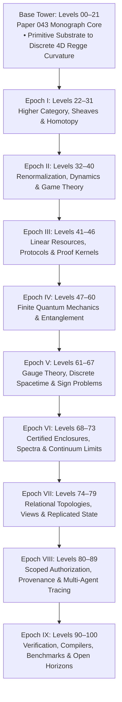

# The Symbol Game & Proposal Fidelity Protocol (PFP) Levels Catalog: Level 00 to Level 100

**AuthorityEffect:** None.  
**Framework:** Proposal Fidelity Protocol (PFP / Runtime Engine) & Monograph Curriculum  
**Canonical Monographs:**
- [`meta_00_symbol_game_foundations.md`](meta_00_symbol_game_foundations.md): Foundations, Core Invariants & Architecture
- [`meta_01_symbol_game_historical_curriculum.md`](meta_01_symbol_game_historical_curriculum.md): Paper 043 Historical 22-Level Curriculum (Historical Notice & Crosswalk)
- [`meta_02_symbol_game_pfp.md`](meta_02_symbol_game_pfp.md): Proposal Fidelity Protocol (PFP) & Packet Envelopes
- [`meta_03_symbol_game_proof_ledger.md`](meta_03_symbol_game_proof_ledger.md): Formal Verification & Lean 4 Proof Ledger
**Numbered curriculum specifications:** 101 ($N = 0 \dots 100$). Supplemental walkthroughs have no runtime stage number.

## Start with a worked certificate

Begin with the [finite-QM certificate walkthrough](level_finite_qm_certificate_walkthrough.md): four vertices, four signed edge values, one potential and one independently checkable lower bound. It teaches a complete finite calculation before introducing the larger catalogue. Follow the [workflow walkthrough](../docs/23_finite_qm_workflow_walkthrough.md) to prepare the actual offline request, understand source pins, and distinguish preparation from judging.

Experienced readers can go directly to [the actual prompt, six research stages and mode](../docs/22_unified_pfp_v4_operad_workflow_and_hacks.md). Those **six workflow stages**, the **eleven public runtime stages**, and these **101 curriculum specifications** name different objects. The [current interfaces](../docs/16_current_types_and_learnings.md) describe runtime availability. The table below retains proposed evaluator names and error labels as teaching specifications; their presence does not establish executable dispatch or implementation coverage.

## Listen, then watch

This block is a recording plan for the catalogue, not a rendered clip. AuthorityEffect: None.

**Plain opening.** This folder lists 101 teaching specifications, numbered 0 through 100. It is not a list of programs that run. The one calculation to do before reading the table is four edge numbers whose leftover is 3.

**Terms at first use.** A potential is a height on each corner. The coboundary, said "d zero", turns heights into edge differences. A residual is what is left when you subtract those differences from the measured edges. Phi one, said "phi one", is the smallest leftover, found by adding absolute values.

**One number before the table.** Take corners 0, 1, 2 and 3. Edges in order: 0 to 1, 1 to 2, 2 to 3, and 0 to 3. Measured values: 2, minus 3, 5, and 7. The three-edge path adds to 4. The direct edge says 7. Seven minus four is 3. Heights 0, 2, minus 1 and 4 reproduce 2, minus 3, 5 and 4, so the leftover list is 0, 0, 0, 3. The absolute sum is 3. The general catalogue, in the ledger below, is 101 separate specifications. This number is only the certificate lesson.

**A check you can fail.** A second list of weights, minus 1, minus 1, minus 1 and 0, does not balance. Vertex 0 is left with plus 1 and vertex 3 with minus 1. If you treat a pairing from those weights as a proof that 3 is optimal, the check fails. Balance comes first. The full arithmetic is in the [certificate walkthrough](level_finite_qm_certificate_walkthrough.md).

**Spoken segment.** Duration: 40 seconds. One idea: the path adds to 4 and the direct edge asks for 7, so the leftover is 3.

> Two, minus three, plus five, is four. The direct edge, from corner zero to corner three, asks for seven. Seven minus four is three. Heights zero, two, minus one and four leave zero, zero, zero and three. Add the absolute values: three. That three is a sum you can do aloud. It is not the output of a level referee. The names checked in the 22 October sample were not in the code. This sentence does not sweep every name in the table.

**Check with no screen.** Add two, then minus three, then five. If you got seven, you added the direct edge too early. The path is four. Seven is the other edge. The leftover is three.

**Video beats.**

| Time | On screen | Narration |
| --- | --- | --- |
| 0:00–0:10 | 101 specifications | "This catalogue is 101 specifications. It is not 101 programs." |
| 0:10–0:22 | 2, −3, +5 = 4 | "Two, minus three, plus five, is four. That is the long path." |
| 0:22–0:32 | 7 − 4 = 3 | "The direct edge says seven. Seven minus four is three." |
| 0:32–0:45 | leftover 0, 0, 0, 3 | "Heights leave a leftover of three on the last edge. The absolute sum is three." |
| 0:45–0:55 | not a log | "Do not read a REFEREE line as a recorded run. The sample names are not in the code." |

## Status rechecked at `305b9690f9` (2026-10-22)

The 2026-10-20 notes below still describe the catalogue. This pass did not regenerate the ledger. It reopened [`CodaTerminal`](../../../../engine/crates_rs/core_state/src/coda_gtla_protocol.rs): the eight names are unchanged, and `CertifiedReceipt` and `Halted` are still absent. `git grep` in `engine`, `pfp` and `lean4` found none of these sample names: `SubstrateModule`, `RigidityModule`, `CochainResidualModule`, `ReggeMetricModule`, `SpectralDiagnosticModule`, `CategoryLimitsModule`, `SheafDescentContract`, `MarkovKernelModule`, `StochasticMatrixContract`, `QuantumFoundationsModule`, `ProjectiveMeasurementContract`, `StabilizerCodeModule`, `StabilizerCodeContract`, `ReggeGeometryModule`, `ReggeGravityContract`, `EnclosureAnalysisModule`, `AlgebraicRootContract`, `FiniteElementCochainModule`, `MeshConvergenceContract`, `RelationalDataModule`, `RelationalQueryContract`, `SecurityGovernanceModule`, `SemanticLossContract`, `AuthorityModule`, `ReleaseManifestContract`. The all-134 name sweep from 2026-10-20 was not repeated. The C4 public input is unchanged, and the leftover 3 above was recomputed from it.

---

## Status at source pin `c419cc6beb` (2026-10-20)

- **No level referee is implemented.** None of the 134 evaluator module or contract names in the level frontmatter occurs in any `*.rs`, `*.py`, `*.lean`, `*.yaml` or `*.json` file outside this documentation. Each numbered file now carries a "Source status" line saying so, its frontmatter status fields were lowered from `verified`/`production`/`passing` to `specified`/`instructional`/`not_run`, and its "native Rust referee" and "RFC 8785" wording was corrected.
- **Terminal names.** The eight statuses match `CodaTerminal` in [`core_state/src/coda_gtla_protocol.rs`](../../../../engine/crates_rs/core_state/src/coda_gtla_protocol.rs). Levels 60 to 79 also list `CertifiedReceipt` and `Halted`, which are not members; each of those files has a correction note.
- **Worked checks.** Each numbered level gained a dated "Worked check", "Correction" or "Reproducibility gap" note next to its test vectors. Several stated dispositions were wrong for the data shown (for example Level 02, whose "valid" cochain certifies $\Phi_1 = 1$, not an exact repair). Many vectors carry only flags or placeholder digests and cannot be replayed from the packet alone.
- **Ledger columns.** The table in Section 3 was regenerated from each file's frontmatter on 2026-10-20; before that, 48 rows disagreed with their files on module, error code, domain or title.

## 1. Architecture and evidence scope

The Symbol Game curriculum describes an arena in which untrusted candidates meet an independent referee. Each numbered specification declares a board, permitted moves and checking obligations. The catalogue is broader than the currently implemented runtime. Its recurring specification fields are:

1. **Game Board 5-Tuple:** $\mathcal{S} = (\mathcal{C}, \mathcal{R}_{\text{active}}, \mathcal{D}_{\text{evaluator}}, \mathcal{H}_{\text{trace}}, \mathcal{I}_{\text{invariants}})$.
2. **Proposer & Referee Dynamics:** Fuel quotas, allowable moves (`ASSERT`, `CUT`, `VERIFY`, `RETRACT`), and syntax firewall.
3. **core-canonical-v1 Packet Envelope:** Immutable boundary slots, candidate payloads, and witness terms across the canonical 6-slot envelope. The sealer is NFC, the `core-canonical-v1` marker, and a bare SHA-256 digest. RFC 8785 is the name of `jcs.rs`, not this sealer.
4. **Typed Objective Evaluators:** Modular evaluator selection (`CochainResidualModule`, `RigidityModule`, `ConvexOptimizationModule`, `ReggeMetricModule`, `AdjunctionModule`, `ObserverReplayModule`, `ReleaseLedgerModule`, etc.) mapping exact domain invariants. Cochain evaluators apply only to levels that declare a cochain complex.
5. **Exact/Certified Arithmetic Law:** Verification carriers use explicitly declared exact or certified representations—e.g. integers, rationals, finite fields, algebraic extensions, algebraic-number encodings, or validated interval enclosures. Uncertified binary floating-point values may not serve as authoritative proof witnesses.
6. **Canonical 8-Status Terminal Taxonomy:** Complete disposition enum (`ExactRepair`, `StabilizedSurvivor`, `OpenObstruction`, `OracleNeeded`, `LiftLicenseNeeded`, `Refused`, `Invalid`, `InfrastructureFailure`) with explicit error routing and mechanically derived reachability.
7. **Claim Hygiene Quadrant:** Strictly scoped empirical claims with zero authority minting.

---

## 2. Epoch Architecture Breakdown

---

## 3. Complete 101-Level Master Ledger

| Level | Document | Title | Epoch | Domain | Evaluator Module / Contract (proposed) | Primary Error Code |
|:---:|:---|:---|:---|:---|:---|:---|
| **00** | [`level_00_ground.md`](level_00_ground.md) | The Sub-Binary Ground & Void Wire Packet | Base Tower | Substrate Foundations | `SubstrateModule` | `ERR_EMPTY_CARRIER` |
| **01** | [`level_01_symbol_genesis.md`](level_01_symbol_genesis.md) | Symbol Genesis & Rigid Binary Cuts | Base Tower | Combinatorial Rigidity | `RigidityModule` | `ERR_BINARY_CUT_MALFORMED` |
| **02** | [`level_02_relational_pairings.md`](level_02_relational_pairings.md) | Relational Pairings & Obstructed 2-Step Cochains | Base Tower | Discrete Homology | `CochainResidualModule` | `ERR_BOUNDARY_DEFECT` |
| **03** | [`level_03_abstract_simplices.md`](level_03_abstract_simplices.md) | Abstract Simplices & Exact LP Weak Duality | Base Tower | Convex Optimization | `ConvexOptimizationModule` | `ERR_DUALITY_BOUND_VIOLATION` |
| **04** | [`level_04_simplex_graph_expansions.md`](level_04_simplex_graph_expansions.md) | Simplex Graph Expansions & Presheaf Topoi | Base Tower | Category Theory | `PresheafModule` | `ERR_CONTEXT_INCONGRUENT` |
| **05** | [`level_05_regge_metric_simplices.md`](level_05_regge_metric_simplices.md) | Regge Metric Simplices & Deficit Obstructions | Base Tower | Discrete Geometry | `ReggeMetricModule` | `ERR_CAYLEY_MENGER_METRIC_VIOLATION` |
| **06** | [`level_06_tower_extension_retraction.md`](level_06_tower_extension_retraction.md) | Tower Extension, Retraction & Survivor Zeta | Base Tower | Analytic Combinatorics | `SurvivorZetaModule` | `ERR_RETRACTION_DEFECT` |
| **07** | [`level_07_transfer_operators_orbits.md`](level_07_transfer_operators_orbits.md) | Shift Dynamics, De Bruijn Orbits & 12 Extension Conditions | Base Tower | Symbolic Dynamics | `ExtensionAuditModule` | `ERR_AUDIT_CONDITION_FAILED` |
| **08** | [`level_08_monadic_adjunction_cochains.md`](level_08_monadic_adjunction_cochains.md) | Adjoint Monads & 16-Family Packet Catalog | Base Tower | Categorical Protocols | `AdjunctionModule` | `ERR_TRIANGLE_IDENTITY_VIOLATION` |
| **09** | [`level_09_dagger_monads_reversal.md`](level_09_dagger_monads_reversal.md) | Dagger Monads & Reflection Duality | Base Tower | Involution Categories | `InvolutionModule` | `ERR_DAGGER_ASYMMETRY` |
| **10** | [`level_10_spectral_epistemic_quarantine.md`](level_10_spectral_epistemic_quarantine.md) | Spectral Shadows & Epistemic Quarantine | Base Tower | Spectral Graph Theory | `SpectralDiagnosticModule` | `ERR_SPECTRAL_LEAKAGE` |
| **11** | [`level_11_polygraph_confluence_peaks.md`](level_11_polygraph_confluence_peaks.md) | Term Rewriting, ARS Confluence & 3-Polygraphs | Base Tower | Rewriting Theory | `RewriteModule` | `ERR_CRITICAL_PEAK_NOT_JOINABLE` |
| **12** | [`level_12_observer_stack_dda.md`](level_12_observer_stack_dda.md) | Observer Stack & DDA Event Records | Base Tower | Automata Theory | `ObserverReplayModule` | `ERR_OBSERVER_INADEQUATE` |
| **13** | [`level_13_alternation_cycle_detection.md`](level_13_alternation_cycle_detection.md) | Alternation Ladders & Bounded Non-Universal Execution | Base Tower | Computational Complexity | `BoundedLadderModule` | `ERR_CYCLE_DETECTED` |
| **14** | [`level_14_bounded_quantifier_grammar.md`](level_14_bounded_quantifier_grammar.md) | Bounded Quantifier Grammar & Polarity Partitioning | Base Tower | Formal Grammar | `GrammarPolarityModule` | `ERR_POLARITY_MISMATCH` |
| **15** | [`level_15_rbg_authority_separation.md`](level_15_rbg_authority_separation.md) | R-B-G Horizon & Tri-Colour Authority Separation | Base Tower | Governance Architecture | `AuthorityModule` | `ERR_UNVERIFIED_PROMOTION` |
| **16** | [`level_16_filtered_ind_objects.md`](level_16_filtered_ind_objects.md) | Filtered Ind-Objects & Colimit Isolation | Base Tower | Category Theory | `CategoryLimitsModule` | `ERR_COLIMIT_INCOHERENCE` |
| **17** | [`level_17_per_lift_dialects.md`](level_17_per_lift_dialects.md) | Per-Lift Dialect Languages & Conformance Audits | Base Tower | Compiler Theory | `DialectAuditModule` | `ERR_DIALECT_CHECKSUM_MISMATCH` |
| **18** | [`level_18_discrete_hodge_decomposition.md`](level_18_discrete_hodge_decomposition.md) | Discrete Hodge Decomposition & Harmonic Cochains | Base Tower | Differential Topology | `CochainResidualModule` | `ERR_HODGE_RESIDUAL_NONZERO` |
| **19** | [`level_19_zeta_spectral_shadow.md`](level_19_zeta_spectral_shadow.md) | Ihara-Ramanujan Zeta Quarantine & Spectral Arithmetic | Base Tower | Algebraic Number Theory | `SpectralDiagnosticModule` | `ERR_ZETA_POLE_POLLUTION` |
| **20** | [`level_20_autopoietic_reflection.md`](level_20_autopoietic_reflection.md) | Autopoietic Reflection & Mandatory Gödel Break | Base Tower | Mathematical Logic | `AutopoieticLoopModule` / `DescentVerificationContract` | `ERR_AUTOPOIETIC_LOOP` |
| **21** | [`level_21_discrete_4d_regge_curvature.md`](level_21_discrete_4d_regge_curvature.md) | Discrete 4D Regge Metric Deficits & Bianchi Holonomy | Base Tower | Discrete General Relativity | `ReggeGeometryModule` / `ReggeBianchiContract` | `ERR_BIANCHI_HOLONOMY_DEFECT` |
| **22** | [`level_22_fibred_dependent_contexts.md`](level_22_fibred_dependent_contexts.md) | Fibred Dependent Contexts & Reindexing Functors | Epoch I | Fibration Theory | `CategoryLimitsModule` / `FibredContextContract` | `REFUSED_FIBER_MISMATCH` |
| **23** | [`level_23_sheaf_and_descent.md`](level_23_sheaf_and_descent.md) | Sheaf Gluing & Grothendieck Descent | Epoch I | Sheaf Theory | `CategoryLimitsModule` / `SheafDescentContract` | `REFUSED_OVERLAP_CONFLICT` |
| **24** | [`level_24_topos_and_subobject.md`](level_24_topos_and_subobject.md) | Topos Subobject Classifiers & Truth Objects | Epoch I | Topos Theory | `CategoryLimitsModule` / `SubobjectClassifierContract` | `ERR_SUBOBJECT_MONO_DEFECT` |
| **25** | [`level_25_model_localization.md`](level_25_model_localization.md) | Model Localization & Weak Equivalences | Epoch I | Homotopical Algebra | `LocalizationModule` / `ModelLocalizationContract` | `ERR_WEAK_EQUIVALENCE_DEFECT` |
| **26** | [`level_26_operad_and_multiarity.md`](level_26_operad_and_multiarity.md) | Coloured Operads & Multiarity Tree Composition | Epoch I | Operad Theory | `OperadModule` / `OperadCompositionContract` | `ERR_OPERATION_ARITY_DEFECT` |
| **27** | [`level_27_higher_coherence.md`](level_27_higher_coherence.md) | Higher Coherence & Monoidal Pentagon Identity | Epoch I | Higher Categories | `HigherCoherenceModule` / `MonoidalPentagonContract` | `ERR_ASSOCIATOR_CELL_DEFECT` |
| **28** | [`level_28_homotopy_type_equivalence.md`](level_28_homotopy_type_equivalence.md) | Homotopy Type Equivalence Witnesses | Epoch I | Homotopy Type Theory | `HomotopyTypeModule` / `HomotopyEquivalenceContract` | `ERR_EQUIVALENCE_WITNESS_DEFECT` |
| **29** | [`level_29_derived_obstruction.md`](level_29_derived_obstruction.md) | Derived Obstruction & Projective Resolutions | Epoch I | Homological Algebra | `DerivedFunctorModule` / `ProjectiveResolutionContract` | `ERR_RESOLUTION_COMPLEX_DEFECT` |
| **30** | [`level_30_spectral_sequence_pages.md`](level_30_spectral_sequence_pages.md) | Spectral Sequence Pages & Differential Transits | Epoch I | Homological Algebra | `SpectralSequenceModule` / `SpectralSequencePageContract` | `ERR_FILTRATION_DEFECT` |
| **31** | [`level_31_cohomology_operations.md`](level_31_cohomology_operations.md) | Steenrod Squares & Cohomology Operations | Epoch I | Algebraic Topology | `CohomologyOperationsModule` / `SteenrodF2Contract` | `ERR_OPERATION_DEGREE_DEFECT` |
| **32** | [`level_32_coarse_graining.md`](level_32_coarse_graining.md) | Kadanoff Block Coarse Graining & Projection | Epoch II | Statistical Mechanics | `StatisticalPhysicsModule` / `CoarseGrainingContract` | `ERR_BLOCK_MAP_DEFECT` |
| **33** | [`level_33_renormalization_flow.md`](level_33_renormalization_flow.md) | Wilsonian Renormalization Flow & Fixed Points | Epoch II | Dynamical Systems | `StatisticalPhysicsModule` / `RenormalizationFlowContract` | `ERR_SCALE_PARAMETER_DEFECT` |
| **34** | [`level_34_statistical_manifolds.md`](level_34_statistical_manifolds.md) | Fisher Information Metrics & Statistical Manifolds | Epoch II | Information Geometry | `InformationGeometryModule` / `StatisticalManifoldContract` | `ERR_PARAMETRIC_FAMILY_DEFECT` |
| **35** | [`level_35_finite_markov_kernels.md`](level_35_finite_markov_kernels.md) | Finite Markov Kernels & Stochastic Matrices | Epoch II | Probability Theory | `MarkovKernelModule` / `StochasticMatrixContract` | `ERR_STOCHASTIC_KERNEL_DEFECT` |
| **36** | [`level_36_bayesian_updates.md`](level_36_bayesian_updates.md) | Bayesian Likelihood Updates & Evidence Ratio | Epoch II | Bayesian Statistics | `BayesianUpdateModule` / `BayesianLikelihoodContract` | `ERR_LIKELIHOOD_DEFECT` |
| **37** | [`level_37_causal_intervention.md`](level_37_causal_intervention.md) | Pearl Causal Graphs & Do-Calculus Interventions | Epoch II | Causal Inference | `CausalInferenceModule` / `CausalInterventionContract` | `ERR_STRUCTURAL_EQUATION_DEFECT` |
| **38** | [`level_38_counterfactuals.md`](level_38_counterfactuals.md) | Counterfactual Structural Equations & Exogenous Twins | Epoch II | Causal Logic | `CausalLogicModule` / `CounterfactualAbductionContract` | `ERR_EXOGENOUS_CONTEXT_DEFECT` |
| **39** | [`level_39_game_strategies.md`](level_39_game_strategies.md) | Normal Form Game Strategies & Dominance Elimination | Epoch II | Game Theory | `GameTheoryModule` / `NormalFormStrategyContract` | `ERR_STRATEGY_MAP_DEFECT` |
| **40** | [`level_40_equilibrium_evidence.md`](level_40_equilibrium_evidence.md) | Zero-Sum Minimax Certificates & Equilibrium Duality | Epoch II | Game Theory | `GameTheoryModule` / `ZeroSumMinimaxContract` | `ERR_BEST_RESPONSE_DEFECT` |
| **41** | [`level_41_linear_resources.md`](level_41_linear_resources.md) | Girard Linear Logic & Resource Token Accounting | Epoch III | Proof Theory | `LinearLogicModule` / `LinearResourceAccountingContract` | `ERR_RESOURCE_TOKEN_DEFECT` |
| **42** | [`level_42_session_protocols.md`](level_42_session_protocols.md) | Multiparty Session Types & Duality Choreography | Epoch III | Concurrency Theory | `SessionProtocolModule` / `SessionTypeChoreographyContract` | `ERR_SEND_STATE_DEFECT` |
| **43** | [`level_43_effect_and_capability.md`](level_43_effect_and_capability.md) | Effect Rows & Scoped Capability Tokens | Epoch III | Type Systems | `EffectSystemModule` / `ScopedCapabilityRowContract` | `ERR_EFFECT_ROW_DEFECT` |
| **44** | [`level_44_refinement_contracts.md`](level_44_refinement_contracts.md) | Liquid Refinement Types & Hoare Predicates | Epoch III | Formal Methods | `RefinementContractModule` / `LiquidRefinementTypeContract` | `ERR_PREDICATE_REFINEMENT_DEFECT` |
| **45** | [`level_45_proof_kernel_boundary.md`](level_45_proof_kernel_boundary.md) | LCF Proof Kernel & Trusted Computing Base | Epoch III | Proof Engines | `ProofKernelModule` / `LCFProofKernelContract` | `ERR_PROOF_TERM_DEFECT` |
| **46** | [`level_46_self_host_and_termination.md`](level_46_self_host_and_termination.md) | Total Self-Hosting & Kleene Fixed-Point Fences | Epoch III | Metamathematics | `AutopoieticLoopModule` / `SelfHostingTerminationContract` | `ERR_SELF_DESCRIPTION_DEFECT` |
| **47** | [`level_47_exact_complex_scalars.md`](level_47_exact_complex_scalars.md) | Gaussian Rational Field Q(i) & Exact Amplitudes | Epoch IV | Quantum Foundations | `QuantumFoundationsModule` / `GaussianRationalScalarContract` | `ERR_RATIONAL_PAIR_DEFECT` |
| **48** | [`level_48_finite_hilbert_states.md`](level_48_finite_hilbert_states.md) | Exact Finite Inner-Product State Spaces & Normalization | Epoch IV | Quantum State Space | `QuantumFoundationsModule` / `StateNormalizationContract` | `ERR_STATE_VECTOR_DEFECT` |
| **49** | [`level_49_spin_one_half_states.md`](level_49_spin_one_half_states.md) | Qubit States & Pauli/Bloch Representation | Epoch IV | Qubit Geometry | `QuantumFoundationsModule` / `BlochQubitContract` | `ERR_SPIN_BASIS_DEFECT` |
| **50** | [`level_50_pauli_observables.md`](level_50_pauli_observables.md) | Pauli Observable Algebra & Commutator Rings | Epoch IV | Operator Algebras | `QuantumFoundationsModule` / `PauliAlgebraContract` | `ERR_PAULI_MATRIX_DEFECT` |
| **51** | [`level_51_born_instruments.md`](level_51_born_instruments.md) | Born Rule Projective Measurement Instruments | Epoch IV | Measurement Theory | `QuantumFoundationsModule` / `ProjectiveMeasurementContract` | `ERR_PROJECTOR_FAMILY_DEFECT` |
| **52** | [`level_52_sequential_instruments.md`](level_52_sequential_instruments.md) | Sequential Measurements & Non-Commutative Collapse | Epoch IV | Quantum Logic | `QuantumFoundationsModule` / `SequentialInstrumentContract` | `ERR_MEASUREMENT_ORDER_DEFECT` |
| **53** | [`level_53_tensor_product_states.md`](level_53_tensor_product_states.md) | Kronecker Tensor Products & Multipartite States | Epoch IV | Quantum Information | `QuantumFoundationsModule` / `TensorProductContract` | `ERR_FACTOR_BASIS_DEFECT` |
| **54** | [`level_54_entanglement_witness.md`](level_54_entanglement_witness.md) | Schmidt Decomposition & Entanglement Witnesses | Epoch IV | Quantum Information | `QuantumFoundationsModule` / `SchmidtRankContract` | `ERR_SCHMIDT_RANK_DEFECT` |
| **55** | [`level_55_no_signaling_marginals.md`](level_55_no_signaling_marginals.md) | No-Signaling Marginal Polytopes & Local Reductions | Epoch IV | Quantum Foundations | `QuantumFoundationsModule` / `NoSignalingContract` | `ERR_LOCAL_MEASUREMENT_DEFECT` |
| **56** | [`level_56_environment_tracing.md`](level_56_environment_tracing.md) | Environment Tracing & Mixed Density Matrices | Epoch IV | Open Quantum Systems | `QuantumFoundationsModule` / `PartialTraceContract` | `ERR_JOINT_STATE_DEFECT` |
| **57** | [`level_57_discrete_unitary_dynamics.md`](level_57_discrete_unitary_dynamics.md) | Discrete Unitary Dynamics & Cayley Solvers | Epoch IV | Quantum Dynamics | `QuantumFoundationsModule` / `UnitaryCayleyContract` | `ERR_HAMILTONIAN_SPEC_DEFECT` |
| **58** | [`level_58_contextuality_scenarios.md`](level_58_contextuality_scenarios.md) | Kochen-Specker Contextuality Scenarios | Epoch IV | Quantum Contextuality | `QuantumFoundationsModule` / `ContextualityContract` | `ERR_MEASUREMENT_CONTEXT_DEFECT` |
| **59** | [`level_59_bell_correlation_tests.md`](level_59_bell_correlation_tests.md) | Bell-CHSH Correlation Tests & Tsirelson Bounds | Epoch IV | Non-Locality | `QuantumFoundationsModule` / `CHSHCorrelatorContract` | `ERR_SETTING_PAIR_DEFECT` |
| **60** | [`level_60_quantum_error_correction.md`](level_60_quantum_error_correction.md) | Gottesman Stabilizer Codes & Syndrome Decoders | Epoch IV | Quantum Computing | `StabilizerCodeModule` / `StabilizerCodeContract` | `ERR_STABILIZER_GENERATORS_DEFECT` |
| **61** | [`level_61_gauge_connections.md`](level_61_gauge_connections.md) | Principal Bundles & Discrete Gauge Group Transits | Epoch V | Gauge Theory | `GaugeConnectionModule` / `GaugeConnectionContract` | `ERR_GAUGE_TRANSFORMATION_DEFECT` |
| **62** | [`level_62_discrete_lattice_gauge.md`](level_62_discrete_lattice_gauge.md) | Wilson Plaquette Loops & Lattice Yang-Mills Action | Epoch V | Lattice Field Theory | `LatticeGaugeModule` / `LatticeGaugeContract` | `ERR_PLAQUETTE_HOLONOMY_DEFECT` |
| **63** | [`level_63_discrete_gravity.md`](level_63_discrete_gravity.md) | Discrete Regge Spacetime & Simplicial Action | Epoch V | Quantum Gravity | `ReggeGeometryModule` / `ReggeGravityContract` | `ERR_REGGE_METRIC_DEFECT` |
| **64** | [`level_64_discrete_bianchi_tests.md`](level_64_discrete_bianchi_tests.md) | Discrete Bianchi Identities & 3-Cell Commutation | Epoch V | Spacetime Geometry | `ReggeGeometryModule` / `DiscreteBianchiContract` | `ERR_BIANCHI_IDENTITY_DEFECT` |
| **65** | [`level_65_quantum_gravity_interface.md`](level_65_quantum_gravity_interface.md) | Commuting Triangle Bridges & Spin Foam Vertices | Epoch V | Quantum Gravity | `SpinFoamModule` / `SpinFoamContract` | `ERR_INTERTWINER_INVARIANCE_DEFECT` |
| **66** | [`level_66_signed_sum_models.md`](level_66_signed_sum_models.md) | Signed Sum Characters & Non-Positive Measures | Epoch V | Computational Physics | `SignedStatisticalPhysicsModule` / `SignedPartitionSumContract` | `ERR_SIGN_COLLAPSE_DEFECT` |
| **67** | [`level_67_sign_problem_lower_bounds.md`](level_67_sign_problem_lower_bounds.md) | Fermion Sign Problem & NP-Hardness Barriers | Epoch V | Computational Complexity | `ComputationalComplexityModule` / `ComplexityReductionContract` | `ERR_REDUCTION_MAP_DEFECT` |
| **68** | [`level_68_interval_arithmetic.md`](level_68_interval_arithmetic.md) | Validated Interval Arithmetic & Box Enclosures | Epoch VI | Rigorous Numerics | `EnclosureAnalysisModule` / `IntervalArithmeticContract` | `ERR_INTERVAL_CONTAINMENT_DEFECT` |
| **69** | [`level_69_algebraic_real_numbers.md`](level_69_algebraic_real_numbers.md) | Real Algebraic Field Q_alg & Sturm Chains | Epoch VI | Computer Algebra | `EnclosureAnalysisModule` / `AlgebraicRootContract` | `ERR_ALGEBRAIC_ROOT_ISOLATION_DEFECT` |
| **70** | [`level_70_finite_transfer_spectra.md`](level_70_finite_transfer_spectra.md) | Transfer Matrix Spectra & Spectral Gap Enclosures | Epoch VI | Statistical Mechanics | `SpectralDiagnosticModule` / `TransferSpectraContract` | `ERR_TRANSFER_SPECTRAL_GAP_DEFECT` |
| **71** | [`level_71_analytic_limit_fences.md`](level_71_analytic_limit_fences.md) | Cauchy Sequence Filtrations & Analytic Fences | Epoch VI | Constructive Analysis | `EnclosureAnalysisModule` / `CauchyModulusContract` | `ERR_CAUCHY_MODULUS_DEFECT` |
| **72** | [`level_72_finite_element_cochains.md`](level_72_finite_element_cochains.md) | Simplicial Finite Element Meshes & Whitney Forms | Epoch VI | Numerical PDE | `FiniteElementCochainModule` / `WhitneyFormContract` | `ERR_WHITNEY_COMMUTATION_DEFECT` |
| **73** | [`level_73_continuum_approximation.md`](level_73_continuum_approximation.md) | Mesh Refinement Convergence & Error Bounds | Epoch VI | Approximation Theory | `FiniteElementCochainModule` / `MeshConvergenceContract` | `ERR_CONVERGENCE_RATE_DEFECT` |
| **74** | [`level_74_relational_query_mapping.md`](level_74_relational_query_mapping.md) | Codd Relational Algebra & Join Topology Graphs | Epoch VII | Database Theory | `RelationalDataModule` / `RelationalQueryContract` | `ERR_QUERY_EQUIVALENCE_DEFECT` |
| **75** | [`level_75_incremental_views.md`](level_75_incremental_views.md) | Incremental View Maintenance & Delta Relations | Epoch VII | Database Systems | `RelationalDataModule` / `IncrementalViewContract` | `ERR_VIEW_MAINTENANCE_DEFECT` |
| **76** | [`level_76_topological_database_cells.md`](level_76_topological_database_cells.md) | Topological Database Cells & Sheaf Indexing | Epoch VII | Data Models | `RelationalDataModule` / `DatabaseSheafContract` | `ERR_DATABASE_SHEAF_CONSISTENCY_DEFECT` |
| **77** | [`level_77_transactional_receipts.md`](level_77_transactional_receipts.md) | ACID Transaction Envelopes & Two-Phase Commit | Epoch VII | Distributed Systems | `TransactionModule` / `TransactionSerializabilityContract` | `ERR_SERIALIZABILITY_CYCLE_DEFECT` |
| **78** | [`level_78_distributed_event_logs.md`](level_78_distributed_event_logs.md) | Lamport Clocks & Append-Only Merkle DAGs | Epoch VII | Distributed Systems | `AutomataTraceModule` / `CausalEventLogContract` | `ERR_VECTOR_CLOCK_PROGRESSION_DEFECT` |
| **79** | [`level_79_convergent_replicated_data.md`](level_79_convergent_replicated_data.md) | Conflict-Free Replicated Data Types (CRDTs) | Epoch VII | Distributed State | `RelationalDataModule` / `CRDTJoinSemilatticeContract` | `ERR_CRDT_JOIN_DEFECT` |
| **80** | [`level_80_scoped_authorization.md`](level_80_scoped_authorization.md) | Macaroon Caveat Chains & Scoped Delegation | Epoch VIII | Authorization | `AuthorityModule` / `AuthorizationContract` | `REFUSED_ACTION_NOT_PERMITTED` |
| **81** | [`level_81_privacy_boundaries.md`](level_81_privacy_boundaries.md) | Differential Privacy & Bounded Query Sensitivity | Epoch VIII | Data Privacy | `SecurityGovernanceModule` / `DifferentialPrivacyContract` | `ERR_RELEASE_QUERY_DEFECT` |
| **82** | [`level_82_security_provenance.md`](level_82_security_provenance.md) | Software Supply Chain Provenance (SLSA v1.0) | Epoch VIII | Supply Chain Security | `SecurityGovernanceModule` / `SupplyChainProvenanceContract` | `ERR_SIGNED_MANIFEST_DEFECT` |
| **83** | [`level_83_data_lineage.md`](level_83_data_lineage.md) | End-to-End Data Lineage & Mutation DAGs | Epoch VIII | Data Governance | `SecurityGovernanceModule` / `DataLineageContract` | `ERR_SOURCE_DIGEST_DEFECT` |
| **84** | [`level_84_llm_tool_calls.md`](level_84_llm_tool_calls.md) | LLM Tool Call Schemas & JSON-Schema Isolation | Epoch VIII | Agentic Systems | `SecurityGovernanceModule` / `ToolExecutionContract` | `ERR_TOOL_SCHEMA_DEFECT` |
| **85** | [`level_85_agent_task_routing.md`](level_85_agent_task_routing.md) | Task Routing DAGs & Capability Gating | Epoch VIII | Multi-Agent Systems | `SecurityGovernanceModule` / `CapabilityRoutingContract` | `ERR_TASK_SCOPE_DEFECT` |
| **86** | [`level_86_multi_agent_traces.md`](level_86_multi_agent_traces.md) | Multi-Agent Turn Trace Integrity & Audit | Epoch VIII | Multi-Agent Systems | `SecurityGovernanceModule` / `AgentTraceContract` | `ERR_AGENT_EVENT_DEFECT` |
| **87** | [`level_87_audit_challenge.md`](level_87_audit_challenge.md) | Adversarial Challenge Injection & Red-Team Probes | Epoch VIII | Security Auditing | `SecurityGovernanceModule` / `AdversarialFixtureContract` | `ERR_NEGATIVE_FIXTURE_DEFECT` |
| **88** | [`level_88_sandbox_boundaries.md`](level_88_sandbox_boundaries.md) | Process Sandbox Boundaries & System Call Fences | Epoch VIII | Platform Security | `SecurityGovernanceModule` / `SandboxPolicyContract` | `ERR_EXECUTION_POLICY_DEFECT` |
| **89** | [`level_89_error_accounting.md`](level_89_error_accounting.md) | Residual Error Accounting & Bounded Loss Budgets | Epoch VIII | Fault Tolerance | `SecurityGovernanceModule` / `ErrorBudgetContract` | `ERR_ERROR_SOURCE_DEFECT` |
| **90** | [`level_90_natural_language_fidelity.md`](level_90_natural_language_fidelity.md) | Natural Language Extraction & Semantic Loss Ledgers | Epoch IX | Language Grounding | `SecurityGovernanceModule` / `SemanticLossContract` | `ERR_SOURCE_SPAN_DEFECT` |
| **91** | [`level_91_typed_translation.md`](level_91_typed_translation.md) | Verified Cross-Language AST Translation | Epoch IX | Compiler Verification | `DialectAuditModule` / `LanguageTranslationContract` | `ERR_SOURCE_AST_DEFECT` |
| **92** | [`level_92_proof_extraction.md`](level_92_proof_extraction.md) | Automated Proof Witness Extraction & Replay | Epoch IX | Automated Reasoning | `VerificationToolchainModule` / `ProofExtractionContract` | `ERR_SOLVER_TRACE_DEFECT` |
| **93** | [`level_93_compiler_preservation.md`](level_93_compiler_preservation.md) | Compiler Optimization Preservation & Bisimulation | Epoch IX | Compilers | `DialectAuditModule` / `CompilerPreservationContract` | `ERR_INTERMEDIATE_AST_DEFECT` |
| **94** | [`level_94_protocol_composition.md`](level_94_protocol_composition.md) | Vertical Protocol Stacking & Clean Architecture Ports | Epoch IX | Software Architecture | `VerificationToolchainModule` / `CleanArchitectureContract` | `ERR_INTERFACE_PORT_DEFECT` |
| **95** | [`level_95_performance_receipts.md`](level_95_performance_receipts.md) | Deterministic Resource Counting & Memory Bounds | Epoch IX | Performance Engineering | `VerificationToolchainModule` / `PerformanceReceiptContract` | `ERR_RESOURCE_COUNTER_DEFECT` |
| **96** | [`level_96_benchmark_trials.md`](level_96_benchmark_trials.md) | Hermetic Benchmark Trials & Variance Analysis | Epoch IX | Empirical Evaluation | `VerificationToolchainModule` / `BenchmarkAnalysisContract` | `ERR_TRIAL_MANIFEST_DEFECT` |
| **97** | [`level_97_mutation_suites.md`](level_97_mutation_suites.md) | Mutation Testing & Mutant Kill Ratio Auditing | Epoch IX | Quality Assurance | `VerificationToolchainModule` / `MutationTestingContract` | `ERR_MUTATION_OPERATOR_DEFECT` |
| **98** | [`level_98_differential_checking.md`](level_98_differential_checking.md) | Differential Fuzzing & Dual-Engine Parity | Epoch IX | Security Testing | `VerificationToolchainModule` / `DifferentialCheckingContract` | `ERR_CHECKER_PAIR_DEFECT` |
| **99** | [`level_99_property_tests.md`](level_99_property_tests.md) | QuickCheck-Style Property Generators & Shrinking | Epoch IX | Automated Testing | `VerificationToolchainModule` / `PropertyTestingContract` | `ERR_GENERATOR_SEED_DEFECT` |
| **100** | [`level_100_open_horizon_and_release.md`](level_100_open_horizon_and_release.md) | Open Horizon Claim Ledger & Release Sealing | Epoch IX | Epistemic Governance | `AuthorityModule` / `ReleaseManifestContract` | `ERR_RELEASE_MANIFEST_DEFECT` |

---

## 4. Other files in this folder

| File | What it is |
| :--- | :--- |
| [`level_finite_qm_certificate_walkthrough.md`](level_finite_qm_certificate_walkthrough.md) | Worked C4 certificate lesson (supplement, no stage number) |
| [`curriculum_lesson_crosswalk.md`](curriculum_lesson_crosswalk.md) | Level-to-lesson crosswalk; links repointed to [`../curriculum/`](../curriculum/) on 2026-10-20 |
| [`meta_00_symbol_game_foundations.md`](meta_00_symbol_game_foundations.md) to [`meta_03_symbol_game_proof_ledger.md`](meta_03_symbol_game_proof_ledger.md) | The four canonical monographs listed at the top |
| [`level_challenge_findings_readme.md`](level_challenge_findings_readme.md) | Index of the challenge findings notes |
| [`level_c043_space_bunny_and_combinatorial_findings.md`](level_c043_space_bunny_and_combinatorial_findings.md) to [`level_c059_space_bunny_and_sql_findings.md`](level_c059_space_bunny_and_sql_findings.md) | Seventeen per-challenge findings notes, C043 to C059 (copies of the atlas notes; see their 2026-10-20 source checks) |
| [`level_challenges_findings_and_updates.md`](level_challenges_findings_and_updates.md) | Hub of challenge findings and updates |
| [`level_symbol_game_challenge_and_demos_findings.md`](level_symbol_game_challenge_and_demos_findings.md) | Hub of challenge and demo findings |

The folder holds 128 files: 101 numbered levels, these 26 files and this README.

## 5. Claim Hygiene Quadrant

1. **What this supports:**
   - A 101-level curriculum specification and game catalogue for the Symbol Game and Proposal Fidelity Protocol (PFP).
   - A uniform 6-section protocol specification across the mathematical, physical, computational and agentic domains.
   - Declared evaluator boundaries that require an implementation and task-specific evidence before dispatch can be claimed.
   - Packet and terminal specifications whose executable coverage must be checked separately. PacketCodec uses NFC, tagged `core-canonical-v1` and bare SHA-256; it is not RFC 8785.
2. **What this does not support:**
   - Does not assert that every trans-base stage possesses an active production Rust solver deployment today.
   - Does not promote local candidate replay receipts into external operational authority or global truth.
3. **The narrowest defensible claim:**
   - The 101 numbered files provide declared learning and verification obligations. The supplemental certificate lesson works one supplied finite cochain example.
4. **Next test needed:**
   - Run documentation integrity validators across all 101 level files and verify cross-links.
