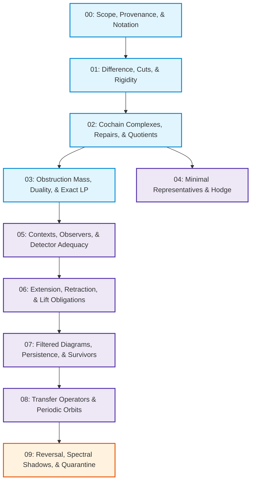

# Chapter 00: Mathematical Scope, Provenance, and Notation

**Status:** Canonical Mathematics Foundation (Spine Chapter 00)  
**Authority:** None. Epistemic scope, namespace definitions, and claim discipline.

---

## 1. Foundational Namespace Firewall

Before formulating any mathematical definitions or relations, the Symbol Game mathematical estate establishes the strict namespace and provenance separation:

$$\boxed{
\text{Genesis } S(n) \;\neq\; \text{MSS-}N \;\neq\; \text{SG-}N
}$$

| Namespace | Notation | Mathematical & Operational Role | Custody & Authority |
| :--- | :--- | :--- | :--- |
| **Genesis Derivation** | $\text{Genesis } S(n)$ | The sealed, provenance-bearing seed derivation and regime trace ($19L57G1@\text{sealed-derivation-v1}$). | Immutable derivation custody; not to be redefined as naming statistics. |
| **Minimal Symbol System** | $\text{MSS-}N$ | The internal operational stratum ($N \in \{0, \dots, 100\}$) defining evaluation depth, audit ladders, and structural stages. | Operational engine and evaluator hierarchy. |
| **Symbol Game Levels** | $\text{SG-}N$ | The progressive educational curriculum and evaluation board game levels within the Proposal Fidelity Protocol (PFP). | Curricular game levels and evaluation specifications. |
| **Naming Pressure** | $NP(n)$ | The discrete generator accounting statistic measuring the cardinality increment of new generators required to resolve an admitted family of context witnesses $W_n$. | Discrete metric: $NP(n+1) = NP(n) + \Delta(W_n)$. Never named $S(n)$. |

### 1.1 The Naming Pressure Recurrence

In legacy documentation, naming pressure was conflated with Genesis by writing $S(n+1) = S(n) + \Delta(W_n)$.  
This notation is permanently deprecated. Naming pressure is denoted strictly by $NP(n)$:

$$\boxed{NP(n+1) = NP(n) + \Delta(W_n)}$$

where $\Delta(W_n)$ is the joint constructor increment: the minimal cardinality of an admitted generator set $\mathsf{G}$ resolving all witnesses in $W_n$.

---

## 2. Epistemic Claim Stratification Grades

Every statement and theorem across the Symbol Game mathematical estate belongs to one of seven distinct epistemic grades. No document may present a speculative analogy or an operational policy as an established mathematical theorem.

```text
1. Definition:
   Explicit, unambiguous introduction of terms, carriers, complexes, or operators.

2. Prose Theorem:
   A mathematically rigorous statement with a complete, verifiable deduction in text,
   bounded by explicit declared hypotheses.

3. Lean Theorem:
   A formal theorem mechanized and type-checked in the Lean 4 proof assistant kernel
   with zero unadmitted axioms or `sorry` tokens.

4. Finite Computation:
   An exact, reproducible numerical or symbolic calculation over finite combinatorial
   structures (e.g. rational linear programs, matrix traces, Cayley-Menger determinants).

5. Runtime Policy:
   A host operational constraint or execution convention (e.g. step budgets, cycle
   interruption via GODEL_BREAK) enforced to ensure termination or safety.

6. Application:
   A downstream mapping of mathematical cochain structures to external domains
   (e.g. database view maintenance, discrete simplicial spacetime models).

7. Conjecture / Research Program:
   An open mathematical question or exploratory analogy carrying strict epistemic
   quarantine (e.g. spectral shadows, functional reflection analogies).
```

Every subsequent chapter in this canonical spine declares its contents using machine-readable YAML frontmatter under `mathematical_status`.

---

## 3. The Declared Exact / Certified Scalar Law

The Symbol Game mathematical estate rejects unverified floating-point numbers as truth-bearing certificates:

> **The Declared Exact / Certified Scalar Law:**  
> Approximate or heuristic algorithms (including IEEE-754 floating-point numerical solvers, subgradient approximations, and deep learning heuristics) are permitted to explore candidate spaces and propose bases. However, **all final admission, certificate verification, and duality-gap closure must execute strictly over declared exact or certified scalar domains**:
> 1. The field of rational numbers $\mathbb{Q}$,
> 2. Certified algebraic number field extensions $\mathbb{Q}(\alpha)$,
> 3. Certified rational interval arithmetic $\operatorname{Interval}[\mathbb{Q}]$ with rigorous outer bounds.

### 3.1 Specialization to $\mathbb{Q}$
The canonical $\ell^1$ linear programming dual certificate implementations in Chapters 02–04 specialize to the rational field $K = \mathbb{Q}$. Floating-point residuals are untrusted proposals until checked by rational arithmetic.

---

## 4. Canonical Spine Dependency Map (10 Chapters)

The 10 chapters form a linear and stratified mathematical dependency tree:



### Chapter Overview
- **Chapter 00:** Scope, Provenance, and Notation (Foundations & Fences)
- **Chapter 01:** Difference, Cuts, and Rigidity (Relational Core, $D_2$, $S_2$, Lean 4 Proofs)
- **Chapter 02:** Cochain Complexes, Repairs, and Quotients (1-Skeleton, $C^0 \to C^1 \to C^2$, $Q^1$)
- **Chapter 03:** Obstruction Mass, Duality, and Exact LP ($\Phi_1, \Gamma_2$, Dual Witnesses, Certified Scalars)
- **Chapter 04:** Minimal Representatives, Hodge Decomposition, and the Difference Between Them ($\ell^1$ vs. Harmonic, $\Pi_1$, $C^1 = \operatorname{im} d_0 \oplus \mathcal{H}^1 \oplus \operatorname{im} d_1^*$)
- **Chapter 05:** Contexts, Observers, Contextual Distinguishability, and Detector Adequacy ($\mathcal{O}=(C, p, \sim, W, V, \tau)$, Non-Congruence)
- **Chapter 06:** Extension, Retraction, Partial Descent, and Lift Obligations ($\Lambda_n$, $U_n F_n = \mathrm{id}$, $\operatorname{descend}_n$, $NP(n)$)
- **Chapter 07:** Filtered Diagrams, Persistence, and Survivor Generating Functions ($H^1_\infty$, Free Commutative Monoid, Formal Generating Functions)
- **Chapter 08:** Transfer Operators, Primitive Periodic Orbits, and Dynamical Zeta ($B(2,1)$, Adjacency Matrix $A$, $\zeta_A(z) = (1-2z)^{-1}$)
- **Chapter 09:** Reversal, Dynamical Zeta, Arithmetic Shadows, and Epistemic Quarantine (Refuting $s \leftrightarrow 1-s$, Quarantine Ledger)
