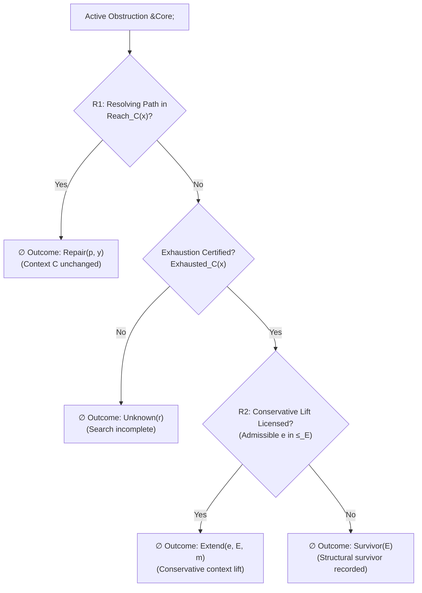

# 01. Primitive Difference & The Two-Rule OESOS Law

**AuthorityEffect:** `None`  
**Estate:** `education/documentation/004_oepfp/math/`  
**Parent Document:** [`oesos_layers_index.md`](oesos_layers_index.md)  
**Status:** Canonical Foundation  
**Research Terminal:** `FRONTIER_OBSTRUCTION`  

---

## 0. Scope, Vocabulary & Nonclaims

### 0.1 Classification Vocabulary

Every substantial object in this spine carries exactly one ontological classification:

| Classification | Meaning |
|---|---|
| `DERIVED` | Forced by earlier definitions and the two-rule law. |
| `DECLARED` | Supplied explicitly to make a problem executable; not forced by Primitive Difference. |
| `INTERFACE-SPECIFIC` | Required only by a named transport or consequence regime. |
| `OPEN` | Not fixed by the present axioms, evidence, or implementation. |

Every definition, theorem, or proposition carries an explicit claim label:

| Label | Meaning |
|---|---|
| `DEFINITION` | Fixes vocabulary or constructs a mathematical object. |
| `PROVED` | A proof is supplied at the stated scope. |
| `MECHANIZED` | A named, building formal artifact checks the exact statement. |
| `TESTED-FINITE` | A named finite executable test covers the stated cases. |
| `CONJECTURE` | A precise statement is proposed but not proved. |
| `OPEN` | Required proof, choice, or evidence is absent. |

### 0.2 Architectural Layer Boundary

The mathematical Symbol Game occupies layers L0 through L6. Downstream layers handle operational logging and product interfaces:

| Layer | Object | Classification | Part of Mathematical Core? |
|---|---|---|:---:|
| **L0** | Primitive Difference | `DECLARED` primitive | **Yes** |
| **L1** | Representation and current context | `DECLARED` | **Yes** |
| **L2** | Same-context transformations | `DECLARED` family governed by R1 | **Yes** |
| **L3** | Obstruction report | `DERIVED` from declared checks | **Yes** |
| **L4** | Structural exhaustion | `DERIVED` proposition; certificate `DECLARED` | **Yes** |
| **L5** | Context extension | `DECLARED` candidate governed by R2 | **Yes** |
| **L6** | Descent, forgetting, and invariants | `DECLARED`, required for comparisons | **Yes** |
| **L7** | DDC transition history | `DERIVED` audit need; schema `DECLARED` | Operational trace |
| **L8** | Packet kernel and transformations | `INTERFACE-SPECIFIC` transport | No (downstream) |
| **L9** | Task fibers (chat, code, research) | `INTERFACE-SPECIFIC` | No (downstream) |
| **L10** | Multi-agent coordination | `INTERFACE-SPECIFIC` | No (downstream) |
| **L11** | External validation and authority | `INTERFACE-SPECIFIC`; external | No (external) |

### 0.3 Binding Nonclaims

This spine explicitly rejects false authority and unsupported claims:
- A bare glyph has zero mathematical semantics without an explicit declaration.
- Primitive Difference does not possess two endpoints, an orientation, or a graph.
- Not every obstruction is numerical.
- Failure to discover a repair does **not** establish structural exhaustion.
- Structural exhaustion alone does **not** license or ensure an extension.
- A globally least extension, valid across all declared extension classes, is an open question, not an established fact.
- Hashes are not injective and do not authenticate a producer.
- Packet shape does not establish semantic truth.
- A verifier receipt or successful replay mints zero semantic authority.

---

## 1. Layer 0: Primitive Difference

### 1.1 Primitive Declaration

**Primitive Difference `[DEFINITION]` — `DECLARED`.** The genesis object is a nullary marked occurrence:

$$\vdash \diamond : \mathsf{PrimitiveDifference}$$

serialized on the wire as:
```text
<>
```

Its admitted gloss is invariant:
> *"A distinction or obstruction is marked and has not been silently collapsed."*

The gloss is part of the primitive declaration. It is not an unprompted theorem about the two characters used to serialize it.

### 1.2 Non-Entailments & Graph Non-Determination

Primitive Difference does not entail:
- Named relata or endpoints;
- Ordered direction or orientation;
- Reflexive, symmetric, or transitive equality;
- A vertex set, edge relation, graph, path, or cell complex;
- A metric, carrier, field, observer, or tolerance;
- Time, probability, causality, authority, or agency.

**Theorem SG-L0 (Graph Non-Determination) `[PROVED]`.**  
*Primitive Difference does not determine graph structure.*

**Proof:**  
Take one base model containing only the marked occurrence $\diamond$. Expand that same reduct in two ways over the finite vertex carrier $\mathbb{B} = \{\text{false}, \text{true}\}$:
1. Expansion $\mathcal{M}_1$: has the empty edge relation $E_1 = \varnothing$.
2. Expansion $\mathcal{M}_2$: has exactly one self-loop $E_2 = \{(\text{true}, \text{true})\}$.

Both reducts agree on every fact at Layer L0 (the presence of the marked occurrence), yet their graph expansions disagree ($\mathcal{M}_1 \not\cong \mathcal{M}_2$). Therefore, L0 does not determine graph structure. $\blacksquare$

*This model-theoretic independence result demonstrates that constructing a graph requires an explicit declaration, not an assumption from genesis.*

---

## 2. The Two-Rule OESOS Governing Law

### 2.1 Governing Axioms

**OESOS `[DEFINITION]` — `DECLARED` governing law.** For the current admitted context $C$:
1. **Rule 1 (R1 - Same-Context Repair):** Resolve the current obstruction using only declared transformations inside the present context.
2. **Rule 2 (R2 - Context Extension):** If and only if the present structure has been genuinely proven exhausted, consider the least admissible structure required to continue.

*The term "least" is strictly relative to a declared extension class and preorder. A globally unique least extension is `OPEN`.*



### 2.2 Exact Five-Branch Decision Form

For context $C$, state $x$, and accepted-state predicate $\mathsf{Accept}_C$, the evaluator emits exactly one of five typed outcomes:

$$\begin{array}{ll}
\mathsf{Repair}(p, y) & y \in \operatorname{Reach}_C(x), \; \mathsf{Accept}_C(y) \\
\mathsf{Unknown}(r) & \text{no repair is established and exhaustion is absent} \\
\mathsf{Survivor}(E) & E \text{ certifies structural exhaustion and no extension is selected} \\
\mathsf{Extend}(e, E, m) & E \text{ certifies exhaustion and } m \text{ justifies conservative extension } e \\
\mathsf{Refuse}(r) & \text{the request, context, operation, or evidence is malformed}
\end{array}$$

### 2.3 Priority and Trigger Theorems

**Theorem SG-L1 (R1 Priority) `[PROVED]`.**  
*Under the OESOS decision definition, if an admitted resolving same-context path exists, the evaluator is strictly forbidden from emitting $\mathsf{Extend}$.*

**Proof:**  
Let $y \in \operatorname{Reach}_C(x)$ satisfy $\mathsf{Accept}_C(y)$. By definition, structural exhaustion requires $\forall z \in \operatorname{Reach}_C(x), \; \neg\mathsf{Accept}_C(z)$. The witness $y$ contradicts exhaustion. Because an extension outcome $\mathsf{Extend}(e, E, m)$ requires a valid exhaustion certificate $E$, no such certificate can be constructed. Therefore, the outcome cannot be $\mathsf{Extend}$. $\blacksquare$

**Theorem (Trigger-Not-License) `[PROVED]`.**  
*The emergence of a non-empty obstruction $\Omega \neq \emptyset$ triggers a search for repair or extension evidence; it does not itself license an extension.*

**Proof:**  
An extension requires both certified structural exhaustion ($E$) and a valid justification witness ($m$). The existence of an obstruction establishes only that the current state is not accepted ($\neg\mathsf{Accept}_C(x)$). Because reachability may contain an accepted state $y \neq x$, an obstruction does not entail exhaustion, and therefore cannot license an extension. $\blacksquare$

**Theorem (Exhaustion-Not-Sufficiency) `[PROVED]`.**  
*Exhaustion is a necessary condition for R2, but not a sufficient one.*

**Proof:**  
If $E$ certifies exhaustion, but no candidate extension is admissible, candidate extensions are incomparable under the declared preorder, or an extension violates old-language conservativity, the decision form emits $\mathsf{Survivor}(E)$ or $\mathsf{Refuse}(r)$, not $\mathsf{Extend}$. Thus, exhaustion alone does not ensure an extension. $\blacksquare$
