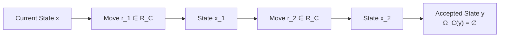

# 02. Executable Contexts & Reachability Closure

**AuthorityEffect:** `None`  
**Estate:** `omega_engine_education/documentation/004_oepfp/math/`  
**Parent Document:** [`oesos_layers_index.md`](oesos_layers_index.md)  
**Status:** Canonical Foundation  
**Layers Covered:** L1 (Representation & Context), L2 (Same-Context Transformations)  

---

## 1. Layer 1: Executable Context Definition

Primitive Difference ($\diamond$) becomes computationally operational only when bound to an explicit context.

### 1.1 Formal Context Tuple

**Executable Context `[DEFINITION]` — `DECLARED`.** A minimal finite context is a 4-tuple:

$$C = (X_C, Q_C, \operatorname{check}_C, \mathcal{R}_C)$$

where:
* **$X_C$** is a finite set or a finitely encoded state type.
* **$Q_C$** is a finite set of named obligations ($q \in Q_C$).
* **$\operatorname{check}_C(q, x)$** is a computable checker returning:
  $$\operatorname{check}_C : Q_C \times X_C \longrightarrow \{\mathsf{Pass}, \mathsf{Fail}(w), \mathsf{Unknown}(r)\}$$
  where $w$ is a concrete failure witness certificate.
* **$\mathcal{R}_C$** is the declared family of licensed, partial, same-context transformations:
  $$\mathcal{R}_C \subseteq X_C \rightharpoonup X_C$$

An interface may declare additional carrier types, evaluation metrics, or syntax rules; none is assumed globally.

### 1.2 Exact Generic Obstruction

**Obstruction Report `[DEFINITION]` — `DERIVED`.** The active obstruction $\Omega_C(x)$ of a state $x \in X_C$ is the exact map of failed obligations:

$$\Omega_C(x) = \{ (q, w) \mid q \in Q_C, \; \operatorname{check}_C(q, x) = \mathsf{Fail}(w) \}$$

* **Accepted State:** A state $x$ is accepted iff its obstruction is empty:
  $$\mathsf{Accept}_C(x) \iff \Omega_C(x) = \varnothing \quad \land \quad \forall q \in Q_C, \; \operatorname{check}_C(q, x) = \mathsf{Pass}$$
* **Non-Numerical Obstructions:** An obstruction report is by definition a set of obligation-witness pairs. Mapping $\Omega_C(x)$ to a scalar numerical mass (such as an $L_1$ norm $\Phi_1$) is an interface-specific observation projection, not a primitive property.

### 1.3 Context Depth vs. Syntax Length

**Context Depth `[DEFINITION]` — `DECLARED`.** The depth $d(C) \in \mathbb{N}$ of context $C$ counts the number of certified, conservative context extensions required to reach $C$ from the genesis ground state $C_0$:

$$d(C_0) = 0, \quad d(C_{n+1}) = d(C_n) + 1$$

* **Critical Invariant:** Context depth does **not** measure string length, token count, AST node count, or execution cycle count. Expanding an external prompt display leaves context depth strictly invariant ($\Delta P \centernot\implies \Delta d$).

---

## 2. Layer 2: Same-Context Reachability & Exhaustion

Rule 1 (R1) mandates that the engine search for a resolving state inside the present context before any extension can be considered.

### 2.1 Reachability Closure

**Reachability Closure `[DEFINITION]` — `DERIVED`.** The reachability set $\operatorname{Reach}_C(x) \subseteq X_C$ is the reflexive, transitive closure of $x$ under the licensed transformation family $\mathcal{R}_C$:

$$\operatorname{Reach}_C(x) = \{ y \in X_C \mid x \xrightarrow{\mathcal{R}_C^*} y \}$$

where $x \xrightarrow{\mathcal{R}_C^*} y$ denotes a finite sequence of licensed steps:
$$x = x_0 \xrightarrow{r_1} x_1 \xrightarrow{r_2} \dots \xrightarrow{r_k} x_k = y, \quad r_i \in \mathcal{R}_C$$

**Admissible Step Theorem (ENC-0122) `[PROVED]`.**  
*A state transition $x \to y$ is valid within context $C$ if and only if there exists a licensed transformation $r \in \mathcal{R}_C$ such that $r(x) = y$.*

*Proof:* a valid one-step transition is defined as the application of a licensed move, so both directions hold by definition; the content of the statement is that no other source of transitions exists. Because each $r$ is partial, "$r(x) = y$" includes the requirement that $r$ is defined at $x$. *Example:* with $X_C = \{0, 1, 2\}$ and $\mathcal{R}_C = \{r\}$, $r(0) = 1$, $r(1) = 2$ and $r(2)$ undefined, the valid steps are $0 \to 1$ and $1 \to 2$; $\operatorname{Reach}_C(0) = \{0, 1, 2\}$ and $\operatorname{Reach}_C(2) = \{2\}$.

---

### 2.2 Structural Exhaustion Proposition

**Structural Exhaustion `[DEFINITION]` — `DERIVED`.** A state $x$ is structurally exhausted within context $C$ iff no accepted state exists within its reachability closure:

$$\operatorname{Exhausted}_C(x) \iff \forall y \in \operatorname{Reach}_C(x), \; \neg\mathsf{Accept}_C(y)$$

* **Exhaustion Certificate ($E$):** A formal certificate $E$ establishes the proposition $\operatorname{Exhausted}_C(x)$.
* **Finite Verification Methods for $E$:**
  1. **Finite Graph Enumeration:** In finite state spaces, an exhaustive breadth-first traversal verifying that every reachable state has $\Omega_C(y) \neq \varnothing$.
  2. **LP Duality Gap / Infeasibility Witness:** In continuous or rational relaxation spaces, Farkas' lemma or dual infeasibility certificates proving primal feasibility is empty.
  3. **Homological Obstruction:** A non-zero cocycle class $[\omega] \neq 0 \in H^1$ proving no 0-cochain can eliminate the coboundary defect.

**Theorem (Failure-Not-Exhaustion) `[PROVED]`.**  
*The inability of an algorithm, model, or heuristic search to find a repair does not entail structural exhaustion.*

$$\text{SearchTerminated}(\text{timeout}) \;\not\Longrightarrow\; \operatorname{Exhausted}_C(x)$$

*An uncompleted search emits $\mathsf{Unknown}(\text{budget\_exhausted})$, never $\mathsf{Survivor}(E)$ or $\mathsf{Extend}$.*
