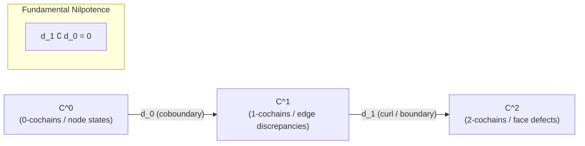

# 03. Quotient Obstruction Calculus & Homological Algebra

**AuthorityEffect:** `None`  
**Estate:** `education/documentation/004_oepfp/math/`  
**Parent Document:** [`oesos_layers_index.md`](oesos_layers_index.md)  
**Status:** Canonical Foundation  
**Layers Covered:** L3 (Obstruction Reporting), L4 (Quotient & Structural Exhaustion)  

---

## 1. The Discrete Cochain Complex

When an executable context declares a discrete cell carrier (vertices, edges, faces) or a linear representation over a field $\mathbb{K}$ (typically $\mathbb{Q} = \text{Rational64}$), the obstruction calculus is realized as a finite cochain complex:

$$C^0 \xrightarrow{\;d_0\;} C^1 \xrightarrow{\;d_1\;} C^2$$

### 1.1 Cochain Spaces & Operators

* **$C^0$ (0-Cochains):** The space of local node assignments or state parameters $\alpha \in C^0$.
* **$C^1$ (1-Cochains):** The space of edge discrepancies, transition flows, or active candidate differences $\omega \in C^1$.
* **$C^2$ (2-Cochains):** The space of face defects, boundary mismatches, or non-integrable curvature.
* **$d_0 : C^0 \to C^1$:** The discrete coboundary operator mapping node assignments to licensed edge differences. Transitions in $\operatorname{im}(d_0)$ represent **licensed internal repairs**.
* **$d_1 : C^1 \to C^2$:** The discrete curl or boundary operator measuring failure of integrability.

### 1.2 The Nilpotence Invariant

**Cochain Identity `[PROVED]`.** For all licensed discrete carriers, the coboundary operators satisfy exact nilpotence:

$$d_1 \circ d_0 = 0$$

Every licensed repair move generates a closed discrepancy:
$$\forall \alpha \in C^0, \quad d_1(d_0 \alpha) = 0$$

---

## 2. Quotient Spaces & Cohomological Invariants

### 2.1 The Quotient Class $Q^1$ (Cokernel)

**Quotient Space $Q^1$ `[DEFINITION]` — `DERIVED`.** The quotient space of discrepancies modulo licensed repairs is the cokernel of $d_0$:

$$Q^1 = \operatorname{coker}(d_0) = C^1 / \operatorname{im}(d_0)$$

For an active discrepancy $\omega \in C^1$, its quotient class is:
$$[\omega]_{Q^1} = \{ \omega + d_0 \alpha \mid \alpha \in C^0 \}$$

* **Exact Repair ($[\omega] = 0$):** If $[\omega]_{Q^1} = 0$, there exists an exact primal witness $\alpha \in C^0$ such that $\omega = d_0 \alpha$. The obstruction is eliminated within the current context via R1 ($\mathsf{Repair}$).
* **Active Quotient Obstruction ($[\omega] \neq 0$):** If $[\omega]_{Q^1} \neq 0$, no repair in the declared family $\operatorname{im}(d_0)$ can eliminate the discrepancy. Other declared same-context moves are a separate question (see Section 3.2 of [`02_math_cochain_complexes_repairs_and_quotients.md`](02_math_cochain_complexes_repairs_and_quotients.md)).

---

### 2.2 The Closed Survivor Sector $H^1$ (Cohomology)

**First Cohomology Group $H^1$ `[DEFINITION]` — `DERIVED`.** The space of closed discrepancies modulo exact repairs is:

$$H^1 = \frac{\ker(d_1)}{\operatorname{im}(d_0)}$$

* **Closed Discrepancy ($\ker(d_1)$):** $\omega \in C^1$ satisfies $d_1 \omega = 0$.
* **Survivor Sector:** If $d_1 \omega = 0$ but $[\omega] \neq 0 \in H^1$, the obstruction represents a genuine topological or structural hole that cannot be closed without enlarging the carrier (R2 candidate).

---

### 2.3 Obstruction Mass ($\Phi_1$) and Closure Defect ($\Gamma_2$)

To evaluate finite convergence without floating-point drift, two exact $L_1$ norms are evaluated over $\mathbb{Q}$:

$$\Phi_1(\omega) = \min_{\alpha \in C^0} \|\omega - d_0 \alpha\|_1$$

$$\Gamma_2(\omega) = \|d_1 \omega\|_1$$

The exact joint zero condition is:
$$\boxed{\Phi_1 = 0 \quad \land \quad \Gamma_2 = 0 \iff \text{Exact Operational Resolution}}$$

*Note (2026-10-20):* the second conjunct follows from the first. If $\Phi_1(\omega) = 0$ then $\omega = d_0\alpha$ for some $\alpha$ (the minimum is attained in finite dimension), so $\Gamma_2(\omega) = \|d_1 d_0 \alpha\|_1 = 0$. The two diagnostics therefore give three classes, matching the GTLA diagnostic axis: $\Phi_1 = 0$ (exact repair); $\Phi_1 > 0, \Gamma_2 = 0$ (closed residual); $\Gamma_2 > 0$ (open obstruction, which forces $\Phi_1 > 0$).

---

## 3. Linear Programming Duality & Dual Witness Certificates

Evaluating $\Phi_1(\omega)$ over discrete rational carriers is formulated as an exact Linear Program (LP).

### 3.1 Primal and Dual Formulations

* **Primal LP ($L_1$ Minimization):**
  $$\min_{\alpha, u} \sum_e u_e \quad \text{s.t.} \quad -u \le \omega - d_0 \alpha \le u, \quad u \ge 0$$
* **Dual LP:**
  $$\max_{y} \omega^T y \quad \text{s.t.} \quad d_0^T y = 0, \quad \|y\|_\infty \le 1$$

### 3.2 LP Optimality Soundness Theorem (ENC-0114)

**Theorem (ENC-0114: LP Optimality Soundness) `[PROVED]`.**  
*Let $\mathcal{P} = \{\omega - d_0\alpha : \alpha \in C^0\}$ be the set of residuals (the coset $\omega + \operatorname{im} d_0$). Let $x^*$ be a primal candidate vector and $y^*$ be a dual vector over $\mathbb{Q}$. If:*
1. *Primal feasibility holds: $x^* \in \mathcal{P}$;*
2. *Dual feasibility holds: $d_0^T y^* = 0$ and $\|y^*\|_\infty \le 1$;*
3. *Zero duality gap holds: $\omega^T y^* = \|x^*\|_1$;*

*then $x^*$ is certified to achieve the exact global minimum $L_1$ residual, and $y^*$ is a certified dual witness of structural optimality.*

**Proof:**  
By weak duality for linear programming, for any primal feasible $x$ and dual feasible $y$:
$$\omega^T y \le \|x\|_1$$
(Write $x = \omega - d_0\alpha$. Then $\omega^T y = x^T y + \alpha^T d_0^T y = x^T y \le \|x\|_1 \|y\|_\infty \le \|x\|_1$.)
If equality holds for a specific pair $(x^*, y^*)$, then:
$$\|x^*\|_1 = \omega^T y^* \le \|x\|_1 \quad (\forall \text{ primal feasible } x)$$
Therefore, $x^*$ achieves the minimal $L_1$ norm. $\blacksquare$

---

## 4. The Čech Contextual Obstruction Gate

In distributed or multi-agent settings, local patches $U_i$ carry local evaluations $\alpha_i \in C^0(U_i)$.

* **Overlaps ($U_{ij} = U_i \cap U_j$):** The discrepancy on overlap $U_{ij}$ is supplied data $h_{ij}$, for example a measured offset between the coordinates of patches $i$ and $j$, with $h_{ji} = -h_{ij}$ and, on triple overlaps, $h_{ij} + h_{jk} + h_{ki} = 0$ (the cocycle condition).
* **Čech Gate (`GTFOC-CHECK-01`):** The Čech gate verifies whether the collection of local discrepancies $\{h_{ij}\}$ defines an exact 1-coboundary, that is, whether there are patch corrections $\beta_i$ with
  $$h_{ij} = (\delta \beta)_{ij} = \beta_j - \beta_i \quad \text{on } U_{ij}$$
* If the Čech cohomology class $[\{h_{ij}\}] \in \check{H}^1$ is non-zero, the local patches cannot be glued into a single global state without context extension.

*Correction (2026-10-20):* an earlier version defined $h_{ij} = \alpha_i - \alpha_j$ from the patch values themselves. Data of that form are a Čech coboundary by construction (take $\beta_i = -\alpha_i$), so the gate would pass on every input. The test is informative only when the overlap data are given independently of a global choice of patch values. *Worked example:* three patches arranged in a cycle with offsets $h_{12} = 1$, $h_{23} = 1$, $h_{31} = 1$ and no triple overlap. Any coboundary satisfies $(\beta_2 - \beta_1) + (\beta_3 - \beta_2) + (\beta_1 - \beta_3) = 0$, but the offsets sum to 3, so no $\beta$ exists and the class is non-zero. Changing $h_{31}$ to $-2$ makes the sum 0, and $\beta = (0, 1, 2)$ solves it.
