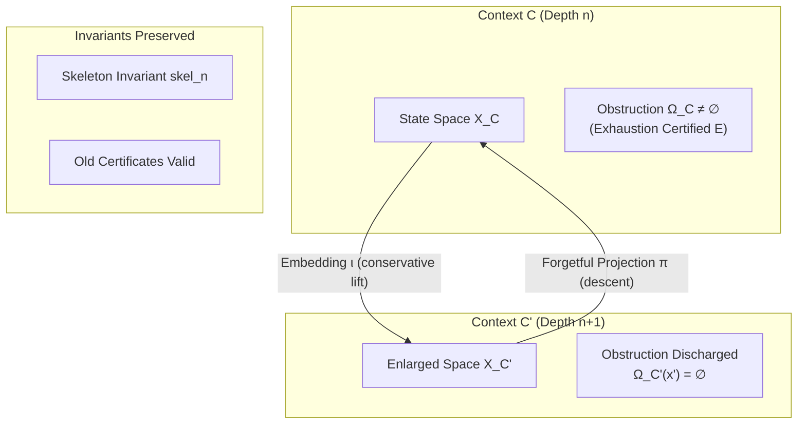

# 04. Conservative Context Extension & Descent Calculus

**AuthorityEffect:** `None`  
**Estate:** `omega_engine_education/documentation/004_oepfp/math/`  
**Parent Document:** [`oesos_layers_index.md`](oesos_layers_index.md)  
**Status:** Canonical Foundation  
**Layers Covered:** L5 (Context Extension), L6 (Descent, Forgetting & Invariants)  

---

## 1. Layer 5: Context Extension Calculus (CEC)

When a state $x \in X_C$ is certified structurally exhausted ($\operatorname{Exhausted}_C(x)$ by certificate $E$), Rule 2 (R2) permits evaluating candidate context extensions.



### 1.1 Context-Extension Candidate

**Context-Extension Candidate `[DEFINITION]` — `DECLARED`.** A candidate context extension is a 6-tuple:

$$e = (C, C', \iota, \pi, \Delta_C, \mathcal{W})$$

where:
* **$C = (X_C, Q_C, \operatorname{check}_C, \mathcal{R}_C)$** is the exhausted parent context of depth $n$.
* **$C' = (X_{C'}, Q_{C'}, \operatorname{check}_{C'}, \mathcal{R}_{C'})$** is the candidate enlarged context of depth $n+1$.
* **$\iota : C \hookrightarrow C'$** is an injective embedding map mapping old states into the enlarged space:
  $$\iota : X_C \longrightarrow X_{C'}$$
* **$\pi : C' \to C$** is a partial forgetful projection or descent map:
  $$\pi : X_{C'} \rightharpoonup X_C$$
* **$\Delta_C$** is the explicit delta of net-new structure (new tokens, obligations, or transformations).
* **$\mathcal{W}$** is the structural justification witness demonstrating how $C'$ resolves the obstruction that exhausted $C$.

---

## 2. Conservativity & Old-Certificate Preservation

An extension cannot be an arbitrary rewrite. It must be **conservative** over the parent language.

### 2.1 The Conservative Extension Predicate

**Conservative Extension `[DEFINITION]` — `DECLARED`.** An extension candidate $e$ is conservative over context $C$ iff for every sentence or predicate $\phi$ expressible in the language $\mathcal{L}(C)$ of the parent context:

$$C' \models \iota(\phi) \iff C \models \phi$$

* **Non-Interference:** The enlarged context $C'$ neither derives new theorems about old objects nor invalidates existing proofs.
* **Old-Language Faithfulness:** If two old states are distinct in $C$, their embedded images remain distinct in $C'$:
  $$\forall x, y \in X_C, \quad x \neq y \iff \iota(x) \neq \iota(y)$$

### 2.2 Skeleton Invariant Preservation (proposed requirement)

**Requirement (Skeleton Invariant) `[OPEN]`.**  
*Let $\operatorname{skel}_n(C)$ denote the core relational signature of context $C$. An admitted conservative context extension $C \to C'$ should preserve the skeleton invariant:*

$$\pi(\operatorname{skel}_{n+1}(\iota(x))) = \operatorname{skel}_n(x) \quad (\forall x \in X_C)$$

*Upward extension should not mutate the structural backbone of existing levels.*

> **Status correction (2026-10-20):** an earlier version labelled this `[PROVED]` and attributed it to ENC-0129. Neither holds. No proof is given here, $\operatorname{skel}_n$ is not defined precisely enough to prove it, and the encyclopedia card [`enc-0129-skeleton-invariant-theorem.md`](../encyclopedia/entries/enc-0129-skeleton-invariant-theorem.md) states a different result: a total, non-panicking, value-preserving constructor that performs non-trivial validation with observable rejection must expose a rejection channel $T + E$ in its return type. One sufficient condition for the displayed equation is easy to state: if $\operatorname{skel}_{n+1} \circ \iota = \iota \circ \operatorname{skel}_n$ on $X_C$ and $\pi \circ \iota = \operatorname{id}_{X_C}$ (exact descent, Section 3.1), then $\pi(\operatorname{skel}_{n+1}(\iota(x))) = \pi(\iota(\operatorname{skel}_n(x))) = \operatorname{skel}_n(x)$. Checking the first condition is the open part.

---

## 3. Layer 6: Forgetful Descent & Loss Ledgers

When an operation in $C'$ projects back down to $C$ via the forgetful map $\pi$, the descent may be either **exact** or **lossy**.

### 3.1 Exact vs. Lossy Descent

```text
               Exact Descent:             π(ι(x)) = x
               Lossy Descent:             π(y) = x  with LossLedger L
```

* **Exact Descent:** The composition $\pi \circ \iota = \operatorname{id}_{X_C}$ is the exact identity on $X_C$.
* **Admitted Lossy Projections:** If $y \in X_{C'}$ contains net-new dimensions (e.g. higher-order tensors, extra tokens) that have no counterpart in $X_C$, the projection $\pi(y)$ must emit an explicit **Loss Ledger**:

$$\operatorname{Descent}(y) = (\pi(y), \mathcal{L}_{\text{discarded}})$$

*No information may be silently discarded without an auditable ledger entry.*

---

## 4. Minimal Extension Preorder ($\le_{\mathcal{E}}$)

Rule 2 (R2) mandates considering the *least* admissible extension.

### 4.1 Extension Preorder

Let $\mathcal{E}_C$ denote the family of admitted conservative extension candidates for exhausted context $C$. A preorder $\le_{\mathcal{E}}$ is declared over $\mathcal{E}_C$ evaluating:
1. **Added Token Count:** $|\Sigma_{C'}| - |\Sigma_C|$;
2. **Added Transformation Complexity:** $\dim(\mathcal{R}_{C'}) - \dim(\mathcal{R}_C)$;
3. **Carrier Dimension Lift:** $\operatorname{rank}(X_{C'}) - \operatorname{rank}(X_C)$.

**The Minimal Lift Selection Law:**  
$$e^* = \operatorname{argmin}_{e \in \mathcal{E}_C} \operatorname{cost}(e)$$

* **Branching on Incomparability:** If $\mathcal{E}_C$ contains multiple minimal extensions that are mutually incomparable ($e_1 \not\le e_2 \land e_2 \not\le e_1$), the system is forbidden from making an arbitrary choice. It must either:
  1. Retain both candidate branches in a branched trace; or
  2. Emit $\mathsf{Survivor}(E)$ indicating an unresolvable structural bifurcation.
