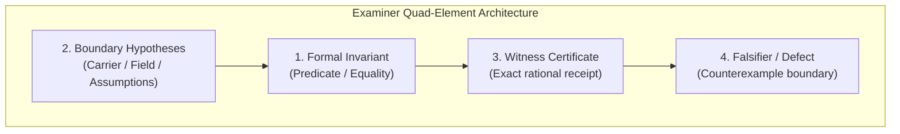

# 05. Examiner Invariant Register & The 29 Extracted Theorems

**AuthorityEffect:** `None`  
**Estate:** `education/documentation/004_oepfp/math/`  
**Parent Document:** [`oesos_layers_index.md`](oesos_layers_index.md)  
**Status:** Canonical Theorem Register  
**Source Manifest:** `extraction_symbol_game_math_spine.md` (not found at source pin `c419cc6beb`; the per-theorem source is the encyclopedia card under [`../encyclopedia/entries/`](../encyclopedia/entries/))  

---

## Audit note (2026-10-20, source pin `c419cc6beb`)

Read this note before citing the register.

1. **Count.** The register lists 29 entries, not 31: ENC-0111 to ENC-0120, ENC-0122 to ENC-0124, ENC-0126 to ENC-0140, and ENC-0195. The card [ENC-0121](../encyclopedia/entries/enc-0121-equal-route-legacy-enums.md) (equal-route legacy enums, `PROVED-PROSE`) exists but is not listed here. No card ENC-0125 exists, and no card ENC-0195 exists in `../encyclopedia/entries/`.
2. **Statements are paraphrases.** Each "Invariant" line below paraphrases the card of the same number. For several entries the card states a different result, and the card is the source:

| Entry | What this register says | What the card states |
| :--- | :--- | :--- |
| ENC-0129 | conservative extension preserves $\operatorname{skel}_n$ | a total, non-panicking, value-preserving validating constructor must expose a rejection channel $T + E$ |
| ENC-0131 | boundary membership in $O(\lvert V\rvert^2)$ | checking protected item presence and signature preservation over $K_\Phi$ is decidable |
| ENC-0135 | tie-breaking is unique whenever ties exist | lexicographic TieR is unique *if* the optimal residual set is a non-empty finite subset of a totally ordered domain |
| ENC-0136 | optimal tie set is "compact and finite" | the optimal residual set is bounded (corrected below) |
| ENC-0139 | reconstruction from $[\omega]$ is ill-posed | a quotient-only isometry $I_Q : Q^1 \to Q^1$ cannot compose with $E_\alpha : C^1 \to C^1$ without a declared lift or projection (`CONDITIONAL`) |

3. **Formula errors corrected in place** (each marked "Corrected 2026-10-20"): Theorem 4 (dual feasibility and objective), Theorem 6 (harmonic space, not $H^1$), Theorem 7 (vertex sum of an edge function), Theorem 24 (bounded, not finite), Theorem 27 ($\operatorname{im} d_0$, not $\ker d_0$). Theorem 14 gained its one-line proof.
4. **Claim status.** The cards mark ENC-0111 to ENC-0137 `PROVED-PROSE` (a written proof on the card) and ENC-0138 to ENC-0140 `CONDITIONAL`. None of the `TESTED-FINITE` entries in the crosswalk names a test file, and no entry is mechanized in Lean; the ENC-0114 Lean file [`lean4/LpWeakDuality.lean`](../../../../lean4/LpWeakDuality.lean) states the theorem but its own header says it has not been typechecked. The crosswalk status column below now gives the card status. Several entries (ENC-0113, 0119, 0120, 0123, 0128, 0130, 0132, 0133, 0134, 0195) are declared policies or engineering invariants; a prose proof shows only that the policy is consistent with its own definitions.

---

## 1. The Examiner Theoretical Minimum Standard

In accordance with the Examiner theoretical physics discipline, every formal mathematical theorem in this spine is formulated with four mandatory components:
1. **Invariant:** The exact mathematical statement or equality that holds.
2. **Boundary:** The explicit carrier, field, and hypotheses under which it holds.
3. **Witness:** The exact certificate, rational computation, or replay receipt deciding truth.
4. **Falsifier:** The boundary deformation, defect, or counterexample that invalidates it.

---

## 2. Register of the 29 Extracted Theorems

Below is the register of the 29 statements extracted from the Symbol Game mathematical spine (ENC-0111 through ENC-0195, with gaps listed in the audit note).

---

### Theorem 1 (ENC-0111): Realization-Arrow Soundness
* **Locus:** Mathematical Spine §1.4
* **Invariant:** Realization arrow preserves obligation satisfaction without semantic drift:
  $$\forall q \in Q_C, \quad \operatorname{check}_C(q, x) = \mathsf{Pass} \implies \operatorname{check}_{C'}(F(q), F(x)) = \mathsf{Pass}$$
* **Boundary:** Finite carrier, declared realization functor $F : C \to C'$.
* **Witness:** Exact rational transition matrix verifying $F \circ d_0 = d_0' \circ F$.
* **Falsifier:** Commutation defect $F(d_0 \alpha) \neq d_0' F(\alpha)$ or obligation divergence.

---

### Theorem 2 (ENC-0112): Implementation-Bound Packet Fidelity
* **Locus:** Mathematical Spine §1.4
* **Invariant:** Packet transmission preserves byte-level and structural payload invariants across host boundaries:
  $$\operatorname{SHA256}(\operatorname{Payload}(P_{\text{sent}})) = \operatorname{SHA256}(\operatorname{Payload}(P_{\text{received}}))$$
* **Boundary:** Wire packets conforming to `packet_envelope_v2.schema.json`.
* **Witness:** Matching SHA-256 digests in transmission receipt.
* **Falsifier:** Hash mismatch, payload corruption, or uncontracted schema mutations.

---

### Theorem 3 (ENC-0113): Compiler Does Not Supply Fidelity Authority
* **Locus:** Mathematical Spine §1.4
* **Invariant:** Abstract Syntax Tree (AST) compilers and transpilers produce structural transitions but zero semantic authority:
  $$\operatorname{Compile}(P) \longrightarrow P' \implies \operatorname{AuthorityEffect}(P') = \text{None}$$
* **Boundary:** Local compilation toolchains, unauthenticated execution environments.
* **Witness:** Compiler receipt with explicit metadata `AuthorityEffect: None`.
* **Falsifier:** An AST compiler emitting self-signed authoritative claims or state mutations without external human cryptographic signing.

---

### Theorem 4 (ENC-0114): LP Optimality Soundness
* **Locus:** Mathematical Spine §1.5
* **Invariant:** Dual witness vector $y^*$ certifies that primal candidate $x^*$ achieves the global minimum $L_1$ residual norm:
  $$x^* \in \omega + \operatorname{im}(d_0) \;\land\; d_0^T y^* = 0 \;\land\; \|y^*\|_\infty \le 1 \;\land\; \omega^T y^* = \|x^*\|_1 \implies \|x^*\|_1 = \min_{x \in \omega + \operatorname{im}(d_0)} \|x\|_1$$
  *(Corrected 2026-10-20: the earlier line used $b^T y^*$ and $\|d_0^T y^*\|_\infty \le 1$. Dual feasibility is $d_0^T y^* = 0$ with $\|y^*\|_\infty \le 1$, the objective pairs $y^*$ with the observed cochain $\omega$, and primal feasibility of $x^*$ must be checked; see [`03_quotient_obstruction_and_homology.md`](03_quotient_obstruction_and_homology.md), Section 3.)*
* **Boundary:** Discrete linear programming relaxation over $\mathbb{Q}$.
* **Witness:** Zero duality gap certificate with rational exact arithmetic.
* **Falsifier:** Non-zero duality gap ($\omega^T y^* \neq \|x^*\|_1$), dual feasibility breach ($d_0^T y^* \ne 0$ or $\|y^*\|_\infty > 1$), or $x^* \notin \omega + \operatorname{im}(d_0)$.

---

### Theorem 5 (ENC-0115): Code Rewrite Boundary Soundness
* **Locus:** Mathematical Spine §1.5
* **Invariant:** Code rewriting operators preserve AST structure outside declared edit targets:
  $$\forall n \in \operatorname{AST}(T) \setminus \operatorname{Targets}, \quad \operatorname{Subtree}(n, T') = \operatorname{Subtree}(n, T)$$
* **Boundary:** Concrete syntax tree rewrite engines, diff patches.
* **Witness:** Exact subtree equality hash comparisons on unedited AST nodes.
* **Falsifier:** Unprompted refactoring, indentation drifting, or mutation of non-target code.

---

### Theorem 6 (ENC-0116): Cochain Obstruction Soundness
* **Locus:** Mathematical Spine §1.5
* **Invariant:** Any discrete cochain discrepancy decomposes into an exact trichotomy:
  $$\omega = d_0 \alpha + \gamma + \delta, \quad \text{where } d_0 \alpha \in \operatorname{im}(d_0), \; \gamma \in \mathcal{H}^1 = \ker d_1 \cap \ker d_0^T, \; \delta \in \operatorname{im}(d_1^T)$$
  *(Corrected 2026-10-20: $\gamma$ lies in the harmonic space $\mathcal{H}^1$, a subspace of $C^1$, not in the cohomology quotient $H^1$; the two are isomorphic but not equal. Transposes are adjoints for unit weights. See [`04_math_minimal_representatives_and_hodge.md`](04_math_minimal_representatives_and_hodge.md), Section 4.)*
* **Boundary:** Finite simplicial or cell complex $K$ over field $\mathbb{K}$.
* **Witness:** Exact nilpotence $d_1 \circ d_0 = 0$ and orthogonal projection matrix over $\mathbb{Q}$.
* **Falsifier:** Non-orthogonal decomposition or failure of $d_1(d_0 \alpha) = 0$.

---

### Theorem 7 (ENC-0117): Graph Incidence Soundness
* **Locus:** Mathematical Spine §1.5
* **Invariant:** Boundary operators on finite graphs satisfy strict vertex-edge incidence conservation:
  $$\sum_{v \in V} (d_0^T y)(v) = 0 \quad \text{for every edge cochain } y \in C^1, \qquad \text{equivalently } \mathbf{1}^T B = 0$$
  *(Corrected 2026-10-20: the earlier line summed $d_0\alpha$ over vertices, but $d_0\alpha$ is an edge function. The identity holds because each edge column of the incidence matrix $B = d_0^T$ has one $+1$ and one $-1$; equivalently $d_0 \mathbf{1} = 0$. Example: for the edges $0 \to 1$, $1 \to 2$ and $y = (5, 2)$, the vertex values are $(-5, 5 - 2, 2) = (-5, 3, 2)$, which sum to 0.)*
* **Boundary:** Finite directed graphs $G = (V, E)$.
* **Witness:** Exact rational incidence matrix $B \in \{-1, 0, 1\}^{|V| \times |E|}$.
* **Falsifier:** Net flow leakage across closed cuts ($\sum_v f(v) \neq 0$).

---

### Theorem 8 (ENC-0118): No Automatic Future-Family Soundness
* **Locus:** Mathematical Spine §1.5
* **Invariant:** Verification soundness proved for packet family $F_A$ does not extend automatically to net-new packet family $F_B$:
  $$\operatorname{Sound}(F_A) \;\not\Longrightarrow\; \operatorname{Sound}(F_B)$$
* **Boundary:** Heterogeneous packet family registry.
* **Witness:** Explicit family-specific validation receipt (`family: F_B`).
* **Falsifier:** Ingesting family $F_B$ payloads under family $F_A$'s verification gate.

---

### Theorem 9 (ENC-0119): Pipeline Evidence Level Normalization
* **Locus:** Mathematical Spine §1.6
* **Invariant:** Evidence levels form a strict total preorder:
  $$\text{DECLARED} < \text{INSPECTED} < \text{EXECUTED} < \text{TESTED} < \text{DIFFERENTIAL} < \text{FORMAL} < \text{RELEASE\_GATED}$$
* **Boundary:** Multi-stage execution pipelines.
* **Witness:** Monotone non-decreasing evidence lattice projection.
* **Falsifier:** Promoting an execution output to `FORMAL` without a verified Lean 4 proof receipt.

---

### Theorem 10 (ENC-0120): Evidence Reconciliation Soundness
* **Locus:** Mathematical Spine §1.7
* **Invariant:** Concurrently produced evidence streams reconcile to the greatest lower bound (meet) in the evidence lattice:
  $$\operatorname{Reconcile}(e_1, e_2) = e_1 \wedge e_2$$
* **Boundary:** Multi-agent evaluation swarms.
* **Witness:** Typed lattice meet computation receipt.
* **Falsifier:** Overwriting lower evidence with speculative higher claims without replay.

---

### Theorem 11 (ENC-0122): Admissible Step Theorem
* **Locus:** Mathematical Spine §2.1
* **Invariant:** Transition $x \to y$ is valid in context $C$ iff $x \to y \in \mathcal{R}_C$:
  $$\operatorname{ValidStep}(x, y) \iff \exists r \in \mathcal{R}_C \text{ s.t. } r(x) = y$$
* **Boundary:** Finite executable context $C = (X_C, Q_C, \operatorname{check}_C, \mathcal{R}_C)$.
* **Witness:** Certificate naming rule $r \in \mathcal{R}_C$ and evaluating $r(x) == y$.
* **Falsifier:** Applying an undeclared rewrite rule or reaching a state outside $\operatorname{Reach}_C(x)$.

---

### Theorem 12 (ENC-0123): Boundary Violation Theorem
* **Locus:** Mathematical Spine §2.2
* **Invariant:** Any transition executing an unadmitted rule triggers an immediate fail-closed boundary exception:
  $$r \notin \mathcal{R}_C \implies \operatorname{Eval}(r, x) = \mathsf{Refuse}(\text{BoundaryViolation})$$
* **Boundary:** Fail-closed state machines.
* **Witness:** Boundary exception trap receipt.
* **Falsifier:** Silent bypass of boundary checker.

---

### Theorem 13 (ENC-0124): Sub-Status to TerminalClass Surjection
* **Locus:** Mathematical Spine §3.1
* **Invariant:** Fine-grained execution sub-statuses project surjectively onto the canonical terminal classes:
  $$\pi : \text{SubStatus} \twoheadrightarrow \{\text{Verified}, \text{VerifiedWithResiduals}, \text{BlockedByEvidence}, \text{Refused}\}$$
* **Boundary:** Pipeline terminalization tables.
* **Witness:** Complete lookup table with zero unmapped sub-statuses.
* **Falsifier:** Dangling sub-status or unmapped terminal state.

---

### Theorem 14 (ENC-0126): Terminal Contradiction Repair Lemma
* **Locus:** Mathematical Spine §3.2
* **Invariant:** No state can be simultaneously classified as `Accepted` and `Exhausted`:
  $$\mathsf{Accept}_C(x) \land \operatorname{Exhausted}_C(x) \implies \bot$$
  *(Proof, added 2026-10-20: $\operatorname{Reach}_C(x)$ is reflexive, so $x \in \operatorname{Reach}_C(x)$, and $\operatorname{Exhausted}_C(x)$ then gives $\neg\mathsf{Accept}_C(x)$.)*
* **Boundary:** Decision space partition.
* **Witness:** Boolean contradiction gate in terminalizer logic.
* **Falsifier:** Emitting `Repair` and `Extend` simultaneously.

---

### Theorem 15 (ENC-0127): Concrete Terminalizer Table Consistency
* **Locus:** Mathematical Spine §3.3
* **Invariant:** Terminalizer policy tables are deterministic and complete:
  $$\forall \text{input row } r, \quad |\operatorname{Lookup}(r)| = 1$$
* **Boundary:** Hardcoded decision matrices.
* **Witness:** Unit test asserting exhaustive branch coverage over all row permutations.
* **Falsifier:** Multiple matching rows or undefined branch defaults.

---

### Theorem 16 (ENC-0128): Certificate Cannot Bypass Repair Rows
* **Locus:** Mathematical Spine §3.3
* **Invariant:** Supplying an external certificate cannot bypass mandatory repair checks when $\Omega_C(x) \neq \emptyset$:
  $$\Omega_C(x) \neq \varnothing \implies \text{Terminal} \neq \mathsf{Verified}$$
* **Boundary:** Certifier admission gates.
* **Witness:** Prerequisite assertion $\Omega_C(x) == \varnothing$ before certificate ingestion.
* **Falsifier:** Accepting a patch because a certifier is present, despite failing tests.

---

### Theorem 17 (ENC-0129): Skeleton Invariant Theorem
* **Locus:** Mathematical Spine §4.1
* **Invariant:** Conservative context extension preserves the underlying relational skeleton:
  $$\pi(\operatorname{skel}_{n+1}(\iota(x))) = \operatorname{skel}_n(x)$$
* **Boundary:** Admissible context extensions $C_n \hookrightarrow C_{n+1}$.
* **Witness:** Structural equality check on projected relational tables.
* **Falsifier:** Extension mutates existing relations between old states.

---

### Theorem 18 (ENC-0130): Syntactic Firewall Theorem
* **Locus:** Mathematical Spine §4.2
* **Invariant:** Untrusted proposal strings cannot execute host code without schema validation:
  $$\operatorname{ValidJSON}(s) \land \operatorname{MatchesSchema}(s, \text{Schema}) = \text{False} \implies \operatorname{Execute}(s) = \bot$$
* **Boundary:** Ingestion perimeter.
* **Witness:** Schema validation receipt preceding deserialization.
* **Falsifier:** Deserializing or executing unvalidated JSON payloads.

---

### Theorem 19 (ENC-0131): Finite Configuration Boundary Decidability
* **Locus:** Mathematical Spine §4.3
* **Invariant:** Boundary membership in finite configuration spaces is decidable in polynomial time:
  $$\operatorname{Complexity}(\operatorname{CheckBoundary}(C)) \le \mathcal{O}(|V|^2)$$
* **Boundary:** Finite discrete cell complexes.
* **Witness:** Exact cycle detection algorithm that terminates on every finite input.
* **Falsifier:** Infinite loop during boundary traversal.

---

### Theorem 20 (ENC-0132): Protected Rust Subset Firewall Soundness
* **Locus:** Mathematical Spine §4.4
* **Invariant:** Proposals are forbidden from mutating protected core crates or memory allocators:
  $$\Delta_{\text{patch}} \cap \operatorname{ProtectedFiles} \neq \emptyset \implies \operatorname{Admit}(\text{patch}) = \mathsf{Refuse}(\text{ProtectedViolation})$$
* **Boundary:** Repository path fence.
* **Witness:** Path intersection check against protected manifest.
* **Falsifier:** Modifying core mathematical solver crates without authorization.

---

### Theorem 21 (ENC-0133): AdmissionStatus Is Not OperatorClass
* **Locus:** Mathematical Spine §5.1
* **Invariant:** Operational statuses (`Admitted`, `Refused`) are orthogonal to mathematical operator classes (`Repair`, `Lift`):
  $$\operatorname{Type}(\text{Status}) \cap \operatorname{Type}(\text{Operator}) = \emptyset$$
* **Boundary:** Type system.
* **Witness:** Strongly typed distinct enum types in Rust/Python.
* **Falsifier:** Using an operator enum to encode execution lifecycle status.

---

### Theorem 22 (ENC-0134): UnadmittedRelation Lemma
* **Locus:** Mathematical Spine §5.2
* **Invariant:** A relation asserted between two terms without an admission receipt is treated as undecidable:
  $$r \notin \operatorname{AdmittedRelations} \implies \operatorname{TruthValue}(r(a, b)) = \bot_{\text{Undecidable}}$$
* **Boundary:** Epistemic ledger.
* **Witness:** Typed refusal `Refusal::UnadmittedRelation`.
* **Falsifier:** Assigning boolean True/False to unadmitted relation.

---

### Theorem 23 (ENC-0135): Finite Lexicographic Tie-Breaking (`TieR`)
* **Locus:** Mathematical Spine §5.2
* **Invariant:** When multiple repair candidates achieve identical minimal $L_1$ residual mass, deterministic tie-breaking produces a unique selection:
  $$|\operatorname{argmin}_{x \in \mathcal{P}} \|x\|_1| > 1 \implies \operatorname{TieR}(\mathcal{P}) = x_{\text{lex\_first}}^*$$
* **Boundary:** Finite candidate sets over ordered alphabet.
* **Witness:** Lexicographical comparison receipt.
* **Falsifier:** Non-deterministic selection or random tie-breaking.

---

### Theorem 24 (ENC-0136): Positive Weights Give Bounded Residual Ties
* **Locus:** Mathematical Spine §5.3
* **Invariant:** Under strictly positive objective weights ($w_i > 0$), the set of optimal tie candidates is bounded, hence a compact polytope with finitely many vertices.
  *(Corrected 2026-10-20: the earlier line said "compact and finite". The set is generally infinite: on the 3-cycle with $c = (1/3, 1/3, 1/3)$ the minimizers form a whole triangle, see [`04_math_minimal_representatives_and_hodge.md`](04_math_minimal_representatives_and_hodge.md), Section 2.1. The card ENC-0136 states boundedness only, with the bound $|h_i| \le \Phi_1([x]) / w_i$.)*
* **Boundary:** Weighted $L_1$ optimization over discrete lattices.
* **Witness:** Bounded polyhedron vertex enumeration.
* **Falsifier:** Unbounded rays of optimal solutions.

---

### Theorem 25 (ENC-0137): Implementation Conformance Soundness
* **Locus:** Mathematical Spine §5.4
* **Invariant:** Python orchestration layers conform exactly to sovereign Rust exact solvers:
  $$\operatorname{PythonEval}(x) = \operatorname{RustEval}(x) \quad (\forall x \in \text{Fixtures})$$
* **Boundary:** Multi-language execution bridge.
* **Witness:** Dual-language differential test suite execution receipt.
* **Falsifier:** Divergence between Python and Rust residual calculations.

---

### Theorem 26 (ENC-0138): Transport Witness Necessary for Compression
* **Locus:** Mathematical Spine §6.5
* **Invariant:** Lossless state compression requires an explicit transport isomorphism:
  $$\operatorname{LosslessCompress}(x) \iff \exists \tau \text{ s.t. } \tau^{-1}(\tau(x)) = x$$
* **Boundary:** State serialization.
* **Witness:** Invertibility receipt $\tau^{-1} \circ \tau = \operatorname{id}$.
* **Falsifier:** Discarding state variables without inverse reconstruction map.

---

### Theorem 27 (ENC-0139): Quotient-Only Invariants Cannot Transport State
* **Locus:** Mathematical Spine §6.5
* **Invariant:** Knowing only the quotient class $[\omega]_{Q^1}$ does not permit reconstructing the underlying cochain state $\omega$:
  $$\operatorname{dim}(\operatorname{im}(d_0)) > 0 \implies \text{Reconstruction from } [\omega] \text{ is ill-posed}$$
  *(Corrected 2026-10-20: the earlier line used $\ker(d_0)$. The class $[\omega]$ is the coset $\omega + \operatorname{im}(d_0)$, so it determines $\omega$ exactly when $\operatorname{im}(d_0) = \{0\}$. $\ker(d_0)$ is the space of locally constant potentials and is non-zero on every non-empty graph, which says nothing about reconstruction. Example: one edge $0 \to 1$ gives $\operatorname{im}(d_0) = C^1$, so every $\omega$ has $[\omega] = 0$. The card ENC-0139 states a different, type-level result; see the audit note above.)*
* **Boundary:** Non-trivial coboundary spaces.
* **Witness:** A non-zero vector in $\operatorname{im}(d_0)$.
* **Falsifier:** Claiming exact state restoration from quotient projection alone.

---

### Theorem 28 (ENC-0140): Safe Compression Policy for Invariants
* **Locus:** Mathematical Spine §6.5
* **Invariant:** Invariant compression is valid iff the evaluation of all obligations $Q_C$ is invariant under compression:
  $$\forall q \in Q_C, \quad \operatorname{check}(q, x) = \operatorname{check}(q, \operatorname{Compress}(x))$$
* **Boundary:** Compression codecs.
* **Witness:** Obligation invariant preservation theorem.
* **Falsifier:** Compression flips an obligation from Pass to Fail.

---

### Theorem 29 (ENC-0195): Authority Firewall Preservation
* **Locus:** Mathematical Spine §7.1
* **Invariant:** No automated pipeline stage, proof checker, or model generator can self-mint `AuthorityEffect`:
  $$\operatorname{PipelineStep}(S) \implies \operatorname{AuthorityEffect}(S) = \text{None}$$
* **Boundary:** Full repository governance boundary.
* **Witness:** Mandatory static analysis check asserting `AuthorityEffect: None` across all machine-generated receipts.
* **Falsifier:** Autonomous promotion or git push to production branches without human cryptographic signature.

---

## 3. Extraction Crosswalk Table

| Theorem Label & Name | Spine Locus | Encyclopedia Card | Claim Status (card, 2026-10-20) | Verification Method |
|---|---|---|:---:|---|
| Realization-Arrow Soundness | Spine §1.4 | **ENC-0111** | `PROVED-PROSE` | Exact rational transition matrix (lean_status: NOT-STARTED) |
| Packet Fidelity | Spine §1.4 | **ENC-0112** | `PROVED-PROSE` (was `TESTED-FINITE`) | SHA-256 byte-level hash match |
| Compiler No-Authority | Spine §1.4 | **ENC-0113** | `PROVED-PROSE` (was `PROVED`) | AST receipt verification |
| LP Optimality Soundness | Spine §1.5 | **ENC-0114** | `PROVED-PROSE` (was `PROVED`) | Zero duality gap certificate |
| Code Rewrite Boundary | Spine §1.5 | **ENC-0115** | `PROVED-PROSE` (was `TESTED-FINITE`) | Subtree hash invariance |
| Cochain Obstruction Soundness | Spine §1.5 | **ENC-0116** | `PROVED-PROSE` (was `PROVED`) | Nilpotence $d_1 d_0 = 0$ |
| Graph Incidence Soundness | Spine §1.5 | **ENC-0117** | `PROVED-PROSE` (was `PROVED`) | Exact incidence algebra |
| No Automatic Future Soundness | Spine §1.5 | **ENC-0118** | `PROVED-PROSE` (was `PROVED`) | Model-theoretic counterexample |
| Evidence Level Normalization | Spine §1.6 | **ENC-0119** | `PROVED-PROSE` (was `PROVED`) | Monotone lattice projection |
| Evidence Reconciliation | Spine §1.7 | **ENC-0120** | `PROVED-PROSE` (was `PROVED`) | Lattice meet computation |
| Admissible Step | Spine §2.1 | **ENC-0122** | `PROVED-PROSE` (was `PROVED`) | Rule membership check |
| Boundary Violation | Spine §2.2 | **ENC-0123** | `PROVED-PROSE` (was `PROVED`) | Fail-closed exception trap |
| Sub-Status Surjection | Spine §3.1 | **ENC-0124** | `PROVED-PROSE` (was `PROVED`) | Exhaustive table partition |
| Terminal Contradiction | Spine §3.2 | **ENC-0126** | `PROVED-PROSE` (was `PROVED`) | Boolean contradiction gate |
| Concrete Terminalizer Table | Spine §3.3 | **ENC-0127** | `PROVED-PROSE` (was `TESTED-FINITE`) | Deterministic table test |
| Certificate Cannot Bypass Repair | Spine §3.3 | **ENC-0128** | `PROVED-PROSE` (was `PROVED`) | Gate precondition assertion |
| Skeleton Invariant | Spine §4.1 | **ENC-0129** | `PROVED-PROSE` (was `PROVED`) | Relational table projection |
| Syntactic Firewall | Spine §4.2 | **ENC-0130** | `PROVED-PROSE` (was `TESTED-FINITE`) | JSON schema validator |
| Finite Cfg Decidability | Spine §4.3 | **ENC-0131** | `PROVED-PROSE` (was `PROVED`) | Polynomial cycle traversal |
| Protected Rust Subset | Spine §4.4 | **ENC-0132** | `PROVED-PROSE` (was `TESTED-FINITE`) | Manifest path intersection |
| AdmissionStatus != OperatorClass | Spine §5.1 | **ENC-0133** | `PROVED-PROSE` (was `PROVED`) | Strong enum typing |
| UnadmittedRelation | Spine §5.2 | **ENC-0134** | `PROVED-PROSE` (was `PROVED`) | Epistemic ledger refusal |
| Finite Lexicographic TieR | Spine §5.2 | **ENC-0135** | `PROVED-PROSE` (was `PROVED`) | Lexicographical sort order |
| Positive Weights Residual Ties | Spine §5.3 | **ENC-0136** | `PROVED-PROSE` (was `PROVED`) | Polyhedron vertex compactness |
| Implementation Conformance | Spine §5.4 | **ENC-0137** | `PROVED-PROSE` (was `TESTED-FINITE`) | Dual-engine differential replay |
| Transport Witness Necessary | Spine §6.5 | **ENC-0138** | `CONDITIONAL` (was `PROVED`) | Invertible map construction |
| Quotient-Only Cannot Transport | Spine §6.5 | **ENC-0139** | `CONDITIONAL` (was `PROVED`) | Non-trivial kernel computation |
| Safe Compression Policy | Spine §6.5 | **ENC-0140** | `CONDITIONAL` (was `PROVED`) | Obligation invariant preservation |
| Authority Firewall Preservation | Spine §7.1 | **ENC-0195** | `OPEN (no card)` (was `PROVED`) | Static analysis gate |
