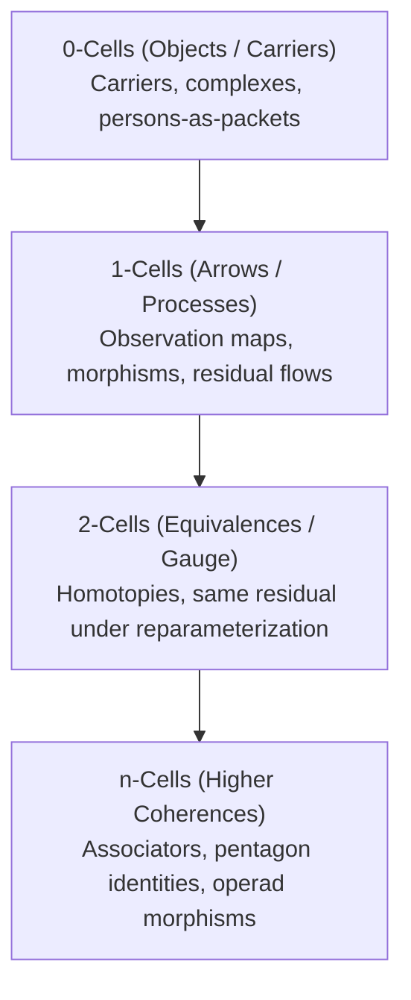

# 06. Symbols in Higher Dimensions & Homotopy Type Theory

**AuthorityEffect:** `None`  
**Estate:** `omega_engine_education/documentation/004_oepfp/math/`  
**Parent Document:** [`oesos_layers_index.md`](oesos_layers_index.md)  
**Status:** Advanced Mathematical Lens  

---

## 1. Higher-Dimensional Cell Typing

In advanced symbolic reasoning and multi-agent coordination, claims are formulated not only as natural language prose, but as **cells in higher-dimensional geometric and categorical complexes**:



### 1.1 Structural Role of Dimensional Cells

| Cell Dimension | Mathematical Object | Operational Role in Symbol Game |
|---|---|---|
| **0-cells** | Carriers, complexes, persons-as-packets | The concrete domain objects, state spaces, or agent identities. |
| **1-cells** | Observation maps, unitaries, morphisms, residuals | Processes, transformations, or directed differences between states. |
| **2-cells** | Homotopies, gauge transformations | Equivalences between processes ("same residual under reparameterization"). |
| **n-cells** | Higher coherences (associators, braiding) | Consistency conditions when higher category structures are loaded. |
| **Types (HoTT)** | Propositions as types; identity types as paths | Answering: *"Same claim under what homotopy path?"* |
| **PFP / Packet** | Proposal $\to$ Fidelity Residual $\to$ Receipt | Agent speech formalized as a typed, verifiable packet. |

---

## 2. Homotopy Type Theory (HoTT) & Identity Paths

Under the Curry-Howard-Voevodsky correspondence, **propositions are types** and **proofs are terms**:

$$\phi \text{ is true} \iff \text{Type } \phi \text{ is inhabited: } \exists p : \phi$$

### 2.1 The Identity Type as Path

In standard first-order logic, equality $x = y$ is a static boolean predicate. In HoTT, equality is an **identity type** representing the space of paths between $x$ and $y$:

$$\operatorname{Id}_A(x, y) \quad \text{or} \quad x =_A y$$

* **Path Witness:** An element $p : x =_A y$ is a continuous deformation or computational homotopy connecting $x$ to $y$.
* **Higher Equality:** Two paths $p, q : x =_A y$ may themselves be connected by a 2-path $\alpha : p =_{(x =_A y)} q$.
* **Application to Symbol Game Claims:**  
  Two agent proposals are not declared "equal" based on identical surface English. They are equal iff there exists a verified 2-cell (a computational path in the identity type) transporting their respective residual certificates without loss.

---

## 3. The Transport-Quotient Lens ($Q_F^1$)

In Higher Category Theory (HCT) and the General Theory of Model-Theoretic Update Regimes (GTMUR), transport across contexts is modeled as a **transport-quotient**:

$$Q_F^1 = \operatorname{coker}(d_0^F)$$

```text
                     C_n ───────── F ─────────> C_n+1
                      │                          │
                     d_0                        d_0'
                      │                          │
                      ▼                          ▼
                     C_n^1 ─────── χ□ ────────> C_n+1^1
```

* **Transport Square ($\chi_\square$):** Measures the commutation defect between context lift $F$ and same-context coboundary $d_0$.
* **Transport Coherence ($\chi$):** If the transport square commutes ($\chi_\square = 0$), the realization arrow is sound and preserves all lower-level certificates.

---

## 4. Re-Typing Major Physics & Epistemic Debates

> **Scope fence (2026-10-20):** this section is an informal typed sketch (`[Model]` / analogy grade in the Chapter 00 taxonomy). The type signatures below are not Lean code, are not checked anywhere in source, and do not state theorems. In particular the phrase "non-zero cohomological obstruction" in 4.2 names an analogy; no cochain complex or class is defined for the measurement problem. Bell's theorem itself is a standard result under its stated assumptions; only the typed rendering here is informal.

Formulating foundational physical and philosophical debates in higher-dimensional typed symbols can reduce rhetorical ambiguity:

### 4.1 Bell's Theorem
```text
Package_LHV : Type
  = (Locality × PredeterminedLocalOutcomes × QM_Correlations)

Bell_theorem : Package_LHV → Empty   -- under stated assumptions
-- Not: "The physical world is nonlocal"
-- But: The triple of local hidden-variable 1-data is mathematically uninhabited.
```

### 4.2 Albert's Quantum Measurement Problem
```text
Unitary : Dynamics
CollapseBorn : MeasurementRule
IncludeApparatus : System → System

Clash : Unitary ∘ IncludeApparatus  ≰  CollapseBorn
-- The measurement problem is the non-zero cohomological obstruction to commuting these 1-cells.
```

### 4.3 Friston's Variational Free Energy
```text
Blanket = Sensory × Active
Self ⊑ Internal  -- screened by Markov Blanket
Residual = FreeEnergy  -- variational surprise bound over observed 1-cells
```

### 4.4 QBism (Quantum Bayesianism)
```text
State : Agent → Credence
Measure : Agent × Action → Experience
Born : NormOnCredences
-- Quantum states are 1-cells representing agent credences, not unobserved 0-cells.
```
