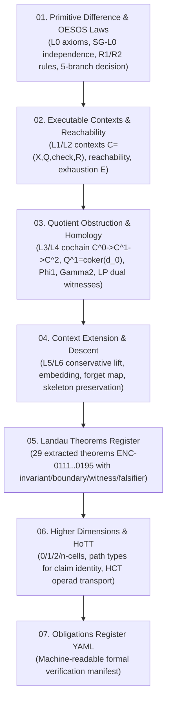

# 02. Mathematics: Finite Mathematical Spine & Epistemic Calculus

**AuthorityEffect:** `None`  
**Estate:** `omega_engine_education/documentation/004_oepfp/math/`  
**Master Cartography:** [`../docs/00_master_synthesis_and_cartography.md`](../docs/00_master_synthesis_and_cartography.md)  
**Governing Standard:** Landau Theoretical Minimum & Exact Verification Discipline  

---

## Overview & Role in the Architecture

The **Symbol Game Mathematical Spine** defines the finite, typed calculus that governs state transitions, obstruction measurements, and context extensions across the entire Proposal Fidelity Protocol (PFP).

The mathematics starts from the absolute minimum: a nullary **Primitive Difference** ($\diamond$) and the **Two-Rule OESOS Law**. Richer structures—such as discrete cochain complexes, homology quotients, linear programming dual certificates, and higher-dimensional homotopy types—are introduced strictly when an active obstruction requires them or an interface explicitly declares them.

---

## Fundamental State Trichotomy

Every state transition in this calculus adheres strictly to the fundamental trichotomy:

$$\boxed{
\text{Primitive Difference } \diamond \longrightarrow \text{Obstruction } \Omega \longrightarrow
\begin{cases}
\text{Elimination by admitted same-context repair } (\mathsf{Repair}) \\
\text{Certified structural exhaustion } (\mathsf{Survivor}) \\
\text{Conservative context extension } (\mathsf{Extend})
\end{cases}
}$$

---

## Progressive Reading Order

| Index | Document | Purpose & Scope | Key Invariants & Theorems |
|---|---|---|---|
| **01** | [`01_primitive_difference_and_oesos_laws.md`](./01_primitive_difference_and_oesos_laws.md) | **Foundations & Axioms** | Layer 0 ($L_0$), Primitive Difference $\diamond$, SG-L0 graph non-determination theorem, OESOS governing law, SG-L1 R1 priority theorem, and the exact 5-branch decision form. |
| **02** | [`02_executable_contexts_and_reachability.md`](./02_executable_contexts_and_reachability.md) | **Executable Contexts** | Layers 1 & 2 ($L_1, L_2$), context tuple $C = (X_C, Q_C, \operatorname{check}_C, \mathcal{R}_C)$, context depth, reachability closure $\operatorname{Reach}_C(x)$, and structural exhaustion certification. |
| **03** | [`03_quotient_obstruction_and_homology.md`](./03_quotient_obstruction_and_homology.md) | **Homological Calculus** | Layers 3 & 4 ($L_3, L_4$), discrete cochains $C^0 \xrightarrow{d_0} C^1 \xrightarrow{d_1} C^2$, $d_1 d_0 = 0$, quotient space $Q^1 = \operatorname{coker}(d_0)$, obstruction mass $\Phi_1$, closure defect $\Gamma_2$, and LP duality certifiers. |
| **04** | [`04_conservative_context_extension_and_descent.md`](./04_conservative_context_extension_and_descent.md) | **Context Extension & Descent** | Layers 5 & 6 ($L_5, L_6$), Context Extension Calculus (CEC), conservative extension predicates, forgetful projections, and skeleton preservation ($\operatorname{skel}_n$). |
| **05** | [`05_landau_theorems_and_invariant_register.md`](./05_landau_theorems_and_invariant_register.md) | **The 29 Extracted Theorems** | Register of the 29 extracted spine theorems (ENC-0111 through ENC-0195, with gaps; corrected 2026-10-20 from "31") structured under the Landau Theoretical Minimum (Invariant, Boundary, Witness, Falsifier). Read its audit note first. |
| **06** | [`06_higher_dimensions_and_hott_typing.md`](./06_higher_dimensions_and_hott_typing.md) | **Higher Geometry & Types** | Symbols in higher dimensions: 0-cells, 1-cells, 2-cells, Homotopy Type Theory (HoTT) identity paths, and higher category theory (HCT) operad transport. |
| **07** | [`07_mathematical_obligations_register.yaml`](./07_mathematical_obligations_register.yaml) | **Obligations Manifest** | Machine-readable YAML register of 38 verification obligations and proof targets; re-statused 2026-10-20 against source (2 PROVED, 6 TESTED-FINITE, 30 OPEN). |
| **08** | [`08_omega_engine_dynamics_and_adjunction_boundaries.md`](./08_omega_engine_dynamics_and_adjunction_boundaries.md) | **Adjunction Dynamics (exploratory)** | Conjecture-grade derivation of operator classes from a lift and forget adjunction; not proved. |
| **09** | [`09_staged_mathematical_scope_and_owner_boundaries.md`](./09_staged_mathematical_scope_and_owner_boundaries.md) | **Staged Scope & Owners** | Staged demonstration families and their code owners, with a 2026-10-20 path check. |

> **Numbering note (2026-10-20):** these Series B files share the prefixes `01_` to `09_` with the canonical spine files `01_math_*` to `09_math_*`, which are different documents indexed in [`README.md`](./README.md). Cite both series by full filename.

---

## Landau Theoretical Minimum Format

Every formal claim in this spine satisfies the four-part **Landau Theoretical Minimum**:
1. **Invariant:** The exact formal predicate that holds.
2. **Boundary:** The explicit carrier and hypotheses under which it holds.
3. **Witness:** The exact certificate, rational matrix calculation, or replay receipt deciding truth.
4. **Falsifier:** The precise counterexample, boundary deformation, or defect that invalidates it.
