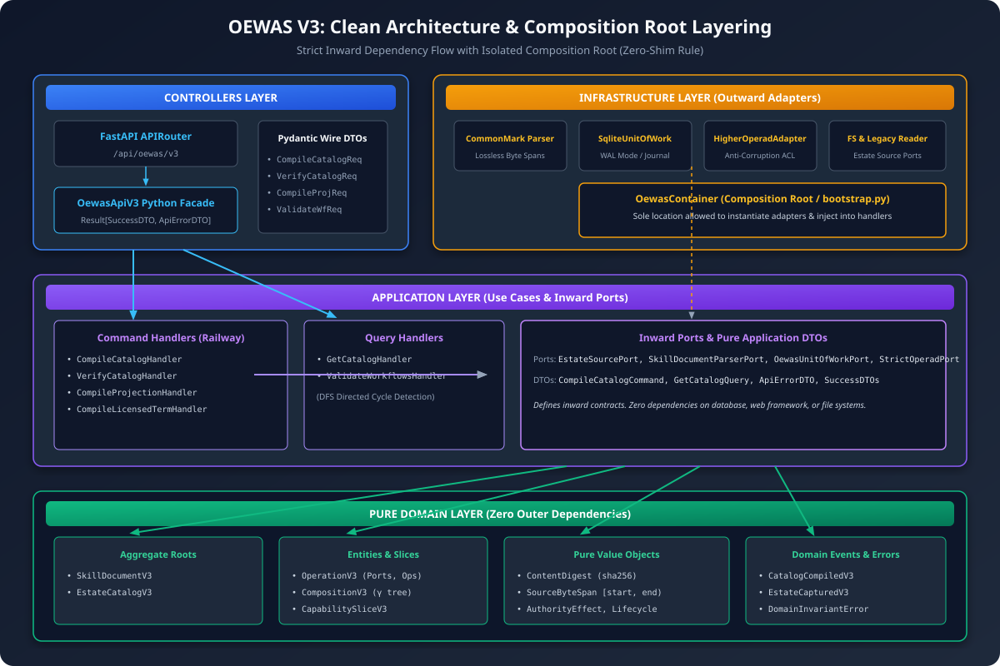
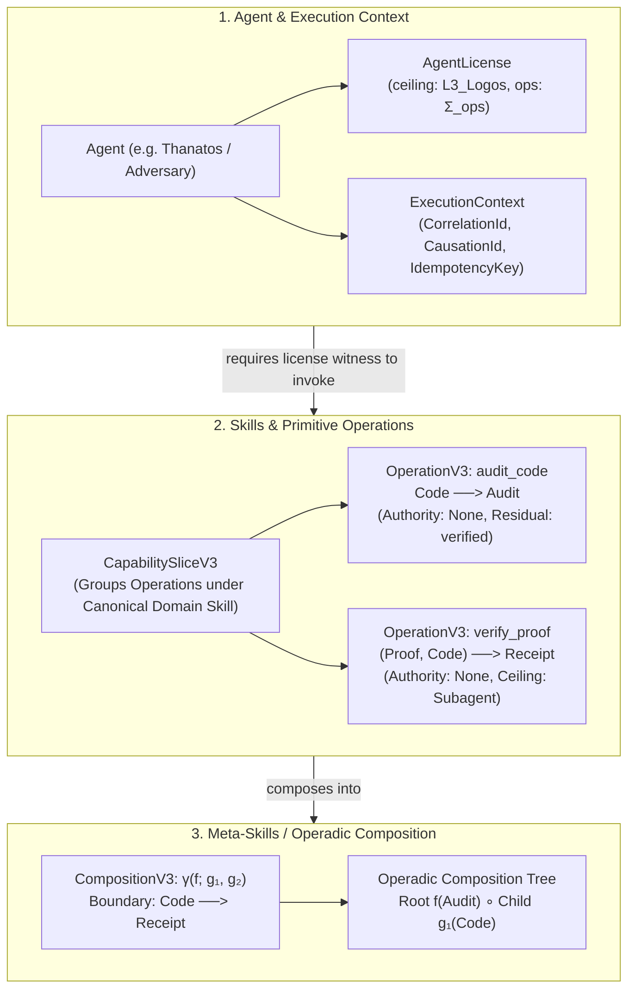
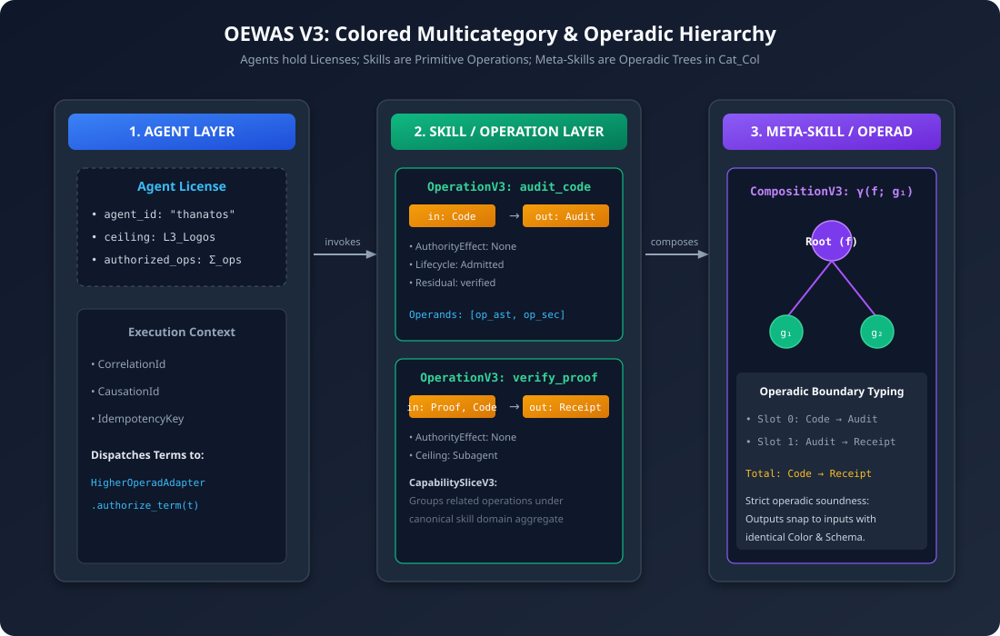
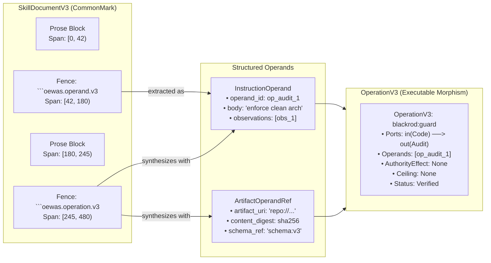
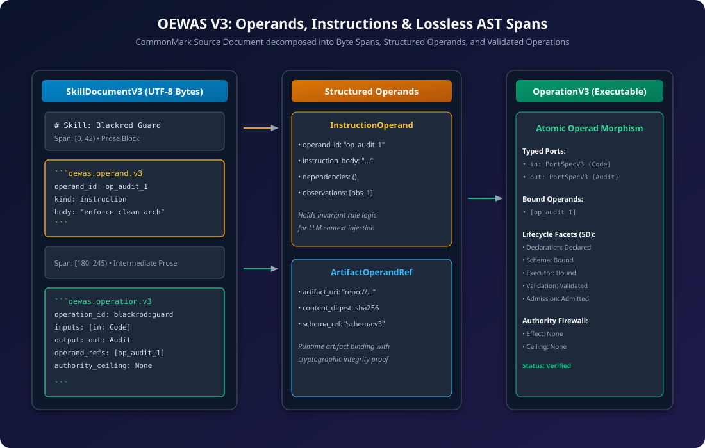
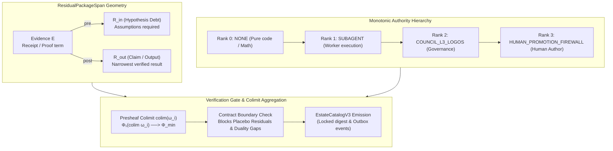
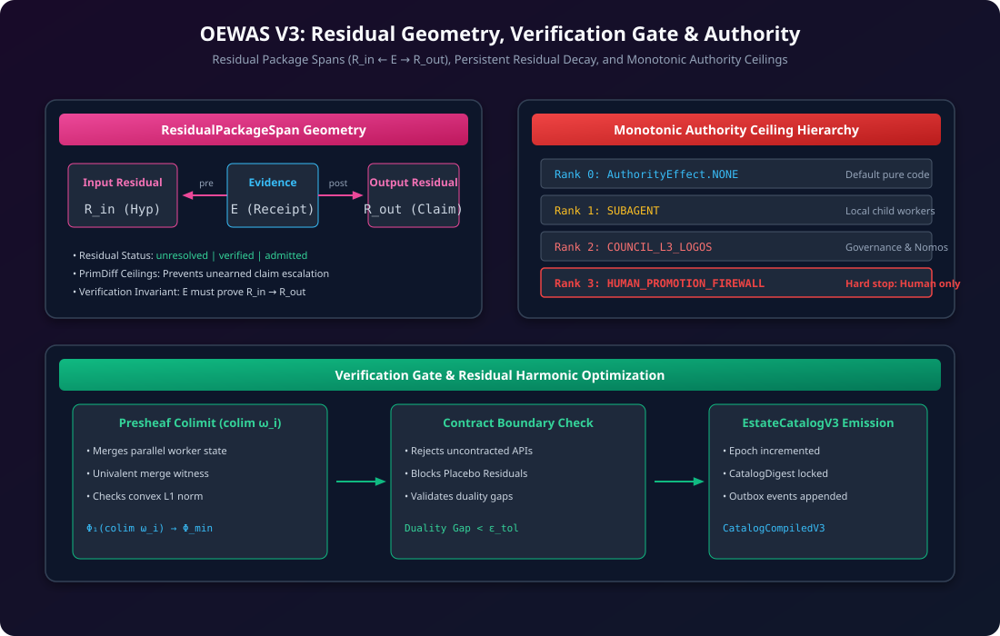
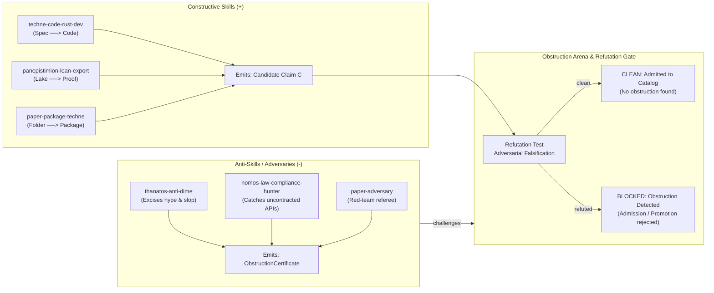
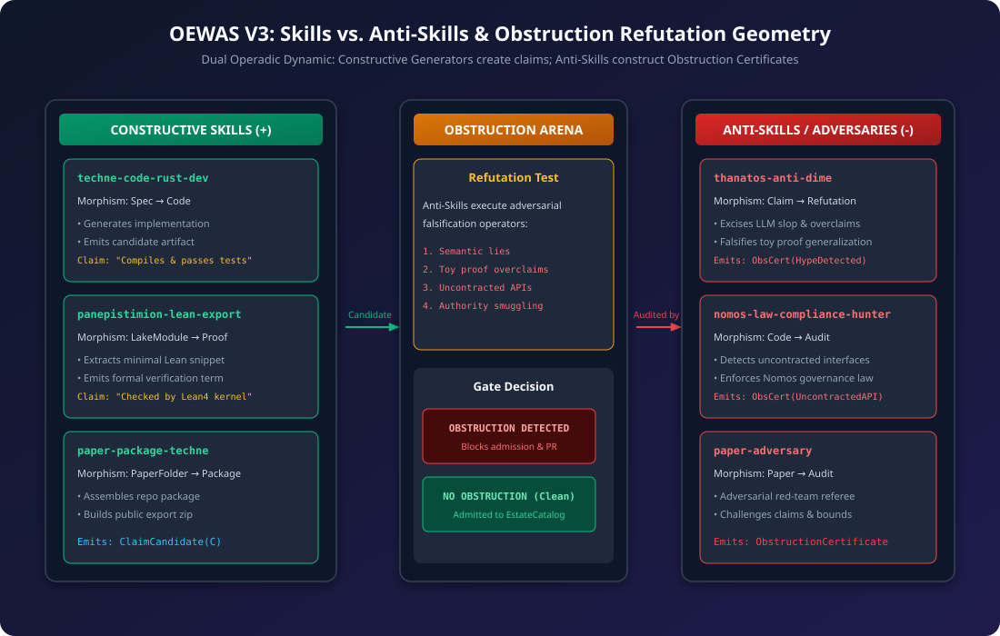

# OEWAS V3 Operadic Architecture, Clean Layering & Categorical Flowchart Guide

This guide presents the formal architecture and models of **OEWAS V3 (Engine Workflows, Agents, and Skills)**. It details how **Agents, Skills, Meta-Skills, Operands, Residuals, and Anti-Skills** operate within a colored multicategory (operad) and Clean Architecture framework.

---

## 0. Clean Architecture & Composition Root Layering

OEWAS V3 enforces strict dependency inversion across 4 decoupled layers:

1. **Controllers Layer**: Contains the mountable FastAPI `APIRouter` (`/api/oewas/v3`), Pydantic wire models, and the `OewasApiV3` Python facade returning railway-oriented `Result[SuccessDTO, ApiErrorDTO]`.
2. **Application Layer**: Contains use cases and inward ports. Pure domain logic and orchestration (`CompileCatalog`, `VerifyCatalog`, `CompileProjection`, `CompileLicensedTerm`, `GetCatalog`, `ValidateWorkflows`). Zero lower-layer framework dependencies.
3. **Domain Layer**: Pure DDD aggregate roots (`SkillDocumentV3`, `EstateCatalogV3`), entities (`OperationV3`, `CompositionV3`, `CapabilitySliceV3`), value objects (`ContentDigest`, `SourceByteSpan`, `AuthorityEffect`, `SkillLifecycleV3`), events, and domain errors.
4. **Infrastructure Layer**: Outward adapters (`LosslessMarkdownParserAdapter`, `SqliteUnitOfWork`, `HigherOperadAdapter`, `FsEstateSourceAdapter`, `LegacyCatalogReaderAdapter`).
5. **Composition Root (`bootstrap.py`)**: `OewasContainer` is the single authorized location to construct adapters and wire them to application ports and controllers.

### Clean Architecture Mermaid Flowchart

```mermaid
graph TD
    subgraph ControllersLayer["Controllers Layer"]
        Router["FastAPI APIRouter (/api/oewas/v3)"]
        Facade["OewasApiV3 Python Facade"]
        Wire["Pydantic Wire DTOs"]
        Router --> Facade
    end

    subgraph InfrastructureLayer["Infrastructure Layer (Outward Adapters)"]
        Parser["Lossless CommonMark Parser Adapter"]
        UoW["SQLite-WAL Unit of Work & Event Journal"]
        Operad["HigherOperad Anti-Corruption Adapter"]
        FS["FS & Legacy Reader Adapters"]
        Bootstrap["OewasContainer Composition Root (bootstrap.py)"]
        Bootstrap --> ApplicationLayer
        Bootstrap --> ControllersLayer
        Bootstrap --> InfrastructureLayer
    end

    subgraph ApplicationLayer["Application Layer (Use Cases & Inward Ports)"]
        Cmd["Command Handlers<br/>(CompileCatalog, VerifyCatalog, CompileProjection, CompileLicensedTerm)"]
        Qry["Query Handlers<br/>(GetCatalog, ValidateWorkflows)"]
        Ports["Inward Ports & Application DTOs"]
        Cmd --> Ports
        Qry --> Ports
    end

    subgraph DomainLayer["Domain Layer (Zero Outer Dependencies)"]
        Agg["Aggregate Roots (SkillDocumentV3, EstateCatalogV3)"]
        Ent["Entities (OperationV3, CompositionV3, CapabilitySliceV3)"]
        VO["Pure Value Objects (ContentDigest, ByteSpan, Authority, Lifecycle)"]
        Events["Domain Events & Typed Errors"]
    end

    Facade --> Cmd
    Facade --> Qry
    Ports --> Agg
    Ports --> Ent
    Ports --> VO
    Ports --> Events
```

### Clean Architecture Visual Diagram

| Vector SVG (Crisp / Scalable) | High-Resolution PNG (Raster) |
| :---: | :---: |
| [`00_clean_architecture_layers.svg`](./00_clean_architecture_layers.svg) | [`00_clean_architecture_layers.png`](./00_clean_architecture_layers.png) |



---

## 1. Colored Multicategory & Operadic Hierarchy (Agent $\to$ Skill $\to$ Meta-Skill)

In OEWAS V3:

- **Colours ($\mathcal{C}$)** represent strongly-typed data planes: `Code`, `Audit`, `Proof`, `Paper`, `Receipt`, `State`, `Post`, `Data`.
- **Agents** hold cryptographic **Licenses** specifying their identity and authority ceiling.
- **Skills** are primitive colored operad morphisms $O(c_1, \dots, c_k; d)$ taking inputs of colour $c_i$ and producing an output of colour $d$.
- **Meta-Skills** are operadic tree compositions $\gamma(f; g_1, \dots, g_k) \to h$ where intermediate outputs plug into corresponding inputs of identical colour and schema digest.

The default container deliberately binds no `AgentLicense` witness. Its licensed-term endpoint therefore refuses with `LICENSE_WITNESS_REQUIRED`; the diagram below shows the required future authorization binding, not an active authorization path.

### Operadic Hierarchy Mermaid Flowchart



### Operadic Hierarchy Visual Diagram

| Vector SVG (Crisp / Scalable) | High-Resolution PNG (Raster) |
| :---: | :---: |
| [`01_operad_agent_skill_metaskill.svg`](./01_operad_agent_skill_metaskill.svg) | [`01_operad_agent_skill_metaskill.png`](./01_operad_agent_skill_metaskill.png) |



---

## 2. Operands, Instructions, and Document AST Spans

In OEWAS V3:

- **`SkillDocumentV3`** is a lossless CommonMark aggregate where every section has an exact `SourceByteSpan` `[start_byte, end_byte)`.
- **`InstructionOperand`** encapsulates static behavioral directives extracted from `oewas.operand.v3` fences.
- **`ArtifactOperandRef`** encapsulates runtime dynamic data inputs with cryptographic SHA-256 digests.
- **`OperationV3`** binds operands to typed input/output ports (`PortSpecV3`) under a 5-dimensional lifecycle facet (`Declared`, `Bound`, `Bound`, `Validated`, `Admitted`).

### Operand AST Mermaid Flowchart



### Operand AST Visual Diagram

| Vector SVG (Crisp / Scalable) | High-Resolution PNG (Raster) |
| :---: | :---: |
| [`02_operands_instructions_ast.svg`](./02_operands_instructions_ast.svg) | [`02_operands_instructions_ast.png`](./02_operands_instructions_ast.png) |



---

## 3. Residual Geometry, Verification Gate & Authority Hierarchy

In OEWAS V3:

- **Where Residuals Live**: Residuals live within `ResidualPackageSpan` as an exact mathematical span $R_{in} \xleftarrow{\text{pre}} \text{Evidence } E \xrightarrow{\text{post}} R_{out}$.
  - $R_{in}$ (Hypothesis / Invariant Debt): What assumptions the operation requires.
  - $E$ (Evidence Receipt): Cryptographic proof/test that the transformation held.
  - $R_{out}$ (Discharged Residual / Claim): The narrowest defensible claim produced.
- **Authority Ceilings**:
  - `Rank 0: NONE` (Default pure mathematical code)
  - `Rank 1: SUBAGENT` (Worker spawns)
  - `Rank 2: COUNCIL_L3_LOGOS` (Nomos & Council governance changes)
  - `Rank 3: HUMAN_PROMOTION_FIREWALL` (Hard stopping firewall for PR merge or publication)
- **Residual Decay**: Multi-agent colimit $\Phi_1(\text{colim}_i \omega_i) \to \Phi_{min}$ tracks residual debt reduction.

### Residual Geometry Mermaid Flowchart



### Residual Geometry Visual Diagram

| Vector SVG (Crisp / Scalable) | High-Resolution PNG (Raster) |
| :---: | :---: |
| [`03_residual_geometry_authority.svg`](./03_residual_geometry_authority.svg) | [`03_residual_geometry_authority.png`](./03_residual_geometry_authority.png) |



---

## 4. Skills vs. Anti-Skills & Obstruction Refutation Geometry

In OEWAS V3:

- **Constructive Skills (+)**: Morphisms that construct artifacts, prove theorems, or build implementations ($\text{Spec} \to \text{Code}$, $\text{LakeModule} \to \text{Proof}$).
- **Anti-Skills (-)**: Dual refutation operators whose explicit mathematical goal is to find an **Obstruction** (e.g. semantic lies, uncontracted boundaries, hype overclaims, placebo residuals).
- **Obstruction Certificates**: If an Anti-Skill produces an `ObstructionCertificate`, the compilation / verification gate **hard-fails**, preventing admission into `EstateCatalogV3` or blocking pull request promotion.

### Anti-Skill Geometry Mermaid Flowchart



### Anti-Skill Geometry Visual Diagram

| Vector SVG (Crisp / Scalable) | High-Resolution PNG (Raster) |
| :---: | :---: |
| [`04_skills_vs_antiskills_obstruction.svg`](./04_skills_vs_antiskills_obstruction.svg) | [`04_skills_vs_antiskills_obstruction.png`](./04_skills_vs_antiskills_obstruction.png) |



---

## 5. Summary & Testing / Development Roadmap

| Concept | Concrete OEWAS V3 Implementation | Testing & Verification Target |
| :--- | :--- | :--- |
| **Clean Architecture Layering** | `domain/`, `application/`, `infrastructure/`, `controllers/` | `test_clean_architecture_ast_boundaries.py` |
| **Agent $\to$ Skill $\to$ Meta-Skill** | `HigherOperadAdapter`, `CompositionV3`, `OperationV3` | `test_higher_operad_adapter.py`, `test_application_railway_handlers.py` |
| **Operands & Byte Spans** | `InstructionOperand`, `ArtifactOperandRef`, `SourceByteSpan` | `test_lossless_markdown_parser.py`, `test_skill_document_v3_aggregate.py` |
| **Residual Geometry & Ceilings** | `ResidualPackageSpan`, `AuthorityEffect`, `SqliteUnitOfWork` | `test_sqlite_journal_unit_of_work.py`, `test_domain_value_objects.py` |
| **Skills vs Anti-Skills** | `CapabilitySliceV3`, `SkillMigratorV3`, `migration_manifest_v3.json` | `test_goo_migration_manifest_parity.py` |

---

## 6. Canonical Directory & Component Tree Layout

```text
operads/
├── __init__.py                               # Public exports
├── domain/                                    # Pure WAS Domain (Zero Infra Dependencies)
│   ├── __init__.py
│   ├── value_objects/                         # Exact-type immutable Value Objects
│   │   ├── identifier.py                      # SkillId, OperationId, DocumentId, OperandId, etc.
│   │   ├── content_digest.py                  # Multi-algorithm exact-type Digest
│   │   ├── byte_span.py                       # SourceByteSpan (half-open byte range provenance)
│   │   ├── authority.py                       # AuthorityEffect (NONE, EVIDENCE_ONLY, etc.)
│   │   ├── lifecycle_facets.py                # Declaration, Schema, Executor, Validation, Admission
│   │   └── operands.py                        # InstructionOperand, ArtifactOperandRef, ResidualPackageSpan
│   ├── entities/
│   │   ├── skill_document_v3.py               # Aggregate Root: Lossless doc tree + operations + compositions
│   │   ├── operation_v3.py                    # Entity: Typed operation with operand refs, colour, schema digest
│   │   ├── composition_v3.py                  # Entity: Composition term, slot, substitution boundary
│   │   └── catalog_v3.py                      # Aggregate: Compiled estate catalog snapshot
│   ├── events/                                # Domain Events (EstateCaptured, OperationDeclared, etc.)
│   └── errors/                                # Typed Domain Errors & Refusals
├── application/                               # Application Layer (Use Cases & Inward Ports)
│   ├── __init__.py
│   ├── ports/                                 # Inward-Owned Interfaces (Ports)
│   │   ├── estate_source_port.py              # EstateSourcePort
│   │   ├── skill_document_parser_port.py      # SkillDocumentParserPort
│   │   ├── legacy_catalog_reader_port.py      # LegacyCatalogReaderPort (V1/V2 dual-read)
│   │   ├── projection_manifest_port.py        # ProjectionManifestPort
│   │   ├── strict_operad_port.py              # StrictOperadPort (Anti-corruption to higher_operad)
│   │   ├── unit_of_work_port.py               # OewasUnitOfWorkPort
│   │   ├── journal_port.py                    # JournalPort & OutboxPort
│   │   ├── clock_port.py                      # ClockPort
│   │   └── id_generator_port.py               # IdGeneratorPort
│   ├── commands/                              # Command Handlers (CompileCatalog, VerifyCatalog, etc.)
│   ├── queries/                               # Query Handlers (GetCatalog, GetProjection, etc.)
│   └── dtos/                                  # Pure DTOs & Error Payloads
├── controllers/                               # Controllers & API Facades
│   ├── __init__.py
│   ├── python_facade.py                       # OewasApiV3 (Railway-oriented Python interface)
│   ├── router.py                              # Mountable FastAPI APIRouter (/api/oewas/v3)
│   └── wire_dtos.py                           # Strict Pydantic v2 wire models & status code mappers
├── frontend/                                  # Frontend User Interfaces & CLI Entry Points
│   ├── __init__.py
│   ├── api/                                   # Standalone FastAPI Application Factory
│   │   ├── __init__.py
│   │   └── app.py                             # create_app() with OpenAPI/Swagger & health endpoints
│   └── cli/                                   # CLI Tooling (Windows CP1252/UTF-8 Safe)
│       ├── __init__.py
│       ├── __main__.py                        # python -m operads.frontend.cli
│       └── main.py                            # compile-estate, verify-catalog, show-catalog subcommands
├── infrastructure/                            # Adapters (Implementing Inward Ports)
│   ├── __init__.py
│   ├── parser/                                # Lossless CommonMark & Fenced Block Parser
│   │   └── markdown_parser_adapter.py
│   ├── storage/                               # SQLite-WAL Journal, Outbox, and Unit of Work
│   │   ├── sqlite_journal_adapter.py
│   │   ├── sqlite_unit_of_work.py
│   │   └── schema.sql
│   ├── fs/                                    # Filesystem & Estate Reader Adapter
│   │   ├── fs_estate_source_adapter.py
│   │   └── legacy_catalog_reader_adapter.py   # Dual-read V1/V2 compatibility adapter
│   ├── operad/                                # Anti-corruption adapter to higher_operad kernel
│   │   └── higher_operad_adapter.py
│   ├── providers/                             # Crypto & Dispatch Providers
│   │   ├── manifest_signature_provider.py     # HMAC-SHA256 Manifest Signer & Constant-Time Verifier
│   │   └── outbox_dispatcher_adapter.py       # Transactional Outbox Event Dispatcher
│   └── bootstrap.py                           # Composition Root (Sole module wiring adapters to controllers)
├── migration/                                 # Goo-skill Consolidation Tools & Manifest
│   ├── __init__.py
│   ├── migration_manifest_v3.json             # 41 goo-* blob digests, successor mappings, archive metadata
│   └── skill_migrator.py                      # Dry-run verifier & 4-host atomic synchronizer
├── _docs/                                     # Subsystem Documentation & Test Execution Guides
│   └── oewas_test_suite_execution_guide.md    # Comprehensive 27-suite test manifest & runbook
├── _images/                                   # Operadic Architecture Models & Visual Diagrams
│   ├── 00_clean_architecture_layers.svg / .png
│   ├── 01_operad_agent_skill_metaskill.svg / .png
│   ├── 02_operands_instructions_ast.svg / .png
│   ├── 03_residual_geometry_authority.svg / .png
│   ├── 04_skills_vs_antiskills_obstruction.svg / .png
│   └── oewas_operad_model_guide.md
└── tests/                                     # Scoped, Layered Test Suites (27 files, 64 tests)
    ├── __init__.py
    ├── unit/                                  # Pure Domain & Parser Unit Suites (7 files)
    │   ├── test_domain_value_objects.py
    │   ├── test_domain_value_objects_boundary_and_fuzz.py
    │   ├── test_skill_document_v3_aggregate.py
    │   ├── test_lossless_markdown_parser.py
    │   ├── test_markdown_parser_edge_case_fuzz.py
    │   ├── test_markdown_parser_property_laws.py
    │   └── test_application_railway_handlers.py
    ├── integration/                           # Infrastructure & End-to-End Suites (19 files)
    │   ├── test_sqlite_journal_unit_of_work.py
    │   ├── test_sql_constraint_rejection_matrix.py
    │   ├── test_outbox_transaction_atomicity.py
    │   ├── test_outbox_message_dispatcher.py
    │   ├── test_projection_manifest_signature_verification.py
    │   ├── test_manifest_signature_adversarial_matrix.py
    │   ├── test_dual_read_legacy_catalog.py
    │   ├── test_higher_operad_adapter.py
    │   ├── test_higher_operad_laws_and_cyclic_graphs.py
    │   ├── test_e2e_full_lifecycle_roundtrip.py
    │   ├── test_e2e_multi_stage_agentic_terms.py
    │   ├── test_e2e_schema_migration_lossless.py
    │   ├── test_agent_to_agent_dag_compilation.py
    │   ├── test_concurrent_multi_worker_idempotency.py
    │   ├── test_benchmark_burst_load.py
    │   ├── test_asgi_multi_tenant_compile_catalog.py
    │   ├── test_openapi_schema_and_swagger_docs.py
    │   ├── test_cli_frontend_encoding_and_exit_codes.py
    │   └── test_goo_migration_manifest_parity.py
    └── architecture/                          # Dependency Inversion & AST Boundary Gates (1 file)
        └── test_clean_architecture_ast_boundaries.py
```
