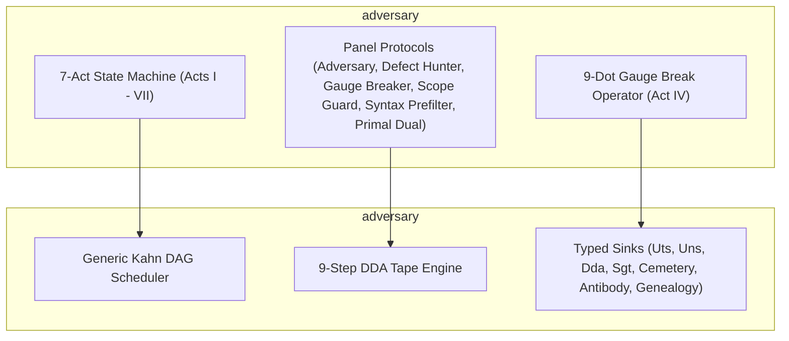
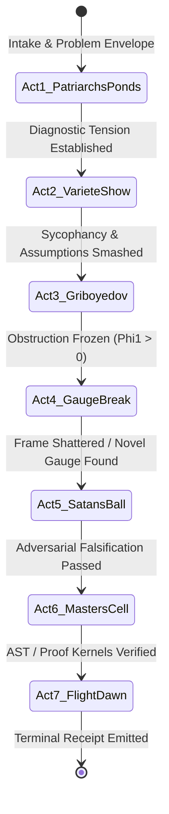

# Specification: Adversary 7-Act Dialectic Workflow & 9-Dot Gauge Break

**Document ID:** `oewas_spec_adversary_7act_dialectic_workflow`  
**Location:** this chapter. Its former source copy `_docs/06_spec_adversary_7act_dialectic_workflow.md` in the retired OEWAS package has no successor under `operads`.  
**Governing Domain:** `adversary`  
**Base Framework:** `adversary` / `operads`  
**Status:** Normative Specialization Specification  
**AuthorityEffect:** `None` (Terminal outputs are proposals; external authorizer holds promotion authority)  

---

## Table of Contents

- [1. Executive Summary & Architecture Boundary](#1-executive-summary--architecture-boundary)
- [2. The 7 Acts of the Dialectical State Machine](#2-the-7-acts-of-the-dialectical-state-machine)
- [3. The 9-Dot Gauge Break (Act IV Transgression)](#3-the-9-dot-gauge-break-act-iv-transgression)
- [4. Panel Personae as Clean Architecture Domain Protocols](#4-panel-personae-as-clean-architecture-domain-protocols)
- [5. Compilation to the 9-Step DDA Tape & Typed Sinks](#5-compilation-to-the-9-step-dda-tape--typed-sinks)
- [6. Canonical Bounded Run Artifacts](#6-canonical-bounded-run-artifacts)
- [7. Claim Discipline Summary](#7-claim-discipline-summary)

---

## 1. Executive Summary & Architecture Boundary

Under the **Swarm Decoupling & Pure Generic Runtime Invariant**, the base execution engine (`adversary` and `operads`) is a pure generic framework containing generic scheduling, typed sink protocols, and telemetry. It contains zero character lore or narrative hardcoding.

The **Adversary 7-Act Dialectic Workflow** lives strictly in the specialized bounded context `adversary`. It models multi-agent problem-solving through the source novel narrative structure to smash sycophancy, execute lateral gauge breaks, and enforce strict terminal descent to exact certificates.



---

## 2. The 7 Acts of the Dialectical State Machine

The workflow executes as a deterministic, finite state machine traversing 7 distinct dialectical acts. Every state transition is recorded as an immutable DDA deformation step.



### Act I: Patriarch's Ponds (Intake, Problem Envelope & Diagnostic Tension)

- **Narrative Theme:** Unsettling encounter; confrontation with unexpected reality ("Boundary Fuzzer has already spilled the sunflower oil").
- **Mathematical Operation:** Parses the raw task into an RFC 8785 `PacketEnvelope` and builds the initial simplicial complex $P_0 = (V_0, E_0, F_0)$ and 1-cochain $\omega_0 \in C^1(E)$.
- **DDA Step:** `E` (Event Intake) $\to$ `R` (Readings & Presentations).

### Act II: The Black Magic Show at the Variété (Sycophancy & False Consensus Smashing)

- **Narrative Theme:** Exposing public illusions, unmasking charlatans, raining false banknotes that vanish upon inspection.
- **Mathematical Operation:** Executes basis rotation / Hadamard mixing ($QM\_122$) across agent debate turns. Exposes latent phase differences and detects hidden agreements on false premises.
- **DDA Step:** `C` (Contradiction Detection) $\to$ `I` (Invariant Computation).

### Act III: Griboyedov House (Bureaucratic Ossification & Loss Ledger Audit)

- **Narrative Theme:** Literary bureaucrats dining sumptuously while producing zero authentic art; burning down the restaurant of complacency.
- **Mathematical Operation:** Audits the current solution attempt against the loss ledger ($\text{LossLedger}$). Detects circular reasoning, shallow prompt tweaking, and unearned `DONE` declarations via Blackrod.
- **DDA Step:** `L` (Loss Ledger Valuation).

### Act IV: The 9-Dot Gauge Break (Transgression & Topological Frame-Breaking)

- **Narrative Theme:** Stepping outside the square; breaking frozen cognitive coordinates with philosophical irony, dark satire, and mathematical transgression.
- **Mathematical Operation:** When linear coboundary descent stalls ($\Phi_1(\omega) > 0$ under locked gauge), Act IV triggers a non-linear gauge transformation $\alpha^* \in C^0(V)$ that re-indexes the simplicial boundary.
- **DDA Step:** `Λ` (Gauge Shift Transformation).

### Act V: The Great Ball at Satan's (Adversarial Stress Testing & Falsification Firewalls)

- **Narrative Theme:** The parade of resurrected historical scoundrels; enduring overwhelming trials without flinching.
- **Mathematical Operation:** Subjects candidate solutions to the Thanatos-Nemesis red-team gauntlet, property-based fuzzers, and Examiner quiz matrices. Logs non-zero curvatures ($\Gamma_2 > 0$) to `AntibodySink`.
- **DDA Step:** `D` (Defect & Curvature Descent).

### Act VI: Manuscript Truth's Basement Cell (Mechanized Extraction & Lean 4 / AST Proof Kernels)

- **Narrative Theme:** "Manuscripts don't burn"; recovering the indestructible core truth written in seclusion.
- **Mathematical Operation:** Extracts verified Lean 4 proof terms, lossless AST roundtrips, and zero-defect code modules. Asserts that the duality gap $\Delta_{\text{gap}} = 0$ in exact rational arithmetic $\mathbb{Q}$.
- **DDA Step:** `M` (Monadic Verification & AST Preservation).

### Act VII: Flight into Dawn & Eternal Refuge (Terminal Reality Gate & Receipt Archival)

- **Narrative Theme:** Leaving the city on black horses; granting peace and quietude; sealing the final manuscript.
- **Mathematical Operation:** Terminal evaluation by Adversary (`ITerminalGatekeeper`). Emits one of three canonical outcomes: `PASS_TO_MASTER` (verified solution), `REFUSE` (typed mathematical refusal), or `OPEN_RESIDUAL` (quarantined residual ledger).
- **DDA Step:** `T` (Terminal Gate Commitment).

---

## 3. The 9-Dot Gauge Break (Act IV Transgression)

The classic 9-dot puzzle cannot be solved by connecting dots within the $3 \times 3$ grid perimeter. Similarly, complex reasoning deadlocks occur when agents are trapped inside an inadequate simplicial representation.

```text
       • ─── • ─── •
       │ ╲         │
       •   •       • ─── (Escape Line extending beyond grid boundary)
       │     ╲     │
       • ─── • ─── •
```

### Mathematical Formulation

When the first-order residual is non-zero ($\Phi_1(\omega) > 0$) and the gradient $\nabla \Phi_1 = 0$ under current basis $V$:

1. **Carrier Expansion:** The gauge break operator expands the vertex set $V \hookrightarrow V \cup \{v_{\text{gauge}}\}$.
2. **Deictic Mass Conservation:** The transformation is valid if and only if total information mass is preserved:
   $$\sum_{e \in E'} |\omega'(e)| \ge M_0 > 0$$
3. **Strict Descent Target:** The transformed complex $P' = (V', E', F')$ must permit a strict descent path:
   $$\Phi_1(\omega') < \Phi_1(\omega) \quad \text{or} \quad \Gamma_2(\omega') < \Gamma_2(\omega)$$

---

## 4. Panel Personae as Clean Architecture Domain Protocols

Every character in Adversary's panel is formally defined as an immutable Domain Protocol (`ports.py`):

```python
from typing import Protocol, Tuple
from dataclasses import dataclass

@dataclass(frozen=True)
class DialogueState:
    task_id: str
    simplicial_complex: dict
    cochain_core: list[float]
    phi_1: float
    gamma_2: float

class ITerminalGatekeeper(Protocol):
    """Adversary: Terminal reality gatekeeper and judge."""
    def judge_terminal(self, state: DialogueState) -> str:
        """Emits PASS_TO_MASTER, REFUSE, or OPEN_RESIDUAL."""
        ...

class IDialecticalProber(Protocol):
    """Defect Hunter: Conductor of ironical tension and semantic traps."""
    def probe_sycophancy(self, state: DialogueState) -> list[str]:
        ...

class IFalsificationPerturber(Protocol):
    """Gauge Breaker: Playful falsification and adversarial edge injection."""
    def inject_perturbation(self, state: DialogueState) -> DialogueState:
        ...

class IExecutioner(Protocol):
    """Scope Guard: Direct obstacle elimination and deadlock breaker."""
    def force_gauge_break(self, state: DialogueState) -> DialogueState:
        ...

class IBoundaryGuard(Protocol):
    """Syntax Prefilter: State boundary inspector and illusion stripper."""
    def strip_prose_slop(self, raw_text: str) -> str:
        ...

class ITruthAdvocate(Protocol):
    """Primal Dual: High-courage invariant sponsor and kernel extractor."""
    def extract_indestructible_kernel(self, state: DialogueState) -> bytes:
        ...
```

---

## 5. Compilation to the 9-Step DDA Tape & Typed Sinks

The Adversary dialectic maps directly onto the generic 9-step Discrete Deformation Algebra (DDA) tape:

| DDA Step | Name | Adversary Act | Primary Responsible Protocol | Target Sink |
| :--- | :--- | :--- | :--- | :--- |
| **`E`** | Event Intake | Act I | `IBoundaryGuard` (Syntax Prefilter) | `UtsSink` |
| **`R`** | Readings | Act I | `IDialecticalProber` (Defect Hunter) | `UnsSink` |
| **`C`** | Contradictions | Act II | `IDialecticalProber` (Defect Hunter) | `SgtSink` |
| **`I`** | Invariants | Act II | `ITruthAdvocate` (Primal Dual) | `DdaSink` |
| **`L`** | Loss Ledger | Act III | Blackrod / `IBoundaryGuard` | `DdaSink` |
| **`Λ`** | Gauge Shift | Act IV | `IExecutioner` (Scope Guard) | `DdaSink` |
| **`D`** | Defect Descent | Act V | `IFalsificationPerturber` (Gauge Breaker) | `AntibodySink` |
| **`M`** | Monadic Proof | Act VI | `ITruthAdvocate` (Primal Dual) | `GenealogySink` |
| **`T`** | Terminal Gate | Act VII | `ITerminalGatekeeper` (Adversary) | `UtsSink` / `CemeterySink` |

---

## 6. Canonical Bounded Run Artifacts

Every bounded run of the Adversary dialectic writes exactly 4 immutable output artifacts to `_intelligence/_adversary/runs/<task_key>/`:

1. **`receipt.json`**: RFC 8785 Canonical JSON receipt containing SHA-256 digests, terminal verdict (`PASS_TO_MASTER` | `REFUSE` | `OPEN_RESIDUAL`), exact rational residual metrics ($\Phi_1, \Gamma_2$), and solver certificate.
2. **`novella.md`**: Human-readable narrative novella rendering the 7-Act dialectic, dialogue turns, and ironical insights.
3. **`dda_actions.jsonl`**: The raw step-by-step DDA action log (`E -> R -> C -> I -> L -> Λ -> D -> M -> T`).
4. **`summary.json`**: Machine-readable execution summary with timing, token budget transitions, and resource metrics.

---

## 7. Claim Discipline Summary

1. **What this document supports:**
   - Formal specification of the 7-Act Adversary dialectical state machine and 9-dot gauge break.
   - Decoupling of literary domain protocols from generic scheduling and DDA tape execution.
   - Standardized 4-file artifact emission contract for all bounded swarm runs.
2. **What this document does NOT support:**
   - Does not claim that literary prose confers semantic authority (`AuthorityEffect: None`).
   - Does not allow agents to bypass exact rational solvers by narrative assertion.
3. **Narrowest defensible claim:**
   - The 7-Act Adversary workflow provides a structured dialectical method for breaking cognitive deadlocks and guiding multi-agent swarms toward exact mathematical certificates.
4. **Next test needed:**
   - Execute an end-to-end 7-act run on a synthetic gauge-deadlock task and verify emission of the 4 canonical run files.
5. **Kill condition:**
   - Generation of unconstrained chat prose that fails to emit structured DDA steps or violates `AuthorityEffect: None`.

---

*Preserved under the Clean Architecture and Governance Directives of the Sentinel Engine.*
