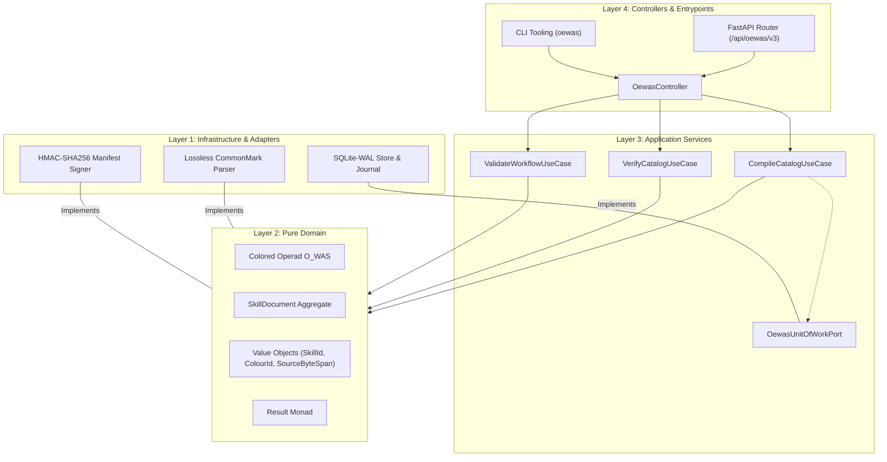
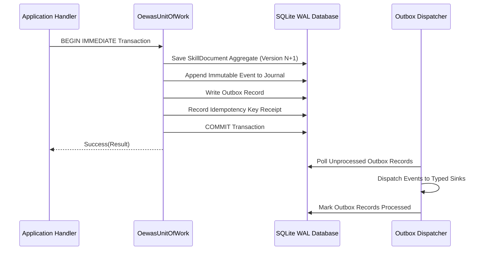
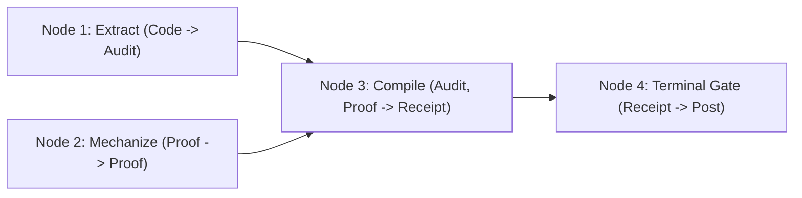

> **HISTORICAL.** The status line below calls this a normative production specification, and the location line names a package `_docs` path. This file is the education copy. It does not make OEWAS a production executor. See [chapter 23](23_plan_oewas_consolidation_oeeis_and_demo_integration.md).

# Specification: OEWAS V3 Production Architecture & Operadic Engine

**Document ID:** `oewas_spec_oewas_v3_production_engine`  
**Location:** this chapter. Its former source copy `_docs/08_spec_oewas_v3_production_engine.md` in the retired OEWAS package has no successor under `omega_engine_operads`.  
**Governing Domain:** `omega_engine_operads`  
**Host & Adapters:** `omega_engine_operating_system`  
**Status:** Normative Production Architecture Specification  
**AuthorityEffect:** `None`  

---

## Table of Contents

- [1. Executive Summary & 4-Layer Clean Architecture](#1-executive-summary--4-layer-clean-architecture)
- [2. The 3-Ring Architecture](#2-the-3-ring-architecture)
- [3. Colored Multicategory (Operad) O_WAS Foundations](#3-colored-multicategory-operad-o_was-foundations)
- [4. Lossless CommonMark Parser & AST Byte-for-Byte Contiguity](#4-lossless-commonmark-parser--ast-byte-for-byte-contiguity)
- [5. Concurrency, SQLite-WAL & Transactional Outbox](#5-concurrency-sqlite-wal--transactional-outbox)
- [6. Multi-Agent DAG Scheduling (Kahn's Algorithm)](#6-multi-agent-dag-scheduling-kahns-algorithm)
- [7. API, CLI & Manifest Cryptographic Signing](#7-api-cli--manifest-cryptographic-signing)
- [8. Mechanical Acceptance Laws & Lev Landau Falsification](#8-mechanical-acceptance-laws--lev-landau-falsification)
- [9. Claim Discipline Summary](#9-claim-discipline-summary)

---

## 1. Executive Summary & 4-Layer Clean Architecture

The **OEWAS (Omega Engine Workflows, Agents, and Skills) V3** subsystem formalizes agent operations, skill catalogs, and multi-agent workflows as mathematical terms in a finite **Colored Multicategory (Operad) $\mathcal{O}_{\text{WAS}}$**.

The implementation strictly enforces Clean Architecture and the inward dependency rule across 4 layers:



### Layer Responsibilities

1. **`domain/`**: Contains zero dependencies on external frameworks, databases, or I/O. Defines `SkillDocument`, `InstructionOperand`, `OperationTree`, `ColourId`, `AuthorityEffect`, and the railway-oriented `Result[T, DomainError]` monad.
2. **`use_cases/`**: Orchestrates catalog compilation, workflow validation, and projection generation via inward domain ports (`ports.py`).
3. **`infrastructure/`**: Implements domain ports using concrete SQLite-WAL storage, lossless Markdown AST parsers, and HMAC-SHA256 signing.
4. **`controllers/` & `frontend/`**: Handles external HTTP requests (`FastAPI`) and CLI commands (`oewas`), mapping DTOs without leaking infrastructure details.

---

## 2. The 3-Ring Architecture

OEWAS operates within a 3-Ring execution containment model:

```text
┌─────────────────────────────────────────────────────────────┐
│ Ring 2: OEOS Host & Adapter Shell                           │
│   (Filesystem, Process Subprocesses, SQLite-WAL, FastAPI)  │
│   ┌─────────────────────────────────────────────────────┐   │
│   │ Ring 1: OEWAS Domain & Operad Engine                │   │
│   │   (Colored Operad, DAG Planner, ROP Result Algebra) │   │
│   │   ┌─────────────────────────────────────────────┐   │   │
│   │   │ Ring 0: Pure Base Mathematical Kernel       │   │   │
│   │   │   (Exact rational linprog, 57 Rust crates,  │   │   │
│   │   │    zero host I/O, pure endomorphisms)       │   │   │
│   │   └─────────────────────────────────────────────┘   │   │
│   └─────────────────────────────────────────────────────┘   │
└─────────────────────────────────────────────────────────────┘
```

- **Ring 0 (Base Kernel):** Pure, deterministic mathematics (`crates_rs/omega_solvers`, `crates_rs/omega_functional`). Zero host side effects, zero I/O.
- **Ring 1 (Operad Engine):** In-memory colored operad evaluation, DAG compilation, and validation.
- **Ring 2 (OEOS Host):** Side-effecting execution, capability sandboxing, filesystem CAS, and durable persistence.

---

## 3. Colored Multicategory (Operad) O_WAS Foundations

The core algebra of OEWAS is a Colored Multicategory $\mathcal{O}_{\text{WAS}}$ defined by:

- **Object Set (Colours $\mathcal{C}$):** Exactly 10 canonical estate colours:
  $$\mathcal{C} = \{\text{State}, \text{Proof}, \text{Paper}, \text{Code}, \text{Contract}, \text{Receipt}, \text{Ledger}, \text{Diagram}, \text{Audit}, \text{Post}\}$$
- **Morphisms (Operations):** An $n$-ary operation $f$ possesses an ordered source profile and a single target colour:
  $$f \in \mathcal{O}(C_1, C_2, \dots, C_n; C_0)$$
- **Operadic Composition ($\circ_i$):**
  $$\circ_i: \mathcal{O}(C_1, \dots, C_n; C_0) \times \mathcal{O}(D_1, \dots, D_m; C_i) \to \mathcal{O}(C_1, \dots, C_{i-1}, D_1, \dots, D_m, C_{i+1}, \dots, C_n; C_0)$$
  Composition is defined if and only if $\text{Target}(g) = \text{Source}_i(f)$ with exact schema and validator agreement.

### Two-Layer Grading Law ($\mathcal{E} \sqcup \mathcal{D}$)

- **$\mathcal{E}$ (Terminal Entry SPOEs):** $0$-ary or $1$-ary boundary entry points (`rip-code`, `rip-papers`, `rip-lawyers`) producing terminal authority proposals.
- **$\mathcal{D}$ (Reusable Discipline Stages):** Pure inner operators ($n$-ary transformations) operating strictly under `AuthorityEffect: None`.

---

## 4. Lossless CommonMark Parser & AST Byte-for-Byte Contiguity

The OEWAS CommonMark parser guarantees zero information loss across Markdown document processing.

### Gap-Free Contiguity Invariant

For any source document $D$ of length $L$ bytes, the ordered list of parsed AST leaf nodes $\{\text{node}_1, \text{node}_2, \dots, \text{node}_k\}$ satisfies:
$$\text{node}_1.\text{start} = 0, \quad \text{node}_k.\text{end} = L, \quad \text{node}_i.\text{end} = \text{node}_{i+1}.\text{start} \quad (\forall i)$$
$$\bigoplus_{i=1}^k \text{node}_i.\text{bytes} = D.\text{bytes}$$

Every character—including YAML frontmatter, blank lines, table formatting, and malformed blocks—is preserved with exact byte provenance (`SourceByteSpan`).

---

## 5. Concurrency, SQLite-WAL & Transactional Outbox

Persistence and event dispatching in OEWAS execute through an atomic SQLite-WAL Unit of Work:



### Concurrency Guarantees

- **Optimistic Locking:** Aggregate updates assert `expected_version == current_version`. Stale writers trigger `ConcurrencyConflict` without corrupting state.
- **Idempotency:** Replaying a request with the same `IdempotencyKey` and payload hash returns the cached receipt without re-executing events.
- **At-Least-Once Delivery:** Outbox records are dispatched asynchronously to typed sinks (`UtsSink`, `UnsSink`, `DdaSink`, `SgtSink`, `CemeterySink`, `AntibodySink`, `GenealogySink`).

---

## 6. Multi-Agent DAG Scheduling (Kahn's Algorithm)

Workflow execution plans are represented as directed acyclic graphs (DAGs) where nodes are operadic operations and edges are typed colour/schema dependencies.



1. **Topological Ordering:** Evaluated via Kahn's algorithm. Circular dependencies trigger an immediate typed error (`CyclicDependencyError`).
2. **Parallel Stage Execution:** Independent nodes with in-degree 0 execute concurrently across available worker threads.
3. **Short-Circuiting Railway:** Any node failure immediately halts downstream dependent tasks and routes the error to the terminal loss ledger.

---

## 7. API, CLI & Manifest Cryptographic Signing

### FastAPI Router (`/api/oewas/v3`)

Mounted as a clean sub-router within the application:

- `POST /catalogs:compile`: Compiles `.agents/` manifests into an immutable catalog DTO.
- `POST /catalogs:verify`: Verifies structural and cryptographic integrity of catalogs.
- `POST /terms:compile`: Compiles a composite operadic term tree into a runnable DAG.
- `POST /workflows:validate`: Validates workflow routing against the 10-colour type checker.

### Cryptographic Manifest Signing

All production skill and agent manifests are signed using `HMAC-SHA256`:
$$\text{Signature} = \text{HMAC-SHA256}(K_{\text{estate}}, \text{CanonicalJSON}(\text{Manifest}))$$
Validation uses constant-time string comparison (`hmac.compare_digest`) to prevent timing attacks.

---

## 8. Mechanical Acceptance Laws & Lev Landau Falsification

An OEWAS V3 deployment is valid only when all 6 Lev Landau falsification suites pass:

1. **AST Dependency Cleanliness:** Architecture linters assert that `domain/` and `use_cases/` contain zero imports of `infrastructure/`, `controllers/`, or external frameworks.
2. **Lossless Roundtrip Guarantee:** Every `.md` file in `.agents/` roundtrips through the CommonMark parser byte-for-byte with zero drift.
3. **Exact-Type Value Object Invariant:** Cross-class comparisons (e.g. `SkillId("a") == OperationId("a")`) evaluate to `False` without exception.
4. **Railway Monad Discipline:** Error rails short-circuit downstream port calls with 100% reliability.
5. **Deterministic Replay:** Replaying a serialized journal reproduces the exact content hashes and aggregate states in both Python and Rust environments.
6. **Zero Data-Loss Invariant:** Failed candidate proposals and rejected gauge shifts are logged to `CemeterySink` and `AntibodySink`.

---

## 9. Claim Discipline Summary

1. **What this document supports:**
   - Complete normative architecture for OEWAS V3 (4 Clean Architecture layers, 3-ring execution model).
   - Mathematical specification of the Colored Multicategory $\mathcal{O}_{\text{WAS}}$ over 10 canonical colours.
   - Lossless CommonMark parsing, SQLite-WAL transactional outbox, and Kahn DAG scheduling.
2. **What this document does NOT support:**
   - Does not claim general $\infty$-category computation or Python dependent type theory.
   - Does not authorize agent self-promotion without human authorization (`AuthorityEffect: None`).
3. **Narrowest defensible claim:**
   - Defines a finite, nonsymmetric, typed operad execution engine and clean architecture runtime for multi-agent skill coordination.
4. **Next test needed:**
   - Run the full OEWAS unit test suite (`python -m pytest omega_engine_operads/tests/`).
5. **Kill condition:**
   - A use-case handler performing direct disk I/O without going through a Domain Port.

---

*Preserved under the Clean Architecture and Governance Directives of the Anomalon Omega Engine.*
