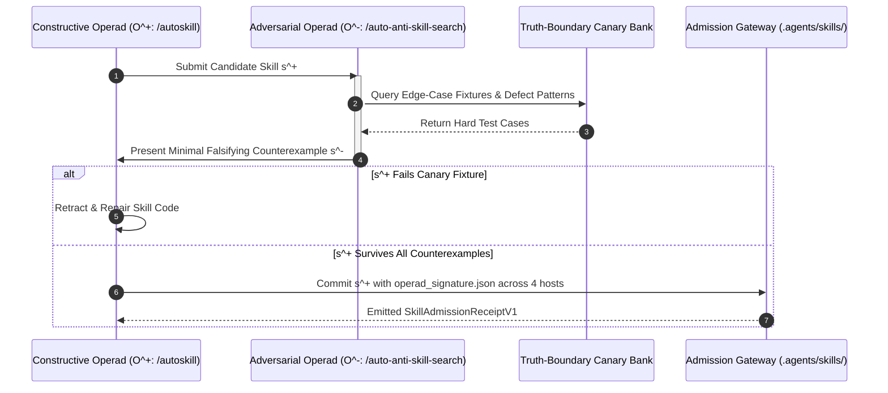

# Debate-Grounded Autopoietic Evolution, Operad Convergence Telemetry & StructureBench Contract Verification

**Bounded Context:** `omega_engine_operads`  
**Location:** this chapter. Its former source copy `_docs/09_spec_debate_grounded_autopoiesis_and_structurebench_contracts.md` in the retired OEWAS package has no successor under `omega_engine_operads`.  
**Status:** Canonical Design Specification  
**Governing Councils:** `L3_logos_techne` (Code & Architecture), `L2_dianoia` (Discursive Reasoning), `L3_logos_thanatos` (Adversarial Truth)  
**AuthorityEffect:** `None`  
**Literature Anchor:** Irving et al. (2018), Adaptive Stability Detection (2025), StructureBench (2025)  

---

## 1. Executive Summary & Architectural Topology

The **Omega Engine Workflows, Agents & Skills (`omega_engine_operads`)** subsystem governs the autopoietic lifecycle of skills, colored operad morphisms, and multi-agent workflow pipelines.

This specification establishes three rigorous foundations drawn from the latest literature synthesis:

```text
+---------------------------------------------------------------------------------------------------------+
|                                    OEWAS AUTOPOIETIC & OPERAD STACK                                     |
|                                                                                                         |
|  1. DEBATE-GROUNDED AUTOPOIESIS          ---> Constructive Generator (O^+) vs Adversarial Search (O^-)  |
|                                               evaluated by deterministic canary fixtures before admission|
|                                                                                                         |
|  2. OPERAD CONVERGENCE TELEMETRY (ASD)   ---> Multi-trial quotient pipeline telemetry (Delta D_t, Phi_1)|
|                                               terminates cyclic rewrite loops with CAPACITY_EXCEEDED     |
|                                                                                                         |
|  3. STRUCTUREBENCH CONTRACT SUITE        ---> Unary, Binary & Triplet relational validation across      |
|                                               all 4 host directories (.agents, .claude, .codex, .grok)   |
+---------------------------------------------------------------------------------------------------------+
```

---

## 2. Debate-Grounded Autopoiesis: Dual Polarized Dynamics $(\mathcal{O}^+, \mathcal{O}^-)$

### 2.1 The Zero-Sum Skill Admission Game

Autopoietic evolution is not a one-sided generative prompt. Following the zero-sum debate game formulation of Irving et al. (2018):

1. **Constructive Generator $\mathcal{O}^+$ (`/autoskill`):** Synthesizes candidate capability specifications and implementation code $s^+ \in \mathcal{S}$.
2. **Adversarial Interrogator $\mathcal{O}^-$ (`/auto-anti-skill-search`):** Searches the truth-boundary canary fixture banks to discover fatal failure modes, under-specified pre-conditions, or side-effect leaks $s^- \in \mathcal{S}^-$.
3. **Deterministic Referee Gate ($V(s) \in \{0, 1\}$):**
   - The candidate skill $s^+$ is admitted into the active garden **if and only if** it passes 100% of canary regression fixtures and exhibits zero unhandled exceptions on adversarial inputs:
   $$\operatorname{Admit}(s^+) \iff \forall f \in \text{CanaryBank}, \text{Run}(s^+, f) = \text{PASS}$$



---

## 3. Operad Convergence Telemetry & Anti-Cyclic Halting

### 3.1 Adaptive Stability Detection for Higher-Arity Morphisms

Higher-arity operad quotient operations (e.g. `(Trace) -> DAG`, `(Contract, Code) -> Audit`, `(Paper, Proof) -> Receipt`) iteratively refine representations. The ASD engine monitors the refinement trajectory:

$$\Delta D_t = \| \text{Rep}(w_t) - \text{Rep}(w_{t-1}) \|_2, \quad \Phi_1(w_t) = \text{defect\_count}(w_t)$$

### 3.2 Stopping Policies

1. **Exact Zero-Defect Convergence ($\Phi_1(w_t) = 0$):**
   - Immediate success. Emit `Receipt(status="CONVERGED_EXACT")`.
2. **Stagnation Trap ($\Delta D_t < \epsilon \land \Phi_1(w_t) > 0$):**
   - The rewrite loop has converged to a non-exact local minimum. **Halt immediately** with `Receipt(status="DISAGREEMENT_LOCALIZED")` rather than burning token budget.
3. **Capacity Budget Limit ($t = T_{\max}$):**
   - Terminate with typed status `Receipt(status="CAPACITY_EXCEEDED")`.

---

## 4. StructureBench Relational Contract Validation

### 4.1 Four-Host Estate Parity Invariant

Any skill package admitted under `.agents/skills/<skill_name>/` must satisfy strict StructureBench relational dependencies:

1. **Atomic 4-Host Replication:**
   $$\text{Hash}(\text{.agents/skills/}S) = \text{Hash}(\text{.claude/skills/}S) = \text{Hash}(\text{.codex/skills/}S) = \text{Hash}(\text{.grok/skills/}S)$$
2. **Budget Constraint:** `SKILL.md` body length must satisfy $\le 300$ lines.
3. **Schema Compliance:** `operad_signature.json` must validate against `OperadSignatureV1` with non-empty input/output color types.

### 4.2 Multi-Axis Risk Vector $r(w)$

Skill and agent execution workflows evaluate risk across 6 explicit orthogonal axes:
$$r(w) = (r_{\text{syntax}}, r_{\text{relation}}, r_{\text{provenance}}, r_{\text{causal}}, r_{\text{freshness}}, r_{\text{authority}})$$

- **Hard Componentwise Zero-Tolerance:** Admission is granted **if and only if** all critical risk axes are strictly zero:
$$\operatorname{Accept}(w) \iff \forall j \in \{\text{syntax}, \text{relation}, \text{provenance}, \text{authority}\}, r_j(w) = 0$$
- Scalar risk averaging across components is strictly forbidden.

---

## 5. Summary & Claim Hygiene Ledger

```text
====================================================================================================
CLAIM HYGIENE LEDGER: OEWAS DEBATE-GROUNDED AUTOPOIESIS SPECIFICATION
====================================================================================================
1. What this specification supports:
   - Dual polarized operad dynamics pairing constructive synthesis with adversarial canary search.
   - ASD telemetry bounding rewrite iterations across higher-arity quotient morphisms.
   - StructureBench relational validation and 4-host atomic replication invariants.

2. What this specification does NOT support:
   - Claims that self-reflection or generative prompting without adversarial canary tests ensures skill quality.

3. Narrowest Defensible Claim:
   - This specification provides a closed-loop, verifiable architecture for synthesizing, testing, 
     and admitting skills into a multi-host agent environment under deterministic test gates.
====================================================================================================
```
