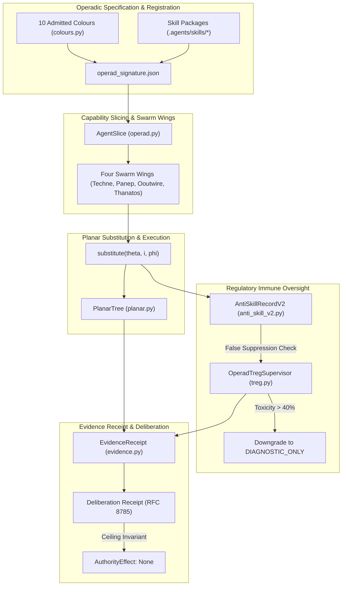

> **HISTORICAL.** `source_paths` above cites `.agents/operad/operad_signature.json`. That path is absent. The live signature is `operads/skill_operad/json/operad_signature.json`. See [chapter 23](../atlas/23_plan_oewas_consolidation_oeeis_and_demo_integration.md).

# Workflows, Agents & Skills Levels: Multicategories, Operads & Swarm Orchestration

**AuthorityEffect:** None. Complete educational curriculum for the 10-Coloured Operad, agent capability slices, planar tree composition, epistemic anti-skills, regulatory Treg supervision, and multi-host estate synchronization; no operational authorization is conferred.

---

## 1. Executive Overview: Operadic Multi-Agent Architecture

In unconstrained multi-agent architectures, agent coordination rapidly degenerates into **semantic drift**, hallucinated handoffs, prompt context exhaustion, and autoimmune execution loops. The Sentinel Engine prevents these failure modes by grounding all workflows, agents, and skills in the rigorous mathematics of **Coloured Operads and Multicategories**:

$$\boxed{\begin{aligned}
\text{\textbf{Coloured Operad}} \quad \mathcal{O} &= \left( \mathcal{C}_{10},\, \{\mathcal{O}(c_1, \ldots, c_k;\, c_{\mathrm{target}})\},\, \circ_i,\, \mathrm{id}_c \right) \\
\mathcal{C}_{10} &= \{ \text{State},\, \text{Proof},\, \text{Paper},\, \text{Code},\, \text{Contract},\, \text{Receipt},\, \text{Ledger},\, \text{Diagram},\, \text{Audit},\, \text{Post} \}
\end{aligned}}$$

Every skill in the estate is a typed morphism $f \in \mathcal{O}(c_1, \ldots, c_k; c_{\mathrm{target}})$, every agent execution is bounded by an `AgentSlice`, every multi-step workflow is a planar substitution tree verified for associativity, and every negative detector is governed by a Regulatory T-cell (`Treg`) supervisor.

---

## 2. Matrix of the 10 Curriculum Levels

The curriculum spans 11 progressive levels (Levels 00 through 10), moving from abstract operadic colour theory to concrete multi-host estate synchronization, cryptographic deliberation receipts, and higher operad DDC tape execution:

| Level | Document | Primary Scope & Focus | Canonical Claims & Invariants | Reference Implementations |
| :---: | :--- | :--- | :--- | :--- |
| [**Level 00**](level_00_coloured_operad_architecture.md) | **Coloured Operad Architecture** | The 10-Colour closed vocabulary, signatures & units | 10 admitted colours, identity units $\mathrm{id}_c$, derived arity | [`colours.py`](../../../../operads/domain/operad/colours.py), [`operation.py`](../../../../operads/domain/operad/operation.py) |
| [**Level 01**](level_01_skill_document_and_packaging_discipline.md) | **Skill Packaging & Budget Discipline** | `SKILL.md` packaging standard & budget ceilings | Budget gate: $\le 300$ lines, $\le 20\text{ KB}$, lifecycle states | [`.agents/skills/`](../../../../.agents/skills/), [`lifecycle.yaml`](../../../../.agents/registry/lifecycle.yaml) |
| [**Level 02**](level_02_planar_trees_and_operadic_associativity.md) | **Planar Trees & Associativity** | Partial composition $f \circ_i g$ & associativity witnesses | Sequential & parallel operadic associativity, planar trees | [`planar_substitution.py`](../../../../operads/domain/planar_substitution.py), [`planar.py`](../../../../operads/domain/operad/planar.py) |
| [**Level 03**](level_03_capability_slices_and_swarm_wing_boundaries.md) | **Capability Slices & Swarm Wings** | `AgentSlice` least privilege & 4 swarm wings | Techne, Panepistimion, Ooutwire, Thanatos boundaries | [`operad.py`](../../../../operads/domain/operad/operad.py), [`.agents/agents/`](../../../../.agents/agents/) |
| [**Level 04**](level_04_epistemic_anti_skills_and_somatic_mutation.md) | **Polarized Operads & Anti-Skills** | Polarized operad $(\mathcal{O}^+, \mathcal{O}^-)$ & somatic decay | Negative detectors, somatic hypermutation, half-life decay | [`anti_skill_v2.py`](../../../../operads/domain/anti_skills/anti_skill_v2.py), [`.agents/anti_skills/`](../../../../.agents/anti_skills/) |
| [**Level 05**](level_05_regulatory_treg_supervision_and_antibody_synthesis.md) | **Regulatory Treg Supervision** | Autoimmune tolerance threshold $\tau = 40\%$ | Downgrade to `DIAGNOSTIC_ONLY`, sample floor $N \ge 3$ | [`treg.py`](../../../../operads/domain/operad/treg.py) |
| [**Level 06**](level_06_residual_geometry_and_ddc_contractivity.md) | **Residual Geometry & DDC Contractivity** | Defect descent $\Delta \Phi \le 0$ & evidence traces | `CONTRACTIVE_OBSERVED` vs `PROVISIONAL`, 3-run audit | [`evidence.py`](../../../../operads/domain/operad/evidence.py), [`evidence_trace.json`](../../../../operations/skill_operad/json/evidence_trace.json) |
| [**Level 07**](level_07_workflow_graphs_and_dialectic_pipelines.md) | **Workflow Graphs & Dialectic Pipelines** | Slot-based pipeline substitution & Adversary 7-Act | Acyclic planar sequences, danger gates, Adversary dialectic | [`workflow_graph.py`](../../../../operads/domain/workflow_graph.py), [`.agents/workflows/`](../../../../.agents/workflows/) |
| [**Level 08**](level_08_four_host_mirror_parity_and_synchronization.md) | **Four-Host Parity & Deep Consolidation** | Mirror parity (`.agents`, `.claude`, `.codex`, `.grok`) | Anti-fragmentation law, 5-phase merge, sync scripts | [`.agents/AGENTS.md`](../../../../.agents/AGENTS.md), [`sync_cross_host_skills.py`](../../../../operations/use_cases/packaging/sync_cross_host_skills.py) |
| [**Level 09**](level_09_sovereign_non_authority_and_deliberation_receipts.md) | **Sovereign Non-Authority & Receipts** | `AuthorityEffect: None` & cryptographic receipts | RFC 8785 canonical digest, human promotion firewall | [`treg.py`](../../../../operads/domain/operad/treg.py), [`evidence.py`](../../../../operads/domain/operad/evidence.py) |
| [**Level 10**](level_10_higher_operad_and_ddc_tape_execution.md) | **Higher Operad Adapter & DDC Tapes** | Higher Operad adapter, DDC tape execution, mirror rollback & Rust estate verification | Monotonic descent $\Delta \Phi \le 0$, atomic mirror rollbacks, compiled Rust estate contract | [`higher_operad_adapter.py`](../../../../operads/infrastructure/operad/higher_operad_adapter.py), [`ddc_tape.py`](../../../../operads/infrastructure/ddc_execution/ddc_tape.py), [`estate.rs`](../../../../engine/crates_rs/core_workflows_agents_skills/src/estate.rs) |

---

## 3. The Four Cardinal Invariants of OEWAS

```
+-------------------------------------------------------------------------------+
|                       THE FOUR CARDINAL INVARIANTS OF OEWAS                   |
+-------------------------------------------------------------------------------+
| 1. Closed Finite Colour Vocabulary (The Ten-Colour Category Boundary)        |
| 2. Planar Composition & Associativity Purity (Zero Hallucinated Edge Splicing) |
| 3. Sovereign Non-Authority (GTOC-5 AuthorityEffect::None Invariant)           |
| 4. Four-Host Atomic Parity & Anti-Fragmentation Discipline                    |
+-------------------------------------------------------------------------------+
```

### Invariant 1: Closed Finite Colour Vocabulary
The 10 colours (`State`, `Proof`, `Paper`, `Code`, `Contract`, `Receipt`, `Ledger`, `Diagram`, `Audit`, `Post`) form an immutable, closed vocabulary:
- No runtime operation can declare or emit a colour outside this set.
- Arities are derived directly from input tuples, never independently declared.

### Invariant 2: Planar Composition & Associativity Purity
Skill composition is planar substitution $\theta \circ_i \phi$ into slot $i$:
- Input ordering is preserved before and after slot $i$.
- Both sequential and parallel bracketing must yield identical composite colour signatures.

### Invariant 3: Sovereign Non-Authority
Multi-agent swarms, deliberation consensus, and automated test passes do **not** confer operational authority:
- All transits, receipts, and manifests enforce `authority_effect: "None"`.
- Promotion to production requires explicit human cryptographic sign-off.

### Invariant 4: Four-Host Atomic Parity & Anti-Fragmentation
All capabilities, rules, and skills must maintain byte-level parity across all four active host roots (`.agents/`, `.claude/`, `.codex/`, `.grok/`):
- Micro-skills are forbidden; single-check tools must be merged into deep, authoritative parent packages.
- Every `SKILL.md` is strictly bound to $\le 300$ lines and $\le 20\text{ KB}$.

---

## 4. Operational Flow: Multi-Agent Operadic Lifecycle



---

## 5. Verification Commands & Test Harness

All implementations referenced across these 10 levels are locally verifiable on Windows Python 3.12 without external network calls:

```powershell
# 1. Test Operad colour vocabulary and domain models
py -3.12 -m pytest operads/tests/unit/test_operad_colour_vocabulary.py

# 2. Test Planar substitution, arity derivation, and associativity
# Retired: OEWAS tests/unit/test_planar_substitution.py has no successor file under operads.

# 3. Test Regulatory Treg supervisor, toxicity threshold, and downgrade receipts
# Retired: OEWAS tests/unit/test_operad_treg_supervisor.py has no successor file under operads.

# 4. Test Epistemic Anti-Skills and Somatic Mutation
# Retired: OEWAS tests/unit/test_anti_skill_v2.py has no successor file under operads.

# 5. Verify 4-host estate parity and skill registry
py -3.12 operations/use_cases/packaging/sync_cross_host_skills.py --dry-run
```

---

## 6. Atlas & Technical Monograph Cross-References

- [**`00_oewas_atlas_encyclopedia.md`**](../atlas/00_oewas_atlas_encyclopedia.md): Canonical 22-chapter atlas index.
- [**`03_colours_operations_and_composition.md`**](../atlas/03_colours_operations_and_composition.md): Formal analysis of colour signatures and composition.
- [**`13_spec_polarized_operad_and_anti_skills.md`**](../atlas/13_spec_polarized_operad_and_anti_skills.md): Mathematical specification of $(\mathcal{O}^+, \mathcal{O}^-)$.
- [**`18_spec_adversary_7act_dialectic_workflow.md`**](../atlas/18_spec_adversary_7act_dialectic_workflow.md): Adversary 7-Act dialectic execution engine.
- [**`19_spec_skill_consolidation_and_deep_modules.md`**](../atlas/19_spec_skill_consolidation_and_deep_modules.md): Deep module consolidation protocol and budget ceiling rules.
