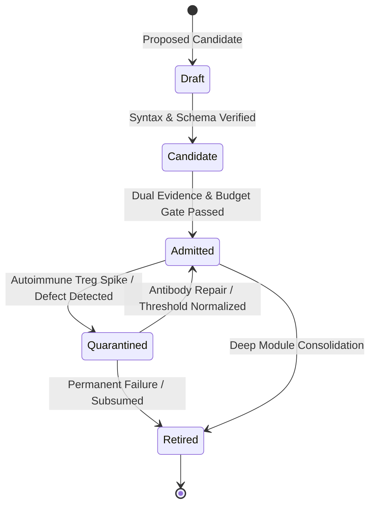

# OEWAS Level 01: Skill Document Ingestion, Packaging Standard & Budget Ceiling

**AuthorityEffect:** None. Complete engineering specification for `SKILL.md` packaging, frontmatter validation, budget ceilings ($\le 300$ lines, $\le 20\text{ KB}$), and lifecycle state tracking; no operational authorization is conferred.

---

## 1. Executive Intuition: Skills as Reusable Operadic Morphisms

In the Anomalon multi-agent ecosystem, an agent skill is not an ad-hoc prompt snippet or arbitrary text file. A skill is a **first-class operadic morphism**:

$$f_{\mathrm{skill}} \in \mathcal{O}(c_1, \ldots, c_k;\, c_{\mathrm{target}})$$

To ensure that LLM agents can discover, index, and load skills on demand without exhausting prompt token budgets or incurring hallucinated handoffs, every skill must conform to a strict structural packaging standard and pass automated size and budget gates.

---

## 2. Canonical Structure of an Anomalon Skill Package

Every skill lives inside its own hermetic directory under `.agents/skills/<skill_name>/` (and mirrored across all active host roots):

```text
.agents/skills/<skill_name>/
├── SKILL.md                 # Mandatory entrypoint: YAML frontmatter + procedural overview
├── references/              # Detailed checklists, runbooks, and domain manuals (modular factorizations)
│   ├── checklist.md
│   └── domain_rules.md
└── scripts/                 # Optional deterministic Python/Rust verification scripts
    └── verify_contract.py
```

### 2.1 The `SKILL.md` Mandatory YAML Frontmatter

Every `SKILL.md` file must begin with valid YAML frontmatter specifying:

```yaml
---
name: example-skill-name
description: A clear, actionable description of the capability and its trigger conditions.
operad_source_colours:
  - Code
  - Contract
operad_target_colour: Audit
operad_arity: 2
---
```

### Frontmatter Fields and Invariants

1. **`name` (string):** Unique identifier matching the directory name exactly (`^[a-z0-9-]+$`).
2. **`description` (string):** High-density summary of what the skill does and when an agent should invoke it.
3. **`operad_source_colours` (list of strings):** Sequence of input colours drawn strictly from the closed 10-colour vocabulary $\mathcal{C}_{10}$.
4. **`operad_target_colour` (string):** Target colour produced by the skill, also drawn from $\mathcal{C}_{10}$.
5. **`operad_arity` (integer):** Must equal the length of `operad_source_colours` (`operad_arity == len(operad_source_colours)`).

---

## 3. The Budget Gate Ceilings: Line Count and Byte Size

When an LLM agent is injected with prompt context, oversized skill documents degrade attention quality, trigger catastrophic forgetting, and inflate token billing. Therefore, every skill package is subjected to the **Anti-Rule-Bloat Budget Ceiling**:

$$\boxed{\begin{aligned}
\text{Total Lines in } \texttt{SKILL.md} &\;\le\; 300\text{ lines} \\
\text{Total Byte Size of } \texttt{SKILL.md} &\;\le\; 20\text{ KB} \; (20{,}480\text{ bytes})
\end{aligned}}$$

### 3.1 Progressive Disclosure via `references/`

If a skill requires extensive checklists, domain-specific formulas, or multi-step execution runbooks:

1. **Keep `SKILL.md` Concise:** Provide the core intuition, input/output contract, and primary decision flow in $\le 300$ lines.
2. **Factor Out Details:** Place detailed reference tables and deep instructions in `references/<topic>.md`.
3. **Link via Relative Markdown:** In `SKILL.md`, link to references using standard relative links:
   ```markdown
   For full checklist details, see [references/checklist.md](references/checklist.md).
   ```
4. **On-Demand Loading:** The agent reads `SKILL.md` first, and loads `references/` only when actively executing that sub-routine.

---

## 4. The Skill Lifecycle State Machine

Skill packages are tracked in [`.agents/registry/lifecycle.yaml`](../../../../.agents/registry/lifecycle.yaml) and [`.agents/registry/capabilities.yaml`](../../../../.agents/registry/capabilities.yaml) across five canonical lifecycle states:



### Lifecycle State Definitions

1. **`draft`**: Initial proposal, under active development; not registered in active operad signature.
2. **`candidate`**: Frontmatter and budget gate validated; awaiting dual-evidence proof runs.
3. **`admitted`**: Production-ready; registered in `operad_signature.json` and `capability_catalog.v1.json`.
4. **`quarantined`**: Temporarily demoted due to high false-suppression rate or broken imports; accessible only in shadow/diagnostic mode.
5. **`retired`**: Subsumed into a deeper parent skill or permanently archived.

---

## 5. Ingestion & Lossless Byte-Level Cleanliness

The OEWAS ingestion pipeline validates skill packages using three byte-level invariants:

### 5.1 No UTF-8 BOM
All Markdown files, JSON manifests, and YAML contracts must be encoded in pure UTF-8 without byte-order marks (`\xef\xbb\xbf`). Any file containing a BOM causes automated CI failure.

### 5.2 Ordinal Path Sorting
All path lists in registries and manifests must be sorted in strict ordinal UTF-8 byte order:
```python
sorted_paths = sorted(paths, key=lambda s: s.encode("utf-8"))
```
This guarantees bit-for-bit reproducibility across Windows and Linux environments without locale-dependent sorting discrepancies.

### 5.3 Deterministic JSON Ingestion
All JSON registries are serialized using RFC 8785 Canonical JSON (`separators=(",", ":")`, `sort_keys=True`), ensuring identical SHA256 hashes across different platforms and interpreters.

---

## 6. Verification and Local Audit Commands

To verify that all skill packages in the repository adhere to the packaging standards and budget ceilings:

```powershell
# 1. Run the skill budget gate audit across all skills
py -3.12 omega_engine_operations/domain/cicd/budget_gate.py

# 2. Assert four-host bit-level parity for skills and registries
py -3.12 omega_engine_operations/use_cases/packaging/sync_cross_host_skills.py --dry-run

# 3. Test OEWAS catalog ingestion and validation
# Retired: OEWAS tests/unit/test_capability_catalog.py has no successor file under omega_engine_operads.
```

### The Level 01 Governance Invariants
- **INV-01-01 (Budget Ceiling):** No `SKILL.md` may exceed 300 lines or 20 KB.
- **INV-01-02 (Hermetic Packaging):** A skill must reside in its dedicated directory with frontmatter specifying operadic colours.
- **INV-01-03 (Parity Synchronization):** Modifying a skill in `.agents/` requires atomic replication to `.claude/`, `.codex/`, and `.grok/`.
- **INV-01-04 (Authority Ceiling):** Skill registration confers no execution authority; `AuthorityEffect: None`.
