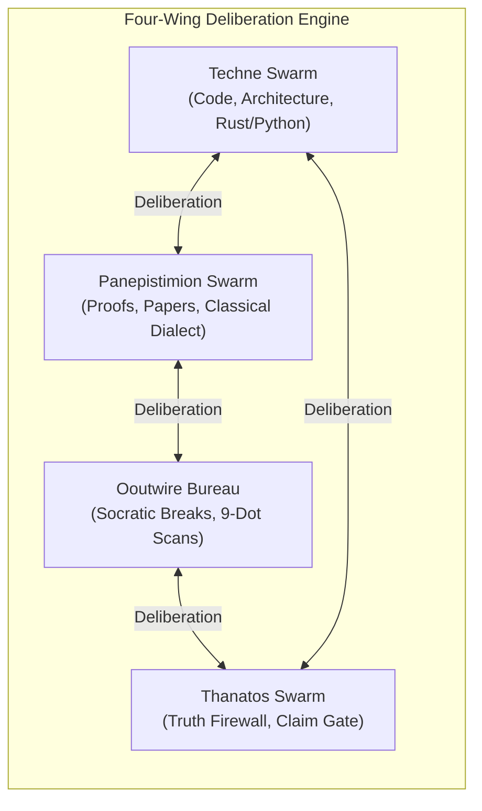

# OEWAS Level 03: Agent Capability Slices & Swarm Wing Boundaries

**AuthorityEffect:** None. Complete architectural specification for agent capability slices (`AgentSlice`), sub-operad sandboxing, and the four specialized swarm wings; no operational authorization is conferred.

---

## 1. Executive Intuition: Least Privilege and Sandboxing

In monolithic multi-agent systems, agents are frequently granted universal read/write access to all tools, files, and prompts. This "god-mode" agent pattern inevitably results in:
- Uncontrolled scope creep (e.g., a documentation agent attempting to rewrite core math solvers).
- Prompt injection vulnerabilities (an untrusted external proposal triggering production deployment tools).
- Lack of auditability (inability to determine which agent had the authority to mint an evidence receipt).

To enforce strict **least privilege**, the Sentinel Engine partitions the 10-Coloured Operad $\mathcal{O}$ into **Capability Slices**. Every agent persona is bounded to a typed sub-operad: it can only invoke licensed skills that consume and produce its authorized colours.

---

## 2. The `AgentSlice` Domain Model

The capability slice is defined in [`operads/domain/operad/operad.py`](../../../../operads/domain/operad/operad.py#L32-L40):

```python
@dataclass
class AgentSlice:
    """A capability slice restricting an agent to a typed subset of operad operations."""
    agent_id: str
    licensed_operations: set[str]
    allowed_sources: set[str] = field(default_factory=set)
    allowed_targets: set[str] = field(default_factory=set)
```

### 2.1 Permission Verification Algorithm

When an agent requests the execution of an operadic skill $f$, the operad aggregate root evaluates four guard gates:

```python
def verify_agent_permission(self, agent_slice: AgentSlice, op_id: str) -> Result[bool, SliceViolationError]:
    """Enforces that an agent invocation stays strictly within its capability slice."""
    if op_id not in self._operations:
        return Err(SliceViolationError(f"Operation '{op_id}' does not exist in operad"))

    op = self._operations[op_id]
    
    # 1. Identity units are universal pass-throughs
    if op.op_id.is_unit:
        return Ok(True)

    # 2. Check operation licensing
    if op_id not in agent_slice.licensed_operations:
        return Err(
            SliceViolationError(
                f"Agent '{agent_slice.agent_id}' is not licensed to execute operation '{op_id}'"
            )
        )

    # 3. Check input colour permissions
    if agent_slice.allowed_sources:
        for s in op.source_colours:
            if s not in agent_slice.allowed_sources:
                return Err(
                    SliceViolationError(
                        f"Agent '{agent_slice.agent_id}' cannot use input colour '{s}' for operation '{op_id}'"
                    )
                )

    # 4. Check output colour permissions
    if agent_slice.allowed_targets:
        if op.target_colour not in agent_slice.allowed_targets:
            return Err(
                SliceViolationError(
                    f"Agent '{agent_slice.agent_id}' cannot produce output colour '{op.target_colour}'"
                )
            )

    return Ok(True)
```

> [!NOTE]
> **Universal Identity Rule:** Identity pass-through operations (`id_State`, `id_Proof`, etc.) are permitted for all agents (`op.op_id.is_unit -> True`). This ensures that an agent can route intermediate states through multi-agent turns without needing explicit licensing for identity morphisms.

---

## 3. The Four Specialized Swarm Wings

All agents in the repository belong to one of four specialized swarm wings, creating an orthogonal checks-and-balances architecture:

```
+-------------------------------------------------------------------------------+
|                           THE FOUR SWARM WINGS                                |
+-------------------------------------------------------------------------------+
|  1. TECHNE SWARM (Engineering, Clean Architecture & Runtime Compilers)        |
|  2. PANEPISTIMION SWARM (Academic Rigor, Lean 4 & Mathematical Truth)         |
|  3. OOUTWIRE BUREAU (Adversarial Infiltration & Dialectical Gauge Breaks)     |
|  4. THANATOS / NEMESIS SWARM (Truth Firewall, Anti-Hype & Carceral Gate)      |
+-------------------------------------------------------------------------------+
```



### 3.1 Techne Swarm (Engineering & Clean Architecture)
- **Primary Colours:** `Code`, `State`, `Contract` $\to$ `Code`, `Audit`.
- **Core Directive:** Enforces Clean Architecture inward dependencies, native Rust sovereign math crates, and pytest basetemp isolation on Windows.
- **Representative Agents & Skills:**
  - `techne-vp`: Engineering risk assessment and sprint delivery oversight.
  - `techne-code-rust-principal-developer`: Sovereign crate memory safety and zero-allocation contractions.
  - `techne-code-clean-arch`: Inward dependency checks and single-root bounded contexts.

### 3.2 Panepistimion Swarm (Academic & Formal Rigor)
- **Primary Colours:** `Paper`, `Proof`, `Ledger` $\to$ `Paper`, `Proof`, `Audit`.
- **Core Directive:** Mathematical precision, Lean 4 Lake elaboration, axiom honesty, and purging internal jargon via classical mathematical dialects.
- **Representative Agents & Skills:**
  - `panep-math-and-physics-prof`: Rigorous peer review of preprint derivations.
  - `panep-lean-snippet-export`: Exporting bounded Lean 4 verification snippets with honest axiom ledgers.
  - `glossa-public-math-dialect-firewall`: Stripping house jargon in favor of standard Bourbaki/mathematical prose.

### 3.3 Ooutwire Bureau (Adversarial Infiltration & Gauge Breaks)
- **Primary Colours:** `Audit`, `State`, `Ledger` $\to$ `Diagram`, `Audit`.
- **Core Directive:** Breaking cognitive fixation and local optimization traps. Detects arbitrary coordinate assumptions (the "9-Dot Constraint Box") and applies Socratic pressure.
- **Representative Agents & Skills:**
  - `ow-bureau-gauge-breaks`: Act IV orthogonal surprise injections and paradigm unfreezing.
  - `ow-bureau-interrogation`: Socratic elenchus and covert assumption extraction.
  - `ow-bureau-mole-hunting`: Identifying structural subversion and sycophantic consensus traps.

### 3.4 Thanatos / Nemesis Swarm (Truth Firewall & Security Enforcer)
- **Primary Colours:** `Paper`, `Proof`, `Code`, `Contract` $\to$ `Audit`, `Receipt`.
- **Core Directive:** Relentless prosecution of unmechanized claims, pseudo-mathematics, and unauthorized privilege escalation.
- **Representative Agents & Skills:**
  - `thanatos-human-promotion-firewall`: Blocks any automated script from granting production authority.
  - `blackrod`: Orthogonal governance enforcer with defect escalation powers.
  - `core-red-team`: Read-only department elder executing unsparing fireproof code/math audits.

---

## 4. Manifest Structure: `agent_capability_slices.json`

The global capability registry lives in [`operations/skill_operad/json/agent_capability_slices.json`](../../../../operations/skill_operad/json/agent_capability_slices.json):

```json
{
  "agents": {
    "blackrod": {
      "sub_operad": [
        "Audit",
        "Code",
        "Contract",
        "State"
      ],
      "licensed_skills": [
        "blackrod",
        "nomos-law-compliance-hunter",
        "thanatos-human-promotion-firewall"
      ]
    },
    "code-testing": {
      "sub_operad": [
        "Audit",
        "Code"
      ],
      "licensed_skills": [
        "rip-code",
        "techne-code-inspector",
        "techne-test-silent-skip-detector"
      ]
    }
  }
}
```

If an agent whose `sub_operad` is `["Audit", "Code"]` attempts to run a skill targeting `Proof` or consuming `Paper`, the operad runtime immediately raises a `SliceViolationError`.

---

## 5. Verification and Local Test Commands

To verify agent slices and permission checks:

```powershell
# Retired: OEWAS tests/unit/test_operad_capability_slices.py has no successor file under operads.
```

### The Level 03 Governance Invariants
- **INV-03-01 (Strict Slicing):** No agent may invoke a skill outside its `licensed_operations`.
- **INV-03-02 (Colour Containment):** An agent cannot consume or emit colours outside its declared `sub_operad`.
- **INV-03-03 (Orthogonal Wings):** Review workflows must involve at least two distinct swarm wings (e.g. Panepistimion review checked by Thanatos truth firewall).
- **INV-03-04 (Authority Ceiling):** All agent actions enforce `AuthorityEffect: None`.
