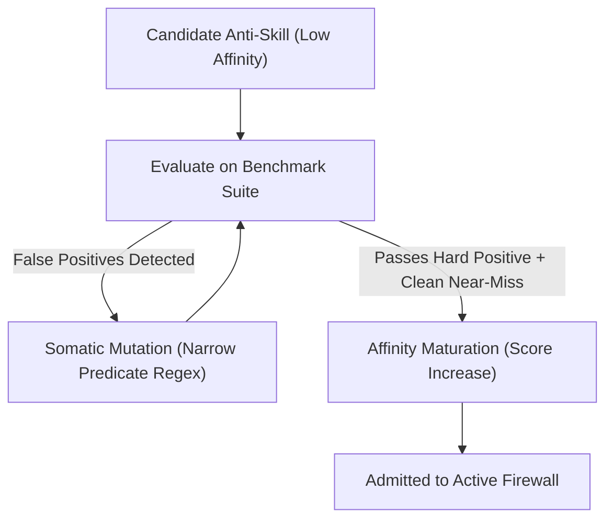

# OEWAS Level 04: The Polarized Operad & Epistemic Anti-Skills

**AuthorityEffect:** None. Complete mathematical and architectural reference for the Polarized Operad $(\mathcal{O}^+, \mathcal{O}^-)$, epistemic anti-skills, somatic hypermutation, and exponential decay; no operational authorization is conferred.

---

## 1. Executive Intuition: Constructive vs. Inhibitory Operations

Standard software and agentic frameworks focus almost exclusively on **constructive capabilities** (how to generate code, write text, synthesize proofs). However, in recursive autonomous self-improvement systems, unconstrained generation inevitably leads to **epistemic cancer**: the accumulation of subtle hallucinations, circular proofs, and tautological tests.

To maintain structural health, the biological immune system uses inhibitory signals and regulatory T-cells to suppress harmful or autoreactive cells. In the Sentinel Engine, this is modeled mathematically as a **Polarized Operad**:

$$\boxed{(\mathcal{O}^+, \mathcal{O}^-)}$$

- $\mathcal{O}^+$ contains constructive skills that produce artifacts.
- $\mathcal{O}^-$ contains epistemic anti-skills (antibodies and detectors) that inhibit corrupted state transitions.

---

## 2. Mathematical Definition of the Polarized Operad

A **Polarized Operad** is a two-sorted operadic structure:

1. **Constructive Sector $\mathcal{O}^+$:**
   Operations $f^+ \in \mathcal{O}^+(c_1, \ldots, c_k;\, c_{\mathrm{target}})$ that synthesize or transform artifacts (e.g. `meta-techne-code-to-code-verifier`).
2. **Inhibitory Sector $\mathcal{O}^-:**
   Operations $\alpha^- \in \mathcal{O}^-(c;\, \text{Audit})$ that inspect an artifact of colour $c$ and either emit a typed defect finding or return $\mathrm{pass}$.
3. **Asymmetric Action:**
   An anti-skill $\alpha^-$ acts on a constructive operation $f^+$ via composition:
   $$\alpha^- \circ_1 f^+ \in \mathcal{O}(c_1, \ldots, c_k;\, \text{Audit})$$

> [!CAUTION]
> **Anti-Skill is NOT an Inverse Morphism:** Calling a detector an "anti-skill" does not mean it is an inverse $f^{-1}$ satisfying $f \circ f^{-1} = \mathrm{id}$. An anti-skill does not "undo" code; it is a specialized, bounded detector that maps candidate bytes to an audit finding or refusal. Typed repair is an entirely separate operation with its own carrier and equations.

---

## 3. The `AntiSkillRecordV2` Domain Model

The core anti-skill data structure is implemented in [`operads/domain/anti_skills/anti_skill_v2.py`](../../../../operads/domain/anti_skills/anti_skill_v2.py):

```python
@dataclass(frozen=True)
class AntiSkillRecordV2:
    anti_skill_id: str
    target_pattern: str
    danger_predicate: str
    near_miss_predicate: str
    affinity_score: Fraction
    half_life_days: int
    created_at: str
    last_triggered_at: str | None = None
    authority_effect: str = "None"
```

### 3.1 Dual-Witness Falsification Contract

To prevent speculative or hallucinated detectors from being admitted into the active runtime, every anti-skill must exhibit two explicit witness test cases:

1. **Hard Positive Witness (Danger):** An artifact that strictly trips the `danger_predicate`, proving that the anti-skill actually detects the intended defect.
2. **Clean Near-Miss Witness (Safety):** A closely related, valid artifact that satisfies the `near_miss_predicate` and does **not** trip the detector, proving that the anti-skill does not indiscriminately block benign code.

An anti-skill lacking either witness cannot be admitted into $\mathcal{O}^-$.

---

## 4. Somatic Hypermutation & Affinity Maturation

In biological immunology, B-cells undergo somatic hypermutation in germinal centers, increasing their binding affinity to foreign antigens.

In OEWAS, anti-skills undergo an analogous maturation cycle governed by [`episteme-clonal-affinity-maturation`](../../../../.agents/skills/episteme-clonal-affinity-maturation/SKILL.md):



- When an anti-skill successfully flags a true regression in a local test suite, its `affinity_score` increases:
  $$A_{t+1} = \min\left(1,\, A_t + \Delta_{\mathrm{success}}\right)$$
- If an anti-skill flags benign code, its affinity is penalized, or it is transferred to the Regulatory Treg supervisor for quarantine.

---

## 5. Exponential Half-Life Decay

One of the greatest dangers in prompt-engineered agent systems is **prompt context bloat**: rules added to fix one-off mistakes remain in prompt files forever, eventually degrading model instruction following.

To prevent this, every epistemic anti-skill is subjected to **exponential decay**:

$$\boxed{A(t) = A_0 \cdot 2^{-\frac{\Delta t}{t_{1/2}}}}$$

where:
- $A(t)$ is the effective affinity score at elapsed time $\Delta t$.
- $t_{1/2}$ is the declared half-life in days (typically 14 to 30 days).
- When $A(t) < A_{\mathrm{prune}}$ (default threshold $0.15$), the anti-skill is automatically archived from active agent prompt injection.

If an anti-skill is triggered again by a recurring regression, its timer resets and its affinity is refreshed. Non-recurring, one-off artifacts naturally fade away.

---

## 6. Concrete Example: `silent-failure-hunter`

A representative anti-skill is `silent-failure-hunter`, which detects swallowed exceptions in Railway-Oriented Programming (ROP) flows:

```python
# Hard Positive (Trips Detector):
try:
    result = compute_solver()
except Exception:
    pass  # Defect: Swallowed exception violates ROP monad purity!

# Clean Near-Miss (Passes Safely):
try:
    result = compute_solver()
except SolverDivergenceError as err:
    return Err(Refusal("SOLVER_DIVERGED", str(err)))  # Typed ROP refusal
```

The anti-skill explicitly inspects the AST for empty `except:` blocks or `except Exception: pass`, emitting an `Audit` record if found.

---

## 7. Verification and Local Unit Tests

To run the unit tests verifying anti-skill records, somatic mutation, and exponential decay:

```powershell
# Retired: OEWAS tests/unit/test_anti_skill_v2.py has no successor file under operads.
```

### The Level 04 Governance Invariants
- **INV-04-01 (Dual Witness Totality):** Every admitted anti-skill must possess both a hard positive and a clean near-miss test fixture.
- **INV-04-02 (No Inverse Assumption):** An anti-skill must never be assumed to possess an inverse repair law.
- **INV-04-03 (Mandatory Half-Life):** All candidate anti-skills must declare an explicit half-life $t_{1/2}$ to ensure automated pruning.
- **INV-04-04 (Authority Ceiling):** Detecting a defect confers no execution authority; `AuthorityEffect: None`.
