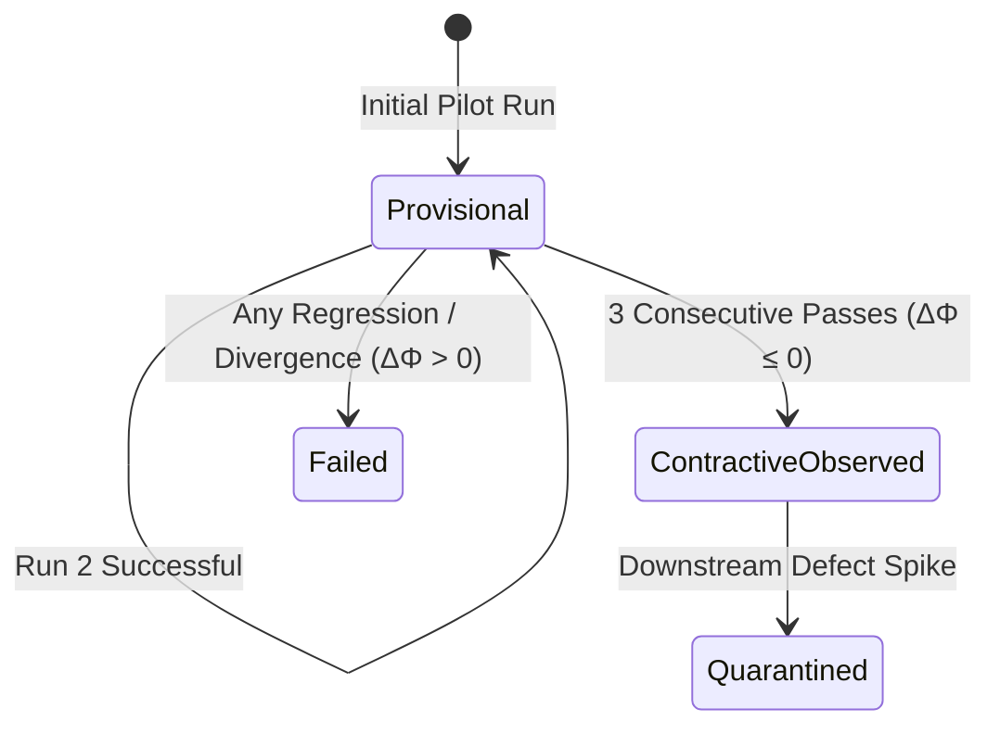

# OEWAS Level 06: Residual Geometry, Evidence Traces & DDC Contractivity

**AuthorityEffect:** None. Complete mathematical and architectural reference for residual defect potential $\Phi$, evidence traces, the 3-run empirical contractivity protocol, and the Discrete Deformation Calculus (DDC) letter mapping; no operational authorization is conferred.

---

## 1. Executive Intuition: Defect Descent vs. Semantic Churn

A primary vulnerability of LLM-based agent swarms is **semantic churn**: agents repeatedly edit code or rewrite documents, generating pages of plausible prose, while the underlying mathematical or architectural defect remains unchanged (or worsens).

To prevent hollow iterations, the Sentinel Engine embeds all operadic evaluations in a **Residual Geometry**. Every state transition is measured against an explicit defect functional $\Phi$. An operation is admitted only if it provably or empirically contracts this residual:

$$\boxed{\Delta \Phi = \Phi(S_{\mathrm{after}}) - \Phi(S_{\mathrm{before}}) \le 0}$$

If an operation increases defect potential ($\Delta \Phi > 0$), it is classified as *expansive/divergent* and rejected by the execution monitor.

---

## 2. Mathematical Definition: Residual Geometry and Contractivity

Let $\mathcal{S}$ denote the state space of artifacts (code checkouts, proof terms, manuscripts), and let $\Phi: \mathcal{S} \to \mathbb{R}_{\ge 0}$ be a non-negative residual defect functional (such as the cochain boundary leakage $\Phi_1$ or cycle obstruction $\Gamma_2$).

For an operadic morphism $f: S \to S'$:

1. **Strictly Contractive:**
   $$\Phi(S') < \Phi(S) \iff \Delta \Phi < 0$$
   The operation strictly reduces the defect norm (e.g. repairing a broken import or resolving a lint error).
2. **Neutral / Invariant:**
   $$\Phi(S') = \Phi(S) \iff \Delta \Phi = 0$$
   The operation transforms the artifact without introducing or resolving defects (e.g. formatting or pure identity pass-through $\mathrm{id}_c$).
3. **Expansive / Divergent:**
   $$\Phi(S') > \Phi(S) \iff \Delta \Phi > 0$$
   The operation damaged healthy code or introduced new invariant violations. The transition is immediately rolled back.

---

## 3. The `EvidenceReceipt` Value Object: `evidence.py`

In [`operads/domain/operad/evidence.py`](../../../../operads/domain/operad/evidence.py):

```python
class EvidenceType(str, enum.Enum):
    COMPILATION = "compilation"
    BUDGET_AUDIT = "budget_audit"
    ASSOCIATIVITY = "associativity"
    SLICE_VERIFICATION = "slice_verification"
    COCHAIN_OBSTRUCTION = "cochain_obstruction"

@dataclass(frozen=True)
class EvidenceObservation:
    """Individual observation recorded during an operad evaluation pass."""
    key: str
    value: Any
    timestamp: str = field(default_factory=lambda: datetime.now(timezone.utc).isoformat())

@dataclass(frozen=True)
class EvidenceReceipt:
    """Immutable evidence receipt emitted by the operad compiler and runners."""
    receipt_id: str
    evidence_type: EvidenceType
    passed: bool
    observations: tuple[EvidenceObservation, ...] = ()
    metadata: Dict[str, Any] = field(default_factory=dict)
    emitted_at: str = field(default_factory=lambda: datetime.now(timezone.utc).isoformat())
```

Every compiler check, planar substitution pass, and budget audit emits an `EvidenceReceipt`. These receipts are appended to the execution trace, forming an immutable audit trail.

---

## 4. The 3-Run Empirical Protocol: `evidence_trace.json`

In empirical agent research, claiming that an agent workflow "works" based on a single successful demo is a violation of claim hygiene.

The OEWAS engine enforces the **Three-Run Empirical Protocol** in [`operations/skill_operad/json/evidence_trace.json`](../../../../operations/skill_operad/json/evidence_trace.json):



### Claim Status Definitions

- **`PROVISIONAL`:** The operation succeeded in an isolated pilot trial or toy setting ($N_{\mathrm{runs}} < 3$). It is unverified for general multi-agent composition.
- **`CONTRACTIVE_OBSERVED`:** The operation has completed at least 3 independent end-to-end execution sweeps with zero regressions, strictly contracting or preserving residual defect norm:
  $$\forall i \in \{1, 2, 3\}, \quad \Delta \Phi_i \le 0$$
- **Narrow Claim Hygiene:** A `CONTRACTIVE_OBSERVED` status supports only the narrow claim that the operation contracted defects on the tested benchmark fixtures; it does **not** prove universal correctness.

---

## 5. Mapping to the Discrete Deformation Calculus (DDC) Alphabet

When operadic operations execute within a workflow, their state transitions emit letters from the **8-letter Discrete Deformation Calculus (DDC) alphabet**:

$$\boxed{\Sigma_{\mathrm{DDC}} = \{ E,\, R,\, C,\, I,\, \Lambda,\, D,\, M,\, T \}}$$

| DDC Letter | Operation Name | Operadic Mapping | Residual Action |
| :---: | :--- | :--- | :--- |
| **`E`** | **Exact Repair** | Contractive skill execution (`residual_effect: "contractive"`) | $\Delta \Phi < 0$ |
| **`R`** | **Residual Projection** | Diagnostic red-team evaluation (`core-red-team`) | Computes $\Phi(S)$ |
| **`C`** | **Context Exposure** | Planar substitution $\theta \circ_i \phi$ splicing input colours | Connects ports |
| **`I`** | **Integration** | Multi-agent deliberation consensus merging wings | Aggregates votes |
| **`Λ`** | **Structural Lift** | Elevating a raw artifact to an admitted operadic object | Admittance gate |
| **`D`** | **Descent** | Parameter or dimensionality reduction | Simplifies state |
| **`M`** | **Typed Refusal** | Inadmissible substitution or slice violation (`SubstitutionError`) | Aborts transition |
| **`T`** | **Terminalization** | Workflow completion and receipt sealing (`EvidenceReceipt`) | Terminalizes run |

By mapping operad transitions to the DDC alphabet, the entire multi-agent deliberation can be formally audited using the sovereign Rust crate [`core_discrete_deformation_calculus`](../../../../engine/crates_rs/core_wdp/src/ddc/).

---

## 6. Verification and Local Unit Tests

To run the unit tests verifying evidence receipts and DDC alphabet mapping:

```powershell
# 1. Verify DDC letter trace and non-authority firewall
cargo test --package core_discrete_deformation_calculus --test authority_firewall

# 2. Verify evidence trace ledger
# Retired: OEWAS tests/unit/test_operad_evidence.py has no successor file under operads.
```

### The Level 06 Governance Invariants
- **INV-06-01 (Residual Non-Expansion):** No multi-agent pipeline may commit state transitions that yield $\Delta \Phi > 0$.
- **INV-06-02 (Three-Run Minimum):** Claiming `CONTRACTIVE_OBSERVED` requires $\ge 3$ consecutive passing test sweeps.
- **INV-06-03 (DDC Alignment):** All operadic transitions must map deterministically to the 8 DDC alphabet letters.
- **INV-06-04 (Authority Ceiling):** All evidence receipts enforce `authority_effect: "None"`.
