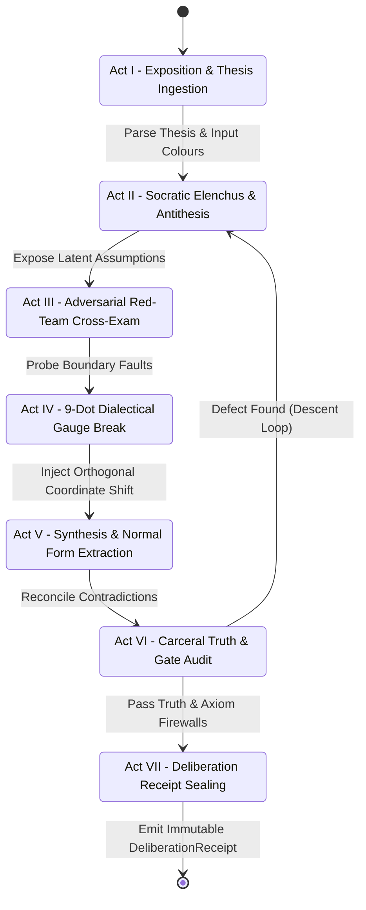

# OEWAS Level 07: Typed Workflow Graphs & the Woland 7-Act Dialectic Pipeline

**AuthorityEffect:** None. Complete architectural specification for declared workflow JSON manifests, sequential planar pipeline validation, danger signal policies, and the Woland 7-Act dialectic bout state machine; no operational authorization is conferred.

---

## 1. Executive Intuition: Pipelines as Planar Sequences

In conventional DAG-based pipeline frameworks (Airflow, LangGraph), workflows are modeled as arbitrary directed graphs with arbitrary edges and conditional branching. This flexibility often introduces severe bugs: cyclic deadlocks, uninitialized state variables, and untyped edge splicing.

In OEWAS, a workflow is **not** an arbitrary graph; it is a **planar substitution sequence**. Each step in the pipeline specifies:
- An operation (skill) to invoke.
- A discrete target slot index into the composite tree accumulated so far.

Because each step $k$ substitutes into the well-typed composite accumulated by steps $0 \ldots k-1$, the execution path is **acyclic by construction**.

---

## 2. The Workflow Manifest Specification

Every declared workflow lives under `.agents/workflows/<workflow_id>.json` conforming to [`REQUIRED_WORKFLOW_KEYS`](../../../../omega_engine_operads/domain/workflow_graph.py#L48-L55):

```json
{
  "workflow_id": "contract_compliance_audit_workflow",
  "name": "Nomos Law Contract Compliance Audit Workflow",
  "source_colours": [
    "Contract",
    "Code"
  ],
  "target_colour": "Audit",
  "pipeline": [
    {
      "slot": 0,
      "operation": "nomos-law-contract-manager"
    },
    {
      "slot": 0,
      "operation": "meta-law-contract-enforcer"
    }
  ],
  "authority_effect": "None"
}
```

### Manifest Fields and Invariants

1. **`workflow_id` (string):** Unique slug matching the filename.
2. **`source_colours` (list of strings):** Expected external input colours for the entire workflow.
3. **`target_colour` (string):** Final output colour produced by the composite.
4. **`pipeline` (list of objects):** Ordered sequence of `{ "slot": int, "operation": str }`.
5. **`authority_effect` (string):** Must be strictly `"None"`.

---

## 3. The Planar Pipeline Validation Algorithm: `workflow_graph.py`

In [`omega_engine_operads/domain/workflow_graph.py`](../../../../omega_engine_operads/domain/workflow_graph.py), validation is performed by repeatedly applying `substitute`:

```python
def validate_workflow(
    workflow: Mapping[str, Any],
    catalog: Mapping[str, OperadOperation],
) -> list[WorkflowFinding]:
    """Validates that a declared workflow composes cleanly over the operad."""
    findings = []
    
    # 1. Validate required keys and authority effect
    for key in REQUIRED_WORKFLOW_KEYS:
        if key not in workflow:
            findings.append(WorkflowFinding(workflow["workflow_id"], "MISSING_KEY", f"Missing {key}"))
    if workflow.get("authority_effect") != "None":
        findings.append(WorkflowFinding(workflow["workflow_id"], "BAD_AUTHORITY", "AuthorityEffect must be None"))

    # 2. Iterate through pipeline and execute planar substitutions
    pipeline = workflow.get("pipeline", [])
    if not pipeline:
        findings.append(WorkflowFinding(workflow["workflow_id"], "EMPTY_PIPELINE", "Pipeline cannot be empty"))
        return findings

    # Step 0 establishes the base operation
    first_step = pipeline[0]
    op_name = first_step["operation"]
    if op_name not in catalog:
        findings.append(WorkflowFinding(workflow["workflow_id"], "UNKNOWN_OPERATION", f"Unknown {op_name}", 0, op_name))
        return findings
    composite = catalog[op_name]

    # Steps 1..N substitute into the composite
    for idx, step in enumerate(pipeline[1:], start=1):
        step_op_name = step["operation"]
        slot = step["slot"]
        if step_op_name not in catalog:
            findings.append(WorkflowFinding(workflow["workflow_id"], "UNKNOWN_OPERATION", f"Unknown {step_op_name}", idx, step_op_name))
            continue
        step_op = catalog[step_op_name]
        try:
            composite = substitute(composite, slot, step_op)
        except SubstitutionError as err:
            findings.append(WorkflowFinding(workflow["workflow_id"], err.code, str(err), idx, step_op_name))

    # 3. Assert composed signature matches declared workflow signature
    if tuple(workflow["source_colours"]) != composite.source_colours:
        findings.append(WorkflowFinding(workflow["workflow_id"], "SIGNATURE_DRIFT", "Source colours disagree"))
    if workflow["target_colour"] != composite.target_colour:
        findings.append(WorkflowFinding(workflow["workflow_id"], "TARGET_DRIFT", "Target colour disagrees"))

    return findings
```

---

## 4. The Danger Signal Policy: `DangerSignalPolicy`

During execution, workflow step transitions are monitored by an immune policy:

```python
@dataclass(frozen=True, slots=True)
class DangerSignalPolicy:
    enforce_danger_gate: bool = True
    quarantine_on_critical: bool = True
    allosteric_quorum_threshold: Fraction = Fraction(1, 2)
```

If an upstream step emits a critical danger finding (e.g. memory safety violation or unverified math lemma), the danger gate halts execution before downstream terminalization can occur.

---

## 5. The Woland 7-Act Dialectic Pipeline

For high-consequence deliberations (such as admitting a new mathematical theorem or publishing a research monograph), workflows are executed as a **7-Act Dialectic Bout** managed by [`omega_engine_woland`](../../../../omega_engine_woland/):

```text
Act I: Ingestion  ──>  Act II: Elenchus  ──>  Act III: Red-Team  ──>  Act IV: Gauge Break
                                                                             │
Act VII: Receipt  <──  Act VI: Carceral  <──  Act V: Synthesis  <────────────┘
```



### The Seven Acts Explained

1. **Act I (Exposition & Ingestion):** Ingests the initial artifact (`Paper`, `Proof`, or `Code`), verifies YAML frontmatter and operad colours, and bounds the task scope.
2. **Act II (Socratic Elenchus):** Ooutwire interrogators question definitions and force the proposer to state implicit axioms.
3. **Act III (Adversarial Red-Team):** Thanatos and Old Man Red Team execute aggressive boundary-value tests, searching for counterexamples and type defects.
4. **Act IV (9-Dot Gauge Break):** Detects if the bout is trapped in a false dilemma or coordinate artifact; injects an orthogonal perspective.
5. **Act V (Synthesis):** Techne and Panepistimion synthesize surviving insights into a canonical normal form with minimal residual defect.
6. **Act VI (Carceral Truth Verification):** Verifies that all Lean 4 proof terms compile without unadmitted axioms (`sorry`), tests pass with zero skips, and claim ledgers match 1:1.
7. **Act VII (Receipt Sealing):** Synthesizes the final `DeliberationReceipt`, computes the RFC 8785 canonical hash, and seals the record with `AuthorityEffect: None`.

---

## 6. Verification and Local Unit Tests

To run the unit tests verifying workflow graph validation:

```powershell
# Retired: OEWAS tests/unit/test_workflow_graph_validator.py has no successor file under omega_engine_operads.
```

### The Level 07 Governance Invariants
- **INV-07-01 (Sequential Planarity):** All workflows must compose as valid sequential planar substitutions.
- **INV-07-02 (Signature Consistency):** Declared `source_colours` and `target_colour` must match the accumulated composite exactly.
- **INV-07-03 (Acyclic Pipeline):** Workflows are linear substitution sequences; circular loop constructs are rejected at validation time.
- **INV-07-04 (Authority Ceiling):** Workflow validation and execution enforce `AuthorityEffect: None`.
