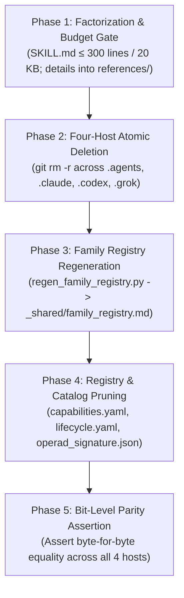

# OEWAS Level 08: Four-Host Mirror Parity & Deep Module Consolidation

**AuthorityEffect:** None. Complete engineering reference for multi-host estate synchronization across `.agents/`, `.claude/`, `.codex/`, and `.grok/`, the 5-phase deep module consolidation protocol, and cross-host synchronization tooling; no operational authorization is conferred.

---

## 1. Executive Intuition: The Multi-Host Estate Reality

In enterprise AI engineering, autonomous agents do not operate inside a single proprietary IDE. Engineering swarms run across multiple IDE host platforms simultaneously:
- **Google Antigravity:** Reads from `.agents/`
- **Anthropic Claude Code:** Reads from `.claude/`
- **OpenAI Codex:** Reads from `.codex/`
- **xAI Grok:** Reads from `.grok/`

If these host directories diverge—e.g. an anti-skill is updated in `.agents/` but remains stale in `.claude/`—agents executing on different platforms reach contradictory conclusions, produce irreproducible commits, and trigger merge conflicts.

To eliminate this entropy, the repository maintains **Four-Host Bit-Level Parity**: every skill, rule, and agent persona must be bit-for-bit identical across all four host roots.

---

## 2. The Four Canonical Host Roots

The four active host roots are:

$$\boxed{\left\{ \texttt{.agents/},\, \texttt{.claude/},\, \texttt{.codex/},\, \texttt{.grok/} \right\}}$$

```text
the_symbol_game/
├── .agents/                 # Canonical Primary Host Root
│   ├── skills/              # Reusable agent skill packages
│   ├── rules/               # Passive ambient governance rules
│   ├── agents/              # Agent persona manifests
│   └── evals/               # Evaluation suites and test fixtures
├── .claude/                 # Bit-for-bit mirror for Claude Code
│   ├── skills/
│   ├── rules/
│   └── ...
├── .codex/                  # Bit-for-bit mirror for Codex
└── .grok/                   # Bit-for-bit mirror for Grok
```

### 2.1 Surfaces Required to be in Exact Parity
- **`skills/`:** Every skill directory and its contents (`SKILL.md`, `references/`, `scripts/`).
- **`rules/`:** All modular rule files (e.g. `rust_and_python_engineering_standards.md`).
- **`agents/`:** All persona configurations and JSON slices.
- **`evals/`:** All test inputs and expected outputs.
- **`registry/`:** `capabilities.yaml` and `lifecycle.yaml`.
- **`_shared/family_registry.md`:** The centralized taxonomy registry.

### 2.2 Intentional Canon-Only Surfaces
The following directories exist **only** under `.agents/` and are intentionally exempted from mirroring:
- `.agents/archive/`: Historical deprecated files.
- `.agents/locks/`: Local file lock records (`content_locks.json`).

> [!CAUTION]
> **Banned Live Doctrine Hygiene:** Live `SKILL.md` packages must never declare hardcoded host counts (e.g. `four-host`, `4-host`, `five-host`) as live active doctrine, as this trips the `knowledge_parity.py` CI linter. Use generic terms such as `cross-host`, `active host roots`, or `estate host seats`.

---

## 3. Deep Module Skill Consolidation Invariant

A severe anti-pattern in agent ecosystems is the proliferation of **fragmented micro-skills**: creating a separate 15-line skill for every single check, regex, or script (e.g. `goo-check-comma`, `goo-check-import`). This causes:
- High prompt retrieval overhead and token wastage.
- Fragmented, overlapping documentation.
- Flaky routing decisions by agent dispatchers.

The repository strictly enforces the **Anti-Fragmentation Law**: all domain invariants, lint rules, and architectural guards must be consolidated into **deep, authoritative parent skills**.

### The 5-Phase Consolidation Protocol

Whenever micro-skills are merged into a parent skill or retired, the agent must execute the following atomic 5-phase protocol:



1. **Phase 1 (Factorization & Budget Ceiling):** Ensure the parent `SKILL.md` remains strictly $\le 300$ lines and $\le 20\text{ KB}$. Detailed manuals, checklists, and formulas must reside in `references/<topic>.md`.
2. **Phase 2 (Four-Host Atomic Deletion):** Subsumed or retired micro-skills must be deleted atomically across all four host roots using `git rm -r`.
3. **Phase 3 (Family Registry Regeneration):** Run `python operations/skill_operad/regen_family_registry.py` to refresh `_shared/family_registry.md`, and sync `_shared/` to all four hosts.
4. **Phase 4 (Registry & Catalog Pruning):**
   - Prune retired entries from `.agents/registry/capabilities.yaml` and `lifecycle.yaml`, then mirror identically.
   - Prune retired skill IDs from `operad_signature.json`, `agent_capability_slices.json`, and `capability_catalog.v1.json`.
5. **Phase 5 (Bit-Level Parity Assertion):** Assert byte-level equality between `.agents/` and all three mirrors (`.claude/`, `.codex/`, `.grok/`).

---

## 4. Cross-Host Synchronization Tooling

The canonical tool for syncing skills across hosts is [`sync_cross_host_skills.py`](../../../../operations/use_cases/packaging/sync_cross_host_skills.py):

```powershell
# Sync a single updated skill across all 4 host roots:
py -3.12 operations/use_cases/packaging/sync_cross_host_skills.py --skills <skill_name>

# Sync all skills across all 4 host roots:
py -3.12 operations/use_cases/packaging/sync_cross_host_skills.py --all

# Dry-run parity check without mutating files:
py -3.12 operations/use_cases/packaging/sync_cross_host_skills.py --dry-run
```

---

## 5. Rule vs. Skill Demarcation Invariant

The repository enforces an absolute structural separation between ambient rules and on-demand skills:

```
+-------------------------------------------------------------------------------+
|                       RULE VS. SKILL DEMARCATION INVARIANT                    |
+-------------------------------------------------------------------------------+
| RULES (rules/*.md & AGENTS.md):                                               |
| - Passive, ambient negative constraints injected into every turn.             |
| - Strictly reserved for:                                                      |
|   a. Universal negative constraints (never push directly to main).            |
|   b. Universal claim hygiene fences (narrow defensible claims, no hype).      |
|   c. Cross-host invariants (UTF-8 without BOM, four-host parity).             |
| - Must NOT contain procedural manuals or tutorials. Max 100 lines.            |
+-------------------------------------------------------------------------------+
| SKILLS (skills/<skill>/SKILL.md & references/):                               |
| - Active, on-demand capabilities loaded only when explicitly needed.          |
| - Contains procedural workflows, domain algorithms, and execution steps.     |
+-------------------------------------------------------------------------------+
```

---

## 6. Verification and Local Parity Checks

To audit cross-host parity locally:

```powershell
# 1. Assert host root parity
py -3.12 -m pytest operations/tests/unit/test_host_root_parity.py

# 2. Check for banned live doctrine in skill documentation
py -3.12 operations/domain/cicd/knowledge_parity.py
```

### The Level 08 Governance Invariants
- **INV-08-01 (Atomic Parity):** Any skill, rule, or agent edit in `.agents/` must be mirrored atomically to `.claude/`, `.codex/`, and `.grok/`.
- **INV-08-02 (Anti-Micro-Skill):** Single-check tools must be combined into deep parent packages.
- **INV-08-03 (Anti-Rule-Bloat):** Rules must not exceed 100 lines; procedural workflows belong in skills.
- **INV-08-04 (Authority Ceiling):** Estate synchronization confers no operational authority; `AuthorityEffect: None`.
