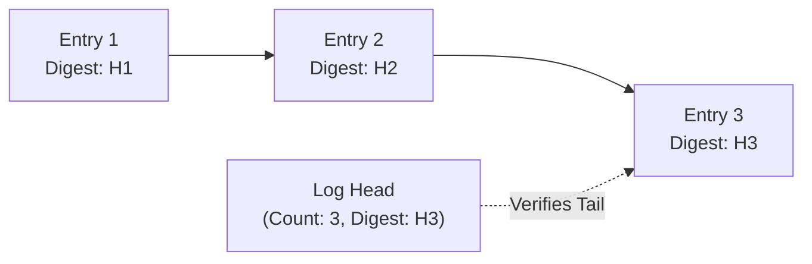
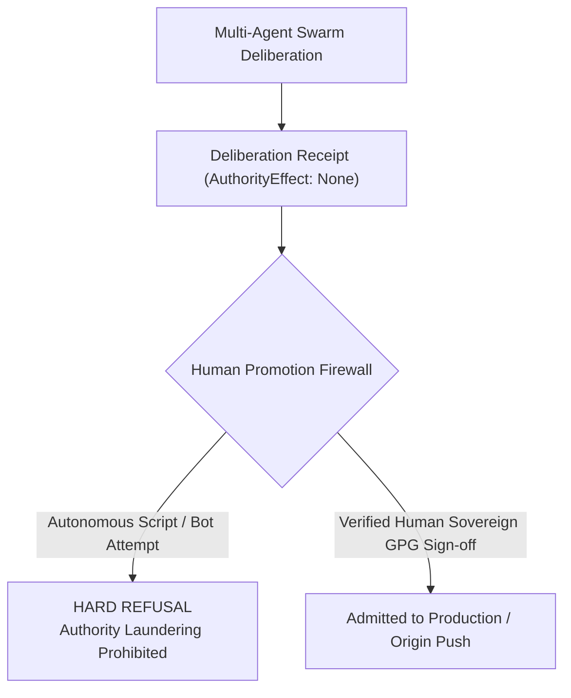

# OEWAS Level 09: Sovereign Non-Authority, Deliberation Receipts & Merkle Commitments

**AuthorityEffect:** None. Complete mathematical and architectural reference for sovereign non-authority (`AuthorityEffect: None`), RFC 8785 canonical deliberation receipts, Merkle audit commitments, and the human promotion firewall; no operational authorization is conferred.

---

## 1. Executive Intuition: The Sovereign Authority Firewall (GTOC-5)

The most catastrophic failure mode of autonomous multi-agent systems is **autonomous authority escalation**: an agent swarm deliberates, agrees with its own proposal, and autonomously executes a high-consequence external action (pushing directly to production, deleting databases, publishing unverified research) under the illusion that consensus equals authorization.

To make authority escalation mathematically unrepresentable, the Anomalon Engine enforces the **GTOC-5 Sovereign Authority Firewall**:

$$\boxed{\forall \, \text{Receipt } R, \quad R.\text{authority\_effect} \equiv \textbf{"None"}}$$

No matter how sophisticated the deliberation, how unanimous the agent vote, or how rigorous the mathematical proof, **an agent swarm is strictly a proposal generator, never an authority**. Operational authority belongs exclusively to verified human sovereigns.

---

## 2. Mathematical Definition: Non-Authoritative Realization

Let $\mathcal{A}$ be the set of autonomous agent proposals, and let $\mathcal{V}$ be the set of computational verification results:

$$\mathcal{V} = \{ \text{Pass},\, \text{Fail},\, \text{Refusal} \}$$

A verification pipeline computes a diagnostic mapping:

$$\operatorname{Verify}: \mathcal{A} \times \text{TestFixtures} \longrightarrow \mathcal{V}$$

Under the **Principle of Non-Authoritative Realization**:

$$\boxed{\operatorname{Verify}(A) = \text{Pass} \centernot\implies \operatorname{Authorize}(A)}$$

A passing verification result is evidence that artifact $A$ satisfied the specific tested predicates. It is **not** an operational license. In code:

```rust
// omega_wdp/src/ddc/non_authority.rs
#[derive(Debug, Clone, Copy, PartialEq, Eq, Serialize, Deserialize)]
pub enum AuthorityEffect {
    None,
}

impl AuthorityEffect {
    pub const fn is_none(self) -> bool {
        matches!(self, Self::None)
    }
}
```

Any attempt to construct an `AuthorityEffect` other than `None` fails at compile time in Rust and triggers an immediate validation exception in Python.

---

## 3. Deliberation Receipts: `DeliberationReceipt`

When a multi-agent swarm completes a dialectic bout (e.g. across Techne, Panepistimion, Ooutwire, and Thanatos), it emits an immutable **Deliberation Receipt**:

```json
{
  "deliberation_id": "DELIB-20261001-094b6101",
  "topic": "Admission of Coloured Operad Planar Substitution Kernel",
  "wings_participated": [
    "Techne",
    "Panepistimion",
    "Ooutwire",
    "Thanatos"
  ],
  "vote_breakdown": {
    "unanimous_pass": true,
    "defects_found": 0,
    "residuals_contracted": 3
  },
  "terminal_state": "CONTRACTIVE_OBSERVED",
  "rfc8785_canonical_hash": "e3b0c44298fc1c149afbf4c8996fb92427ae41e4649b934ca495991b7852b855",
  "authority_effect": "None"
}
```

### RFC 8785 Canonical JSON Serialization

To ensure that receipt hashes are bit-for-bit identical regardless of operating system, Python version, or JSON library:

1. **Float-Free Arithmetic:** All ratios and probabilities are encoded as exact string fractions (`"2/5"`) or integers; IEEE 754 floats are banned.
2. **Lexicographic Key Ordering:** All keys are sorted in strict ASCII / UTF-8 byte order.
3. **Minimal Whitespace:** Compact separators `(",", ":")` without indentation or trailing spaces.
4. **Pure UTF-8:** Encoded without BOM (`\xef\xbb\xbf`).

```python
canonical_bytes = json.dumps(receipt_body, sort_keys=True, separators=(",", ":")).encode("utf-8")
receipt_hash = hashlib.sha256(canonical_bytes).hexdigest()
```

---

## 4. Merkle Commitments & Append-Only Log Truncation Protection

Every deliberation step is recorded in an append-only hash chain. To prevent **tail truncation attacks** (where an attacker or runaway agent deletes the last few defect findings to make a failed run appear successful), the log enforces explicit head commitments via [`thanatos-append-only-log-truncation-auditor`](../../../../.agents/skills/thanatos-append-only-log-truncation-auditor/SKILL.md):

```text
Log Head:
├── total_entries: 42
└── last_entry_digest: "a7c2f8..."
```



If an adversary truncates Entry 3, `total_entries` becomes 2 (mismatch with declared 3) and `last_entry_digest` becomes `H2` (mismatch with declared `H3`). The log audit fails instantly.

---

## 5. The Human Promotion Firewall

The ultimate gate between agent deliberation and production realization is the **Human Promotion Firewall** ([`thanatos-human-promotion-firewall`](../../../../.agents/skills/thanatos-human-promotion-firewall/SKILL.md)):



### The Three Strict Promotion Invariants

1. **No Bot Promotion:** An autonomous agent may never call the promotion endpoint on behalf of another agent.
2. **Dual Human Sign-off for Core Directives:** Modifying prime directives (`PRIME_00` to `PRIME_09`) or `AGENTS.md` requires explicit human review.
3. **No Direct Main Push:** Agents must never execute `git push origin main`. All work lands on feature branches and awaits human pull request review.

---

## 6. Verification and Local Audit Commands

To run the local audit checks verifying non-authority firewalls and receipt integrity:

```powershell
# 1. Rust crate non-authority assertion test
cargo test --package omega_wdp --test test_ddc_authority_firewall

# 2. Audit append-only log truncation safety
py -3.12 -m pytest omega_engine_operations/tests/unit/test_append_only_log_truncation.py

# 3. Check for unauthorized git push attempts
py -3.12 -m pytest omega_engine_operations/tests/unit/test_git_push_firewall.py
```

### The Level 09 Governance Invariants
- **INV-09-01 (Universal Authority Ceiling):** Every emitted receipt, manifest, and transcript must declare `authority_effect: "None"`.
- **INV-09-02 (Canonical RFC 8785 Digest):** All receipt hashes must be derived from float-free, lexicographically sorted canonical JSON.
- **INV-09-03 (Truncation Rejection):** Any modification or truncation of append-only audit logs must be rejected as an integrity violation.
- **INV-09-04 (Human Sovereign Exclusivity):** Only human sovereigns possess the authority to promote artifacts from shadow/provisional to production.
