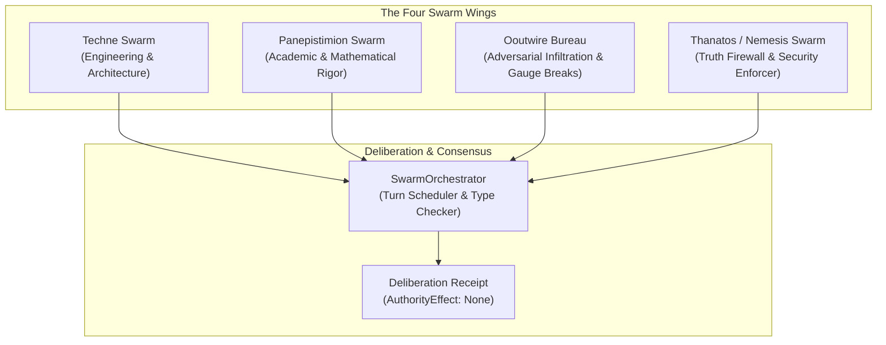

# Multi-Agent Swarm Orchestration & Coloured Operad

**Bounded Context:** `omega_engine_operads`  
**Location:** `omega_engine_education/documentation/008_oeop/multi_agent_swarm_orchestration_and_operad.md`  
**Status:** Canonical Multi-Agent Specification  
**AuthorityEffect:** `None`  

---

## 1. Coloured Operad Architecture

Multi-agent coordination in the research papers engine is governed by a **10-Coloured Operad** $(\mathcal{O}, \circ)$, enforcing that agent interactions compose as valid typed morphisms without semantic leakage or type mismatches.

### 1.1 The Ten Operadic Colours
Every agent input, intermediary state, and emitted artifact is assigned an immutable operadic colour $c \in \mathcal{C}_{10}$:

```text
       ┌───────────┐       ┌───────────┐       ┌───────────┐
       │   Paper   │       │   Proof   │       │   Code    │
       └─────┬─────┘       └─────┬─────┘       └─────┬─────┘
             │                   │                   │
             └───────────┬───────┴───────────────────┘
                         ▼
             ┌───────────────────────┐
             │         Audit         │
             └───────────┬───────────┘
                         ▼
             ┌───────────────────────┐
             │        Receipt        │
             └───────────┬───────────┘
                         ▼
             ┌───────────────────────┐
             │  Post / State / etc.  │
             └───────────────────────┘
```

1. **`Paper`**: Scientific manuscripts, monograph text, and frontmatter.
2. **`Proof`**: Formal Lean 4 proof terms, Lake configurations, and axiom declarations.
3. **`Code`**: Computational Python solvers, Rust crates, and Jupyter notebooks.
4. **`Audit`**: Structured critique findings, defect reports, and claim hygiene audits.
5. **`Receipt`**: Cryptographic evidence bundles, hash chains, and gate receipts.
6. **`Post`**: Formatted public announcements and external communications.
7. **`Contract`**: YAML schemas, Nomos law contracts, and API protocol definitions.
8. **`State`**: Git worktree files, directory structures, and environment settings.
9. **`Ledger`**: Append-only event logs, claim ledgers, and difference tables.
10. **`Diagram`**: Vector graphics, KaTeX formulas, and Mermaid diagrams.

### 1.2 Morphism Composition & Type Checking
An agent operation $f$ is an operadic operation with signature:

$$f \in \mathcal{O}(c_1, \ldots, c_k; c_{\mathrm{out}})$$

For example, the adversarial referee operates as:

$$\text{AdversarialReview}: \mathcal{O}(\text{Paper}, \text{Proof}, \text{Code}; \text{Audit})$$

The `SwarmOrchestrator` verifies that whenever agent $A$ hands off its output to agent $B$, the output colour of $A$ exactly matches the input colour expected by $B$, eliminating un-recomputed bindings and hallucinated artifacts.

---

## 2. The Four Specialized Swarm Wings

The engine orchestrates four specialized agent wings, each executing orthogonal peer review responsibilities:



### 2.1 Techne Swarm (Engineering & Clean Architecture)
- **Role**: Software engineering standards, Clean Architecture inward dependencies, Rust FFI bindings, and local test execution.
- **Key Checks**: Asserts zero circular dependencies between domain layers; verifies that native Rust math libraries build cleanly; audits Windows Python 3.12 compatibility.

### 2.2 Panepistimion Swarm (Academic & Formal Rigor)
- **Role**: Peer-review faculty, mathematical soundness, LaTeX/KaTeX precision, and literature grounding.
- **Key Checks**: Evaluates whether mathematical definitions are classical or secret jargon; audits bibliography citations; ensures claim scope matches proof strength.

### 2.3 Ooutwire Bureau (Dialectical Gauge Breaks)
- **Role**: Infiltration, Socratic elenchus, lateral thinking, and breaking local optimization traps.
- **Key Checks**: Detects when an analysis is trapped in an arbitrary coordinate system (the "9-Dot Constraint Box"); executes unexpected counter-proposals to test theorem robustness.

### 2.4 Thanatos / Nemesis Swarm (Truth & Security Firewall)
- **Role**: Relentless prosecution of hype, pseudo-mathematics, and security violations.
- **Key Checks**:
  - Enforces the **No-BS Claim Firewall**: forbids hype words (`proves`, `guarantees`, `universal`).
  - Demands exact hash-bound evidence for every assertion.
  - Deploys **Old Man ChatGPT Red Team** to attack logical fallacies and ungrounded assumptions.

---

## 3. Text Checks That Feed the Woland Bout

### 3.1 Hand-Waving Lint (Old Man ChatGPT persona)
[`use_cases/hand_waving_lint.py`](../../../omega_engine_research_papers/use_cases/hand_waving_lint.py) is a regex scan over monograph prose for unhedged phrases such as "naturally follows" or "rapid convergence". Each match is a blocking finding with its line number. The scan does not judge baselines, toy models or generalisation; that criticism belongs to the Woland bout's critic seat (Act II, `seat_koroviev`), which receives the findings as evidence.

### 3.2 Unstated-Premise Questions (Ooutwire interrogator persona)
[`use_cases/unstated_premise_questions.py`](../../../omega_engine_research_papers/use_cases/unstated_premise_questions.py) raises a question when the text leans on "obviously", or when the abstract mentions a continuum and the text gives no interval enclosure. It only asks questions; it does not change a carrier or report a descent. The questions go to the Woland bout as evidence for the gauge break (Act IV, `seat_margarita`).

---

## 4. Deliberation Receipts & Consensus Protocol

Swarm deliberations produce an immutable `DeliberationReceipt`:

```python
@dataclass(frozen=True)
class DeliberationReceipt:
    """Immutable receipt recording multi-perspective swarm deliberation."""

    bout_id: str
    paper_id: str
    participating_agents: tuple[str, ...]
    operad_trace: tuple[str, ...]
    verdicts: Mapping[str, str]       # Agent -> Verdict
    consensus_disposition: str        # "ACCEPT", "REVISE", "REFUSE"
    residual_objections: tuple[str, ...]
    timestamp_utc: str
    receipt_sha256: str
    authority_effect: str = "None"
```

The receipt proves that every swarm wing inspected the monograph, records all dissenting minority opinions, and certifies that no unadmitted claims escaped scrutiny.
