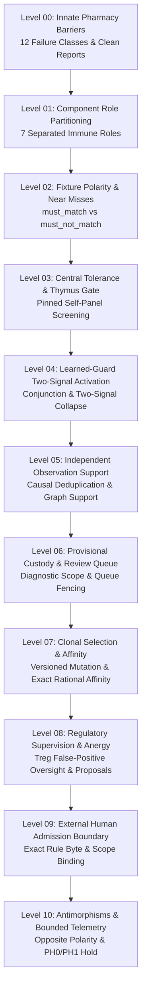

# Epistemic Immune System (EIS) Levels Catalog: Level 00 to Level 10

**AuthorityEffect:** None.  
**System Domain:** Epistemic Defense, Threat Elimination, Anti-Morphisms, and Multi-Agent Immune Surveillance  
**Canonical Epic Planning Reference:** [`epic_claude_oeeis_oeprmptciv_plan.md`](../../../../product_planning_office/plans/epics/epic_claude_oeeis_oeprmptciv_plan.md)  
**Underlying Python Domain Package:** [`eis`](../../../../eis)  
**Underlying Pure Rust Crates:** [`core_epistemic_immune_system`](../../../../engine/crates_rs/core_epistemic_immune_system), [`core_prompt_civilization::pharmacy`](../../../../engine/crates_rs/core_prompt_civilization/src/pharmacy.rs)  
**Total Progressive Levels:** 11 Levels ($N = 0 \dots 10$)

---

## 1. Architectural Architecture & Evidential Stratification

The **Epistemic Immune System (OEEIS)** provides autonomous, authority-safe immune surveillance across the Symbol Game Proposal Fidelity Protocol (PFP). Modern multi-agent LLM systems are uniquely vulnerable to semantic degradation: hallucinatory self-certification, sycophantic peer collusion, silent failure skips, and unverified authority mimicry. OEEIS neutralizes these failure modes using principles derived from artificial immune systems, structured across rigorous clean architecture boundaries:

1. **The Innate Barrier:** 12 immutable, compile-time verified failure classes implemented in pure Rust ([`core_prompt_civilization::pharmacy`](../../../../engine/crates_rs/core_prompt_civilization/src/pharmacy.rs)), detecting model self-certification, fake receipts, conclusion preloading, and theorem name laundering.
2. **Component Role Decoupling:** Seven strictly separated role data types (`Spec`, `FixtureBank`, `EvaluationReceipt`, `ExternalDecision`, `Registry`, `ActivationProfile`, `Hit`), preventing the conflation of detector authoring with operational authority.
3. **Fixture Polarity Discipline:** Explicit mapping between `must_match` (known triggering defects) and `must_not_match` (valid near-miss controls) under [`FixturePolarityMapV1`](../../../../eis/domain/external_admission.py), eliminating false positive triggers on valid prompts.
4. **Central Tolerance (Thymus Gate):** Pinned self-panel screening of candidate detectors against admitted repository prompts, skills, and receipts. Any candidate firing on an admitted self artifact is permanently eliminated before evaluation.
5. **Learned-Guard Law & Two-Signal Activation:** Learned guards activate if and only if:
   $$\text{externally\_admitted}(g, s) \land \text{detector\_match}(g, \text{subject}) \land \text{independent\_danger\_signal}(\text{subject}, \text{context}) \land \neg \text{suspended}(g, s)$$
   Copying the danger signal from the detector match or the model output is rejected with `TWO_SIGNAL_COLLAPSE`.
6. **Independent Observation Support Policy:** Candidate antibodies require at least 3 pairwise-uncorrelated observations across distinct causal events, model lineages, scaffolds, and inheritance subtrees under [`ObservationSupportPolicyV1`](../../../../eis/domain/external_admission.py) before achieving provisional status.
7. **Provisional Bridge & Review Queue:** Support $\ge 3$ promotes an antibody to `Provisional`. Provisional antibodies arm Signal-1 detectors yielding `FINDING` only; `HOLD` and `REFUSE` strictly require `HumanAdmitted` external authority.
8. **Regulatory Supervision & Reversible Anergy:** False-positive monitoring ([`TregSupervisor`](../../../../pfp/domain/immune/treg.py)) emits anergy proposals to external epoch queues; detectors never self-suspend.
9. **External Human Admission Boundary:** Admission authority resides strictly outside autonomous agents in external human decision records ([`HumanAntiSkillAdmissionDecisionV1`](../../../../eis/domain/external_admission.py)) bound to exact rule bytes and operational scope.
10. **Antimorphisms & Diagnostic-Only Telemetry:** Mathematical anti-morphisms and bounded persistent homology shadow records ($\text{PH}_0/\text{PH}_1$) operate under strict `RESEARCH_HOLD` with `AuthorityEffect: None`.

---

## 2. Progressive Level Catalog

| Level | Document | Primary Focus | Key Invariant / Falsifier |
| :--- | :--- | :--- | :--- |
| **00** | [`level_00_innate_pharmacy_barriers.md`](level_00_innate_pharmacy_barriers.md) | 12 Innate Failure Classes in `pharmacy.rs` | Clean report is not admission; no repair field (`F-BIO-07`) |
| **01** | [`level_01_component_role_partitioning.md`](level_01_component_role_partitioning.md) | Decoupling the 7 Immune Roles | Adjunct repair hints forbidden from admission records (`F-IMMUNE-01`) |
| **02** | [`level_02_fixture_polarity_and_near_misses.md`](level_02_fixture_polarity_and_near_misses.md) | Fixture Polarity & Near-Miss Verification | `must_match` vs `must_not_match`; polarity map (`F-FIX-01..02`) |
| **03** | [`level_03_central_tolerance_and_thymus_gate.md`](level_03_central_tolerance_and_thymus_gate.md) | Central Tolerance & The Thymus Gate | Self-panel match triggers elimination; regex miss never admits (`F-IMMUNE-02`) |
| **04** | [`level_04_learned_guard_two_signal_activation.md`](level_04_learned_guard_two_signal_activation.md) | Conjunction & Two-Signal Activation | Copying danger from detector match yields `TWO_SIGNAL_COLLAPSE` |
| **05** | [`level_05_independent_observation_support_policy.md`](level_05_independent_observation_support_policy.md) | Independent Observation Support Policy | Max independent set over host correlation keys $\ge 3$ (`F-SUPPORT-01..04`) |
| **06** | [`level_06_provisional_custody_and_review_queue.md`](level_06_provisional_custody_and_review_queue.md) | Provisional Custody & Review Queue | Provisional arms `FINDING` only; never writes `ACTIVE` (`F-CUSTODY-01`) |
| **07** | [`level_07_clonal_selection_and_affinity.md`](level_07_clonal_selection_and_affinity.md) | Clonal Selection & Affinity Maturation | Mutants born `Candidate`; exact rational affinity without floats (`F-IMMUNE-08`) |
| **08** | [`level_08_regulatory_supervision_and_anergy.md`](level_08_regulatory_supervision_and_anergy.md) | Regulatory Supervision & Anergy | Detectors never self-suspend; `AnergyProposalV1` to epoch queue (`F-BIO-06`) |
| **09** | [`level_09_external_admission_boundary.md`](level_09_external_admission_boundary.md) | External Human Admission Boundary | Authenticated decision binding exact rule bytes and scope (`F-CUSTODY-02`) |
| **10** | [`level_10_antimorphism_polarity_and_bounded_telemetry.md`](level_10_antimorphism_polarity_and_bounded_telemetry.md) | Antimorphisms & Bounded Telemetry | Opposite polarity operations; $\text{PH}_0/\text{PH}_1$ on `RESEARCH_HOLD` |

---

## 3. Epistemic Posture

- **`AuthorityEffect: None`** is bound into every metadata header, detector report, and evaluation receipt.
- Immunological analogies (Thymus, Regulatory T-Cells, Clonal Selection, Anaphylaxis) are explicit **architectural metaphors**, strictly implemented as clean software engineering contracts over deterministic data types.
- Immune detectors detect violations and enforce negative constraints; they **never** grant positive authority, prove correctness, or auto-promote candidates into production custody.
