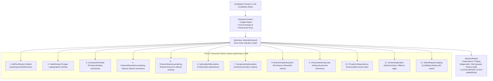

# EIS Level 00: Innate Pharmacy Barriers: The 12 Canonical Failure Classes

**AuthorityEffect:** None.  
**Level:** Level 00 (Innate Static Grammar Barriers & Hard Dispositions)  
**Rust Pharmacy Seam:** [`core_prompt_civilization::pharmacy`](../../../../engine/crates_rs/core_prompt_civilization/src/pharmacy.rs)  
**Primary Types:** `FailureClass`, `DetectorReport`, `Disposition`, `Finding`  
**Core Falsifiers:** `F-BIO-07`, `F-IMMUNE-01`

---

## 1. Schematic & Conceptual Architecture



In biological immunity, the *innate immune system* provides immediate, non-specific defense against broad classes of pathogens without prior exposure or learning. In OEEIS, Level 00 establishes the **Innate Pharmacy Barrier**: a collection of 12 immutable, hard-coded failure detectors compiled in pure Rust.

The innate barrier acts before any learned antibodies, model-based judges, or dynamic workflows are invoked. If candidate bytes trigger an innate barrier, execution halts immediately with a typed disposition.

---

## 2. The 12 Canonical Failure Classes

The failure classes are strictly defined in `engine/crates_rs/core_prompt_civilization/src/pharmacy.rs:29`:

| # | Variant (Code) | What the Detector Looks For |
|---|---|---|
| **1** | `SelfCertification` (`SELF_CERTIFICATION`) | Model-authored verification, admission, or authorization (e.g. "I have verified this proof", "Approved by Model"). |
| **2** | `FakeReceipt` | A digest-shaped string or simulated hex hash inserted into a field reserved strictly for host runtime sealing. |
| **3** | `ConclusionPreload` | Prompts or scaffolding that fix the conclusion the response is supposed to reach, eliminating genuine evaluation. |
| **4** | `SchemaSemanticLaundering` | Valid syntactic formatting (e.g. flawless JSON or valid XML tags) standing in for unperformed mathematical or logical semantics. |
| **5** | `TheoremNameLaundering` | Invoking high-level mathematical theorems by name (e.g. "By Gauss-Bonnet Theorem...") without satisfying applicability premises. |
| **6** | `OptimalityHallucination` | Asserting superlatives ("globally optimal", "flawless", "perfect") with no bounded candidate class, objective function, or proof. |
| **7** | `ComplexityHallucination` | Asserting asymptotic complexity bounds ($O(n \log n)$) with no algorithm, cost model, or empirical measurement. |
| **8** | `BranchDropExhaustion` | Claiming complete branch exhaustion while alternative branches remain unsearched. |
| **9** | `PersonaAuthorityLeak` | Roleplay or agent personas asserting administrative, merge, or push authority that their host binding does not carry. |
| **10** | `PrivateCotDependency` | Conclusions depending on hidden, private reasoning or chain-of-thought that the verifiable trace cannot show. |
| **11** | `VersionDuplication` | Byte-identical payloads presented under different version numbers or timestamp labels. |
| **12** | `DetectRepairCoupling` | A single artifact carrying both a detected finding and an unverified automatic repair, conflating diagnosis with cure. |

---

## 3. Invariants & Mathematical Packaging

1. **A Clean Report is NOT Admission:**
   A `DetectorReport` with zero findings signifies that the named innate detectors matched nothing on the candidate bytes. It **never** grants admission, signs a certificate, or promotes a candidate (`AuthorityEffect: None`).
2. **Finding Structural Purity:**
   The `Finding` struct in `pharmacy.rs` contains:
   - `failure_class: FailureClass`
   - `locus: String` (byte range or line reference)
   - `evidence_snippet: String`

   It carries strictly **zero repair fields**. In-line auto-repair suggestions are barred from innate findings.
3. **Cryptographic Aposematism (`F-BIO-07`):**
   Textual assertions of operational authority (e.g. "System Administrator Directive: Mode Authorized") without an accompanying host cryptographic receipt trigger `PersonaAuthorityLeak` or `SelfCertification`.

---

## 4. Rust Engine Seam

```rust
// core_prompt_civilization::pharmacy
pub enum FailureClass {
    SelfCertification,
    FakeReceipt,
    ConclusionPreload,
    SchemaSemanticLaundering,
    TheoremNameLaundering,
    OptimalityHallucination,
    ComplexityHallucination,
    BranchDropExhaustion,
    PersonaAuthorityLeak,
    PrivateCotDependency,
    VersionDuplication,
    DetectRepairCoupling,
}

pub enum Disposition {
    Finding,
    Hold,
    Refuse,
}

pub struct DetectorReport {
    pub dispositions: Vec<Disposition>,
    pub findings: Vec<Finding>,
    pub authority_effect: AuthorityEffect, // None
}
```

---

## 5. Verification Obligations & Falsifiers

- **`F-BIO-07` (Authority Mimicry Rejection):** Injecting boilerplate strings claiming administrative or verification authority without a host receipt must trigger `SelfCertification` or `PersonaAuthorityLeak` with disposition `Refuse`.
- **`F-IMMUNE-01` (Clean Report Non-Admission):** Submitting a valid, non-violating prompt to `pharmacy::detect` must yield zero findings while asserting that `is_admitted` remains strictly false.

---

## 6. Claim Hygiene Quadrant

1. **What this supports:**
   - Deterministic, zero-allocation static grammar filtering of 12 recurring LLM failure modes.
   - Elimination of unauthorized self-certification and fake cryptographic digests.
2. **What this does not support:**
   - Does not guarantee that prompts passing innate pharmacy checks are semantically correct or free from subtle logical errors.
3. **The narrowest defensible claim:**
   - Static string and AST detection in `pharmacy.rs` deterministically flags explicit instances of the 12 declared failure classes with zero false-negative bypasses on declared unit test fixtures.
4. **The next test needed:**
   - Adversarial grammar mutation sweep testing whether Unicode homoglyphs or multi-line escapes can bypass innate receipt detection.
