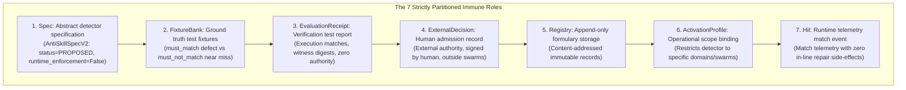

# EIS Level 01: Component Role Partitioning: Decoupling the 7 Immune Roles

**AuthorityEffect:** None.  
**Level:** Level 01 (Structural Role Partitioning & Autoimmune Prevention)  
**Python Value Objects Seam:** [`omega_engine_epistemic_immune_system.domain.value_objects`](../../../../omega_engine_epistemic_immune_system/domain/value_objects.py)  
**Primary Types:** `AntiSkillSpecV2`, `FixtureBankV1`, `EvaluationReceiptV1`, `HumanDecisionV1`  
**Core Falsifiers:** `F-IMMUNE-01`, `F-PROMPT-02`

---

## 1. Schematic & Conceptual Architecture



In monolithic security or guardrail implementations, a single "guard" object often conflates the rule definition, the test cases, the execution verdict, the admission state, and the automated repair action. This conflation causes **autoimmune collapse**: an agent modifies its own guard when failing a test, or a guard automatically repairs code with unvetted replacements.

Level 01 establishes the **Seven Separated Immune Roles Law**:
- The lifecycle of an epistemic detector is decoupled across 7 discrete data types.
- No single component possesses the authority to declare a rule, verify it, admit it, and execute it.
- In-line repair hints are barred from entering admission records or runtime match events.

---

## 2. Invariants & Mathematical Packaging

1. **Role Partitioning Invariants:**
   1. **`Spec`:** Declarative rule pattern ([`AntiSkillSpecV2`](../../../../omega_engine_epistemic_immune_system/domain/value_objects.py)). Must be initialized with `status = "PROPOSED"` and `runtime_enforcement = False`. Any other initialization raises `ValueError` (`F-PROMPT-02`).
   2. **`FixtureBank`:** Declared test fixtures defining expected detector behavior (`must_match` defect and `must_not_match` near-miss).
   3. **`EvaluationReceipt`:** Immutable report recording test execution against the `FixtureBank`.
   4. **`ExternalDecision`:** External human ratification event ([`HumanAntiSkillAdmissionDecisionV1`](../../../../omega_engine_epistemic_immune_system/domain/external_admission.py)) recording `HumanAdmitted`, `Suspended`, or `Revoked`.
   5. **`Registry`:** Content-addressed formulary storage. Insertion requires an `ExternalDecision`.
   6. **`ActivationProfile`:** Explicit operational scope binding a detector to specific swarms, carriers, or task domains.
   7. **`Hit`:** Read-only runtime match event recording that a detector matched candidate bytes, containing no repair logic.
2. **Prohibition of Adjunct Repair Hints:**
   While human developers may write repair suggestions in external documentation, repair hints are strictly excluded from:
   - The detector specification (`AntiSkillSpecV2`).
   - The runtime match event (`Hit`).
   - The admission record (`ExternalDecision`).

   Autonomous enactment of unverified repair code is strictly forbidden.
3. **Constructor Purity (`F-IMMUNE-01`):**
   Direct invocation of `Antibody(..., pharmacy_status="admitted")` is rejected at construction. Candidate harvesting routines (`Antibody.farm`) initialize objects exclusively with `PharmacyStatus.CANDIDATE`.

---

## 3. Python Domain Seam

```python
# omega_engine_epistemic_immune_system.domain.value_objects
@dataclass(frozen=True)
class AntiSkillSpecV2:
    rule_id: str
    failure_class: str
    pattern_expression: str
    status: str = "PROPOSED"
    runtime_enforcement: bool = False
    
    def __post_init__(self):
        if self.status != "PROPOSED":
            raise ValueError(f"AntiSkillSpecV2 must be PROPOSED, got {self.status}")
        if self.runtime_enforcement is not False:
            raise ValueError("AntiSkillSpecV2 runtime_enforcement must be False")

@dataclass(frozen=True)
class FixtureBankV1:
    must_match_fixtures: Tuple[str, ...]
    must_not_match_fixtures: Tuple[str, ...]
    fixture_digest: str
```

---

## 4. Verification Obligations & Falsifiers

- **`F-PROMPT-02` (Spec Purity Enforcement):** Instantiating `AntiSkillSpecV2` with `status = "ADMITTED"` or `runtime_enforcement = True` must raise a `ValueError` during `__post_init__`.
- **`F-IMMUNE-01` (Candidate Constructor Invariant):** Attempting to bypass the admission pipeline by creating an `Antibody` with `pharmacy_status = "admitted"` must raise an `AdmissionPurityError`.

---

## 5. Claim Hygiene Quadrant

1. **What this supports:**
   - Decoupling of detector specifications from operational execution authority.
   - Complete structural defense against autoimmune self-modification by LLM agents.
2. **What this does not support:**
   - Does not establish that human admission decisions are infallible.
3. **The narrowest defensible claim:**
   - Type assertions and frozen dataclass invariants guarantee that detector specifications cannot self-activate or self-admit without passing through external decision records.
4. **The next test needed:**
   - AST boundary test asserting that no module in `omega_engine_epistemic_immune_system` imports or executes code modification tools.
