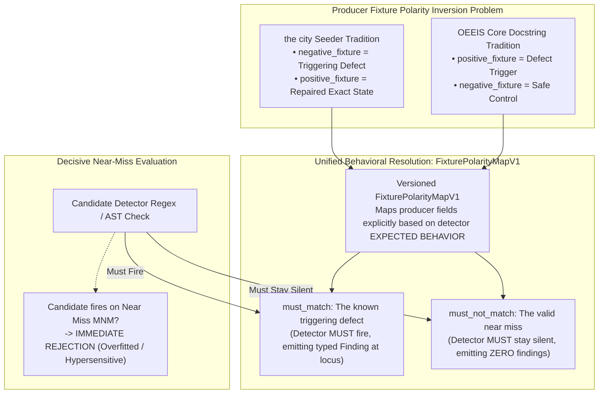

# EIS Level 02: Fixture Polarity & Near-Miss Verification

**AuthorityEffect:** None.  
**Level:** Level 02 (Behavioral Fixture Mapping & Negative Control Fences)  
**Python Admission Seam:** [`omega_engine_epistemic_immune_system.domain.external_admission`](../../../../omega_engine_epistemic_immune_system/domain/external_admission.py)  
**Primary Policies:** `FixturePolarityMapV1`, `FixtureValidationFailureV1`  
**Core Falsifiers:** `F-FIX-01`, `F-FIX-02`, `F-PHARM-03`

---

## 1. Schematic & Conceptual Architecture



In automated security and linting pipelines, the labels "positive" and "negative" are notoriously ambiguous: does a "positive test" mean the code tested was *good*, or does it mean the vulnerability detector tested *positive* for a bug? In the Omega Engine codebase, the city seeders historically referred to the triggering defect as `negative_fixture` (a bad input), while OEEIS documentation referred to the triggering defect as `positive_fixture` (a positive detection).

Level 02 eliminates this semantic ambiguity by establishing **Behavioral Fixture Mapping**:
1. All fixtures are defined strictly by **expected detector behavior**:
   - **`must_match`:** The known defect artifact; the detector **must** trigger and emit the specified finding.
   - **`must_not_match`:** A valid "near-miss" artifact; the detector **must** stay silent.
2. A candidate detector that correctly flags `must_match` but also fires on `must_not_match` is an overfitted, hypersensitive detector and is eliminated immediately.
3. If an operational detector stops validating against either fixture, it becomes immediately non-effective.

---

## 2. Invariants & Mathematical Packaging

1. **Explicit Producer Polarity Mapping (`F-FIX-01`):**
   The system binds a versioned [`FixturePolarityMapV1`](../../../../omega_engine_epistemic_immune_system/domain/external_admission.py) keyed by `(producer_id, schema_version)`:
   $$\operatorname{resolve\_fixtures}(\text{artifact}, \text{producer}) \longrightarrow (\text{must\_match}, \text{must\_not\_match})$$
   A producer without an explicit entry in `FixturePolarityMapV1` is rejected with `FIXTURE_POLARITY_UNDECLARED`. Persisted database fields are never silently relabeled in place.
2. **Decisive Near-Miss Verification:**
   A detector $D$ passes candidate admission preflight if and only if:
   $$\forall x \in \text{must\_match}, D(x) \neq \emptyset \quad \land \quad \forall y \in \text{must\_not\_match}, D(y) = \emptyset$$
   A candidate that fires on $y \in \text{must\_not\_match}$ fails preflight with `OVERFITTED_DETECTOR_TRIGGERED_ON_NEAR_MISS`.
3. **Fixture Validation Failure & Immediate Non-Effectiveness (`F-PHARM-03`, `F-FIX-02`):**
   If a running detector fails to validate against its fixture bank during periodic health checks:
   - OEEIS records a [`FixtureValidationFailureV1`](../../../../omega_engine_epistemic_immune_system/domain/external_admission.py).
   - The detector's operational binding becomes **immediately non-effective**, as both `diagnostic_eligible` and `enforcing_eligible` predicates require a currently validating fixture bank.
   - A [`RetirementProposalV1`](../../../../omega_engine_epistemic_immune_system/domain/external_admission.py) is submitted to the external epoch review queue; custody status is not altered automatically.

---

## 3. Python Domain Seam

```python
# omega_engine_epistemic_immune_system.domain.external_admission
@dataclass(frozen=True)
class FixturePolarityMapV1:
    producer_id: str
    schema_version: str
    must_match_field_name: str
    must_not_match_field_name: str
    policy_digest: str

@dataclass(frozen=True)
class FixtureValidationFailureV1:
    failure_id: str
    rule_digest: str
    implementation_digest: str
    failed_fixture_digest: str
    expected_behavior: str # "must_match" or "must_not_match"
    actual_behavior: str
```

---

## 4. Verification Obligations & Falsifiers

- **`F-FIX-01` (Undeclared Polarity Refusal):** Submitting an admission request from an unknown producer without a registered entry in `FixturePolarityMapV1` must refuse with `FIXTURE_POLARITY_UNDECLARED`.
- **`F-FIX-02` (Retirement Proposed, Not Written):** When a fixture validation failure occurs, the runtime must emit `RetirementProposalV1` to the external epoch queue while verifying that the stored custody status remains `HumanAdmitted` until external ratification.
- **`F-PHARM-03` (Immediate Non-Effectiveness):** A detector with an active `FixtureValidationFailureV1` must evaluate to `is_effective = false`, emitting 0 blocking dispositions in live runs.

---

## 5. Claim Hygiene Quadrant

1. **What this supports:**
   - Unambiguous behavioral semantics for detector test fixtures, resolving historical naming contradictions across packages.
   - Elimination of hypersensitive, overfitted detectors that flag valid syntax as errors.
2. **What this does not support:**
   - Does not guarantee that a detector passing one near-miss fixture will never produce false positives on unseen edge cases.
3. **The narrowest defensible claim:**
   - Behavioral mapping ensures that candidate detectors are proven to fire on declared defect strings while remaining silent on declared near-miss strings under automated testing.
4. **The next test needed:**
   - Property-based string mutation test generating 1,000 syntactically valid variations of a near-miss to probe detector boundary sharpness.
