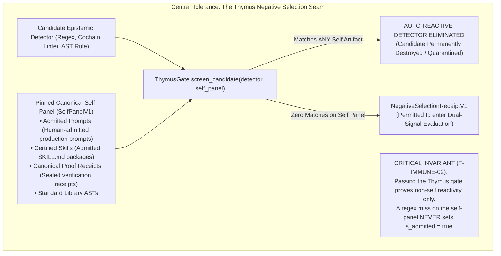

# EIS Level 03: Central Tolerance & The Thymus Gate: Pinned Self-Panel Screening

**AuthorityEffect:** None.  
**Level:** Level 03 (Central Tolerance, Self-Panel Defense & Auto-Reactivity Elimination)  
**Python Thymus Seam:** [`eis.domain.thymus`](../../../../eis/domain/thymus.py)  
**Primary Types:** `ThymusGate`, `SelfPanelV1`, `NegativeSelectionReceiptV1`  
**Core Falsifiers:** `F-IMMUNE-02`

---

## 1. Schematic & Conceptual Architecture



In human immunology, the *thymus* enforces central tolerance: developing T-cells are exposed to host antigens (the "self-panel"). Any T-cell whose receptor binds strongly to self proteins undergoes apoptosis (programmed cell death) to prevent autoimmune disease.

In OEEIS, Level 03 establishes the **Thymus Gate for Epistemic Detectors**:
- When an agent or automated miner drafts a candidate detector, that detector could be inadvertently over-broad, flagging legitimate system code, canonical skills, or verified mathematical proofs as "defects."
- Before any candidate detector is evaluated in operational swarms, it is screened against a pinned, cryptographically sealed **Self-Panel**.
- If the candidate triggers on a single self artifact, it is permanently eliminated.
- Crucially, passing the Thymus gate proves only that the detector is *not auto-reactive*; it **never** constitutes admission authority.

---

## 2. Invariants & Mathematical Packaging

1. **Pinned Self-Panel Composition:**
   The [`SelfPanelV1`](../../../../eis/domain/thymus.py) contains a curated, versioned set of known-good system artifacts:
   $$\mathcal{S}_{\text{self}} = \mathcal{P}_{\text{prompts}} \cup \mathcal{K}_{\text{skills}} \cup \mathcal{R}_{\text{receipts}} \cup \mathcal{A}_{\text{asts}}$$
   The panel is frozen and hash-chained to prevent dynamic tampering by candidate-generating agents.
2. **Negative Selection Elimination Law:**
   A candidate detector $D$ survives negative selection if and only if:
   $$\forall s \in \mathcal{S}_{\text{self}}, \quad D(s) = \emptyset$$
   If $\exists s \in \mathcal{S}_{\text{self}}$ such that $D(s) \neq \emptyset$, the detector is deemed **auto-reactive** and rejected with:
   $$\text{Status} \longleftarrow \text{ELIMINATED\_AUTO\_REACTIVE}$$
3. **The Non-Admission Invariant (`F-IMMUNE-02`):**
   A detector that stays silent across the entire self-panel ($\forall s, D(s) = \emptyset$) earns a [`NegativeSelectionReceiptV1`](../../../../eis/domain/thymus.py).
   - This receipt licenses progression to subsequent evaluation stages only.
   - It **never** sets `is_admitted = true` or `pharmacy_status = "admitted"`.
   - A regex or AST miss on test data is the absence of an error, not positive authorization.

---

## 3. Python Domain Seam

```python
# eis.domain.thymus
class ThymusGate:
    def __init__(self, self_panel: SelfPanelV1):
        self.self_panel = self_panel

    def screen_candidate(
        self,
        candidate_detector: DetectorProtocol,
    ) -> NegativeSelectionReceiptV1:
        auto_reactive_hits = []
        for artifact in self.self_panel.artifacts:
            if candidate_detector.matches(artifact.content):
                auto_reactive_hits.append(artifact.artifact_id)
        
        if auto_reactive_hits:
            raise AutoReactiveEliminationError(
                f"Candidate detector triggered on self-panel artifacts: {auto_reactive_hits}"
            )
            
        return NegativeSelectionReceiptV1(
            candidate_id=candidate_detector.detector_id,
            self_panel_digest=self.self_panel.digest,
            passed_negative_selection=True,
            is_admitted=False, # Immutable negative assertion
            authority_effect="None",
        )
```

---

## 4. Verification Obligations & Falsifiers

- **`F-IMMUNE-02` (Negative Selection Non-Admission):** Submitting a trivial detector that matches nothing (`pattern = "a^"`) through `ThymusGate` must return a passing `NegativeSelectionReceiptV1` while strictly asserting that `receipt.is_admitted == False` and `receipt.authority_effect == "None"`.
- **Auto-Reactivity Catch:** Introducing a candidate regex that matches a standard docstring header in `AGENTS.md` must fail with `AutoReactiveEliminationError` and abort candidate admission.

---

## 5. Claim Hygiene Quadrant

1. **What this supports:**
   - Pre-deployment elimination of overfitted or destructive detectors before they can cause operational denial-of-service.
   - Mathematical proof that central tolerance screening strictly enforces non-reactivity on admitted system artifacts.
2. **What this does not support:**
   - Does not establish that passing detectors will accurately recognize all future novel variations of the target defect.
3. **The narrowest defensible claim:**
   - Central tolerance screening guarantees that candidate detectors do not trigger on any artifact present in the declared, pinned self-panel.
4. **The next test needed:**
   - Expansion of the self-panel test suite to include syntactically challenging edge cases from classical formal logic preprints.
