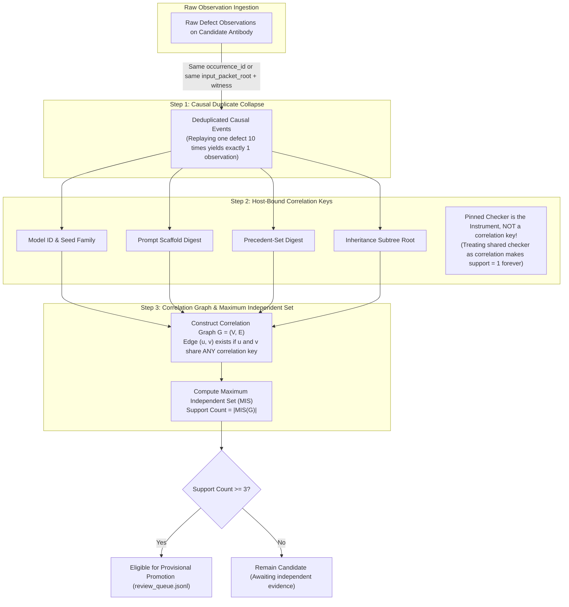

# EIS Level 05: Independent Observation Support Policy: Maximum Independent Sets

**AuthorityEffect:** None.  
**Level:** Level 05 (Causal Observation Deduplication & Correlation Graph Independence)  
**Python Admission Seam:** [`omega_engine_epistemic_immune_system.domain.external_admission`](../../../../omega_engine_epistemic_immune_system/domain/external_admission.py)  
**Primary Policy:** `ObservationSupportPolicyV1`  
**Core Falsifiers:** `F-SUPPORT-01`, `F-SUPPORT-02`, `F-SUPPORT-03`, `F-SUPPORT-04`

---

## 1. Schematic & Conceptual Architecture



When autonomous multi-agent swarms execute thousands of concurrent trials, a single bug in a shared prompt template or model checkpoint can generate hundreds of duplicate failure reports. If an epistemic immune system simply counts raw frequency, a flurry of correlated reports would trigger premature antibody promotion. Conversely, if two observations are deemed "correlated" simply because they were evaluated by the same verification checker, independent occurrences could never accumulate support.

Level 05 establishes **`ObservationSupportPolicyV1`**:
- A three-step algorithm for measuring genuine evidential support.
- Causal deduplication collapses replays of the same event.
- Four host-bound correlation keys build an unweighted correlation graph.
- Support is defined as the size of the **Maximum Independent Set** of the correlation graph, requiring at least 3 mutually independent observations.

---

## 2. Invariants & Mathematical Packaging

1. **Step 1: Causal Duplicate Collapse:**
   Two observations $O_1, O_2$ represent the same causal event if they share either:
   - The same `occurrence_id`, or
   - The same `input_packet_root` and the same `witness_receipt_digest`.

   Replaying the same defect 10 times yields exactly **one** deduplicated observation.
2. **Step 2: Host-Bound Correlation Keys:**
   Correlation keys are derived by the host directly from sealed receipts, never from user-supplied strings:
   - $k_{\text{model}}$: Generating model ID and seed family.
   - $k_{\text{scaffold}}$: Prompt scaffold digest from the stage-1 packet.
   - $k_{\text{precedent}}$: Precedent-set digest from `PrecedentMatchReceiptV1`.
   - $k_{\text{tree}}$: Inheritance subtree root from the lineage ledger.

   Two distinct observations $u, v$ are correlated if and only if:
   $$\operatorname{Correlated}(u, v) \iff \exists i \in \{\text{model}, \text{scaffold}, \text{precedent}, \text{tree}\} \text{ s.t. } k_i(u) = k_i(v)$$
3. **The Checker-as-Instrument Rule:**
   The pinned verification checker is the **instrument of observation**, not a correlation key. Checkers and test fixtures are intentionally frozen across experiments to ensure comparability; treating a shared checker as correlation would render support $\le 1$ permanently.
4. **Step 3: Maximum Independent Set Formulation (`F-SUPPORT-01`):**
   Given the graph $G = (\mathcal{V}, \mathcal{E})$ where edges denote correlation:
   $$\text{Support}(G) = \max \{|\mathcal{S}| \mid \mathcal{S} \subseteq \mathcal{V}, \forall u, v \in \mathcal{S}, (u, v) \notin \mathcal{E}\}$$
   - **Monotonicity:** Adding an observation never decreases support (avoiding the failure mode of connected-component clustering where an intermediate observation merges independent clusters).
   - **Non-Transitivity:** If $A$ correlates with $B$, and $B$ correlates with $C$, but $A$ and $C$ share no keys, the support is **2** ($\{A, C\}$).
   - **Budget Fence:** Exact MIS is computed for $n \le 32$; exceeding 32 deduplicated observations returns `SUPPORT_BUDGET_EXHAUSTED`.
5. **Promotion Threshold:**
   Provisional promotion requires:
   $$\text{Support}(G) \ge 3$$

---

## 3. Python Domain Seam

```python
# omega_engine_epistemic_immune_system.domain.external_admission
class ObservationSupportPolicyV1:
    def compute_support(self, observations: List[DefectObservationV1]) -> int:
        # Step 1: Duplicate collapse
        unique_events = self._collapse_duplicates(observations)
        if len(unique_events) > 32:
            raise SupportBudgetExhaustedError("Observation count exceeds n=32 budget")
            
        # Step 2: Build correlation adjacency
        adj = {i: set() for i in range(len(unique_events))}
        for i in range(len(unique_events)):
            for j in range(i + 1, len(unique_events)):
                if self._share_correlation_key(unique_events[i], unique_events[j]):
                    adj[i].add(j)
                    adj[j].add(i)
                    
        # Step 3: Exact Maximum Independent Set
        return self._exact_max_independent_set(adj)
```

---

## 4. Verification Obligations & Falsifiers

- **`F-SUPPORT-01` (Non-Transitive MIS Counting):** Given three observations $A, B, C$ where $A$ shares a model with $B$, and $B$ shares a scaffold with $C$, but $A$ and $C$ share no keys, the engine must return `support = 2` (set $\{A, C\}$), rejecting `support = 1`.
- **`F-SUPPORT-02` (Monotonicity Invariant):** Introducing a new observation $D$ to an existing graph with support $k$ must yield support $k' \ge k$.
- **`F-SUPPORT-03` (Feasibility Obligation):** A positive test fixture must prove that support 3 is reachable honestly under the default policy: three defect occurrences on distinct input roots, from two model IDs and three scaffolds, in distinct inheritance subtrees, evaluated by one pinned checker.
- **`F-SUPPORT-04` (Replay Invariance):** Ingesting 100 replays of the identical occurrence must return `support = 1`.

---

## 5. Claim Hygiene Quadrant

1. **What this supports:**
   - Mathematically principled calculation of evidential independence across distributed multi-agent failure logs.
   - Robust defense against sybil-driven or replay-driven antibody promotions.
2. **What this does not support:**
   - Does not guarantee that three uncorrelated observations represent an absolute truth invariant of the underlying language model.
3. **The narrowest defensible claim:**
   - Maximum independent set analysis over host-bound correlation keys guarantees that candidate antibodies achieve provisional status only after reproducing across at least three mutually uncorrelated execution contexts.
4. **The next test needed:**
   - Stress test evaluating MIS computation performance and memory allocation on dense random correlation graphs up to $n = 32$.
