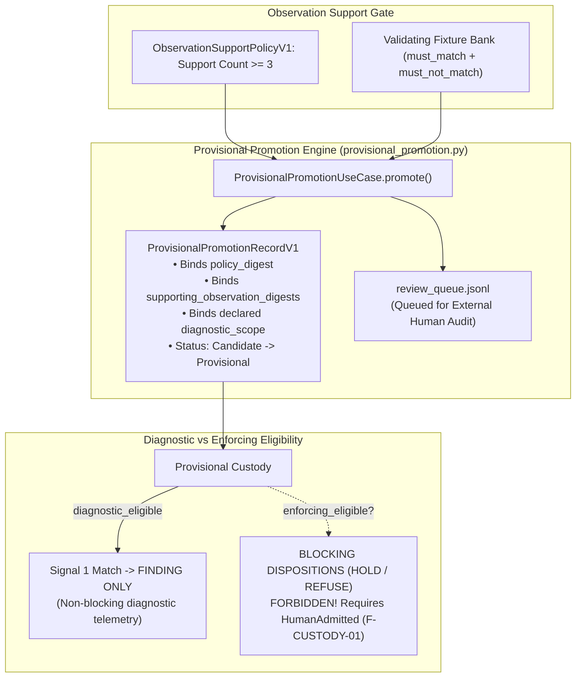

# EIS Level 06: Provisional Custody & Review Queue: Diagnostic Bridging

**AuthorityEffect:** None.  
**Level:** Level 06 (Provisional Bridging, Diagnostic Scope & Human Queue Fencing)  
**Python Use Case Seam:** [`omega_engine_epistemic_immune_system.use_cases.provisional_promotion`](../../../../omega_engine_epistemic_immune_system/use_cases/provisional_promotion.py)  
**Primary Artifacts:** `review_queue.jsonl`, `ProvisionalPromotionRecordV1`  
**Core Falsifiers:** `F-CUSTODY-01`, `F-SCOPE-01`

---

## 1. Schematic & Conceptual Architecture



An acute tension in epistemic governance is between **safety** (refusing to let autonomous systems self-authorize blocking guards) and **velocity** (gathering live empirical telemetry on promising candidate detectors before a human reviews them). If candidate detectors remain completely inert until a human signs an admission decision, researchers receive zero live telemetry. Conversely, if candidate detectors can autonomously block pipelines upon reaching a support threshold, they violate human-in-the-loop governance invariants (`IMMUNE-001`, `IMMUNE-002`).

Level 06 establishes the **Provisional Custody Bridge**:
- Reaching support $\ge 3$ under `ObservationSupportPolicyV1` transitions an antibody from `Candidate` to `Provisional`.
- The promotion appends a review request to `review_queue.jsonl`.
- Provisional antibodies are **diagnostically eligible**: they can arm Signal-1 detectors within their declared `diagnostic_scope`, emitting non-blocking `FINDING` telemetry.
- Provisional antibodies are **enforcing ineligible**: they can **never** emit `HOLD` or `REFUSE` dispositions, and they **never** write `ACTIVE` or grant operational admission authority.

---

## 2. Invariants & Mathematical Packaging

1. **The Diagnostic Eligibility Predicate:**
   $$\operatorname{diagnostic\_eligible}(ref, \text{target}) \iff \begin{aligned} & \operatorname{custody}(ref) \in \{\text{Provisional}, \text{HumanAdmitted}\} \\ \land & \text{target} \in \operatorname{diagnostic\_scope}(ref) \\ \land & \operatorname{is\_current}(ref) \quad (\neg \operatorname{Suspended} \land \neg \operatorname{Revoked}) \end{aligned}$$
   Evaluating $\operatorname{diagnostic\_eligible} = \text{true}$ licenses the emission of disposition `FINDING` **only**.
2. **The Enforcing Ineligibility Invariant (`F-CUSTODY-01`):**
   Blocking dispositions require the strict enforcing predicate:
   $$\operatorname{enforcing\_eligible}(ref, \text{target}, \dots) \iff \operatorname{custody}(ref) = \text{HumanAdmitted} \land \dots$$
   Under no circumstances can `custody = Provisional` satisfy $\operatorname{enforcing\_eligible}$. Any attempt by a provisional detector to halt execution or emit `REFUSE` is blocked by runtime assertion.
3. **Immutable Promotion Record:**
   [`ProvisionalPromotionRecordV1`](../../../../omega_engine_epistemic_immune_system/use_cases/provisional_promotion.py) binds:
   - `policy_digest`: Hash of the governing `ObservationSupportPolicyV1`.
   - `supporting_observations`: Hashes of the $\ge 3$ uncorrelated witness receipts.
   - `diagnostic_scope`: Explicit package or domain identifier where diagnostic telemetry is authorized.
   - `authority_effect: "None"`.
4. **Refusal of Placeholder Classes:**
   Candidate antibodies carrying placeholder defect names (such as `defect:defect:N`) or the three permanently retired parser-bug IDs (`ab_syntax_error_*`) are refused during provisional promotion with `INVALID_DEFECT_SPECIFICATION`.

---

## 3. Python Use Case Seam

```python
# omega_engine_epistemic_immune_system.use_cases.provisional_promotion
class ProvisionalPromotionUseCase:
    def promote_candidate(
        self,
        candidate: CandidateAntibodyV1,
        observations: List[DefectObservationV1],
        policy: ObservationSupportPolicyV1,
        diagnostic_scope: str,
    ) -> ProvisionalPromotionReceiptV1:
        support = policy.compute_support(observations)
        if support < 3:
            raise InsufficientSupportError(f"Required support >= 3, got {support}")
            
        if candidate.is_placeholder_defect:
            raise PlaceholderDefectError("Cannot promote placeholder defect class")
            
        receipt = ProvisionalPromotionReceiptV1(
            antibody_id=candidate.antibody_id,
            previous_custody="Candidate",
            new_custody="Provisional",
            diagnostic_scope=diagnostic_scope,
            support_count=support,
            policy_digest=policy.digest,
            authority_effect="None",
        )
        
        self.queue_human_review(candidate.antibody_id, receipt)
        return receipt
```

---

## 4. Verification Obligations & Falsifiers

- **`F-CUSTODY-01` (Provisional Non-Enforcement Invariant):** In an execution bout matching a `Provisional` antibody that also triggers an independent danger signal, the danger gate must emit `FINDING` and allow execution to proceed, asserting that `REFUSE` is not returned.
- **`IMMUNE-001` Falsifier Preservation:** Running automated provisional promotion across 1,000 observations must assert that the string `"ACTIVE"` and the status `HumanAdmitted` are never written to any database or manifest file.
- **Queue Insertion Check:** Successfully promoting a candidate to `Provisional` must append a verifiable JSON line to `_intelligence/prompt_civ/review_queue.jsonl`.

---

## 5. Claim Hygiene Quadrant

1. **What this supports:**
   - Safe collection of real-world diagnostic telemetry for promising candidate detectors without risking operational disruption.
   - Clear architectural decoupling of automated diagnostic staging from external human admission.
2. **What this does not support:**
   - Does not establish that candidate antibodies in the review queue will be approved by human administrators.
3. **The narrowest defensible claim:**
   - Provisional custody guarantees that detectors possessing $\ge 3$ uncorrelated observations may collect diagnostic finding telemetry within declared scopes without acquiring execution-blocking authority.
4. **The next test needed:**
   - End-to-end integration test verifying that a provisional detector's finding appears in bout telemetry while preserving green CI run status.
