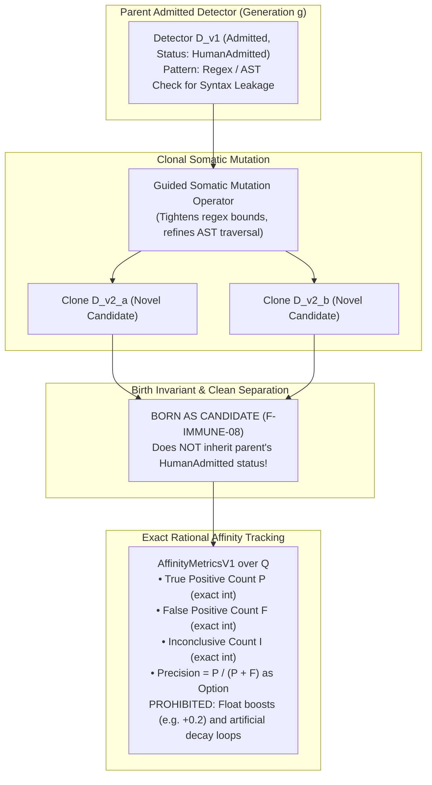

# EIS Level 07: Clonal Selection & Affinity Maturation: Versioned Detector Evolution

**AuthorityEffect:** None.  
**Level:** Level 07 (Somatic Hypermutation of Detectors & Exact Rational Affinity)  
**Python Clonal Seam:** [`eis.domain.clonal_selection`](../../../../eis/domain/clonal_selection.py)  
**Primary Types:** `ClonalSelectionEngine`, `DetectorCloneV1`, `AffinityMetricsV1`  
**Core Falsifiers:** `F-IMMUNE-08`

---

## 1. Schematic & Conceptual Architecture



In biological immunology, *clonal selection and affinity maturation* describes how B-cells responding to an infection undergo somatic hypermutation. Variants whose surface antibodies bind the target pathogen with higher affinity are selected for proliferation, progressively refining immune specificity.

In OEEIS, Level 07 establishes **Clonal Selection for Epistemic Detectors**:
- As software architectures evolve, existing detector patterns may become slightly imprecise or miss subtle permutations of a known vulnerability.
- Specialized mutation operators clone existing detectors to sharpen their boundary conditions (e.g. refining a regex lookahead or tightening an AST node query).
- **The Clonal Birth Invariant:** Every mutated detector is born as an un-admitted [`Candidate`](../../../../eis/domain/clonal_selection.py); it never inherits the parent's admission status.
- **Exact Rational Affinity:** Specificity and sensitivity are tracked as exact integer counts and rational fractions over $\mathbb{Q}$, completely barring arbitrary floating-point affinity scores.

---

## 2. Invariants & Mathematical Packaging

1. **The Clonal Birth Invariant (`F-IMMUNE-08`):**
   When an admitted detector $D_{\text{parent}}$ is mutated into $D_{\text{clone}}$:
   $$\operatorname{custody}(D_{\text{clone}}) = \text{CustodyTier::Candidate}$$
   The clone does **not** inherit operational enforcement authority. It must pass:
   1. The Thymus self-panel gate (central tolerance).
   2. The `ObservationSupportPolicyV1` threshold ($\text{Support} \ge 3$).
   3. External human review and admission.
2. **Exact Rational Affinity Dimensions:**
   Detector telemetry is tracked via exact integer counts:
   - $P \in \mathbb{N}$: True positive matches confirmed by host oracle.
   - $F \in \mathbb{N}$: False positive matches flagged as benign.
   - $N \in \mathbb{N}$: Negative non-matches.
   - $I \in \mathbb{N}$: Inconclusive evaluations.

   From these integer counts, the precision affinity is derived strictly over $\mathbb{Q}$:
   $$\text{precision} = \begin{cases} \text{Some}\left(\frac{P}{P + F}\right) & \text{if } P + F > 0 \\ \text{None} & \text{if } P + F = 0 \end{cases}$$
3. **Prohibition of Float Affinity Boosts:**
   Heuristic scoring hacks common in traditional AI systems (such as `affinity += 0.2` on positive match or geometric floating-point decay `affinity *= 0.95`) are barred from OEEIS. A zero denominator is undefined, never coerced to an artificial float.
4. **External Epoch Decay:**
   Detectors do not experience dynamic real-time evaporation. Decay, suspension, and retirement are evaluated exclusively at discrete, external epoch boundaries governed by regulatory controllers.

---

## 3. Python Domain Seam

```python
# eis.domain.clonal_selection
@dataclass(frozen=True)
class AffinityMetricsV1:
    true_positives: int
    false_positives: int
    inconclusive: int
    
    @property
    def precision(self) -> Optional[Fraction]:
        total = self.true_positives + self.false_positives
        if total == 0:
            return None
        return Fraction(self.true_positives, total)

class ClonalSelectionEngine:
    def mutate_detector(
        self,
        parent: AdmittedDetectorV1,
        mutation_diff: str,
    ) -> CandidateDetectorV1:
        # Clone is ALWAYS born as a Candidate
        return CandidateDetectorV1(
            detector_id=mint_detector_id(parent.id, mutation_diff),
            parent_id=parent.id,
            pattern=apply_diff(parent.pattern, mutation_diff),
            custody="Candidate",
            authority_effect="None",
        )
```

---

## 4. Verification Obligations & Falsifiers

- **`F-IMMUNE-08` (Clone Custody Purity):** Mutating an admitted detector whose status is `HumanAdmitted` must instantiate the resulting child detector with status `Candidate` and `is_admitted = False`. Any child inheriting `HumanAdmitted` directly from its parent fails this test.
- **Float Firewall:** Inspecting `AffinityMetricsV1` in memory must assert that all internal fields are Python `int` or `fractions.Fraction`, with zero `float` instances.

---

## 5. Claim Hygiene Quadrant

1. **What this supports:**
   - Controlled evolutionary refinement of security detectors without authority leakage.
   - Exact mathematical accounting of true and false positives without heuristic floating-point drift.
2. **What this does not support:**
   - Does not establish that somatic mutation will converge on an optimal detector for arbitrary semantic flaws.
3. **The narrowest defensible claim:**
   - Clonal mutation guarantees that all refined detector variants are quarantined in Candidate custody until independently verified by central tolerance and external admission records.
4. **The next test needed:**
   - Automated mutation benchmark testing whether guided regex mutation can narrow a loose pattern to eliminate false positives on a held-out test suite.
