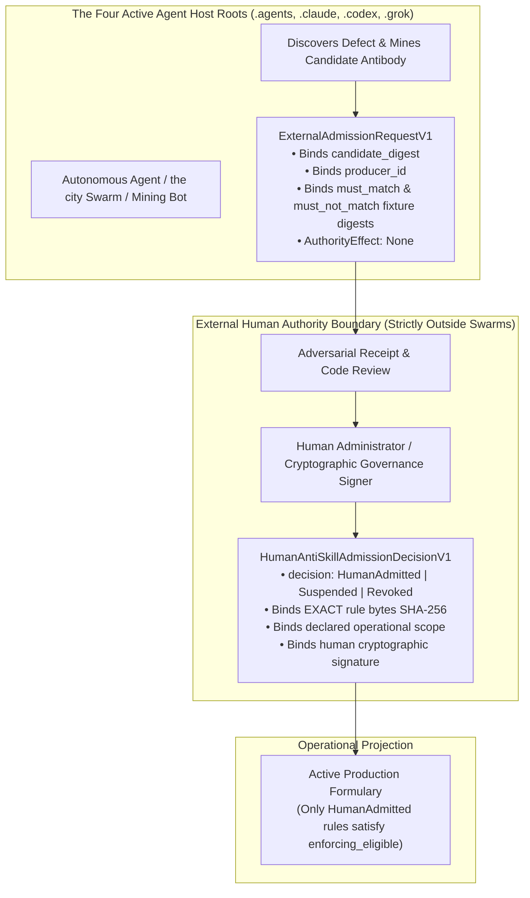

# EIS Level 09: External Human Admission Boundary: Authority Isolation

**AuthorityEffect:** None.  
**Level:** Level 09 (External Human Ratification, Exact Rule Binding & Anti-Phantom Fences)  
**Python Admission Seam:** [`omega_engine_epistemic_immune_system.domain.external_admission`](../../../../omega_engine_epistemic_immune_system/domain/external_admission.py)  
**Primary Types:** `HumanAntiSkillAdmissionDecisionV1`, `ExternalAdmissionRequestV1`  
**Core Falsifiers:** `F-CUSTODY-02`, `F-IMMUNE-03`, `F-IMMUNE-04`

---

## 1. Schematic & Conceptual Architecture



A core constitutional invariant of the Symbol Game repository is that **autonomous AI agents and LLM swarms possess zero authority to promote rules into operational enforcement**. If an agent could discover a bug, generate a detector, test it, and promote it to `Admitted`, the entire security and mathematical verification perimeter could be subverted by a compromised or hallucinating model.

Level 09 establishes the **External Human Admission Boundary**:
- Autonomous agents can mine, propose, and evaluate candidates, packaging them into [`ExternalAdmissionRequestV1`](../../../../omega_engine_epistemic_immune_system/domain/external_admission.py).
- Operational admission authority exists strictly **outside** the four agent host roots.
- An admission decision is an authenticated, external human transaction ([`HumanAntiSkillAdmissionDecisionV1`](../../../../omega_engine_epistemic_immune_system/domain/external_admission.py)) bound immutably to the exact byte-level hash of the detector rule and its declared scope.
- Reusing an admission decision against modified rule bytes is rejected with `F-CUSTODY-02`.

---

## 2. Invariants & Mathematical Packaging

1. **The External Admission Request Envelope:**
   Any request submitted by an autonomous swarm to the admission queue must bind:
   $$\text{req} = (\text{candidate\_digest}, \text{producer\_id}, \text{source\_manifest\_digest}, \text{must\_match\_digest}, \text{must\_not\_match\_digest})$$
   A request missing any field is rejected with `INCOMPLETE_ADMISSION_REQUEST`.
2. **Immutable Rule Byte Binding (`F-CUSTODY-02`):**
   A human admission decision binds the exact SHA-256 digest of the detector's implementation bytes:
   $$\text{decision} = (\text{decision\_id}, \operatorname{SHA256}(\text{rule\_bytes}), \text{admitted\_scope}, \text{human\_signer\_id})$$
   If the implementation code or regex pattern of an admitted detector is modified by even a single byte:
   $$\operatorname{SHA256}(\text{new\_rule\_bytes}) \neq \text{decision.rule\_digest} \implies \text{Refuse}(\text{ADMISSION\_DIGEST\_MISMATCH})$$
   The modified detector reverts instantly to `Candidate` custody.
3. **Unified Provenance Digest (`F-IMMUNE-03`):**
   Legacy implementations hashed arbitrary metadata strings (`defect_str:run_id:task_id`). OEEIS eliminates string concatenation hashing in favor of a canonical provenance digest binding canonical detector bytes, fixture bytes, scope, and implementation bytes into `evidence_sha256`.
4. **Permanent Retirement of Parser-Bug Phantom Defects:**
   Three historical phantom defect IDs created by legacy parser bugs are permanently retired and barred from admission across all seeders:
   - `ab_syntax_error_e033d14a`
   - `ab_syntax_error_4cb62bc5`
   - `ab_syntax_error_bb7045c0`
   Any admission request matching these hashes is rejected with `PHANTOM_DEFECT_PERMANENTLY_RETIRED`.

---

## 3. Python Domain Seam

```python
# omega_engine_epistemic_immune_system.domain.external_admission
@dataclass(frozen=True)
class HumanAntiSkillAdmissionDecisionV1:
    decision_id: str
    rule_id: str
    exact_rule_sha256: str
    admitted_scope: str
    status: str # "HumanAdmitted", "Suspended", "Revoked"
    signer_public_key: str
    signature: str
    authority_effect: str = "None" # Document provenance only

class ExternalAdmissionGateway:
    def verify_and_apply_decision(
        self,
        rule_bytes: bytes,
        decision: HumanAntiSkillAdmissionDecisionV1,
    ) -> bool:
        computed_sha256 = hashlib.sha256(rule_bytes).hexdigest()
        if computed_sha256 != decision.exact_rule_sha256:
            raise AdmissionDigestMismatchError(
                f"Rule bytes modified! Expected {decision.exact_rule_sha256}, got {computed_sha256}"
            )
        return True
```

---

## 4. Verification Obligations & Falsifiers

- **`F-CUSTODY-02` (Rule Modification Reversion):** Taking an admitted detector, modifying one character in its regex pattern, and attempting to execute it under its parent's `decision_id` must fail with `ADMISSION_DIGEST_MISMATCH` and strip operational enforcement authority.
- **`F-IMMUNE-03` (Canonical Digest Purity):** Verifying that all newly registered antibodies derive `evidence_sha256` from pure binary packet serialization rather than arbitrary colon-delimited string representations.
- **Phantom Defect Rejection Check:** Attempting to submit `ab_syntax_error_e033d14a` to the admission gateway must raise `PhantomDefectRetiredError`.

---

## 5. Claim Hygiene Quadrant

1. **What this supports:**
   - Absolute cryptographic fencing preventing autonomous LLM agents from self-granting production enforcement authority.
   - Byte-level binding ensuring that admitted rules cannot be silently modified in place.
2. **What this does not support:**
   - Does not establish that human reviewers will catch all potential flaws in complex rule implementations.
3. **The narrowest defensible claim:**
   - Cryptographic verification guarantees that only detectors whose byte-level hash matches an authenticated external human admission decision can satisfy the `externally_admitted` predicate required for operational enforcement.
4. **The next test needed:**
   - Cryptographic verification test asserting that forged signatures or mismatched public keys are rejected by the admission gateway.
