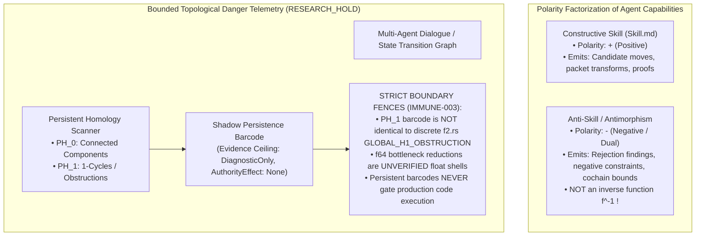

# EIS Level 10: Antimorphism Polarity & Bounded Telemetry Fences

**AuthorityEffect:** None.  
**Level:** Level 10 (Opposite Polarity Algebra, Persistent Homology & Research Holds)  
**Rust Anti-Skill Seam:** [`omega_epistemic_immune_system::anti_skill`](../../../../omega_engine/crates_rs/omega_epistemic_immune_system/src/anti_skill.rs)  
**Research Status Reference:** `SPEC-OE-IMMUNE-003` (`RESEARCH_HOLD`)  
**Primary Invariant:** Polarity Factorization & Telemetry Ceiling

---

## 1. Schematic & Conceptual Architecture



In category theory and algebraic topology, operations carry specific orientations and polarities. A common misconception in agent engineering is treating an "anti-skill" as an inverse function ($f^{-1}$) that undoes a skill's action.

Level 10 establishes the **Antimorphism Polarity Principle** and defines the **Topological Telemetry Boundary Fences**:
1. **Opposite Polarity Algebra:** An anti-skill is an algebraic operator of opposite polarity. While constructive skills synthesize candidate structures, antimorphisms synthesize negative constraints, invariant boundaries, and obstruction witnesses.
2. **Persistent Homology Telemetry on `RESEARCH_HOLD`:** Exploratory topological telemetry evaluating whether persistent homology ($\text{PH}_0$ components and $\text{PH}_1$ cycles) over dialogue graphs can inform human review is held strictly at `DiagnosticOnly` with zero enforcement authority.

---

## 2. Invariants & Mathematical Packaging

1. **Polarity Factorization:**
   Let $\mathcal{C}$ be the category of candidate states and moves.
   - A constructive skill morphism $s: A \to B$ maps an input state to a candidate realization.
   - An antimorphism $a: B \to \Omega$ maps a candidate state to an epistemic truth-value space $\Omega = \{\text{Admissible}, \text{Obstructed}(\Phi_1, \Gamma_2), \text{Refused}\}$.
   - Antimorphisms factorize constraints negatively: they prune the space of admissible paths without performing in-line state recovery.
2. **Bounded Topological Telemetry Fences (`IMMUNE-003`):**
   Topological telemetry is evaluated under an explicit, permanent `RESEARCH_HOLD`:
   - **Evidence Ceiling:** All emitted telemetry records carry `evidence_ceiling = DiagnosticOnly` and `authority_effect = "None"`.
   - **Non-Equivalence Law:** A persistent $\text{PH}_1$ cycle barcode over an embedding graph is an entirely different mathematical object from `GLOBAL_H1_OBSTRUCTION` (which is an exact finite board obstruction in [`omega_symbol_game_runtime::f2`](../../../../omega_engine/crates_rs/omega_symbol_game_runtime/src/f2.rs)). Conflating the two is forbidden.
   - **Float Shell Firewall:** Any floating-point (`f64`) reduction in `persistent_homology.rs` or `bottleneck_distance.rs` is recognized as an unverified float approximation, barred from serving as an authoritative proof certificate.
   - **Higher Dimensions Barred:** Telemetry in dimensions $\ge \text{PH}_2$ is strictly excluded from implementation.
3. **No Automated Lockdown from Barcodes:**
   Topological barcodes are visual and diagnostic aids for human researchers. They **never** trigger automated pipeline halts, agent quarantine, or gate refusals.

---

## 3. Rust Engine Seam

```rust
// omega_epistemic_immune_system::anti_skill
pub enum AntiMorphismPolarity {
    NegativeConstraint,
    ObstructionWitness,
    RefusalBoundary,
}

pub struct AntiSkillSpecV1 {
    pub anti_skill_id: String,
    pub polarity: AntiMorphismPolarity,
    pub target_carrier: String,
    pub failure_class: String,
    pub authority_effect: AuthorityEffect, // None
}

// Bounded Diagnostic Telemetry (RESEARCH_HOLD)
pub struct DiagnosticHomologyBarcodeV1 {
    pub trace_id: String,
    pub ph0_components: usize,
    pub ph1_cycles: usize,
    pub evidence_ceiling: EvidenceCeiling, // DiagnosticOnly
    pub authority_effect: AuthorityEffect, // None
}
```

---

## 4. Verification Obligations & Falsifiers

- **Telemetry Ceiling Assertion:** Any module emitting `DiagnosticHomologyBarcodeV1` must be verified to contain `evidence_ceiling == EvidenceCeiling::DiagnosticOnly` and `authority_effect == "None"`.
- **Zero Gate Interception:** Inspecting runtime gate dispatchers must assert that no production gate (`WolandSevenActCircuit`, `TwoSignalDangerGate`, `WolandGate`) contains branch conditions evaluating persistent homology barcodes.

---

## 5. Claim Hygiene Quadrant

1. **What this supports:**
   - Formal mathematical formulation of anti-skills as typed negative constraints and obstruction operators.
   - Strict containment of speculative topological data analysis within research and diagnostic firewalls.
2. **What this does not support:**
   - Does not claim that persistent homology barcodes detect hallucinations or prove semantic alignment in LLMs.
3. **The narrowest defensible claim:**
   - Anti-skills provide formal algebraic duals to constructive skills, and persistent homology telemetry is strictly quarantined as non-authoritative diagnostic data.
4. **The next test needed:**
   - AST audit asserting that `omega_homology` is never imported by any operational decision controller.
