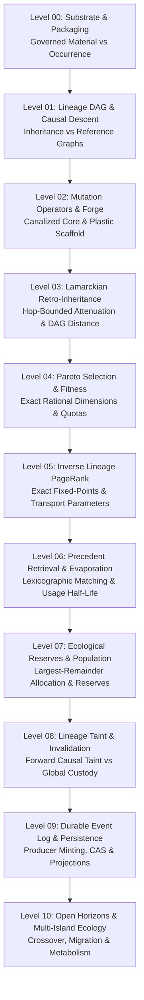

# Prompt Civilization & Lamarckian Evolution Levels Catalog: Level 00 to Level 10

**AuthorityEffect:** None.  
**System Domain:** Governed Prompt Evolution, Population Dynamics, and Lamarckian Trace Inheritance  
**Canonical Epic Planning Reference:** [`epic_claude_oeeis_oeprmptciv_plan.md`](../../../../omega_engine_product_planning_office/plans/epics/epic_claude_oeeis_oeprmptciv_plan.md)  
**Underlying Pure Rust Calculus Crate:** [`omega_prompt_civilization`](../../../../omega_engine/crates_rs/omega_prompt_civilization/src/lib.rs)  
**Total Progressive Levels:** 11 Levels ($N = 0 \dots 10$)

---

## 1. Architectural Architecture & Evidential Stratification

Prompt Civilization establishes a content-addressed, byte-preserving, and non-authoritative evolutionary arena for Large Language Model (LLM) prompts within the Symbol Game Proposal Fidelity Protocol (PFP). Rather than treating prompts as mutating natural-language strings with unmeasured fitness, the civilization models prompt search under strict algebraic invariants:

1. **Separation of Governed Material from Occurrence:** Prompt genomes ([`PromptGenomeV1`](../../../../omega_engine/crates_rs/omega_prompt_civilization/src/record.rs)) are immutable sidecars identified by domain-separated SHA-256 digests over governed prompt packets and protected boundary allocations. Re-executions of unchanged prompts create execution occurrences ([`ExecutionOccurrenceV1`](../../../../omega_engine/crates_rs/omega_prompt_civilization/src/record.rs)), never duplicate genomes.
2. **Two-Graph Separation:** Lineage is partitioned into an **Inheritance DAG** (recording causal `DirectMutation`, `Repair`, and `Retry` relationships) and a **Reference Graph** (recording `RetrievedPrecedent` citations). Reference citation edges never affect ancestral ranking or inherited immunity.
3. **Canalized Mutation Operators:** Mutation operators ([`MutationOperatorCandidateV1`](../../../../omega_engine/crates_rs/omega_prompt_civilization/src/forge.rs)) may edit only plastic bytes strictly outside protected boundary spans. System framings, type contracts, and claim-hygiene fences are canalized and immutable.
4. **Lamarckian Retro-Inheritance:** Learned phenotypic modifications—specifically typed antibody references derived from falsified executions—propagate forward to all descendants and backward across the inheritance DAG for at most 10 hops with $(1/2)^d$ attenuation, without horizon resetting.
5. **Exact Rational Multi-Objective Fitness:** Fitness dimensions are exact rationals over $\mathbb{Q}$ partitioned into non-dominated Pareto fronts. Honest contract refusals and identified obstructions ($\Phi_1 > 0$, $\Gamma_2 > 0$) are measured as compliance, not prompt failure.
6. **Inverse Lineage PageRank:** Ancestral precedent utility is solved via an exact fixed-point certificate over $\mathbb{Q}$ ([`omega.spectral.pagerank.v2`](../../../../omega_engine/crates_rs/omega_prompt_civilization/src/rank.rs)), allocating human inspection budget without minting operational authority.
7. **Ecological Reserves & Evaporation:** Working populations are allocated across disjoint reserve buckets (Front, Unmeasured, Baseline) via the largest-remainder method, preventing monoculture and competitive release. Precedent citations evaporate over epoch-based half-lives.
8. **Durable Append-Only Persistence:** Producer-minted UUIDv5 event identities and independent payload digests guarantee that replay from [`event_log.jsonl`](../../../../_intelligence/prompt_civ/events/event_log.jsonl) and Content-Addressed Storage (CAS) recovers identical state without duplicate provider calls.

---

## 2. Progressive Level Catalog

| Level | Document | Primary Focus | Key Invariant / Falsifier |
| :--- | :--- | :--- | :--- |
| **00** | [`level_00_substrate_and_packaging.md`](level_00_substrate_and_packaging.md) | Governed Prompt Material vs Occurrence | Re-execution creates occurrence, not genome (`F-GENOME-02`) |
| **01** | [`level_01_lineage_dag_and_causal_descent.md`](level_01_lineage_dag_and_causal_descent.md) | Inheritance DAG vs Reference Graph | Precedent edges do not alter ancestral rank (`F-LINEAGE-01`) |
| **02** | [`level_02_mutation_operators_and_forge.md`](level_02_mutation_operators_and_forge.md) | Canalized Core & Plastic Scaffold | Protected spans reject mutation (`F-BIO-03`, `F-PROMPT-03`) |
| **03** | [`level_03_lamarckian_retro_inheritance.md`](level_03_lamarckian_retro_inheritance.md) | Hop-Bounded Retro-Inheritance | Distance is edge hops; no relay reset (`F-IMMUNE-09..10`) |
| **04** | [`level_04_pareto_selection_and_fitness.md`](level_04_pareto_selection_and_fitness.md) | Exact Multi-Objective Pareto Selection | Exact $\mathbb{Q}$; obligation-bound certificates (`F-SELECT-01..03`) |
| **05** | [`level_05_inverse_lineage_pagerank.md`](level_05_inverse_lineage_pagerank.md) | Inverse PageRank on Inheritance DAG | Certified fixed-point over $\mathbb{Q}$; inspection-only (`F-RANK-01..03`) |
| **06** | [`level_06_precedent_retrieval_and_evaporation.md`](level_06_precedent_retrieval_and_evaporation.md) | Lexicographic Retrieval & Evaporation | Reuses age individually; no mass rejuvenation (`F-BIO-04`) |
| **07** | [`level_07_ecological_reserves_and_population.md`](level_07_ecological_reserves_and_population.md) | Population Policy & Ecological Reserves | Largest-remainder 3/5, 1/4, 3/20 disjoint allocation (`F-BIO-05`) |
| **08** | [`level_08_lineage_taint_and_custody_invalidation.md`](level_08_lineage_taint_and_custody_invalidation.md) | Lineage Taint vs Custody Invalidation | Global rule disarming vs causal forward taint (`F-RES-07..11`) |
| **09** | [`level_09_durable_event_log_and_persistence.md`](level_09_durable_event_log_and_persistence.md) | Durable Event Log & CAS Persistence | Producer-minted ID; crash replay zero calls (`F-EVT-01..05`) |
| **10** | [`level_10_open_horizons_and_multi_island_ecology.md`](level_10_open_horizons_and_multi_island_ecology.md) | Multi-Island Ecology & Open Frontiers | Crossover immunity conflict; metabolism boundaries (`v0.2`) |

---

## 3. Epistemic Posture

Every level document in this catalog adheres strictly to repository claim discipline:
- **`AuthorityEffect: None`** is bound into every metadata header and runtime receipt.
- High-level biological analogies (Lamarckism, adaptive therapy reserves, pheromone evaporation) are explicitly tagged as **heuristics and engineering policies**, not formal biological or mathematical proofs.
- All ranking, fitness, and retrieval computations allocate machine exploration and human review quotas; they **never** auto-admit candidates, authorize tool executions, or mint proof verdicts.
