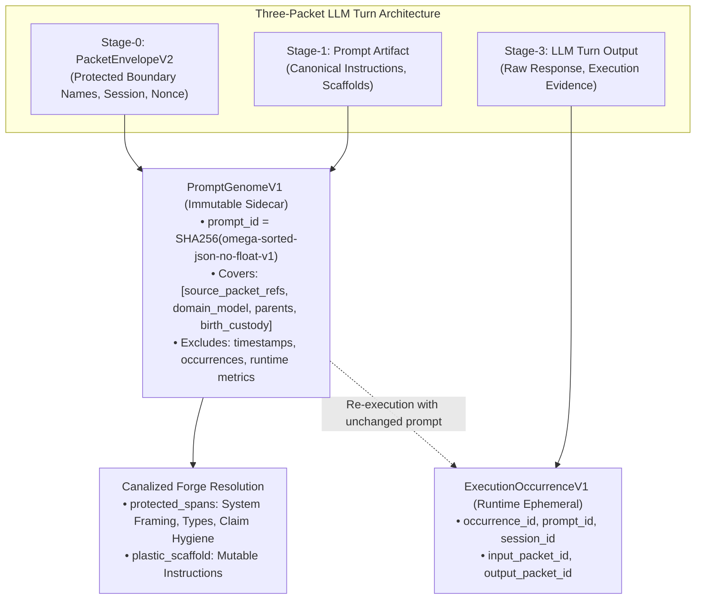

# Prompt Civ Level 00: Substrate & Packaging: Governed Material vs Occurrence

**AuthorityEffect:** None.  
**Level:** Level 00 (Prompt Carrier Genesis & Boundary Canalization)  
**Rust Record Seam:** [`omega_prompt_civilization::record`](../../../../omega_engine/crates_rs/omega_prompt_civilization/src/record.rs)  
**Primary Types:** `PromptGenomeV1`, `ExecutionOccurrenceV1`, `PromptCustodyEventV1`, `PromptViewV1`  
**Core Falsifiers:** `F-GENOME-01`, `F-GENOME-02`, `F-GENOME-03`

---

## 1. Schematic & Conceptual Architecture



In naive prompt evolution systems, every model completion or conversational turn is treated as a new prompt string, causing identity explosion and erasing causal provenance. Level 00 establishes the foundational distinction between **governed prompt material** and **execution occurrences**:

- **Governed Prompt Material:** The canonical text, structural schemas, boundary directives, and parent links that define the prompt. These are packaged into an immutable [`PromptGenomeV1`](../../../../omega_engine/crates_rs/omega_prompt_civilization/src/record.rs).
- **Execution Occurrence:** An execution instance of an existing genome against an input state ([`ExecutionOccurrenceV1`](../../../../omega_engine/crates_rs/omega_prompt_civilization/src/record.rs)). Executing an unchanged prompt 1,000 times generates 1,000 occurrences, but exactly **one** genome.

---

## 2. Invariants & Mathematical Packaging

1. **Genome Identity Envelope:**
   The `prompt_id` is computed as a domain-separated SHA-256 hash using the canonical profile `omega-sorted-json-no-float-v1`:
   $$\text{prompt\_id} = \operatorname{SHA256}(\operatorname{canonical\_json}([\text{source\_packet\_refs}, \text{domain\_model}, \text{parents}, \text{birth\_custody}]))$$
   - Deliberately excludes timestamps, current custody, execution metrics, and child references.
   - Child IDs are derived from the edge ledger, never stored inside the parent genome.
2. **Canalized Core and Plastic Scaffold:**
   The source packet envelope declares `protected_boundaries` (e.g. system framing, type signatures, claim-hygiene fences, and `AuthorityEffect: None` declarations).
   - The runtime re-derives `protected_spans: Vec<SpanDigestV1>` from [`BoundaryResolutionPolicyV1`](../../../../omega_engine/crates_rs/omega_prompt_civilization/src/record.rs) and the prompt bytes.
   - Any mutation operator attempting to modify bytes within a protected span is rejected with `PROTECTED_SPAN_MUTATION_REFUSED`.
3. **Re-derived Fields:**
   `generation` and `protected_spans` sit outside the identity digest tuple. They are deterministically re-derived by checked constructors:
   $$\text{generation} = \begin{cases} 0 & \text{if root} \\ 1 + \max_{p \in \text{parents}}(\text{generation}(p)) & \text{otherwise} \end{cases}$$
   Disagreement between supplied and recomputed fields raises `DERIVED_FIELD_MISMATCH`.

---

## 3. Rust Engine Seam

```rust
// omega_prompt_civilization::record
pub struct PromptGenomeV1 {
    pub prompt_id: PromptId,
    pub source_packet_refs: Vec<PacketRefV1>,
    pub domain_model: DomainModelV1,
    pub parents: Vec<ParentLinkV1>,
    pub generation: u64,
    pub protected_spans: Vec<SpanDigestV1>,
    pub birth_custody: CustodyTier, // Wild by construction
    pub authority_effect: AuthorityEffect, // None
}

pub struct ExecutionOccurrenceV1 {
    pub occurrence_id: OccurrenceId,
    pub prompt_id: PromptId,
    pub session_id: SessionId,
    pub input_packet_id: PacketId,
    pub output_packet_id: PacketId,
}
```

---

## 4. Verification Obligations & Falsifiers

- **`F-GENOME-01` (Ledger View Independence):** Modifying a prompt's custody status, retrieval eligibility, or armed repertoire must leave its underlying `PromptGenomeV1` bytes and `prompt_id` byte-identical.
- **`F-GENOME-02` (Occurrence Invariant):** Submitting multiple completions for the identical prompt material must append new `ExecutionOccurrenceV1` records without creating duplicate `PromptGenomeV1` entries.
- **`F-GENOME-03` (Derived Field Honesty):** Supplying a forged `generation` (e.g. `generation = 0` when witnessed parents exist) must fail construction with `DERIVED_FIELD_MISMATCH`.

---

## 5. Claim Hygiene Quadrant

1. **What this supports:**
   - Cryptographic immutability and byte-level identity deduplication for LLM prompt genomes.
   - Strict separation between static prompt definitions and dynamic execution telemetry.
2. **What this does not support:**
   - Does not guarantee that prompts with identical `prompt_id` produce deterministic outputs from stochastic providers.
3. **The narrowest defensible claim:**
   - Content-addressed genome hashing ensures that changes to prompt material always yield distinct identity digests, and repeated executions of identical prompt material cannot fragment the population lineage.
4. **The next test needed:**
   - Property test asserting that arbitrary permutations of non-identity metadata do not alter `prompt_id`.
