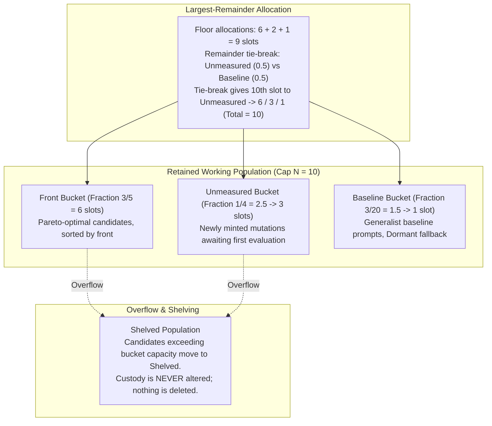

# Prompt Civ Level 07: Ecological Reserves & Population: Largest-Remainder Allocation

**AuthorityEffect:** None.  
**Level:** Level 07 (Working Population Caps & Diversity Preservation)  
**Rust Forge Seam:** [`core_prompt_civilization::forge`](../../../../engine/crates_rs/core_prompt_civilization/src/forge.rs)  
**Primary Policy:** `PopulationPolicyV1`  
**Core Falsifiers:** `F-BIO-05`

---

## 1. Schematic & Conceptual Architecture



In evolutionary search, maintaining an unconstrained population leads to memory exhaustion, while pruning based strictly on fitness leads to **competitive release**—a biological phenomenon observed in oncology and ecology (Gatenby et al. 2009) where aggressively killing off sensitive variants allows a single specialized variant to dominate, creating a fragile monoculture that collapses under distribution shifts.

Level 07 establishes the **Ecological Reserve Architecture**:
- The retained working population (both `Active` and `Dormant` prompts) is capped at a fixed capacity $N$.
- The capacity is partitioned across three disjoint functional buckets:
  1. **Front Bucket ($3/5$):** Top-performing candidates from non-dominated Pareto fronts.
  2. **Unmeasured Bucket ($1/4$):** Novel mutations awaiting initial evaluation.
  3. **Baseline Bucket ($3/20$):** Canonical generalist reference prompts maintained as `Dormant` fallbacks.
- Capacity is divided among the buckets using the **largest-remainder integer allocation method**, guaranteeing exact capacity sums without over-allocation.

---

## 2. Invariants & Mathematical Packaging

1. **Disjoint Bucket Precedence:**
   Every prompt in the retained population belongs to exactly one bucket, evaluated in strict order:
   1. `Unmeasured`: Maturity is `Unmeasured`. Retrieval is `Active` (subject to exploration quotas).
   2. `Baseline`: Declared generalist baselines. Retrieval is `Dormant` (fallback only).
   3. `Front`: All other prompts, ordered by Pareto front $\mathcal{F}_k$, then lexicographic order. Retrieval is `Active`.
2. **Largest-Remainder Integer Allocation (`F-BIO-05`):**
   For declared rational fractions $f_{\text{front}} = \frac{3}{5}$, $f_{\text{unmeasured}} = \frac{1}{4}$, $f_{\text{baseline}} = \frac{3}{20}$, and total integer cap $N$:
   - Initial integer allocation: $s_i = \lfloor N \cdot f_i \rfloor$.
   - Leftover capacity: $R = N - \sum_i s_i$.
   - The $R$ leftover slots are distributed one by one to buckets with the largest fractional remainders $N \cdot f_i - \lfloor N \cdot f_i \rfloor$. Ties break in the declared priority order: `Front`, then `Unmeasured`, then `Baseline`.
   - **Worked Example ($N = 10$):**
     - Front: $10 \times 3/5 = 6.0 \implies \text{floor } 6, \text{ rem } 0.0$.
     - Unmeasured: $10 \times 1/4 = 2.5 \implies \text{floor } 2, \text{ rem } 0.5$.
     - Baseline: $10 \times 3/20 = 1.5 \implies \text{floor } 1, \text{ rem } 0.5$.
     - Sum of floors $= 6 + 2 + 1 = 9$. Leftover $R = 1$.
     - Remainder tie between Unmeasured ($0.5$) and Baseline ($0.5$): tiebreak awards slot to Unmeasured.
     - Final allocation: **Front 6, Unmeasured 3, Baseline 1** (Total $= 10$).
3. **Spare Capacity Redistribution:**
   If a bucket has fewer eligible candidates than its allocated slots, the unoccupied slots are redistributed to the remaining buckets in priority order.
4. **Shelving Purity:**
   Prompts that exceed their bucket capacity are transitioned to retrieval status `Shelved`.
   - Their custody tier (`Candidate`, `Reviewed`, `Admitted`) is **never modified**.
   - No prompt file, digest, or history record is ever deleted.

---

## 3. Rust Engine Seam

```rust
// core_prompt_civilization::forge
pub struct PopulationPolicyV1 {
    pub total_cap: usize,
    pub front_fraction: num_rational::BigRational,      // 3/5
    pub unmeasured_fraction: num_rational::BigRational, // 1/4
    pub baseline_fraction: num_rational::BigRational,   // 3/20
    pub policy_digest: [u8; 32],
}

pub struct PopulationQuotaAllocation {
    pub front_slots: usize,
    pub unmeasured_slots: usize,
    pub baseline_slots: usize,
}

pub fn calculate_largest_remainder_quotas(
    policy: &PopulationPolicyV1,
) -> PopulationQuotaAllocation;
```

---

## 4. Verification Obligations & Falsifiers

- **`F-BIO-05` (Largest-Remainder Cap Parity):** Across test caps $N \in \{1, 2, 3, 7, 10, 13, 19, 21\}$, the sum of allocated bucket slots must equal $N$ exactly ($\sum s_i = N$), with zero slot over-allocations and zero unassigned slots.
- **Monoculture Resistance Check:** Injecting 100 high-performing variants into a population under cap $N=10$ must not displace the 3 `Unmeasured` or 1 `Baseline` reserve slots.

---

## 5. Claim Hygiene Quadrant

1. **What this supports:**
   - Preservation of structural and heuristic diversity in finite prompt populations.
   - Guaranteed exact-integer slot allocation without rounding errors or capacity overflows.
2. **What this does not support:**
   - Does not establish that the specific fractions (3/5, 1/4, 3/20) represent an optimal ecological balance for any external LLM benchmark.
3. **The narrowest defensible claim:**
   - Largest-remainder integer partitioning guarantees that unmeasured mutations and baseline prompts retain reserved population capacity regardless of incumbent Pareto dominance.
4. **The next test needed:**
   - Longitudinal population simulation evaluating whether reserve retention prevents catastrophic forgetting when benchmark task distributions shift.
