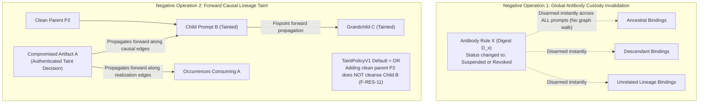

# Prompt Civ Level 08: Lineage Taint & Custody Invalidation: Causal vs Global

**AuthorityEffect:** None.  
**Level:** Level 08 (Security Quarantine, Subtree Taint & Global Disarming)  
**Rust Immunity Seam:** [`omega_prompt_civilization::immunity`](../../../../omega_engine/crates_rs/omega_prompt_civilization/src/immunity.rs)  
**Primary Policies:** `TaintPolicyV1`, `ImmunityPropagationPolicyV1`  
**Core Falsifiers:** `F-RES-07`, `F-RES-11`

---

## 1. Schematic & Conceptual Architecture



When vulnerabilities, corrupted training examples, or defective antibody rules enter an evolutionary prompt search system, the architecture must support rigorous negative operations to purge or neutralize the contamination. A critical defect in naive architectures is conflating **custody invalidation** (disarming a defective rule) with **causal taint propagation** (quarantining artifacts produced from a corrupted source).

Level 08 establishes the formal distinction between two orthogonal negative operations:
1. **Global Antibody Custody Invalidation:** A declarative disarming operation resolved by exact rule version and scope, instantly deactivating an antibody across all bindings without graph traversal.
2. **Forward Causal Lineage Taint:** A directed, causal propagation operation that tracks forward along inheritance and realization edges to quarantine all downstream descendants until a clean fixpoint is reached.

---

## 2. Invariants & Mathematical Packaging

1. **Global Antibody Invalidation (`F-RES-07`):**
   When an external decision marks an antibody rule version $R$ as `Suspended` or `Revoked`:
   - The armed-repertoire evaluation engine instantly disarms any reference matching $R$'s rule digest.
   - This applies simultaneously to:
     - Bindings inherited by descendants.
     - Bindings retro-propagated backward to ancestors.
     - Bindings acquired independently by unrelated lineages.
   - Invalidation requires **zero graph traversal**; the derived view simply evaluates:
     $$\text{is\_armed}(ref) \iff \text{status}(ref.\text{rule\_digest}) \in \{\text{Provisional}, \text{HumanAdmitted}\}$$
2. **Forward Causal Lineage Taint (`F-RES-11`):**
   An authenticated taint decision targeting artifact $A$ propagates *forward* along the causal dependency graph $\mathcal{G}_{\text{causal}} = (\mathcal{V}, \mathcal{E}_{\text{inheritance}} \cup \mathcal{E}_{\text{realization}})$:
   $$\operatorname{Tainted} = \operatorname{Fixpoint}\left(A \cup \{v \in \mathcal{V} \mid \exists u \in \operatorname{Tainted}, (u, v) \in \mathcal{E}_{\text{causal}}\}\right)$$
   - Taint operates without hop limits or decay.
   - All tainted nodes enter status `Quarantined` and are blocked from retrieval and reproduction.
3. **Multi-Parent Taint Law (`TaintPolicyV1`):**
   Under the repository default policy `TaintSemantics::OR`:
   - A child node with multiple parents is tainted if **any** of its parents is tainted:
     $$\left(\exists p \in \operatorname{Parents}(c) \text{ s.t. } p \in \operatorname{Tainted}\right) \implies c \in \operatorname{Tainted}$$
   - The child being evaluated can never choose its own taint policy. Combining a clean parent with a tainted parent cannot cleanse the child.

---

## 3. Rust Engine Seam

```rust
// omega_prompt_civilization::immunity
pub enum TaintSemantics {
    Or,  // Default: any tainted parent taints the child
    And, // Explicit override: requires all parents tainted
}

pub struct TaintPolicyV1 {
    pub semantics: TaintSemantics,
    pub policy_digest: [u8; 32],
}

pub struct LineageTaintDecisionV1 {
    pub decision_id: DecisionId,
    pub target_artifact_digest: [u8; 32],
    pub reason_code: TaintReasonCode,
    pub issuer_signature: [u8; 64],
    pub authority_effect: AuthorityEffect, // None
}
```

---

## 4. Verification Obligations & Falsifiers

- **`F-RES-07` (Zero-Traversal Invalidation Parity):** Suspending an antibody acquired at generation 14 and retro-propagated to generation 4 must instantly result in `is_armed = false` across all prompts at generations $4 \dots 14$ without invoking a recursive graph walk.
- **`F-RES-11` (Multi-Parent Taint Integrity):** Constructing a child prompt with Parent 1 (Clean) and Parent 2 (Tainted) under `TaintPolicyV1::default()` must mark the child as `Quarantined`. Attempting to register an in-line bypass using Parent 1's clean provenance must be rejected.

---

## 5. Claim Hygiene Quadrant

1. **What this supports:**
   - Mathematically verified isolation of corrupted artifacts and instant deactivation of defective rules.
   - Formal proof that multi-parent inheritance cannot be exploited to launder tainted prompt lineages.
2. **What this does not support:**
   - Does not claim that all semantic hallucinations or prompt bugs can be automatically classified as taints without human or oracle adjudication.
3. **The narrowest defensible claim:**
   - Causal forward fixpoint propagation guarantees that every node possessing a directed dependency path from a tainted source is placed in quarantine under `TaintSemantics::Or`.
4. **The next test needed:**
   - Property test verifying that concurrent taint emissions across disconnected subgraphs resolve to the correct joint fixpoint.
