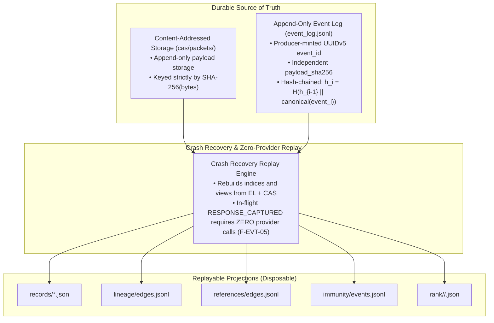

# Prompt Civ Level 09: Durable Event Log & Persistence: Replay & Recovery

**AuthorityEffect:** None.  
**Level:** Level 09 (Durable Event Ledger, Content-Addressed Storage & Replay)  
**Python Persistence Seam:** [`operating_system.adapters.prompt_civ.event_log`](../../../../operating_system/adapters/prompt_civ/event_log.py)  
**Primary Artifacts:** `event_log.jsonl`, `cas/packets/`  
**Core Falsifiers:** `F-EVT-01`, `F-EVT-02`, `F-EVT-03`, `F-EVT-04`, `F-EVT-05`, `F-TX-01`

---

## 1. Schematic & Conceptual Architecture



Persistence systems for machine learning swarms often commit derived projections or database rows without establishing an immutable, append-only causal source of truth. When a process crashes during model generation or view rendering, inconsistent state corrupts fitness histories, and lost completions trigger redundant, expensive model re-invocations.

Level 09 establishes the **Authoritative Event/Transaction Boundary**:
1. **Producer-Minted Event Identity:** Event IDs are minted once at origin using canonical namespacing, decoupling event identity from payload integrity.
2. **Durable CAS vs Disposable Projections:** Content-Addressed Storage (`cas/packets/`) and the append-only log (`event_log.jsonl`) are durable source artifacts. All indices, tables, and caches are disposable projections reconstructed via deterministic replay.
3. **Crash Recovery without Provider Re-calls:** Any bout interrupted after `RESPONSE_CAPTURED` recovers its state on restart by replaying local receipts, performing exactly **zero** additional network calls.

---

## 2. Invariants & Mathematical Packaging

1. **Producer-Minted Event Identity (`F-EVT-01`):**
   The `event_id` is minted deterministically by the producer prior to transmission:
   $$\text{event\_id} = \operatorname{UUIDv5}(\text{NS\_CORE\_PROMPT\_CIV}, \operatorname{canonical}(\text{producer\_id}, \text{event\_kind}, \text{run\_id}, \text{occurrence\_id}, \text{subject}, \text{ordinal}))$$
   - `semantic_subject` specifies what the event governs (e.g. `(antibody_id, rule_digest)` for acquisitions).
   - `producer_ordinal` cleanly separates repeated same-subject events within a single occurrence.
2. **Payload Conflict Detection (`F-EVT-02`):**
   An append request with `(event_id, payload_sha256)` behaves as:
   - **New Event:** If `event_id` is not present, append to log.
   - **Idempotent Re-transmission:** If `event_id` is present and matches the stored `payload_sha256`, return success (no-op).
   - **Identity Conflict:** If `event_id` is present but carries a different `payload_sha256`, reject with `EVENT_IDENTITY_CONFLICT` and append an audit conflict record.
3. **CAS Integrity Invariant (`F-EVT-03`):**
   Raw prompt and response packets are saved to `cas/packets/<sha256>.bin`.
   - The event log references packets by `[packet_id, sha256]`.
   - If a referenced CAS file is missing or fails hash verification upon read, the engine raises `CAS_OBJECT_MISSING` or `CAS_DIGEST_MISMATCH`. Missing bytes are **never** silently regenerated.
4. **Explicit Provider Outcome States (`F-EVT-04`, `F-EVT-05`):**
   Every provider interaction moves through:
   $$\text{INTENT\_RECORDED} \longrightarrow \text{SENT} \longrightarrow \text{RESPONSE\_CAPTURED} \quad \text{or} \quad \text{OUTCOME\_UNKNOWN}$$
   - A crash after `SENT` before capture produces `OUTCOME_UNKNOWN`. Retrying requires an explicit `RetryAuthorizedV1` record or a provider-supported idempotency key.
   - Once `RESPONSE_CAPTURED` is logged, projection rebuilds perform **zero** provider calls (`F-EVT-05`).

---

## 3. Python Persistence Seam

```python
# operating_system.adapters.prompt_civ.event_log
class DurableEventLogV1:
    """Append-only, hash-chained durable event ledger."""
    
    def append_event(
        self,
        event_id: str,
        event_kind: str,
        payload: Dict[str, Any],
        producer_id: str,
    ) -> EventAppendReceiptV1: ...
    
    def replay_events(
        self,
        from_revision: Optional[str] = None,
    ) -> Iterator[CanonicalEventV1]: ...
```

---

## 4. Verification Obligations & Falsifiers

- **`F-EVT-01` (Idempotent Append):** Submitting the identical event twice with matching `event_id` and `payload_sha256` must succeed idempotently without altering log length or hash chain state.
- **`F-EVT-02` (Conflict Rejection):** Submitting an existing `event_id` with modified payload bytes must raise `EVENT_IDENTITY_CONFLICT` and leave the original log entry unmodified.
- **`F-EVT-03` (CAS Corruption Detection):** Corrupting a single byte inside a stored CAS packet file must cause downstream projection rebuilds to halt with `CAS_DIGEST_MISMATCH`.
- **`F-EVT-05` (Zero Provider Replay):** In a test rig simulating a crash during projection update after `RESPONSE_CAPTURED`, re-running the projection engine must restore all indices while asserting that the provider gateway mock receives 0 calls.

---

## 5. Claim Hygiene Quadrant

1. **What this supports:**
   - Cryptographic tamper-evidence and crash recovery for prompt evolutionary events and LLM completion records.
   - Reliable deduplication and conflict isolation under distributed concurrent execution.
2. **What this does not support:**
   - Does not guarantee distributed exactly-once execution at third-party provider endpoints without remote idempotency support.
3. **The narrowest defensible claim:**
   - Local append-only hash chains combined with content-addressed storage guarantee deterministic, crash-consistent projection recovery without duplicate local event emissions.
4. **The next test needed:**
   - High-concurrency multi-process file-lock stress test verifying zero corruption under simultaneous event log appends.
