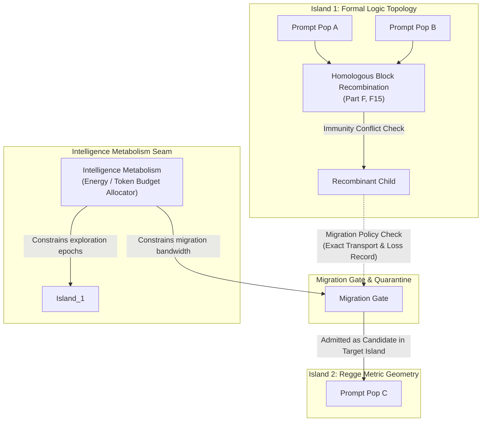

# Prompt Civ Level 10: Open Horizons & Multi-Island Ecology: v0.2 Frontiers

**AuthorityEffect:** None.  
**Level:** Level 10 (Multi-Island Evolutionary Ecology, Recombination & v0.2 Horizons)  
**Planning Roadmap Reference:** [`EPIC-OE-PROMPT-CIV-003`](../../../../product_planning_office/plans/epics/epic_claude_oeeis_oeprmptciv_plan.md)  
**Primary Mechanisms:** Crossover Recombination, Island Migration, Intelligence Metabolism

---

## 1. Schematic & Conceptual Architecture

The v0.1 production release of Prompt Civilization focuses on canalized mutation, hop-bounded retro-propagation, and exact Pareto selection within isolated communities. Level 10 outlines the **v0.2 Architectural Horizon**: expanding from single-population search to a multi-island evolutionary ecology with homologous block recombination and energy-constrained intelligence metabolism.

---

## 2. Theoretical Invariants & Planned v0.2 Directives

1. **Homologous Block Recombination (Crossover):**
   In v0.1, multi-parent nodes are created through repair or joint retry. v0.2 introduces explicit sexual recombination (crossover):
   - Crossover operations are restricted to **homologous structural blocks** (e.g. swapping exemplar sets or recombining disjoint reasoning modules).
   - Recombination across conflicting acquired immunities triggers an explicit `IMMUNITY_CONFLICT` check, requiring joint reconciliation before the recombinant child is admitted to `Wild` custody.
2. **Island Migration & Geographic Isolation:**
   To prevent global convergence onto local optima, populations evolve on separate **Islands** characterized by distinct specialized domain priors or evaluation objectives:
   - Migration between islands is bounded by an explicit migration bandwidth policy.
   - Migrating genomes must pass an inter-island transport check recording semantic projection loss.
3. **The `FROZEN` State & Convergence Invariants:**
   When an island lineage achieves sustained Pareto dominance and passes held-out generalization checks without new mutations for $K$ consecutive epochs:
   - The lineage transitions to status `FROZEN`.
   - `FROZEN` prompts act as immutable reference anchors for downstream agent tools and compiler passes, protected from further mutation.
4. **Intelligence Metabolism & Autocatalytic Fences:**
   Future swarms incorporate metabolic bounds (Part F, F6):
   - Refusal of closed self-feeding evidence loops (RAF detection) where agents cite their own unverified completions as truth evidence.
   - Resource allocation scaled strictly to verified progress receipts, avoiding token exhaustion in dead-end evolutionary branches.

---

## 3. Engineering Crosswalk to Epic Plans

| Planned Feature | Governing Epic / Reference | Target Rust Crate / Module | Epistemic Posture |
| :--- | :--- | :--- | :--- |
| **Crossover Recombination** | `EPIC-OE-PROMPT-CIV-003` §a | `core_prompt_civilization::forge` | Research proposal; no operational authority |
| **Island Topology & Migration** | `EPIC-OE-PROMPT-CIV-003` §b | `core_prompt_civilization::domain` | Multi-population isolation policy |
| **Frozen Settlement Policy** | `EPIC-OE-PROMPT-CIV-003` §c | `core_prompt_civilization::record` | Canonical anchor declaration |
| **Intelligence Metabolism** | `EPIC-OE-PROMPT-CIV-003` §d | `operating_system` | Bounded token and energy allocation |

---

## 4. Verification Obligations & Boundary Constraints

- **`NON-GOAL` (No Universal Evolutionary Optimality):** The Prompt Civilization does not assert that multi-island evolution guarantees monotonic improvement across arbitrary reasoning domains.
- **`NON-GOAL` (No Autonomous Promotion):** Even within multi-island ecologies, crossover, migration, and settlement allocate candidate search bandwidth only; they **never** mint proof certificates or grant operational execution authority without external human/oracle ratification.

---

## 5. Claim Hygiene Quadrant

1. **What this supports:**
   - Conceptual and architectural continuity between the v0.1 landed pure-calculus implementation and the v0.2 multi-island research roadmap.
   - Explicit identification of theoretical boundaries and planned recombination invariants.
2. **What this does not support:**
   - Does not claim that v0.2 crossover algorithms have been benchmarked or deployed in production.
3. **The narrowest defensible claim:**
   - Level 10 documents the planned structural progression toward multi-island genetic search, establishing explicit research fences against self-feeding evidence loops and unconstrained crossover.
4. **The next test needed:**
   - Synthetic crossover prototype testing whether homologous block exchange preserves syntactic validity across heterogeneous prompt formats.
