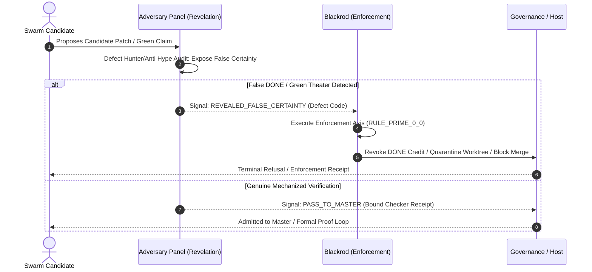

# Blackrod & Panopticon Interface: The Enforcement Axis

**AuthorityEffect:** None (Enforcement Architecture & Panopticon Coordination)  
**Governing Locus:** [`governance/sentinel_councils/blackrod/`](../../../../governance/sentinel_councils/blackrod/) & [`the_thanatos_protocol_v000.md`](../../../../governance/sentinel_councils/blackrod/blackrod_nemesis_only/the_thanatos_protocol_v000.md)

---

## 1. The Separation of Governance, Revelation, and Enforcement

Within the engine sentinel councils, authority is partitioned into four distinct, orthogonal axes:

```text
========================================================================================
                      THE FOUR ORTHOGONAL ESTATE AXES
========================================================================================
  Axis            Primary Seat               Core Function
----------------------------------------------------------------------------------------
  Deliberation    Government Councils        Debate policy, form goals, propose laws
  Diagnosis       Techne VP / Red Team        Evaluate engineering risk, audit claims
  Revelation      Adversary (The Panel)       Dissolve illusions, expose false certainty
  Enforcement     Blackrod (The Panopticon)  Enforce consequences, block merges, revoke credit
========================================================================================
```

> **The Constitutional Maxim:**  
> *"Councils deliberate. VP diagnoses. Adversary reveals. Blackrod enforces consequences."*

Adversary reveals reality without fear or favor; Blackrod enforces consequences without passion or compromise.

---

## 2. The Panopticon Protocol (Joint Council Session 000)

As documented in [`the_thanatos_protocol_v000.md`](../../../../governance/sentinel_councils/blackrod/blackrod_nemesis_only/the_thanatos_protocol_v000.md):

- **The Center (Black Rod):** Stands at the exact center of the circular Panopticon room where the three council tables (Curious, Logos, Nous) meet. He holds nothing, says nothing, and enforces physical discipline against green theater, self-certification, and kill-gate bypasses.
- **The Ether (Adversary-Gate / Adversary Panel):** Present as the metaphysical solvent of false certainty, testing whether the machine's invariants hold under maximum adversarial entropy.
- **The Light (Truth Repair / The Panel):** Radical invariance and truth repair, ensuring that the destruction of illusion leads to clean, mechanized light rather than nihilistic paralysis.

---

## 3. Adversary-to-Blackrod Escalation Handshake

When Adversary's panel conducts an adversarial seance or dialectical bout:



### 3.1 Defect Triggers for Blackrod Intervention
1. **P0 (False DONE):** Candidate claims completion without executed tests or receipts. Blackrod immediately strips credit and halts branch.
2. **P0 (Self-Certification):** Builder or candidate author signs its own verification receipt. Blackrod quashes the receipt.
3. **P1 (Green Theater):** Mocks or synthetic curves passing while actual logic is untested or bypassed. Blackrod blocks merge.
4. **P1 (Silent Skips):** `@pytest.mark.skip` or swallowed exceptions masking failure. Blackrod orders immediate fix.
