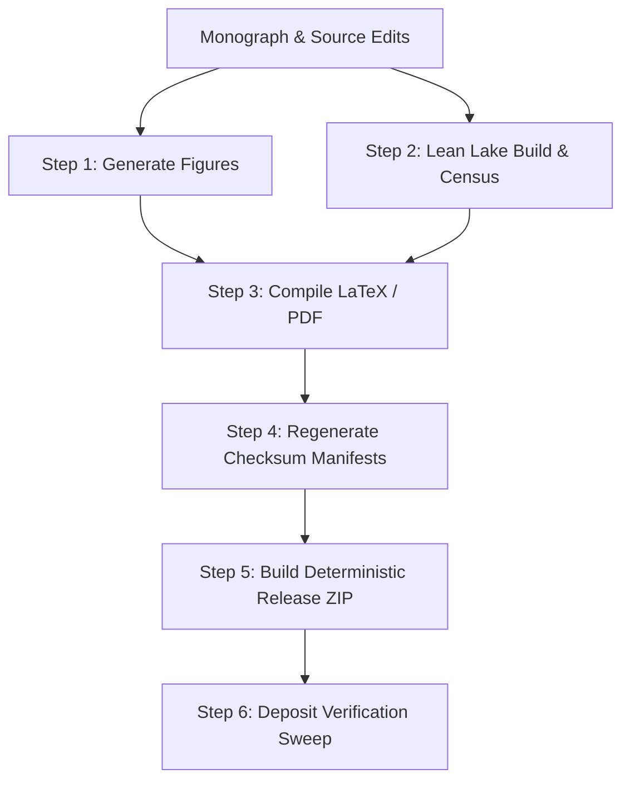

# Deterministic Harmonization Pipeline Specification

**Governing Standard:** GTLA Continuous Release & Anti-Desync Protocol  
**AuthorityEffect:** None.  

---

## The 6-Step Topological Harmonization Pipeline

When an author makes any modification to paper prose, claim tables, Lean formalizations, or Python tests, derived artifacts drift immediately. The harmonization pipeline executes the following 6 steps in strict topological dependency order:

### Step 1: Generate Figures
- Command: `python code/generate_figures.py`
- Enforces headless matplotlib rendering via `matplotlib.use("Agg")`.
- Emits high-resolution figures to `public_export/` with mandatory disclaimer captions:
  `"Schematic only — discrete diagnostic codes, not empirical convergence."`

### Step 2: Lean Lake Build & Census Regeneration
- Command: `lake build` followed by `python tools/replay_lean_axiom_census.py --write`
- Enforces strictly offline, hermetic Lake compilation with zero external git clones.
- Asserts that all Lean modules compile with exit code 0 and zero `sorry` placeholders.
- Updates `lean4/Census.lean` with `#print axioms` commands for every declaration in `lean4/axiom_report.txt`.
- Replays the census in `tools/replay_lean_axiom_census.py`. The admitted axioms are that script's `AXIOM_WHITELIST`.
- Binds audited source hashes to defeat post-audit mutation races.

### Step 3: Documentation & TeX/PDF Recompilation
- Checks the monograph header against `rl_coda_publication_and_monograph_specifications.md`.
- Enforces `## Mechanism inventory` section presence and bibliographic link resolubility.
- Validates companion launcher scripts (`run_notebook.bat`, `run_notebook.sh`) against canonical existing notebook filenames (`001_reviewer_<slug>.ipynb`).
- Preprocesses Markdown, compiles TeX to PDF (>= 3 passes for TOC convergence), and performs visual page inspection for margin overflows.
- Fails the step when the fresh XeLaTeX log reports `Missing character` (XeLaTeX exits 0 while dropping the glyph). Reader extensions and stray prose backslashes are covered in [`pandoc_tex_build_hygiene.md`](pandoc_tex_build_hygiene.md).
- Asserts multi-surface release identity parity across `README.md`, `pyproject.toml`, `zenodo_metadata.json`, and change logs.

### Step 4: Regenerate Checksum Manifests
- Command: `python scripts/regen_sha256sums.py`
- Walks the directory using `deposit_paths.walk_files` (pruning excluded directories in-place).
- Writes pure UTF-8 `MANIFEST.sha256` and bijective `SHA256SUMS`.

### Step 5: Build Deterministic Release Archive
- Command: `python scripts/build_deposit_zip.py`
- Constructs `<slug>_<YYYY-MM-DD>.zip` directly in package root.
- Applies fixed timestamps and attributes ensuring identical byte-level output across runs.

### Step 6: Two-Way Deposit Verification
- Command: `python verify_deposit.py`
- Performs fail-closed symlink check, two-way manifest vs. disk sweep, structural pattern validation, and local test pass.
- Verifies archive member concordance by comparing unpacked ZIP file digests with current manifest-bound on-disk files.
